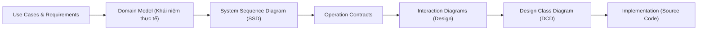

# 01. Quy trình Phát triển Hướng đối tượng & Mô hình hóa UML

## 1. Giới thiệu tổng quan
Theo phương pháp luận của Craig Larman trong *"Applying UML and Patterns"*, quy trình phân tích và thiết kế hướng đối tượng (OOAD) không phải là mô hình thác nước (Waterfall) tuần tự mà là quy trình lặp và tăng dần (Iterative and Evolutionary Development - Unified Process).

Các ghi chú liên quan:
- [[02_GRASP_9_Principles|9 Nguyên lý GRASP]]
- [[03_GoF_Patterns_Applied|Các Mẫu thiết kế GoF]]
- [[04_NextGen_POS_Evolution|Sự tiến hóa của NextGen POS]]

---

## 2. Các giai đoạn then chốt trong OOAD

### 2.1. Domain Model (Mô hình lĩnh vực)
- Là hình ảnh trực quan về các lớp khái niệm (Conceptual Classes) hoặc các đối tượng thực tế trong miền vấn đề.
- **Quy tắc**:
  - Không có phương thức (No operations/methods).
  - Chỉ thể hiện thuộc tính (Attributes) và quan hệ liên kết (Associations).
  - Tránh gán công nghệ hay cấu trúc cơ sở dữ liệu ở bước này.

### 2.2. System Sequence Diagram (SSD)
- Minh họa các sự kiện vào/ra (System Events / Input Operations) giữa người dùng bên ngoài (Actor) và hệ thống (coi như một Hộp đen - Black Box).
- Tên sự kiện hệ thống nên ở dạng động từ mức cao trừu tượng: `makeNewSale()`, `enterItem(itemID, quantity)`, `endSale()`, `makePayment(amount)`.

### 2.3. Operation Contracts (Hợp đồng thao tác)
Đặc tả chi tiết các thay đổi trạng thái sau khi một System Operation thực hiện:
- **Preconditions**: Điều kiện giả định trước khi chạy thao tác.
- **Postconditions**: Các thực thể được tạo mới, các liên kết được hình thành hoặc thay đổi, các thuộc tính được cập nhật.

### 2.4. Design Class Diagram (DCD)
- Chuyển từ mô hình khái niệm sang mô hình phần mềm cụ thể.
- Xác định rõ: Tên lớp, visibility (`+` public, `-` private), kiểu dữ liệu thuộc tính, chữ ký phương thức (methods signature), và quan hệ điều hướng (navigability).
