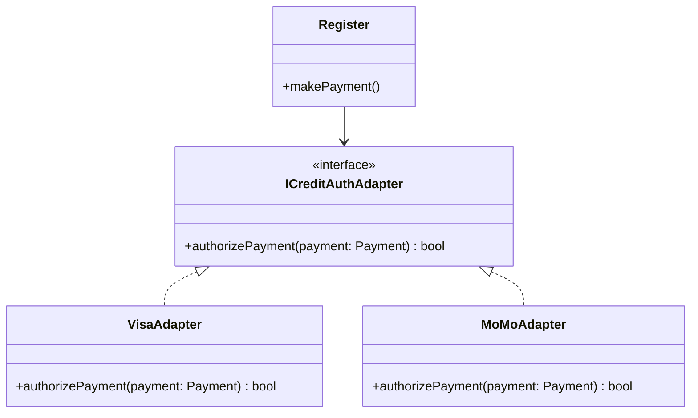

# 03. Áp Dụng Các Mẫu Thiết Kế GoF Vào Kiến Trúc Phần Mềm

Các mẫu thiết kế của nhóm Gang of Four (GoF) thường là phiên bản hiện thực hóa chuyên sâu của hai nguyên lý GRASP cơ bản: **Polymorphism** và **Protected Variations**.

Liên kết chéo:
- [[01_Process_and_UML|Quy trình OOAD & UML]]
- [[02_GRASP_9_Principles|9 Nguyên lý GRASP]]
- [[04_NextGen_POS_Evolution|Ca học NextGen POS]]

---

## 1. Adapter Pattern (Bộ Chuyển Đổi)
- **Bối cảnh**: Hệ thống NextGen POS cần giao tiếp với các dịch vụ ủy quyền thẻ tín dụng (Credit Authorization Service) hoặc máy tính thuế (Tax Calculator) của bên thứ ba với API khác nhau.
- **Giải pháp**: Tạo giao diện chung `ICreditAuthorizationServiceAdapter`, mỗi nhà cung cấp (Visa, Master, MoMo) được hiện thực qua một Adapter cụ thể.

## 2. Factory Pattern (Mẫu Nhà Xưởng)
- **Bối cảnh**: Làm sao để `Register` hoặc `Sale` không phụ thuộc vào lớp cụ thể của Adapter khi khởi tạo?
- **Giải pháp**: Sử dụng `ServicesFactory` (kết hợp với cấu hình động hoặc file config) để sinh ra Adapter phù hợp tại runtime.

## 3. Strategy Pattern (Mẫu Chiến Lược)
- **Bối cảnh**: Các chính sách giảm giá (Pricing/Discount Rules) của cửa hàng thay đổi liên tục: Giảm theo phần trăm, mua 2 tặng 1, giảm theo giờ vàng,...
- **Giải pháp**: Tách thuật toán tính giá ra thành các lớp Strategy hiện thực interface `ISalePricingStrategy`.

## 4. Composite Pattern (Mẫu Kết Hợp)
- **Bối cảnh**: Có thể áp dụng đồng thời nhiều chính sách giảm giá cho một đơn hàng (ví dụ: Khách hàng thân thiết VIP + Voucher sinh nhật).
- **Giải pháp**: `CompositePricingStrategy` cũng hiện thực `ISalePricingStrategy` và chứa danh sách các `ISalePricingStrategy` con, giúp coi một nhóm chính sách như một chính sách đơn lẻ.

## 5. Observer Pattern (Mẫu Quan Sát)
- **Bối cảnh**: Khi trạng thái đơn hàng `Sale` thay đổi (thêm mặt hàng, thanh toán hoàn tất), giao diện màn hình thu ngân và màn hình phụ của khách cần tự động cập nhật mà không bị ghép nối chặt chẽ (Low Coupling) với domain logic.
- **Giải pháp**: `Sale` là Subject phát sinh sự kiện, các màn hình UI đăng ký làm Observer.
