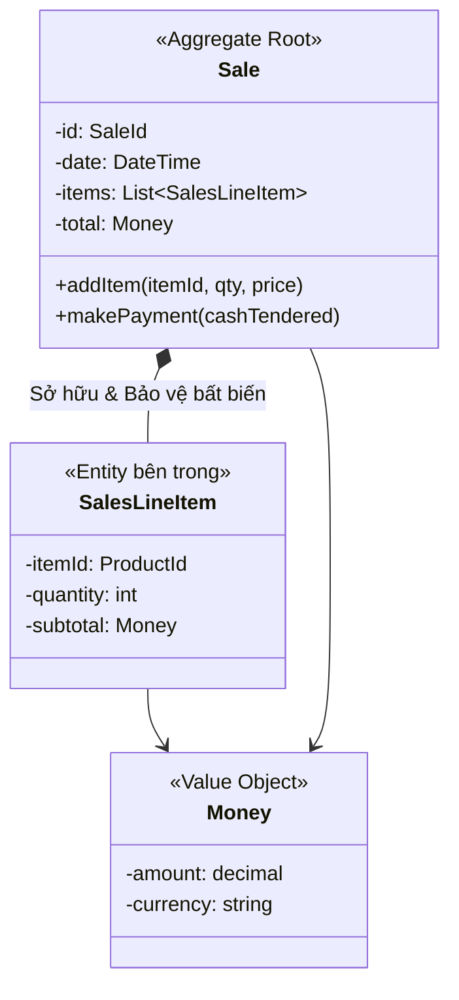

# 06. Thiết Kế Aggregate Chuẩn DDD (Implementing Domain-Driven Design - Vaughn Vernon)

Tài liệu này tổng hợp trọng tâm từ **Chương 10: Aggregates** trong cuốn *"Implementing Domain-Driven Design"* của Vaughn Vernon (The Red Book), cung cấp bước chuyển tiếp từ mô hình hướng đối tượng truyền thống của Craig Larman sang kiến trúc Domain-Driven Design (DDD) hiện đại.

Liên kết chéo:
- [[01_Process_and_UML|Quy trình OOAD & UML]]
- [[02_GRASP_9_Principles|9 Nguyên lý GRASP]]
- [[04_NextGen_POS_Evolution|Tiến hóa NextGen POS]]
- [[05_Martin_Fowler_PoEAA|Martin Fowler PoEAA]]

---

## 1. Aggregate là gì?

> **Aggregate (Cụm thực thể)** là một cụm các Entity và Value Object có liên quan mật thiết với nhau, được coi như một đơn vị thống nhất phục vụ cho việc thay đổi dữ liệu và đảm bảo **tính toàn vẹn nghiệp vụ (Business Invariants)**.

Mỗi Aggregate có một **Aggregate Root (Gốc cụm)**:
- Thế giới bên ngoài chỉ được phép giữ tham chiếu và gọi phương thức thông qua Aggregate Root.
- Các Entity bên trong chỉ có thể được truy xuất gián tiếp qua Root.

---

## 2. 4 Quy Tắc Vàng Thiết Kế Aggregate (Vaughn Vernon)

### Quy tắc 1: Bảo vệ các bất biến nghiệp vụ bên trong ranh giới nhất quán (Consistency Boundary)
- Mọi quy tắc ràng buộc (ví dụ: Tổng tiền của `Sale` phải bằng tổng các `SalesLineItem`, đơn hàng không được có mặt hàng số lượng $\le 0$) phải được kiểm soát nghiêm ngặt ngay lập tức (Immediate Consistency) bên trong Aggregate.

### Quy tắc 2: Thiết kế Aggregate nhỏ gọn (Design Small Aggregates)
- **Sai lầm phổ biến**: Gộp quá nhiều thực thể vào một Aggregate khổng lồ (ví dụ gộp cả `Store` chứa hàng nghìn `Sale`, chứa hàng triệu `SalesLineItem`).
- **Hậu quả**: Xung đột khóa dữ liệu (Optimistic Concurrency Lock exception), hiệu năng sụt giảm nghiêm trọng khi nạp bộ nhớ.
- **Giải pháp**: Giữ Aggregate thật nhỏ. Chỉ gom những thực thể thực sự phải luôn luôn nhất quán tại cùng một thời điểm.

### Quy tắc 3: Tham chiếu các Aggregate khác bằng Định danh (Identity), không dùng tham chiếu đối tượng trực tiếp
- Thay vì `Sale` giữ trực tiếp đối tượng `Customer customer`, `Sale` chỉ nên giữ `CustomerId customerId`.
- Giúp giảm độ gắn kết (Low Coupling), tránh việc ORM nạp toàn bộ đồ thị đối tượng khổng lồ vào bộ nhớ, và cho phép mở rộng dễ dàng sang kiến trúc Microservices.

### Quy tắc 4: Sử dụng Tính Nhất Quán Cuối Cùng (Eventual Consistency) bên ngoài ranh giới
- Nếu một thao tác ở Aggregate này cần kéo theo sự thay đổi ở Aggregate khác (ví dụ: `Sale` thanh toán thành công $\rightarrow$ Cập nhật điểm tích lũy của `Customer` và giảm tồn kho ở `Inventory`):
  - **Không** cập nhật tất cả trong 1 transaction khổng lồ.
  - Hãy phát ra một **Domain Event** (`SaleCompletedEvent`) và để các Aggregate khác lắng nghe rồi tự cập nhật bất đồng bộ.

---

## 3. So sánh: Craig Larman OOAD vs. DDD của Vernon & Evans

| Khía cạnh | Craig Larman (OOAD / GRASP) | Vaughn Vernon (DDD / IDDD) |
|---|---|---|
| **Đơn vị phân tích** | Class, Object, Responsibility | Bounded Context, Aggregate, Value Object |
| **Bảo vệ toàn vẹn** | Phương thức nghiệp vụ trong Information Expert | Consistency Boundary & Aggregate Root |
| **Giao tiếp liên module** | Message Passing, Controller, Adapter | Domain Events, Asynchronous Eventual Consistency |
| **Xử lý dữ liệu** | Data Mapper / Persistence Framework | Repository gắn liền với Aggregate Root |
