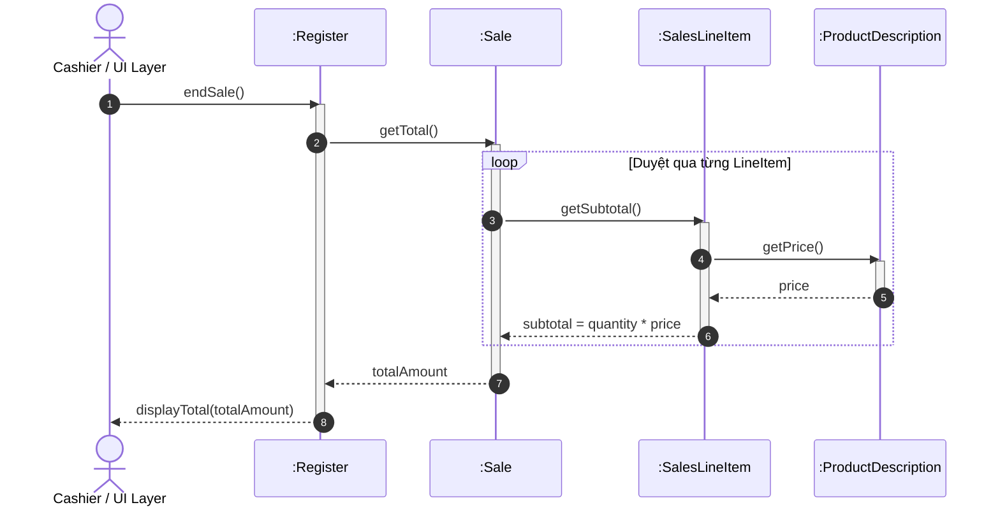

[🏠 Trang Chủ (MOC)](../README.md) | ◄ Đầu sách | [Chương 02: Iterative Development and the Unified Process ►](./02_Iterative_Development_and_the_Unified_Process.md)

---

## CHƯƠNG 1: OBJECT-ORIENTED ANALYSIS AND DESIGN (OOA/D)

### 1. ĐỀ MỤC & MỤC TIÊU CỐT LÕI (CORE PURPOSE)

#### Hệ thống đề mục (Heading Hierarchy)
* **1.1. Applying UML and Patterns in OOA/D** *(Ứng dụng UML và Mẫu hình trong OOA/D)*
* **1.2. Assigning Responsibilities** *(Phân bổ trách nhiệm – Trọng tâm cốt lõi)*
* **1.3. What Is Analysis and Design?** *(Bản chất của Phân tích và Thiết kế)*
* **1.4. What Is Object-Oriented Analysis and Design?** *(Phân tích và Thiết kế Hướng đối tượng là gì?)*
* **1.5. An Example: From Requirements to Code** *(Ví dụ xuyên suốt: Từ Yêu cầu tới Mã nguồn)*
  * *1.5.1. Define Use Cases (Định nghĩa ca sử dụng)*
  * *1.5.2. Define a Domain Model (Xây dựng mô hình miền khái niệm)*
  * *1.5.3. Assign Object Responsibilities & Draw Interaction Diagrams (Phân bổ trách nhiệm và vẽ sơ đồ tương tác)*
  * *1.5.4. Define Design Class Diagrams (Xác định sơ đồ lớp thiết kế)*
* **1.6. The UML (Unified Modeling Language)**
  * *1.6.1. Three Perspectives to Apply UML: Conceptual, Specification, Implementation (Ba lăng kính ứng dụng)*
  * *1.6.2. Three Ways to Use UML: Sketch, Blueprint, Programming Language (Ba cấp độ sử dụng UML)*
* **1.7. Further Readings** *(Tài liệu tham khảo chuyên sâu)*

#### Vấn đề kỹ thuật thực tế & Thảm họa kiến trúc được ngăn chặn
Chương 1 giải quyết **Khoảng cách ngữ nghĩa (Semantic Gap)** giữa miền bài toán nghiệp vụ thực tế (*Problem Domain*) và không gian giải pháp phần mềm (*Solution Space*). 

Nếu một đội ngũ kỹ thuật bỏ qua OOA/D mà nhảy thẳng vào viết mã nguồn (*Code-and-Fix*), hệ thống tất yếu sẽ hứng chịu các thảm họa:
* **The Blob / God Object Anti-Pattern:** Xuất hiện các lớp khổng lồ (vài nghìn dòng code) chứa toàn bộ luồng xử lý dữ liệu, biến các lớp còn lại thành cấu trúc dữ liệu thụ động (*Anemic Domain Model*).
* **Rò rỉ nghiệp vụ vào giao diện (Business Logic Leakage):** Logic nghiệp vụ (tính thuế, giảm giá, kiểm tra hợp lệ) bị đan cài trực tiếp vào UI Event Handlers (ví dụ: viết logic thanh toán trực tiếp trong hàm `button_Click`), dẫn đến việc không thể tái sử dụng logic khi đổi giao diện hoặc đưa lên web/mobile.
* **Khớp nối chặt (Tight Coupling) & Phụ thuộc vòng (Circular Dependencies):** Không phân định ranh giới trách nhiệm khiến việc sửa đổi một phương thức kéo theo hiệu ứng domino làm sập toàn bộ các module phụ thuộc.

---

### 2. PHÂN TÍCH LÝ THUYẾT & NGUYÊN LÝ CHUYÊN SÂU

```
+---------------------------------------------------------------------------------+
|                                 PROBLEM SPACE                                   |
|  Real-World Requirements  ==>  OOA: Domain Model (Concepts, Attributes, Assocs) |
+---------------------------------------------------------------------------------+
                                         |
                                         | (Semantic Bridge)
                                         v
+---------------------------------------------------------------------------------+
|                                 SOLUTION SPACE                                  |
|  OOD: Interaction Diagrams (Responsibilities) ==> DCD ==> Source Code (OOP)    |
+---------------------------------------------------------------------------------+
```

#### 2.1. Bản chất của Phân tích (Analysis) vs. Thiết kế (Design)
* **Phân tích (Analysis):** Tập trung vào việc **"Làm đúng thứ" (*Do the right thing*)**. Đây là quá trình điều tra bài toán và yêu cầu thực tế mà không bận tâm đến công nghệ hay giải pháp kỹ thuật cụ thể. Trong OOA, trọng tâm là tìm kiếm và mô tả các **Đối tượng khái niệm (*Conceptual Objects*)** trong miền ứng dụng (ví dụ: trong siêu thị có `Register`, `Item`, `Sale`).
* **Thiết kế (Design):** Tập trung vào việc **"Làm thứ đó đúng" (*Do the thing right*)**. Đây là việc xác định một giải pháp khái niệm thỏa mãn các yêu cầu đã phân tích. Trong OOD, ta định nghĩa các **Đối tượng phần mềm (*Software Objects*)** cùng sự cộng tác giữa chúng (ví dụ: phương thức nào gọi phương thức nào, kiểu dữ liệu trả về là gì).

#### 2.2. Kỹ năng quan trọng nhất: Phân bổ trách nhiệm (Assigning Responsibilities)
Craig Larman khẳng định: *Kỹ năng quan trọng nhất trong OOD không phải là vẽ cú pháp UML, mà là quyết định xem phương thức/hành vi nào thuộc về lớp nào.*
* Việc này được gọi là **Thiết kế dựa trên trách nhiệm (*Responsibility-Driven Design - RDD*)**. 
* Một đối tượng không chỉ chứa dữ liệu, nó chịu trách nhiệm thực thi các hành vi liên quan chặt chẽ đến dữ liệu đó (*Information Expert*). Nếu phân bổ sai trách nhiệm, hệ thống sẽ thoái hóa về lập trình thủ tục biến tướng (*Procedural programming in OOP disguise*).

#### 2.3. Ba lăng kính nhìn nhận UML (Three Perspectives of UML)
Larman phân loại rõ 3 lăng kính tư duy khi dùng UML để tránh nhầm lẫn giữa phân tích và hiện thực:
1. **Lăng kính khái niệm (Conceptual Perspective):** Sơ đồ mô tả các thực thể trong thế giới thực. Ở lăng kính này, lớp `Sale` thể hiện sự kiện mua hàng thực tế, không hề có phương thức `calculateTotal()` hay kiểu dữ liệu `java.util.Date`.
2. **Lăng kính đặc tả (Specification/Interface Perspective):** Sơ đồ mô tả các đối tượng phần mềm với các giao diện (Interface), chữ ký phương thức (Method Signatures), nhưng không bàn về chi tiết hiện thực bên trong.
3. **Lăng kính hiện thực (Implementation Perspective):** Sơ đồ ánh xạ trực tiếp 1-1 với mã nguồn của một ngôn ngữ lập trình cụ thể (như class Java/C#, các trường private, getter/setter, kiểu collection cụ thể).

---

### 3. MỔ XẺ MÃ NGUỒN HOẶC ĐẶC TẢ THIẾT KẾ (DESIGN / CODE DEEP-DIVE)

Để thấy rõ sự chuyển hóa từ **Khái niệm (Domain Model)** sang **Đối tượng phần mềm có trách nhiệm (Software Object)**, hãy mổ xẻ đoạn mã thể hiện nghiệp vụ tính tổng tiền của một hóa đơn (`Sale`) bao gồm nhiều dòng sản phẩm (`SalesLineItem`):

```java
public class Sale {
    private List<SalesLineItem> lineItems = new ArrayList<>();
    private Date dateTime = new Date();

    public void createSalesLineItem(ProductDescription desc, int quantity) {
        lineItems.add(new SalesLineItem(desc, quantity));
    }

    public Money getTotal() {
        Money total = new Money(0.0);
        for (SalesLineItem lineItem : lineItems) {
            total.add(lineItem.getSubtotal());
        }
        return total;
    }
}
```

#### Bảng phân tích kỹ thuật và ý nghĩa thiết kế:

| Dòng code / Đoạn code then chốt | Giải thích kỹ thuật & Ý nghĩa thiết kế kiến trúc |
| :--- | :--- |
| `private List<SalesLineItem> lineItems` | **Đóng gói thuộc tính (Information Hiding):** Danh sách các dòng hàng được bảo vệ nghiêm ngặt bên trong `Sale`. Các đối tượng bên ngoài không được phép tùy tiện can thiệp trực tiếp vào mảng này. |
| `public void createSalesLineItem(...)` | Hiện thực hóa mẫu hình **Creator (GRASP)**: `Sale` chứa và quản lý trực tiếp các phiên bản `SalesLineItem`, do đó `Sale` nắm trách nhiệm khởi tạo `SalesLineItem` thay vì để tầng UI hay controller làm việc này. |
| `public Money getTotal()` | Hiện thực hóa mẫu hình **Information Expert (GRASP)**: `Sale` là đối tượng nắm giữ danh sách tất cả các `lineItems`, do đó chính nó phải chịu trách nhiệm tính toán tổng số tiền của toàn bộ đơn hàng. |
| `total.add(lineItem.getSubtotal());` | **Ủy thác trách nhiệm (Delegation) & Tell, Don't Ask:** `Sale` không tự tiện chọc vào `desc.getPrice()` và `quantity` của từng `lineItem` để tự nhân tiền; thay vào đó, nó ra lệnh cho `lineItem` tự tính thành tiền (`getSubtotal()`) rồi chỉ việc cộng dồn kết quả. Điều này bảo vệ tính toàn vẹn và giảm khớp nối (*Low Coupling*). |

---

### 4. SƠ ĐỒ TRỰC QUAN HÓA (UML MERMAID)

Sơ đồ tuần tự thể hiện việc phân bổ trách nhiệm thông qua cơ chế truyền thông điệp (*Message Passing*) để tính tổng hóa đơn:



---

### 5. ÁNH XẠ ỨNG DỤNG VÀO DỰ ÁN GAME OOP THỰC CHIẾN

* **Bối cảnh áp dụng:** Hệ thống Hòm đồ & Trang bị (*Inventory & Equipment System*) trong Game 2.5D Multiplayer.
* **Vấn đề nếu thiếu OOA/D:** Lập trình viên thường tạo ra một lớp monolithic như `PlayerController` hoặc `Hero` chứa một mảng String tên trang bị. Khi người chơi đánh một đòn tấn công, lớp `Hero` tự duyệt mảng, kiểm tra từng chuỗi xem có phải kiếm hay áo giáp, tự cộng chỉ số tấn công và gửi socket. Kết quả là lớp này phình to thành hàng ngàn dòng code, không thể test, và tạo ra vô số bug khi thêm trang bị mới.
* **Ánh xạ OOA/D chuyên sâu từ Chương 1:**
  1. *Conceptual Analysis:* Xác định các khái niệm miền game: `Character`, `Inventory`, `ItemSlot`, `Equipment`, `StatModifier`.
  2. *Assigning Responsibilities:* 
     * `Character` không tự tính toán sát thương chi tiết; nó ủy thác cho `EquipmentManager.calculateBonusStats()`.
     * `EquipmentManager` lặp qua các `ItemSlot`, mỗi `Equipment` tự cung cấp `StatModifier` (Information Expert).
  3. *Lợi ích kiến trúc:* Tách biệt hoàn toàn logic thuộc tính nhân vật khỏi tầng hiển thị (Sprite/Animation) và tầng mạng (Network Synchronization).

---

[🏠 Trang Chủ (MOC)](../README.md) | ◄ Đầu sách | [Chương 02: Iterative Development and the Unified Process ►](./02_Iterative_Development_and_the_Unified_Process.md)
