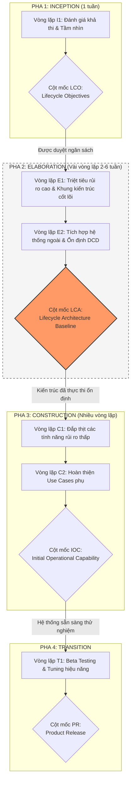

[🏠 Trang Chủ (MOC)](../README.md) | [◄ Chương 01: Object Oriented Analysis and Design](./01_Object_Oriented_Analysis_and_Design.md) | [Chương 03: Case Study The NextGen POS System ►](./03_Case_Study_The_NextGen_POS_System.md)

---

## CHƯƠNG 2: ITERATIVE DEVELOPMENT AND THE UNIFIED PROCESS (UP)

### 1. ĐỀ MỤC & MỤC TIÊU CỐT LÕI (CORE PURPOSE)

#### Hệ thống đề mục (Heading Hierarchy)
* **2.1. The Most Important UP Idea: Iterative Development** *(Ý tưởng cốt lõi nhất của UP: Phát triển Lặp)*
* **2.2. Additional UP Best Practices and Concepts** *(Các thực hành tốt nhất trong UP)*
* **2.3. The UP Phases and Scheduled Milestones** *(Các pha của UP và các cột mốc lịch trình)*
  * *2.3.1. Inception (Khởi tạo)*
  * *2.3.2. Elaboration (Mô tả chi tiết / Định hình kiến trúc)*
  * *2.3.3. Construction (Xây dựng / Hiện thực hóa)*
  * *2.3.4. Transition (Chuyển giao)*
* **2.4. The UP Disciplines (was Workflows)** *(Các bộ môn/hoạt động trong UP)*
* **2.5. Process Customization and the Development Case** *(Tùy biến quy trình và Hồ sơ phát triển)*
* **2.6. The Agile UP** *(Quy trình UP linh hoạt)*
* **2.7. The Sequential "Waterfall" Lifecycle** *(Vòng đời thác nước tuần tự và thất bại tất yếu)*
* **2.8. You Know You Didn't Understand the UP When...** *(Dấu hiệu nhận biết việc áp dụng sai UP)*
* **2.9. Further Readings** *(Tài liệu tham khảo)*

#### Vấn đề kỹ thuật thực tế & Thảm họa kiến trúc được ngăn chặn
Chương 2 đập tan ảo tưởng về việc có thể **đóng băng yêu cầu (*Requirement Freezing*)** và thiết kế hoàn hảo ngay từ đầu theo mô hình Thác nước (*Waterfall*). 

Nếu một tổ chức phần mềm vận hành theo tư duy Thác nước, họ sẽ đối mặt với các thảm họa:
* **Hội chứng tích hợp muộn (*Late Integration Hell*):** Các nhóm phát triển độc lập trong nhiều tháng dựa trên tài liệu đặc tả giấy; đến cuối dự án khi ghép các thành phần lại với nhau thì các giao diện (*Interfaces*) không khớp, phát sinh hàng trăm lỗi kiến trúc nghiêm trọng.
* **Rủi ro kiến trúc cao nhất bị đẩy về cuối (*High-Risk Postponement*):** Các vấn đề hóc búa nhất (như hiệu năng chịu tải, phân tán dữ liệu, đồng bộ hóa) thường bị né tránh để làm sau; khi phát hiện hệ thống không đạt yêu cầu kiến trúc thì chi phí tái cấu trúc lúc này tương đương làm lại dự án từ đầu.
* **Phát triển cái người dùng không cần (*Building the Wrong Thing*):** Người dùng chỉ thực sự hiểu họ muốn gì khi họ được nhìn thấy và tương tác với phần mềm chạy thực tế (*Running software*). Thác nước tạo ra sản phẩm đúng từng câu chữ theo tài liệu yêu cầu ban đầu, nhưng lại hoàn toàn vô dụng trên thực tế.

---

### 2. PHÂN TÍCH LÝ THUYẾT & NGUYÊN LÝ CHUYÊN SÂU

```
+-----------------------------------------------------------------------------------------+
|                                    UP PHASES (Thời gian)                                |
|   Inception    |           Elaboration          |     Construction     |   Transition   |
+----------------+--------------------------------+----------------------+----------------+
|  Milestone:    |  Milestone:                    |  Milestone:          |  Milestone:    |
|  Lifecycle     |  Lifecycle Architecture        |  Initial Operational |  Final Product |
|  Objectives    |  (Architectural Baseline Code) |  Capability          |  Release       |
+----------------+--------------------------------+----------------------+----------------+
|  Iter. 1 (2-6w)| Iter. 2 (2-6w) | Iter. 3 (2-6w)| Iter. 4 ...          | Final Polish   |
+-----------------------------------------------------------------------------------------+
       |                 |               |
       v                 v               v
  [Mỗi Iteration sản sinh: Executable, Tested, Integrated Sub-system Baseline]
```

#### 2.1. Bản chất của Phát triển Lặp (Iterative Development) & Khái niệm Timeboxing
* **Phát triển Lặp và Tăng trưởng (Iterative & Incremental Development):** Dự án được chia thành các chu kỳ ngắn, cố định thời gian gọi là **Vòng lặp (Iterations)**, thường kéo dài từ 2 đến 6 tuần. Mỗi vòng lặp không phải là một bài tập trên giấy, mà là một dự án mini bao gồm đầy đủ các hoạt động: Lập kế hoạch, Phân tích, Thiết kế, Viết mã, Tích hợp và Kiểm thử.
* **Sản phẩm bàn giao của mỗi Iteration:** Bắt buộc phải là một **Hệ thống con chạy được, đã được kiểm thử và tích hợp (*Executable, Tested, Integrated Baseline*)**, không bao giờ là bản vẽ tài liệu đơn thuần.
* **Nguyên tắc Đóng khung thời gian (Timeboxing):** Nếu thời gian của một vòng lặp là 3 tuần, nó **tuyệt đối không được phép trễ hạn**. Nếu nhóm nhận thấy không thể hoàn thành toàn bộ khối lượng công việc đã cam kết, họ **phải cắt giảm phạm vi tính năng (*De-scope*)** để bảo vệ thời hạn chót, thay vì dời ngày kết thúc. Điều này rèn luyện tính kỷ luật và buộc đội ngũ phải luôn ưu tiên giải quyết các tính năng rủi ro cao nhất trước.

#### 2.2. Bốn Pha cốt lõi của UP (The Four UP Phases)
1. **Inception (Khởi tạo):** Không phải là pha phân tích yêu cầu toàn bộ! Inception chỉ kéo dài từ vài ngày đến một tuần nhằm trả lời các câu hỏi: *Tầm nhìn dự án là gì? Nó có khả thi về mặt kỹ thuật và kinh doanh không? Dự trù ngân sách sơ bộ?* Kết quả là cột mốc **Lifecycle Objectives (LCO)**.
2. **Elaboration (Mô tả chi tiết & Định hình kiến trúc):** Đây là pha tối quan trọng nhất đối với một Kiến trúc sư Phần mềm. 
   * Trọng tâm: Xây dựng **Bộ khung xương sống kiến trúc (*Architectural Baseline*)**, triệt tiêu hầu hết các rủi ro kỹ thuật nặng nề nhất (*High-Risk Items*), và làm rõ phần lớn các yêu cầu cốt lõi.
   * Kết thúc Elaboration, mã nguồn của khung kiến trúc cốt lõi phải được thực thi thành công. Cột mốc đạt được là **Lifecycle Architecture (LCA)**.
3. **Construction (Xây dựng):** Hiện thực hóa các tính năng còn lại dựa trên khung kiến trúc đã ổn định ở pha Elaboration. Đây là giai đoạn gia tăng khối lượng tính năng với rủi ro kỹ thuật thấp. Cột mốc đạt được: **Initial Operational Capability (IOC)**.
4. **Transition (Chuyển giao):** Đưa hệ thống vào môi trường vận hành thực tế (Beta test, triển khai sản phẩm, đào tạo người dùng, tinh chỉnh hiệu năng). Cột mốc: **Product Release (PR)**.

#### 2.3. Mối quan hệ hai chiều giữa Pha (Phases) và Bộ môn (Disciplines)
UP phân biệt rạch ròi giữa **Thời gian (*Phases*)** và **Nội dung công việc (*Disciplines*)**:
* Các bộ môn: *Business Modeling, Requirements, Analysis & Design, Implementation, Test, Deployment...*
* Trong **mọi** vòng lặp (dù ở Inception hay Construction), **tất cả** các bộ môn đều diễn ra đồng thời, chỉ khác nhau về mức độ đầu tư công sức (*Effort distribution*). Trong Elaboration, nỗ lực đổ dồn vào Requirements, Analysis & Design; còn trong Construction, nỗ lực tập trung vào Implementation và Testing.

---

### 3. MỔ XẺ MÃ NGUỒN HOẶC ĐẶC TẢ THIẾT KẾ (DESIGN / CODE DEEP-DIVE)

Trong pha Elaboration của UP, nhiệm vụ tối thượng của Kiến trúc sư là tạo ra một **Spike Solution** hoặc **Architectural Tracer Bullet** (Mã nguồn chứng minh kiến trúc) để triệt tiêu rủi ro tích hợp hệ thống ngoài. 

Đoạn mã sau minh họa việc xây dựng kiến trúc cắm rút (*Plug-and-play architecture*) qua Factory & Interface trong vòng lặp 1 để kết nối dịch vụ thanh toán thuế bên thứ ba, loại bỏ rủi ro phụ thuộc nhà cung cấp:

```java
// 1. Khung giao diện trừu tượng thuộc Tầng Miền Nghiệp Vụ
public interface ITaxCalculatorAdapter {
    Money getTax(Sale sale);
}

// 2. Hiện thực hóa cụ thể nằm ở Tầng Dịch vụ Kỹ thuật (Infrastructure)
public class GoodAsGoldTaxAdapter implements ITaxCalculatorAdapter {
    @Override
    public Money getTax(Sale sale) {
        // Thực hiện kết nối socket/REST API phức tạp tới hệ thống ngoài
        return callExternalTaxService(sale.getTotal());
    }
    
    private Money callExternalTaxService(Money amount) {
        // Mã gọi network thực tế được cô lập tại đây
        return new Money(amount.getAmount() * 0.1); // Giả lập thuế 10%
    }
}

// 3. Factory để khởi tạo đối tượng động mà không làm lộ implementation
public class ServicesFactory {
    private static ServicesFactory instance = new ServicesFactory();
    private ITaxCalculatorAdapter taxCalculator;

    public static ServicesFactory getInstance() { return instance; }

    public synchronized ITaxCalculatorAdapter getTaxCalculator() {
        if (taxCalculator == null) {
            // Đọc tên class từ file config (Property file) để phản chiếu động
            String className = System.getProperty("taxcalculator.class.name");
            try {
                taxCalculator = (ITaxCalculatorAdapter) Class.forName(className).getDeclaredConstructor().newInstance();
            } catch (Exception e) {
                taxCalculator = new GoodAsGoldTaxAdapter(); // Fallback mặc định
            }
        }
        return taxCalculator;
    }
}
```

#### Bảng phân tích kỹ thuật và ý nghĩa thiết kế:

| Dòng code / Đoạn code then chốt | Giải thích kỹ thuật & Ý nghĩa thiết kế kiến trúc |
| :--- | :--- |
| `public interface ITaxCalculatorAdapter` | **Nguyên lý Đảo ngược Phụ thuộc (DIP - Dependency Inversion Principle):** Tầng nghiệp vụ cốt lõi không bao giờ phụ thuộc trực tiếp vào SDK của nhà cung cấp bên thứ ba. Nó chỉ phụ thuộc vào một hợp đồng trừu tượng do chính nó làm chủ. |
| `public class GoodAsGoldTaxAdapter ...` | Mẫu hình **Adapter (GoF)**: Bọc kín toàn bộ sự phức tạp về giao thức mạng, lỗi timeout, parse JSON/XML của bên thứ ba vào trong một lớp chuyên biệt, cách ly hoàn toàn lỗi của nhà cung cấp với logic bán hàng. |
| `System.getProperty("taxcalculator.class.name")` | **Khả năng cấu hình động (Runtime Configurability):** Loại bỏ hoàn toàn mã nguồn phụ thuộc vào môi trường. Có thể tráo đổi nhà cung cấp dịch vụ thuế từ *GoodAsGold* sang *TaxMaster* chỉ bằng cách thay đổi cấu hình, không cần biên dịch lại mã nguồn. |
| `taxCalculator = (ITaxCalculatorAdapter)...` | Triệt tiêu rủi ro kiến trúc trong Elaboration: Bằng chứng cụ thể bằng mã chạy thực tế (*Executable Baseline*) chứng minh hệ thống có khả năng tích hợp đa đối tác dịch vụ mà không làm vỡ kiến trúc nghiệp vụ. |

---

### 4. SƠ ĐỒ TRỰC QUAN HÓA (UML MERMAID)

Sơ đồ thể hiện quy trình phát triển lặp của UP qua các pha, các vòng lặp Timeboxed và các mốc kiến trúc bắt buộc:



---

### 5. ÁNH XẠ ỨNG DỤNG VÀO DỰ ÁN GAME OOP THỰC CHIẾN

* **Bối cảnh áp dụng:** Phát triển Game 2.5D Online nhiều người chơi (Multiplayer Action RPG) với mô hình máy chủ tập trung (*Authoritative Dedicated Server*).
* **Thảm họa nếu làm theo kiểu Waterfall:** Nhóm dành 6 tháng viết tài liệu thiết kế chi tiết (vẽ hàng trăm loại quái, thiết kế giao diện HUD, cân bằng chỉ số 50 loại vũ khí). Đến tháng thứ 7 mới bắt đầu viết code mạng socket, và phát hiện ra vấn đề trễ mạng (*Latency jitter*), đồng bộ vật lý giữa Client và Server bị lệch vị trí liên tục (*Desync rubberbanding*). Toàn bộ hệ thống chiến đấu phải đập bỏ xây lại vì cấu trúc dữ liệu không hỗ trợ tua lại trạng thái (*Client-side Prediction & Server Reconciliation*).
* **Ứng dụng quy trình Lặp của UP từ Chương 2:**
  1. *Inception (Vòng lặp 1 - 1 tuần):* Làm rõ kiến trúc mạng: Dùng UDP (ENet/LiteNetLib) hay WebSockets? Khả thi về mặt kỹ thuật không?
  2. *Elaboration (Vòng lặp 2 đến 4 - Mỗi vòng lặp 2 tuần):*
     * *Iteration E1 (High Risk 1):* Không làm đồ họa đẹp, chỉ dùng 2 khối vuông (Capsule). Hiện thực hóa cơ chế di chuyển mạng: Client bấm phím di chuyển, Server tính toán vật lý, gửi lại vị trí; kiểm tra khả năng bù trễ khi ping 150ms.
     * *Iteration E2 (High Risk 2):* Thử nghiệm tải: Đưa 100 con bot vào cùng một phòng trên Server để đo đạc CPU/RAM và tần suất đóng gói gói tin (*Tick rate 30Hz*).
  3. *Kết quả đạt được:* Ngay tại pha Elaboration, "Khung xương kiến trúc mạng và đồng bộ" đã chạy thực tế trên máy chủ. Bước sang Construction chỉ việc tạo thêm model nhân vật, thêm hiệu ứng hạt (*VFX*), thêm âm thanh mà không bao giờ lo sập mạng.

---

[🏠 Trang Chủ (MOC)](../README.md) | [◄ Chương 01: Object Oriented Analysis and Design](./01_Object_Oriented_Analysis_and_Design.md) | [Chương 03: Case Study The NextGen POS System ►](./03_Case_Study_The_NextGen_POS_System.md)
