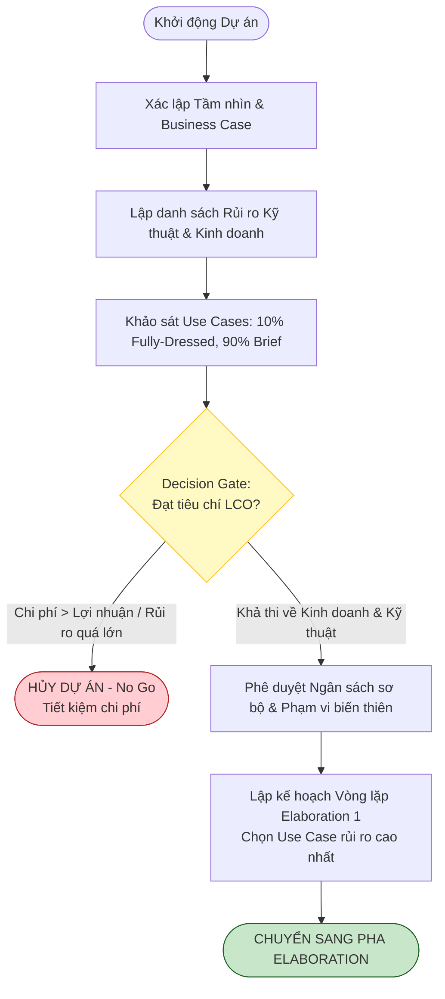

[🏠 Trang Chủ (MOC)](../README.md) | [◄ Chương 03: Case Study The NextGen POS System](./03_Case_Study_The_NextGen_POS_System.md) | [Chương 05: Understanding Requirements ►](./05_Understanding_Requirements.md)

---

## CHƯƠNG 4: INCEPTION

### 1. ĐỀ MỤC & MỤC TIÊU CỐT LÕI (CORE PURPOSE)

#### Hệ thống đề mục (Heading Hierarchy)
* **4.1. Inception: An Analogy** *(Sự tương đồng trực quan về Inception)*
* **4.2. Inception May Be Very Brief** *(Thời lượng cực ngắn của Inception)*
* **4.3. What Artifacts May Start in Inception?** *(Các tạo tác nào được khởi tạo trong Inception?)*
  * *Vision and Business Case (Tầm nhìn & Đề xuất kinh doanh)*
  * *Use-Case Model (Mô hình ca sử dụng sơ bộ)*
  * *Supplementary Specification (Đặc tả bổ sung sơ bộ)*
  * *Glossary (Bảng chú giải thuật ngữ & Từ điển dữ liệu)*
  * *Risk-List & Risk Management Plan (Danh mục và Kế hoạch kiểm soát rủi ro)*
  * *Prototypes and Proof-of-Concepts (Mô hình thử nghiệm và Bằng chứng khái niệm)*
  * *Iteration Plan (Kế hoạch cho Vòng lặp Elaboration 1)*
  * *Development Case (Hồ sơ quy trình phát triển tùy biến)*
* **4.4. You Know You Didn't Understand Inception When...** *(Dấu hiệu nhận biết sự ngộ nhận về Inception)*

#### Vấn đề kỹ thuật thực tế & Thảm họa kiến trúc được ngăn chặn
Chương 4 giải quyết sự nhầm lẫn tai hại kinh điển trong ngành công nghệ: **Đồng nhất pha Inception với giai đoạn thu thập toàn bộ yêu cầu (Requirements Phase) của mô hình Thác nước**.

Nếu một tổ chức hiểu sai Inception, họ sẽ rơi vào các thảm họa:
* **Tê liệt vì phân tích (Analysis Paralysis):** Nhóm dành nhiều tháng cố gắng viết tài liệu yêu cầu chi tiết 100%, tạo ra hàng trăm trang đặc tả tĩnh trên giấy mà không có dòng mã nào được thực thi.
* **Cam kết ngân sách và lịch trình ảo (Premature Over-commitment):** Đưa ra con số chi phí và ngày release chính xác khi chưa khảo sát thực tế và chưa hiểu rõ rủi ro kỹ thuật, dẫn đến vỡ kế hoạch (vượt ngân sách 200-300%).
* **Thất bại trong việc đưa ra quyết định Dừng/Chạy (No-Go Failure):** Không nhận diện được dự án là bất khả thi hoặc phi thực tế ngay từ tuần đầu tiên, tiếp tục đốt hàng trăm ngàn USD vào một sản phẩm vô vọng.

---

### 2. PHÂN TÍCH LÝ THUYẾT & NGUYÊN LÝ CHUYÊN SÂU

```
+-----------------------------------------------------------------------------------+
|                            INCEPTION: ENVISIONING PHASE                           |
|       Thời lượng: Vài giờ đến vài ngày (Tối đa 1 tuần cho dự án trung bình)       |
+-----------------------------------------------------------------------------------+
       |
       +---> [1] Nghiên cứu Tính khả thi (Feasibility Study)
       +---> [2] Làm rõ Tầm nhìn cốt lõi (Vision & Business Case)
       +---> [3] Khảo sát ~10% Use Cases quan trọng nhất (Deep dive sơ bộ)
       +---> [4] Liệt kê tên 90% Use Cases còn lại (Brief format)
       +---> [5] Nhận diện các Rủi ro kỹ thuật chí mạng (High-Risk Items)
       |
       v
+-----------------------------------------------------------------------------------+
|                               GO / NO-GO DECISION GATE                            |
|       - Đạt chuẩn (Go): Chuyển sang Elaboration để xây dựng Kiến trúc             |
|       - Không đạt (No-Go): Hủy dự án ngay lập tức (Tiết kiệm 95% chi phí)         |
+-----------------------------------------------------------------------------------+
```

#### 2.1. Bản chất của Inception: "Envisioning", không phải "Requirements"
* Inception chỉ là bước **Định hình tầm nhìn (*Envisioning*)**. Mục đích duy nhất của nó là thu thập đủ thông tin cơ bản để các bên liên quan quyết định: **"Có nên đầu tư tiền bạc để bước vào pha Elaboration nhằm nghiên cứu sâu hơn hay không?"**.
* Thời lượng chuẩn của Inception: Chỉ kéo dài từ **vài giờ đến vài ngày** (tối đa là 1-2 tuần với các dự án lớn). Nếu một nhóm đang ở "Inception tuần thứ 6", họ đang làm Thác nước trá hình.

#### 2.2. Khối lượng công việc thực tế trong Inception
Craig Larman nêu rõ quy tắc định lượng:
* Chỉ khoảng **10% Use Cases** (những ca sử dụng cốt lõi, đại diện cho giá trị nghiệp vụ chính hoặc chứa rủi ro kỹ thuật cao) được viết chi tiết ở dạng *Fully Dressed*.
* Khoảng **90% Use Cases còn lại** chỉ được ghi nhận dưới dạng tên gọi và tóm tắt 1-2 câu (*Brief format*).
* Tuyệt đối **không vẽ kiến trúc chi tiết, không vẽ hàng loạt biểu đồ UML**. Bản vẽ UML chỉ xuất hiện dưới dạng phác thảo nhanh trên bảng trắng (*UML as sketch*) để thảo luận ý tưởng.

#### 2.3. Các câu hỏi nhận biết việc áp dụng sai Inception
Craig Larman chỉ ra: "Bạn biết mình chưa hiểu Inception khi...":
1. Bạn cố gắng định nghĩa toàn bộ yêu cầu chi tiết.
2. Bạn dành hơn vài tuần cho pha này.
3. Bạn cố gắng đưa ra một ước lượng ngân sách chính xác tuyệt đối (thay vì dải ước lượng biến thiên như: 100,000$ $\pm$ 50%).
4. Bạn không tạo ra được một kế hoạch cụ thể cho Vòng lặp Elaboration 1 nhằm triệt tiêu rủi ro kiến trúc cao nhất.

---

### 3. MỔ XẺ MÃ NGUỒN HOẶC ĐẶC TẢ THIẾT KẾ (DESIGN / CODE DEEP-DIVE)

Trong Inception, công cụ kỹ thuật then chốt không phải là code sản phẩm, mà là **Ma trận Đánh giá Khả thi & Quyết định Go/No-Go (*Feasibility Evaluation & Risk Matrix*)** được mô hình hóa thành Schema cấu trúc dữ liệu để tự động hóa việc đánh giá dự án:

```json
{
  "projectInceptionAssessment": {
    "projectName": "NextGen POS",
    "iteration": "Inception-1",
    "businessViability": {
      "targetROI": "18 months",
      "executiveSponsor": "VP Retail Operations",
      "marketNeedUrgency": "HIGH"
    },
    "technicalFeasibilitySpikes": [
      {
        "riskId": "RISK-01",
        "description": "Mất kết nối mạng Internet khi đang thực hiện giao dịch thẻ tín dụng",
        "impact": "CRITICAL",
        "mitigationStrategy": "Thiết kế cơ chế Store-and-Forward ở Elaboration 1",
        "status": "UNRESOLVED_PENDING_ELABORATION"
      },
      {
        "riskId": "RISK-02",
        "description": "Đa dạng hóa driver máy quét mã vạch trên các hệ điều hành cũ",
        "impact": "MEDIUM",
        "mitigationStrategy": "Sử dụng Java POS chuẩn qua Adapter pattern",
        "status": "ACCEPTED_RISK"
      }
    ],
    "scopeAllocation": {
      "fullyDressedUseCasesCount": 1,
      "briefUseCasesCount": 14,
      "primaryTracerBullet": "Process Sale (Cash only)"
    },
    "decisionGate": {
      "recommendation": "GO_TO_ELABORATION",
      "budgetRangeApproved": "$120,000 - $180,000",
      "nextMilestoneDate": "2026-11-20 (Elaboration-1 Demo)"
    }
  }
}
```

#### Bảng phân tích kỹ thuật và ý nghĩa thiết kế:

| Thành phần đặc tả then chốt | Giải thích kỹ thuật & Ý nghĩa thiết kế kiến trúc |
| :--- | :--- |
| `"fullyDressedUseCasesCount": 1` | **Nguyên tắc tiết chế phạm vi (Scope Control):** Chỉ chọn đúng 1 ca sử dụng sống còn (`Process Sale`) để viết chi tiết. Tránh việc đội ngũ bị chôn vùi trong việc viết văn bản mô tả. |
| `"briefUseCasesCount": 14` | Nắm bắt được bức tranh toàn cảnh (Big Picture) của hệ thống nhưng không tốn tài nguyên đào sâu vào chi tiết khi chưa có phản hồi thực tế. |
| `"RISK-01": "Store-and-Forward"` | **Xác lập mục tiêu cho Elaboration:** Inception nhận diện ra rủi ro chí mạng nhưng **không giải quyết nó trên giấy**. Nó bàn giao rủi ro này làm đề bài bắt buộc cho Vòng lặp 1 của Elaboration phải giải quyết bằng mã nguồn chạy thực tế. |
| `"decisionGate": "GO_TO_ELABORATION"` | **Bản chất của Milestone LCO:** Inception kết thúc bằng một quyết định đầu tư rành mạch. Nếu rủi ro kỹ thuật không có phương án giải quyết khả thi, dự án bị khai tử ngay (No-Go) mà không lãng phí ngân sách. |

---

### 4. SƠ ĐỒ TRỰC QUAN HÓA (UML MERMAID)

Sơ đồ trạng thái quyết định của Pha Inception (Decision Gate Flowchart) trong quy trình UP:



---

### 5. ÁNH XẠ ỨNG DỤNG VÀO DỰ ÁN GAME OOP THỰC CHIẾN

* **Bối cảnh áp dụng:** Pha Inception cho một dự án Game 2.5D Online nhiều người chơi (MMORPG / MOBA).
* **Sai lầm thường gặp (Water-falling Game Development):** Nhóm Game Design viết một cuốn "Kinh thánh Game" (*Game Design Document - GDD*) dày 300 trang: viết toàn bộ cốt truyện thế giới, vẽ concept art cho 100 vị tướng, thiết kế chi tiết chỉ số của 500 món đồ. Khi đưa cho lập trình viên làm, phát hiện ra engine mạng không chịu tải nổi quá 10 người chơi trên cùng một bản đồ, toàn bộ thế giới ảo 300 trang bị vứt vào sọt rác.
* **Ánh xạ Inception từ Chương 4 vào Game:**
  1. *Thời gian:* Giới hạn Inception trong đúng 1 tuần.
  2. *Tầm nhìn cốt lõi (Core Vision):* Xác định **Vòng lặp trải nghiệm cốt lõi (*Core Gameplay Loop*)**: Di chuyển $\to$ Dùng chiêu $\to$ Nhận kinh nghiệm/Rơi đồ.
  3. *Use Case 10% duy nhất:* Ca sử dụng `CombatAction`: Người chơi bấm chiêu, máy chủ tính toán hitbox, mục tiêu mất máu.
  4. *Rủi ro kỹ thuật chí mạng:* Đồng bộ chuyển động 2.5D giữa máy khách và máy chủ khi mạng giật lag.
  5. *Đầu ra Inception:* Không viết thêm lore hay cốt truyện; lập kế hoạch cho Elaboration 1: Tạo một bản build đen trắng (Greybox) gồm 2 nhân vật đánh nhau qua mạng local để kiểm tra Engine vật lý và Netcode.

---

[🏠 Trang Chủ (MOC)](../README.md) | [◄ Chương 03: Case Study The NextGen POS System](./03_Case_Study_The_NextGen_POS_System.md) | [Chương 05: Understanding Requirements ►](./05_Understanding_Requirements.md)
