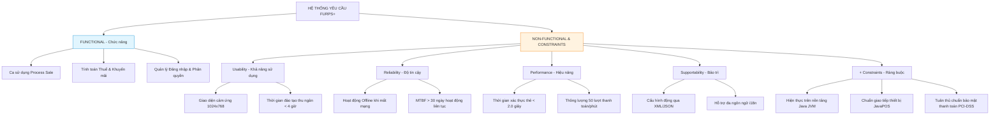

[🏠 Trang Chủ (MOC)](../README.md) | [◄ Chương 04: Inception](./04_Inception.md) | [Chương 06: Use Case Model Writing Requirements in Context ►](./06_Use_Case_Model_Writing_Requirements_in_Context.md)

---

## CHƯƠNG 5: UNDERSTANDING REQUIREMENTS

### 1. ĐỀ MỤC & MỤC TIÊU CỐT LÕI (CORE PURPOSE)

#### Hệ thống đề mục (Heading Hierarchy)
* **5.1. Types of Requirements: The FURPS+ Model** *(Phân loại yêu cầu: Mô hình FURPS+)*
  * *Functional (Chức năng)*
  * *Usability (Khả năng sử dụng / Trải nghiệm)*
  * *Reliability (Độ tin cậy & An toàn vận hành)*
  * *Performance (Hiệu năng & Khả năng đáp ứng)*
  * *Supportability (Khả năng hỗ trợ & Bảo trì)*
  * *The "+" Sub-categories: Implementation, Interface, Operations, Packaging, Legal (Các ràng buộc mở rộng)*
* **5.2. Evolutionary vs. Waterfall Requirements** *(Yêu cầu tiến hóa vs. Yêu cầu thác nước đóng băng)*
* **5.3. Further Readings** *(Tài liệu đọc thêm)*

#### Vấn đề kỹ thuật thực tế & Thảm họa kiến trúc được ngăn chặn
Chương 5 đập tan thói quen xấu của lập trình viên: **Chỉ quan tâm đến Yêu cầu chức năng (*Functional Requirements*) mà coi nhẹ Yêu cầu phi chức năng (*Non-Functional Requirements / Quality Attributes*)**.

Nếu một Kiến trúc sư không làm chủ mô hình FURPS+, hệ thống sẽ hứng chịu các thảm họa:
* **Hội chứng Sụp đổ khi scale (*Scalability Collapse*):** Hệ thống chạy rất tốt trong phòng thí nghiệm với 1 người dùng thử, nhưng chết đứng (*Out of Memory / Thread Deadlock*) khi có 1000 người dùng đồng thời vì không thiết kế cho thuộc tính *Performance & Reliability*.
* **Bế tắc khi nâng cấp (*Supportability Nightmare*):** Mã nguồn bị hard-code các hằng số cấu hình, gắn chặt vào một hệ điều hành cụ thể, không thể quốc tế hóa ngôn ngữ (*i18n*), khiến chi phí bảo trì sau release chiếm tới 80% tổng ngân sách dự án.
* **Vi phạm pháp lý và an toàn dữ liệu (*Legal / Compliance Violations*):** Bỏ qua nhóm ràng buộc "+" (như chuẩn bảo mật PCI-DSS trong thanh toán thẻ, GDPR trong lưu trữ dữ liệu cá nhân), dẫn đến nguy cơ phần mềm bị cấm vận hành hoặc bị phạt hàng triệu USD.

---

### 2. PHÂN TÍCH LÝ THUYẾT & NGUYÊN LÝ CHUYÊN SÂU

```
+-----------------------------------------------------------------------------------+
|                            THE FURPS+ REQUIREMENTS MODEL                          |
+-----------------------------------------------------------------------------------+
| [F] FUNCTIONAL       : Tính năng, Năng lực xử lý, Bảo mật, Luồng nghiệp vụ        |
| [U] USABILITY        : Trải nghiệm UI, Khả năng tiếp cận, Tài liệu hướng dẫn       |
| [R] RELIABILITY      : Tần suất lỗi (MTBF), Khả năng phục hồi, Tính dự đoán được  |
| [P] PERFORMANCE      : Thời gian phản hồi (Latency), Thông lượng (Throughput)    |
| [S] SUPPORTABILITY   : Khả năng bảo trì, Cấu hình hóa, Khả năng mở rộng           |
+-----------------------------------------------------------------------------------+
| [+] CONSTRAINTS                                                                   |
|   - Implementation   : Ngôn ngữ lập trình bắt buộc, Thư viện, Nền tảng phần cứng  |
|   - Interface        : Ràng buộc giao thức phần cứng, Định dạng API ngoài         |
|   - Operations       : Quản trị hệ thống, Sao lưu, Giám sát vận hành (Metrics)   |
|   - Packaging        : Bộ cài đặt, Containerization (Docker), Cơ chế tự update    |
|   - Legal            : Bản quyền mã nguồn mở (GPL/MIT), Chuẩn bảo mật thanh toán  |
+-----------------------------------------------------------------------------------+
```

#### 2.1. Phân rã chuyên sâu mô hình FURPS+
Craig Larman sử dụng mô hình FURPS+ (khởi xướng bởi Robert Grady tại Hewlett-Packard) để phân loại có hệ thống toàn bộ yêu cầu phần mềm:
1. **Functional (Chức năng):** Những gì hệ thống **làm**. Được ghi nhận chủ yếu trong **Use-Case Model**. Bao gồm các tính năng chính, khả năng tính toán, tính toàn vẹn dữ liệu.
2. **Usability (Khả năng sử dụng):** Con người tương tác với hệ thống dễ dàng ra sao? Bao gồm công thái học giao diện (*GUI Ergonomics*), khả năng phòng tránh lỗi gõ nhầm của người dùng, tài liệu trợ giúp trực tuyến.
3. **Reliability (Độ tin cậy):** Mức độ chịu lỗi của hệ thống. Bao gồm thời gian trung bình giữa các lần sập (*Mean Time Between Failures - MTBF*), khả năng tự phục hồi khi database ngắt kết nối, khả năng sao lưu dự phòng (*Failover*).
4. **Performance (Hiệu năng):** Đo lường tính kịp thời của hệ thống. Bao gồm thời gian phản hồi (*Response Time* - ví dụ: giao dịch thanh toán phải hoàn thành dưới 2 giây trong 99% trường hợp), thông lượng (*Throughput* - xử lý 500 giao dịch/giây), mức tiêu thụ tài nguyên (RAM, CPU, băng thông mạng).
5. **Supportability (Khả năng hỗ trợ & Thích ứng):** Bao gồm khả năng bảo trì mã nguồn (*Maintainability*), khả năng mở rộng thêm tính năng mới (*Extensibility*), khả năng cấu hình mà không cần sửa code (*Configurability*), khả năng cài đặt và quốc tế hóa (*Localization*).

#### 2.2. Nhóm dấu "+" (Ràng buộc kỹ thuật & Môi trường)
Dấu "+" đại diện cho các yếu tố định hình trực tiếp Kiến trúc hệ thống (*Architectural Drivers*):
* **Ràng buộc Hiện thực (Implementation Constraints):** Bắt buộc chạy trên JVM 17, sử dụng C++20, bộ nhớ không vượt quá 512MB RAM.
* **Ràng buộc Giao diện (Interface Constraints):** Bắt buộc giao tiếp với máy quẹt thẻ qua chuẩn RS-232, trao đổi dữ liệu với ngân hàng qua chuẩn ISO 8583.
* **Vận hành & Đóng gói (Operations & Packaging):** Tự động phát hiện lỗi và gửi cảnh báo tới hệ thống giám sát Prometheus/Grafana.
* **Pháp lý (Legal):** Tuân thủ luật bảo vệ dữ liệu cá nhân, chứng chỉ bảo mật của cơ quan thuế nhà nước.

#### 2.3. Yêu cầu tiến hóa (Evolutionary Requirements)
Craig Larman nhấn mạnh: Yêu cầu không phải là một bia đá bất di bất dịch. Trong UP, yêu cầu được **làm rõ dần dần qua từng vòng lặp (*Evolutionary Requirements*)**. Khách hàng chỉ phát hiện ra các yêu cầu phi chức năng thực sự (như độ trễ hay tính dễ dùng) sau khi họ trực tiếp thử nghiệm các bản build của pha Elaboration.

---

### 3. MỔ XẺ MÃ NGUỒN HOẶC ĐẶC TẢ THIẾT KẾ (DESIGN / CODE DEEP-DIVE)

Để hiện thực hóa yêu cầu phi chức năng về **Performance & Reliability (FURPS+)** vào mã nguồn kiến trúc, Kiến trúc sư thiết kế một cơ chế kiểm soát hợp đồng thời gian thực thi (*Execution Time SLA Circuit Breaker*) bọc quanh các cuộc gọi dịch vụ ngoài:

```java
public class ReliableServiceProxy<T> {
    private final long maxExecutionTimeMs;
    private final int failureThreshold;
    private int consecutiveFailures = 0;

    public ReliableServiceProxy(long maxExecutionTimeMs, int failureThreshold) {
        this.maxExecutionTimeMs = maxExecutionTimeMs;
        this.failureThreshold = failureThreshold;
    }

    public <R> R executeWithSLA(Supplier<R> serviceCall, R fallbackResult) {
        // [FURPS - Reliability]: Kiểm tra trạng thái Circuit Breaker
        if (consecutiveFailures >= failureThreshold) {
            System.err.println("Circuit Breaker OPEN: Dịch vụ ngoài đang tê liệt. Dùng Fallback.");
            return fallbackResult;
        }

        long startTime = System.currentTimeMillis();
        try {
            R result = serviceCall.get();
            long duration = System.currentTimeMillis() - startTime;
            
            // [FURPS - Performance]: Giám sát thời gian phản hồi theo SLA
            if (duration > maxExecutionTimeMs) {
                System.warn.println("SLA Violated: Cuộc gọi mất " + duration + "ms (Ngưỡng: " + maxExecutionTimeMs + "ms)");
            }
            consecutiveFailures = 0; // Reset khi thành công
            return result;
        } catch (Exception e) {
            consecutiveFailures++;
            // [FURPS - Supportability]: Log lỗi chi tiết để điều tra
            Logger.logServiceError(e, consecutiveFailures);
            return fallbackResult;
        }
    }
}
```

#### Bảng phân tích kỹ thuật và ý nghĩa thiết kế:

| Dòng code / Đoạn code then chốt | Giải thích kỹ thuật & Ý nghĩa thiết kế kiến trúc |
| :--- | :--- |
| `if (consecutiveFailures >= failureThreshold)` | Hiện thực hóa thuộc tính **Reliability (Độ tin cậy)** qua mẫu hình *Circuit Breaker*: Ngăn chặn việc hệ thống tiếp tục gửi request vào một dịch vụ ngoài đang chết, tránh gây tràn hàng đợi (*Thread Starvation*) cho hệ thống chính. |
| `long duration = System.currentTimeMillis() - startTime;` | Hiện thực hóa thuộc tính **Performance (Hiệu năng)**: Kiểm tra cam kết SLA theo yêu cầu phi chức năng (ví dụ: phản hồi không quá 1500ms). |
| `return fallbackResult;` | **Khả năng chịu lỗi an toàn (Graceful Degradation):** Khi dịch vụ thanh toán ngoài sập, hệ thống chuyển sang chế độ dự phòng (chuyển sang thanh toán tiền mặt hoặc lưu giao dịch vào bộ nhớ đệm), đảm bảo hệ thống không bao giờ bị crash trắng màn hình trước mặt khách hàng. |
| `Logger.logServiceError(e...);` | Hiện thực hóa thuộc tính **Supportability (Khả năng hỗ trợ vận hành)**: Cung cấp dấu vết kiểm toán (*Audit Trail*) và log giám sát để đội vận hành chẩn đoán sự cố mà không cần cắm debugger vào môi trường production. |

---

### 4. SƠ ĐỒ TRỰC QUAN HÓA (UML MERMAID)

Sơ đồ phân loại toàn diện cây yêu cầu hệ thống theo mô hình FURPS+:



---

### 5. ÁNH XẠ ỨNG DỤNG VÀO DỰ ÁN GAME OOP THỰC CHIẾN

* **Bối cảnh áp dụng:** Thiết kế bộ yêu cầu FURPS+ cho Game 2.5D Multiplayer (Action RPG).
* **Vấn đề thực tế nếu chỉ tập trung vào Functional:** Đội ngũ làm ra đầy đủ chiêu thức, hệ thống trang bị, đánh boss rất hay. Nhưng khi mở Server thử nghiệm:
  * Game giật lag khung hình dưới 15 FPS trên máy cấu hình trung bình (*Usability/Performance fail*).
  * Mỗi khi rớt mạng 4G, người chơi bị văng thẳng ra màn hình đăng nhập, mất sạch dữ liệu trận đấu (*Reliability fail*).
  * Muốn thay đổi chỉ số sát thương của một cây kiếm, lập trình viên phải sửa code C#, build lại toàn bộ Client, đẩy lên App Store mất 3 ngày duyệt (*Supportability fail*).
* **Ứng dụng FURPS+ chuyên sâu vào Game:**
  1. *Usability:* Phím bấm ảo trên màn hình cảm ứng có độ nhạy cao, tự động khóa mục tiêu gần nhất (*Auto-target*); bố cục HUD không che khuất tầm nhìn 2.5D.
  2. *Reliability:* Khi mất kết nối mạng đột ngột trong trận đánh, hệ thống có cơ chế **Auto-Reconnect**: Client tự kết nối lại trong 10 giây, Server tự gửi lại snapshot trạng thái trận đấu gần nhất mà không bắt người chơi thoát game.
  3. *Performance:* 
     * Tốc độ khung hình (*FPS*): Tối thiểu 60 FPS ổn định trên thiết bị tiêu chuẩn.
     * Tần suất gửi gói tin mạng (*Server Tick Rate*): 30 Hz (30 lần cập nhật/giây).
     * Bộ nhớ RAM Client: Không vượt quá 1.5 GB để tránh bị hệ điều hành tiêu diệt tiến trình (*Out-Of-Memory Crash*).
  4. *Supportability:* Toàn bộ chỉ số quái vật, kỹ năng, vật phẩm được đưa ra ngoài file cấu hình JSON/ScriptableObject. Game Designer có thể chỉnh sửa cân bằng game và cập nhật tức thì (*Hot-fix Over The Air*) mà không cần build lại mã nguồn binary.

---

[🏠 Trang Chủ (MOC)](../README.md) | [◄ Chương 04: Inception](./04_Inception.md) | [Chương 06: Use Case Model Writing Requirements in Context ►](./06_Use_Case_Model_Writing_Requirements_in_Context.md)
