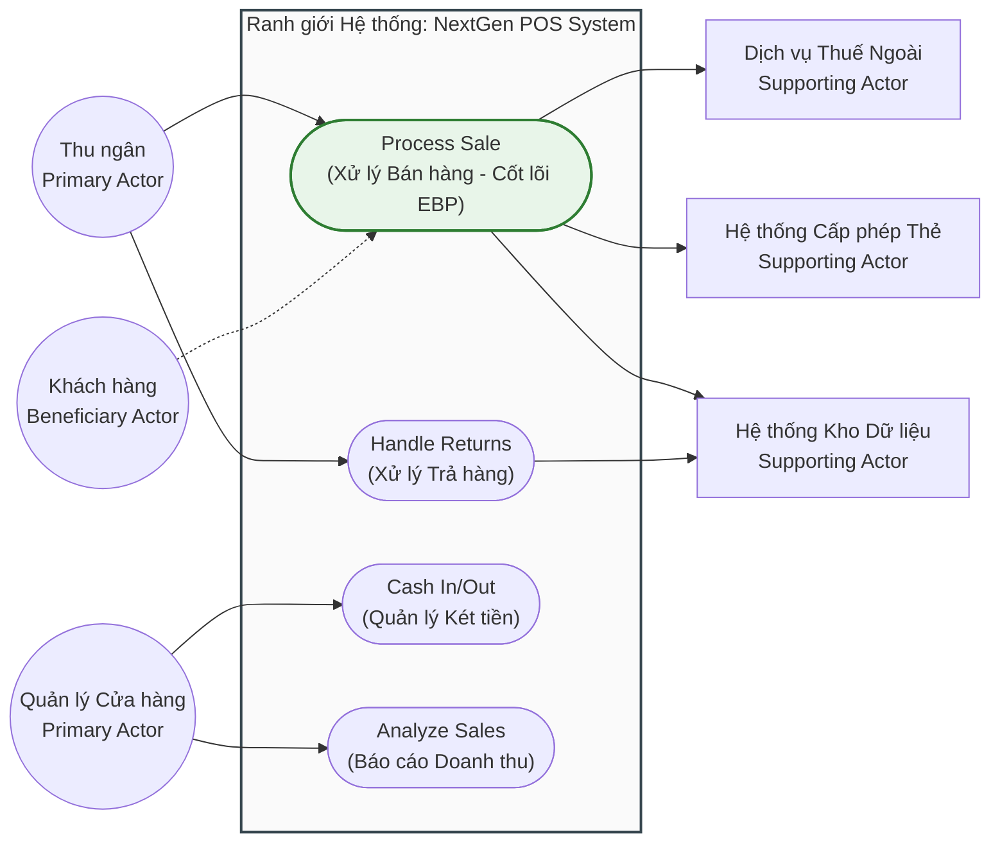

[🏠 Trang Chủ (MOC)](../README.md) | [◄ Chương 05: Understanding Requirements](./05_Understanding_Requirements.md) | [Chương 07: Identifying Other Requirements ►](./07_Identifying_Other_Requirements.md)

---

## CHƯƠNG 6: USE-CASE MODEL: WRITING REQUIREMENTS IN CONTEXT

### 1. ĐỀ MỤC & MỤC TIÊU CỐT LÕI (CORE PURPOSE)

#### Hệ thống đề mục (Heading Hierarchy)
* **6.1. Goals and Stories** *(Mục tiêu của Tác nhân và Câu chuyện)*
* **6.2. Background** *(Bối cảnh ra đời của Use Cases)*
* **6.3. Use Cases and Adding Value** *(Ca sử dụng và Giá trị mang lại)*
* **6.4. Use Cases and Functional Requirements** *(Ca sử dụng là phương tiện mô tả Yêu cầu Chức năng)*
* **6.5. Use Case Types and Formats** *(Các loại và định dạng Ca sử dụng)*
  * *Brief (Tóm tắt sơ lược - 1 đoạn văn)*
  * *Casual (Thân mật - vài đoạn văn)*
  * *Fully Dressed (Trang phục đầy đủ - Cấu trúc chi tiết nhất)*
* **6.6. Fully Dressed Example: Process Sale** *(Ví dụ kinh điển: Xử lý Bán hàng)*
* **6.7. Explaining the Sections of a Fully Dressed Use Case** *(Giải thích chi tiết từng phần trong đặc tả)*
  * *Scope, Level, Primary Actor, Stakeholders & Interests*
  * *Preconditions & Success Guarantee (Postconditions)*
  * *Main Success Scenario (Happy Path)*
  * *Extensions (Alternative Flows / Luồng rẽ nhánh & Ngoại lệ)*
  * *Special Requirements, Technology & Data Variations List*
* **6.8. Goals and Scope of a Use Case: Finding the Right Boundary** *(Quy mô và Mục tiêu: Ranh giới EBP)*
  * *The Elementary Business Process (EBP - Quy trình nghiệp vụ cơ bản)*
  * *The Size Test (Kiểm tra quy mô nghiệp vụ)*
* **6.9. Finding Primary Actors, Goals, and Use Cases** *(Phương pháp tìm kiếm Tác nhân và Ca sử dụng)*
* **6.10. Write Use Cases in an Essential, UI-Free Style** *(Phong cách viết bản chất, không phụ thuộc UI)*
* **6.11. Use Case Diagrams** *(Sơ đồ Ca sử dụng UML và Cú pháp chuẩn)*
* **6.12. Use Cases Within the UP** *(Ca sử dụng trong Quy trình UP)*

#### Vấn đề kỹ thuật thực tế & Thảm họa kiến trúc được ngăn chặn
Chương 6 giải quyết sai lầm phổ biến nhất trong thu thập yêu cầu: **Liệt kê yêu cầu dưới dạng danh sách tính năng phẳng, rời rạc (*Flat Feature Lists*)**, và **Cài cắm chi tiết công nghệ giao diện vào tài liệu phân tích nghiệp vụ**.

Nếu không làm chủ kỹ thuật viết Use Case, dự án sẽ gặp phải các thảm họa:
* **Hội chứng "Tính năng chạy đúng, hệ thống thất bại":** Mọi hàm chức năng đơn lẻ đều test pass, nhưng khi ghép lại thành một quy trình làm việc thực tế của con người thì không thể sử dụng được vì thiếu ngữ cảnh và mục tiêu nghiệp vụ (*Business Goal*).
* **Khóa chết kiến trúc vào giao diện người dùng (UI Coupling in Specs):** Đặc tả ghi: *"Người dùng nhấp vào Dropdown A, nhập text vào ô B, bấm nút C"*. Khi chuyển đổi sang màn hình cảm ứng, giọng nói, hoặc API tự động, toàn bộ tài liệu yêu cầu bị phá sản vì gắn chặt vào các widget UI cụ thể thay vì bản chất của giao dịch.
* **Bỏ sót các kịch bản lỗi và biên ngoại lệ (Ignored Edge Cases):** Lập trình viên chỉ code cho kịch bản màu hồng (*Happy Path*); khi gặp sự cố ngoài đời thực (máy in hết giấy, thẻ bị từ chối, quét mã vạch sai định dạng), hệ thống văng ngoại lệ (*Unhandled Exception*) hoặc rơi vào trạng thái dữ liệu rác không nhất quán.

---

### 2. PHÂN TÍCH LÝ THUYẾT & NGUYÊN LÝ CHUYÊN SÂU

```
+-----------------------------------------------------------------------------------------+
|                                    USE-CASE ANATOMY                                     |
+-----------------------------------------------------------------------------------------+
| USE CASE: Process Sale                                     LEVEL: User Goal (EBP)       |
| PRIMARY ACTOR: Cashier                                     SCOPE: POS Application       |
+-----------------------------------------------------------------------------------------+
| PRECONDITIONS      : Thu ngân đã đăng nhập, Quầy thu ngân sẵn sàng hoạt động.            |
| POSTCONDITIONS     : Hóa đơn được lưu trữ, Thuế được tính, Kho hàng bị trừ số lượng,     |
| (Success Guarantee): Nhật ký kiểm toán được ghi nhận, Biên lai được in ra.              |
+-----------------------------------------------------------------------------------------+
| MAIN SUCCESS SCENARIO (Happy Path):                                                     |
|   1. Khách hàng mang hàng đến quầy.                                                     |
|   2. Thu ngân bắt đầu giao dịch mới.                                                    |
|   3. Thu ngân nhập mã nhận dạng mặt hàng.                                               |
|   4. Hệ thống ghi nhận mặt hàng, hiển thị mô tả và đơn giá.                             |
|      (Các bước 3-4 lặp lại cho đến khi hết hàng).                                       |
|   5. Hệ thống tính tổng tiền.                                                           |
|   6. Thu ngân thông báo số tiền, Khách hàng thanh toán.                                 |
|   7. Hệ thống xử lý thanh toán, in biên lai, cập nhật hàng tồn.                         |
|   8. Khách hàng nhận hàng và rời đi.                                                    |
+-----------------------------------------------------------------------------------------+
| EXTENSIONS (Alternative Flows / 80% độ phức tạp của hệ thống nằm ở đây!):               |
|   3a. Mã vạch không hợp lệ / Không tìm thấy hàng:                                       |
|       .1 Hệ thống báo lỗi âm thanh và hiển thị thông báo.                               |
|       .2 Thu ngân nhập mã thủ công hoặc gọi quản lý.                                    |
|   7a. Khách hàng thanh toán bằng thẻ tín dụng:                                          |
|       .1 Hệ thống gửi yêu cầu cấp phép tới Ngân hàng ngoài.                             |
|       .2 Kết nối mạng bị Timeout: Chuyển sang cơ chế Offline Authorization.             |
+-----------------------------------------------------------------------------------------+
```

#### 2.1. Bản chất của Use Case: Bản hợp đồng văn bản về hành vi hệ thống
* Craig Larman nhấn mạnh: **Use Case trước hết là văn bản viết bằng ngôn ngữ tự nhiên (*Text*), không phải là sơ đồ hình vẽ UML.** Sơ đồ Use Case chỉ đóng vai trò thứ yếu như một bảng mục lục trực quan (*Table of Contents*). Sức mạnh thực sự nằm ở nội dung chi tiết của kịch bản chữ.
* Một Use Case mô tả câu chuyện về một **Tác nhân chính (*Primary Actor*)** tương tác với hệ thống phần mềm nhằm đạt được một **Mục tiêu có giá trị nghiệp vụ (*Goal*)**.

#### 2.2. Kiểm tra quy mô: Quy trình Nghiệp vụ Cơ bản (The EBP Test)
Làm sao để biết một Use Case không quá lớn (như: "Vận hành siêu thị") và không quá vụn vặt (như: "Đăng nhập", "Bấm nút In")? Larman đưa ra bài kiểm tra **Elementary Business Process (EBP)**:
* *Định nghĩa EBP:* Là một nhiệm vụ được thực hiện bởi một người, tại một địa điểm, trong một thời điểm cụ thể, nhằm đáp ứng một sự kiện nghiệp vụ; nhiệm vụ này bổ sung giá trị kinh doanh đo lường được và đưa dữ liệu về trạng thái nhất quán (*Consistent State*).
* Do đó, `Process Sale` là một Use Case chuẩn mức EBP. `Login` hoặc `Print Receipt` chỉ là các bước phụ nhỏ, không mang lại giá trị kinh doanh độc lập nếu đứng một mình.

#### 2.3. Phong cách viết Essential (Bản chất), UI-Free Style
* **Quy tắc vàng:** Không bao giờ nhắc đến các từ như: *Window, Dialog, Button, Click, Mouse, Dropdown, Textbox* trong Use Case.
* **Cách viết đúng (Essential):** "Khách hàng xác nhận danh tính" thay vì "Khách hàng nhập User/Password vào ô Textbox rồi bấm nút Login".
* **Lý do kiến trúc:** Việc tách rời UI khỏi Use Case giúp giải pháp phần mềm tự do lựa chọn hình thái hiện thực: hôm nay có thể là ứng dụng Desktop, ngày mai là ứng dụng Mobile, ngày kia là Voice Assistant tự động, mà bản chất ca sử dụng không hề bị lỗi thời.

---

### 3. MỔ XẺ MÃ NGUỒN HOẶC ĐẶC TẢ THIẾT KẾ (DESIGN / CODE DEEP-DIVE)

Dưới đây là bản đặc tả kịch bản kiểm thử hướng hành vi (**Behavior-Driven Development - BDD / Gherkin Specification**) được sinh ra trực tiếp từ Use Case `Process Sale` (luồng chính và luồng ngoại lệ), làm cầu nối chuyển ngữ cảnh từ Use Case sang Code Test tự động:

```gherkin
Feature: Xử lý Bán hàng (Use Case: Process Sale)
  Là một Thu ngân
  Tôi muốn ghi nhận các mặt hàng khách mua và xử lý thanh toán
  Để hoàn tất giao dịch mua bán và mang lại doanh thu cho cửa hàng

  Background:
    Given Quầy thu ngân "Reg-01" đã mở và Thu ngân "Alice" đã đăng nhập thành công

  Scenario: Thanh toán tiền mặt thành công (Main Success Scenario)
    When Thu ngân bắt đầu một lượt bán hàng mới
    And Thu ngân nhập mã sản phẩm "ITEM-101" với số lượng là 2
    Then Màn hình hiển thị "Sữa chua Vinamilk" với đơn giá 12000 và thành tiền 24000
    When Thu ngân kết thúc lượt quét hàng
    Then Tổng số tiền phải thanh toán là 24000
    When Khách hàng đưa số tiền mặt là 50000
    Then Hệ thống ghi nhận thanh toán thành công
    And Số tiền thừa trả lại khách là 26000
    And Kho hàng giảm tồn kho của "ITEM-101" đi 2 đơn vị

  Scenario: Xử lý khi mã vạch không tồn tại (Extension Flow 3a)
    When Thu ngân bắt đầu một lượt bán hàng mới
    And Thu ngân nhập mã sản phẩm không tồn tại "ITEM-999" với số lượng là 1
    Then Hệ thống từ chối ghi nhận và phát âm thanh cảnh báo lỗi
    And Danh sách hóa đơn hiện tại vẫn có 0 mặt hàng
    And Tổng số tiền thanh toán hiện tại là 0
```

#### Bảng phân tích kỹ thuật và ý nghĩa thiết kế:

| Đoạn đặc tả then chốt | Giải thích kỹ thuật & Ý nghĩa thiết kế kiến trúc |
| :--- | :--- |
| `Given Quầy thu ngân đã mở...` | Ánh xạ trực tiếp từ **Preconditions (Tiền điều kiện)** của Use Case: Đảm bảo đối tượng `Register` và `Cashier` đã ở trạng thái hợp lệ trước khi cho phép hàm nghiệp vụ thực thi. |
| `Then Tổng tiền phải thanh toán là 24000` | Ánh xạ từ bước tính toán hệ thống trong **Main Success Scenario**: Thiết lập kỳ vọng kiểm thử cho phương thức `sale.getTotal()`. |
| `And Kho hàng giảm tồn kho đi 2 đơn vị` | Ánh xạ trực tiếp từ **Success Guarantee / Postconditions (Hậu điều kiện)**: Đảm bảo tính nhất quán dữ liệu của toàn bộ giao dịch (*Data Consistency & Acid Properties*). |
| `Scenario: Xử lý khi mã vạch không tồn tại` | Ánh xạ từ **Extension 3a**: Đảm bảo nhóm phát triển viết Unit Test và Exception Handling cho các tình huống lỗi ngay từ ngày đầu, triệt tiêu lỗi sập app ngoài thực tế. |

---

### 4. SƠ ĐỒ TRỰC QUAN HÓA (UML MERMAID)

Sơ đồ Ca sử dụng UML (Use Case Diagram) chuẩn mực cho Hệ thống NextGen POS thể hiện rõ Ranh giới Hệ thống (*System Boundary*), Tác nhân Chính (*Primary Actor*) và Tác nhân Hỗ trợ (*Supporting Actors*):



---

### 5. ÁNH XẠ ỨNG DỤNG VÀO DỰ ÁN GAME OOP THỰC CHIẾN

* **Bối cảnh áp dụng:** Đặc tả Ca sử dụng `TradeItemBetweenPlayers` (Giao dịch vật phẩm an toàn giữa 2 người chơi) trong Game 2.5D Multiplayer.
* **Thảm họa nếu viết yêu cầu cẩu thả:** Lập trình viên chỉ nghĩ đến kịch bản: Người chơi A chọn kiếm, người chơi B chọn vàng, cả hai bấm nút Đồng ý $\to$ Xong. Kết quả là tạo ra vô số lỗ hổng nhân bản vật phẩm (*Item Duplication Exploit*): Khi người chơi A nhanh tay rút kiếm về đúng miligiây người chơi B bấm Đồng ý; hoặc khi một trong hai người chơi cố tình rút dây mạng (*Disconnect Exploit*) lúc đang giao dịch.
* **Áp dụng cấu trúc Fully Dressed Use Case từ Chương 6:**
  1. *Primary Actors:* Initiator Player và Receiver Player.
  2. *Preconditions:* Cả hai người chơi phải đứng cạnh nhau trong bán kính 3 mét (Tile distance $\le 3$), cả hai không trong trạng thái chiến đấu (*In-Combat state*), không bị đóng băng/choáng.
  3. *Success Guarantee (Postconditions):* Vật phẩm và vàng được tráo đổi thành công theo nguyên lý giao dịch nguyên tử (*Atomic Transaction - ACID*); ghi nhật ký giao dịch (*Audit Log*) trên máy chủ để chống gian lận.
  4. *Extensions (Xử lý lỗ hổng hack/cheat):*
     * *3a. Một trong hai người chơi di chuyển ra xa quá 3 mét:* Hệ thống lập tức hủy giao dịch, hoàn trả toàn bộ đồ về hòm đồ ban đầu.
     * *4a. Một người chơi thay đổi vật phẩm trong ô giao dịch:* Hệ thống lập tức hủy bỏ trạng thái "Sẵn sàng" của người chơi kia, bắt buộc phải bấm xác nhận lại từ đầu.
     * *5a. Một người chơi bị ngắt kết nối mạng:* Hệ thống tự động rollback toàn bộ giao dịch, đảm bảo không một ai bị mất đồ hoặc nhân bản đồ.

---

[🏠 Trang Chủ (MOC)](../README.md) | [◄ Chương 05: Understanding Requirements](./05_Understanding_Requirements.md) | [Chương 07: Identifying Other Requirements ►](./07_Identifying_Other_Requirements.md)
