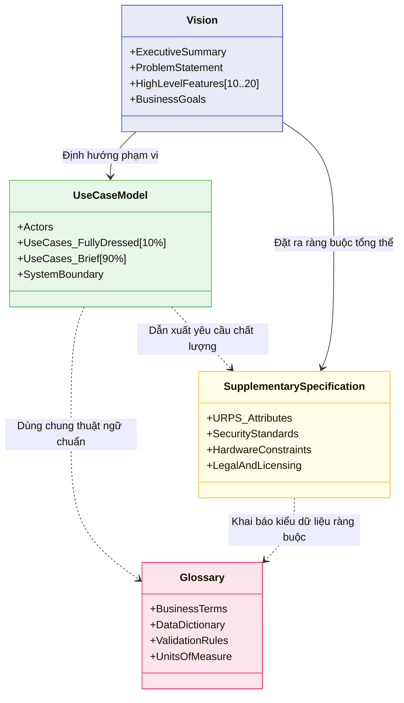

[🏠 Trang Chủ (MOC)](../README.md) | [◄ Chương 06: Use Case Model Writing Requirements in Context](./06_Use_Case_Model_Writing_Requirements_in_Context.md) | [Chương 08: From Inception to Elaboration ►](./08_From_Inception_to_Elaboration.md)

---

## CHƯƠNG 7: IDENTIFYING OTHER REQUIREMENTS

### 1. ĐỀ MỤC & MỤC TIÊU CỐT LÕI (CORE PURPOSE)

#### Hệ thống đề mục (Heading Hierarchy)
* **7.1. NextGen POS Examples: The Non-Use-Case Artifacts** *(Các tạo tác phi ca sử dụng trong NextGen POS)*
* **7.2. NextGen Example: (Partial) Supplementary Specification** *(Đặc tả Bổ sung: Nơi chứa yêu cầu phi chức năng)*
* **7.3. Commentary: Supplementary Specification** *(Bình luận chuyên sâu về Đặc tả Bổ sung)*
* **7.4. NextGen Example: (Partial) Vision** *(Tài liệu Tầm nhìn: Mục tiêu kinh doanh & Khái quát hệ thống)*
* **7.5. Commentary: Vision** *(Bình luận chuyên sâu về Tài liệu Tầm nhìn)*
* **7.6. NextGen Example: A (Partial) Glossary** *(Bảng chú giải: Từ điển dữ liệu nghiệp vụ)*
* **7.7. Commentary: Glossary (Data Dictionary)** *(Bình luận chuyên sâu về Từ điển Dữ liệu)*
* **7.8. Reliable Specifications: An Oxymoron?** *(Đặc tả hoàn hảo tuyệt đối: Nghịch lý ảo tưởng?)*
* **7.9. Online Artifacts at the Project Website** *(Quản lý tài liệu sống động trên Project Portal)*
* **7.10. Not Much UML During Inception?** *(Tại sao không có nhiều UML trong pha Inception?)*
* **7.11. Other Requirement Artifacts Within the UP** *(Các tạo tác yêu cầu khác trong UP)*

#### Vấn đề kỹ thuật thực tế & Thảm họa kiến trúc được ngăn chặn
Chương 7 chỉ ra rằng: **Use Case không thể chứa được toàn bộ yêu cầu phần mềm**. Có rất nhiều yêu cầu mang tính bao trùm toàn hệ thống, các ràng buộc kỹ thuật ngầm và định nghĩa dữ liệu chi tiết cần những nơi lưu trữ chuyên biệt.

Nếu không xây dựng bộ ba tài liệu: *Supplementary Specification, Vision, và Glossary*, dự án sẽ đối mặt với các thảm họa:
* **Hội chứng Ám ảnh kiểu dữ liệu nguyên thủy (Primitive Obsession):** Lập trình viên dùng `String` hoặc `float` cho mọi thứ: mã sản phẩm, tiền tệ, số đo cân nặng. Không có một nơi định nghĩa cấu trúc dữ liệu chuẩn mực, dẫn đến việc tính toán sai lệch tiền lẻ do làm tròn số (*Floating-point precision errors*), hoặc nhầm lẫn giữa Kilogram và Pound.
* **Mất phương hướng chiến lược (Strategic Drift):** Nhóm kỹ thuật cắm đầu vào tối ưu những tính năng phức tạp mà khách hàng không cần, trong khi tính năng sống còn mang lại lợi thế cạnh tranh của sản phẩm (nêu trong *Vision*) lại bị bỏ quên.
* **Mâu thuẫn ngữ nghĩa trong đội ngũ (Semantic Babel):** Cùng một từ "Order", người làm kế toán hiểu là "Hóa đơn đã trả", người làm kho hiểu là "Lệnh xuất hàng", người làm UI hiểu là "Giỏ hàng tạm". Kết quả là các module nói chuyện với nhau sai ngữ nghĩa, tạo ra hàng loạt bug logic dữ liệu.

---

### 2. PHÂN TÍCH LÝ THUYẾT & NGUYÊN LÝ CHUYÊN SÂU

```
+-----------------------------------------------------------------------------------------+
|                                UP REQUIREMENTS ARTIFACT ECOSYSTEM                       |
+-----------------------------------------------------------------------------------------+
| [VISION]                   : TẠI SAO LÀM? Mục tiêu kinh doanh, Thị trường, Vấn đề cần   |
|                              giải quyết, Bức tranh tính năng cấp cao (Executive Level). |
+-----------------------------------------------------------------------------------------+
| [USE-CASE MODEL]           : LÀM CÁI GÌ? Các quy trình tương tác hành vi cụ thể giữa    |
|                              Tác nhân và Hệ thống để đạt mục tiêu nghiệp vụ.            |
+-----------------------------------------------------------------------------------------+
| [SUPPLEMENTARY SPEC]       : LÀM TỐT RA SAO? Chứa toàn bộ các yêu cầu phi chức năng     |
|                              (URPS+), Ràng buộc bảo mật, Phần cứng, Pháp lý.            |
+-----------------------------------------------------------------------------------------+
| [GLOSSARY / DATA DICT]     : DỮ LIỆU LÀ GÌ? Thuật ngữ nghiệp vụ, Cấu trúc trường,       |
|                              Quy tắc kiểm tra hợp lệ (Validation), Đơn vị đo lường.      |
+-----------------------------------------------------------------------------------------+
```

#### 2.1. Supplementary Specification (Đặc tả Bổ sung)
* Nơi lưu trữ tất cả các yêu cầu không nằm gọn trong một Use Case riêng biệt.
* Đây là nơi trú ngụ chính của các yếu tố **URPS+** (Usability, Reliability, Performance, Supportability và Constraints).
* Ví dụ: Ràng buộc "Mọi truy cập cơ sở dữ liệu phải được mã hóa chuẩn AES-256", "Hệ thống phải chịu được việc rút nguồn đột ngột mà không bị tham nhũng dữ liệu (*Data Corruption*)".

#### 2.2. Vision (Tài liệu Tầm nhìn)
* Là bản hợp đồng giữa ban lãnh đạo kinh doanh và nhóm kỹ thuật.
* Chứa **Mô tả vấn đề (*Problem Statement*)**: Vấn đề là gì? Ai bị ảnh hưởng? Giải pháp mang lại lợi ích gì?
* Danh sách các **Tính năng hệ thống cấp cao (*High-Level System Features*)**: Bản tóm tắt súc tích (thường khoảng 10-20 gạch đầu dòng) về các năng lực cốt lõi của phần mềm, giúp tất cả các bên có cùng một góc nhìn tổng thể (*Shared Mental Model*).

#### 2.3. Glossary đóng vai trò là Từ điển Dữ liệu (Data Dictionary)
Craig Larman nâng tầm Glossary vượt ra khỏi một bảng chú giải từ vựng thông thường:
* Nó ghi lại **Quy tắc xác thực dữ liệu (*Validation Rules*)**: Ví dụ: Mã UPC phải có 12 chữ số, số tài khoản ngân hàng từ 9-16 ký tự.
* Định nghĩa **Kiểu dữ liệu phức hợp và Đơn vị đo lường**: Tiền tệ bao gồm mệnh giá và loại tiền (USD, VND); Trọng lượng đi kèm đơn vị (g, kg).
* Trong OOD, các định nghĩa trong Glossary sẽ chuyển hóa trực tiếp thành các **Value Objects** cực kỳ mạnh mẽ trong mã nguồn, loại bỏ hoàn toàn các lỗi xử lý dữ liệu nguyên thủy.

---

### 3. MỔ XẺ MÃ NGUỒN HOẶC ĐẶC TẢ THIẾT KẾ (DESIGN / CODE DEEP-DIVE)

Dưới đây là mã nguồn hiện thực hóa định nghĩa nghiệp vụ từ **Glossary / Data Dictionary** thành một **Value Object** bất biến (`Immutable Value Object`) chuẩn mực cho khái niệm Tiền tệ (`Money`) và Mã sản phẩm (`ItemID`), triệt tiêu triệt để bệnh "Ám ảnh kiểu dữ liệu nguyên thủy" (*Primitive Obsession*):

```java
import java.math.BigDecimal;
import java.math.RoundingMode;
import java.util.Currency;

// Hiện thực hóa định nghĩa trong Glossary: Money không chỉ là con số, nó gồm Lượng và Đơn vị tệ
public final class Money {
    private final BigDecimal amount;
    private final Currency currency;

    public Money(double amount, Currency currency) {
        this(BigDecimal.valueOf(amount), currency);
    }

    public Money(BigDecimal amount, Currency currency) {
        // [Glossary Validation]: Làm tròn chuẩn 2 chữ số thập phân cho tài chính
        this.amount = amount.setScale(2, RoundingMode.HALF_EVEN);
        this.currency = currency;
    }

    public Money add(Money other) {
        // [Business Rule]: Không thể cộng 2 loại tiền tệ khác nhau mà không quy đổi
        if (!this.currency.equals(other.currency)) {
            throw new CurrencyMismatchException("Không thể cộng " + this.currency + " với " + other.currency);
        }
        return new Money(this.amount.add(other.amount), this.currency);
    }

    public BigDecimal getAmount() { return amount; }
    public Currency getCurrency() { return currency; }

    @Override
    public boolean equals(Object o) {
        if (this == o) return true;
        if (!(o instanceof Money)) return false;
        Money money = (Money) o;
        return amount.equals(money.amount) && currency.equals(money.currency);
    }
}
```

#### Bảng phân tích kỹ thuật và ý nghĩa thiết kế:

| Dòng code / Đoạn code then chốt | Giải thích kỹ thuật & Ý nghĩa thiết kế kiến trúc |
| :--- | :--- |
| `public final class Money` | **Đối tượng Giá trị Bất biến (Immutable Value Object):** Một khi đối tượng `Money` được tạo ra, trạng thái của nó không bao giờ bị thay đổi. Điều này loại bỏ hoàn toàn lỗi tranh chấp dữ liệu trong môi trường đa luồng (*Thread-safety*). |
| `BigDecimal.valueOf(amount)` | **Triệt tiêu lỗi làm tròn dấu phẩy động:** Tuyệt đối không dùng `float` hay `double` trong phần mềm tài chính vì lỗi sai số nhị phân (ví dụ: `0.1 + 0.2 = 0.30000000000000004`). `BigDecimal` bảo vệ tính toàn vẹn từng xu. |
| `RoundingMode.HALF_EVEN` | **Hiện thực hóa quy tắc ngân hàng (Banker's Rounding):** Làm tròn đến số chẵn gần nhất theo chuẩn kế toán quốc tế ghi trong Supplementary Specification. |
| `if (!this.currency.equals(other.currency))` | **Bảo vệ toàn vẹn nghiệp vụ tại tầng miền:** Không một dòng code nào có thể vô tình cộng 100 USD với 100 VND. Hệ thống sẽ quăng ngoại lệ ngay tại thời điểm thao tác dữ liệu. |

---

### 4. SƠ ĐỒ TRỰC QUAN HÓA (UML MERMAID)

Sơ đồ phân loại các Artifact yêu cầu trong UP và mối quan hệ hữu cơ giữa chúng:



---

### 5. ÁNH XẠ ỨNG DỤNG VÀO DỰ ÁN GAME OOP THỰC CHIẾN

* **Bối cảnh áp dụng:** Thiết kế Glossary & Supplementary Specification cho Game 2.5D Multiplayer (Hệ thống Chỉ số Chiến đấu - Combat Attributes).
* **Thảm họa thực tế nếu thiếu Glossary / Data Dictionary:**
  * Lập trình viên Client tính toán tọa độ theo không gian màn hình (*Screen Pixels: 1920x1080*), trong khi lập trình viên Server tính toán vị trí theo đơn vị mét ảo trong thế giới (*World Space: x, y float*), dẫn đến việc nhân vật chém trúng quái trên màn hình nhưng Server phán định là đánh trượt.
  * Nhầm lẫn giữa sát thương cộng theo số tuyệt đối (*Flat Damage: +50*) và sát thương cộng theo phần trăm (*Percentage Damage: +50%*), tạo ra bug game nhân vật mạnh gấp 1000 lần bình thường làm sập kinh tế game chỉ sau 1 đêm.
* **Ứng dụng từ Chương 7 vào Game:**
  1. *Glossary (Data Dictionary):*
     * Định nghĩa chính xác hệ tọa độ: Toàn bộ logic sử dụng `TileCoord(int x, int y)` và `WorldCoord(float x, float y)`. 1 Tile = đúng 1.0 mét trong thế giới game.
     * Định nghĩa kiểu dữ liệu chỉ số: Tách bạch rõ `FlatModifier` và `PercentModifier`.
  2. *Supplementary Specification:*
     * Quy định cơ chế đồng bộ thời gian (*Tick Synchronization*): Sai số đồng hồ giữa Client và Server không được vượt quá 100ms; nếu vượt quá, Client phải tự động nội suy vị trí (*Interpolate*) chứ không được giật hình (*Snap*).

---

[🏠 Trang Chủ (MOC)](../README.md) | [◄ Chương 06: Use Case Model Writing Requirements in Context](./06_Use_Case_Model_Writing_Requirements_in_Context.md) | [Chương 08: From Inception to Elaboration ►](./08_From_Inception_to_Elaboration.md)
