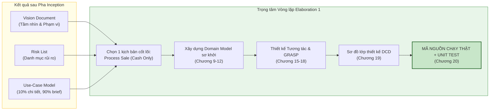

[🏠 Trang Chủ (MOC)](../README.md) | [◄ Chương 07: Identifying Other Requirements](./07_Identifying_Other_Requirements.md) | [Chương 09: Use Case Model Drawing System Sequence Diagrams ►](./09_Use_Case_Model_Drawing_System_Sequence_Diagrams.md)

---

## CHƯƠNG 8: FROM INCEPTION TO ELABORATION

### 1. ĐỀ MỤC & MỤC TIÊU CỐT LÕI (CORE PURPOSE)

#### Hệ thống đề mục (Heading Hierarchy)
* **8.1. Checkpoint: What Happened in Inception?** *(Điểm kiểm soát: Những gì đã đạt được sau Inception)*
* **8.2. On to Elaboration** *(Tiến vào Pha Elaboration)*
* **8.3. Planning the Next Iteration** *(Lập kế hoạch cho Vòng lặp tiếp theo)*
* **8.4. Iteration 1 Requirements and Emphasis: Fundamental OOA/D Skills** *(Yêu cầu và Trọng tâm của Vòng lặp 1: Kỹ năng OOA/D nền tảng)*
* **8.5. What Artifacts May Start in Elaboration?** *(Các tạo tác nào bắt đầu xuất hiện trong Elaboration?)*
  * *Domain Model (Mô hình miền đối tượng)*
  * *Design Model (Mô hình thiết kế: Sơ đồ tương tác và Sơ đồ lớp thiết kế)*
  * *Software Architecture Document - SAD (Tài liệu kiến trúc phần mềm)*
  * *Data Model (Mô hình dữ liệu / Database Schema)*
  * *Test Plan & Automated Test Scripts (Kế hoạch và Mã kiểm thử tự động)*
* **8.6. You Know You Didn't Understand Elaboration When...** *(Dấu hiệu nhận biết việc hiểu sai về Elaboration)*

#### Vấn đề kỹ thuật thực tế & Thảm họa kiến trúc được ngăn chặn
Chương 8 đóng vai trò là cây cầu bản lề kết thúc giai đoạn ý niệm để bước vào thực chiến kỹ thuật. Nó giải quyết nguy cơ **Mất phương hướng khi bước vào vòng lặp đầu tiên (*First Iteration Disorientation*)**.

Nếu không có sự chuyển tiếp chuẩn xác từ Inception sang Elaboration, dự án sẽ gặp các thảm họa:
* **Hội chứng "Cố nuốt trọn chiếc bánh" (Scope Swallowing Failure):** Nhóm cố gắng hiện thực hóa toàn bộ 20 Use Cases trong Vòng lặp 1, dẫn đến việc không có tính năng nào hoàn thành trọn vẹn, mã nguồn dang dở, không build được hệ thống chạy thực tế.
* **Bỏ quên Trục kiến trúc xương sống (Neglecting the Architectural Skeleton):** Dành trọn Vòng lặp 1 để làm những tính năng râu ria dễ làm (như màn hình Đăng ký, trang About Us, chọn Avatar) thay vì tập trung vào nhân kiến trúc có rủi ro kỹ thuật cao nhất (như lõi tính toán bán hàng và cơ chế lưu trữ).
* **Tiếp tục tư duy làm tài liệu trên giấy (Paper Modeling Trap):** Nhóm tưởng rằng bước vào Elaboration là tiếp tục ngồi vẽ hàng trăm trang biểu đồ UML hoàn hảo trước khi được phép gõ phím viết code.

---

### 2. PHÂN TÍCH LÝ THUYẾT & NGUYÊN LÝ CHUYÊN SÂU

```
+-----------------------------------------------------------------------------------------+
|                  SỰ DỊCH CHUYỂN ARTIFACT TỪ INCEPTION SANG ELABORATION                  |
+-----------------------------------------------------------------------------------------+
| ARTIFACT                       INCEPTION (Khởi tạo)        ELABORATION 1 (Thực chiến)   |
+-----------------------------------------------------------------------------------------+
| Use-Case Model                 Khảo sát sơ bộ (~10%)       Đặc tả chi tiết kịch bản lõi |
| Domain Model                   Chưa có hoặc vài ghi chú    Khởi tạo: Tìm khái niệm miền |
| Design Model (UML Diagrams)    Không có                    Bắt buộc: Sequence & DCD     |
| Source Code & Unit Tests       Không có (hoặc spike nhỏ)   Bắt buộc: Khung mã chạy thật |
| Software Architecture Doc      Không có                    Khởi tạo: Định hình phân tầng|
+-----------------------------------------------------------------------------------------+
```

#### 2.1. Cột mốc Checkpoint tại cửa ngõ Elaboration
Trước khi được phép bước vào Elaboration, Kiến trúc sư phải kiểm tra danh sách:
1. Đã có một **Vision** rõ ràng được các bên liên quan đồng thuận?
2. Đã nhận diện được một **Use Case cốt lõi** đại diện cho giá trị nghiệp vụ chính của hệ thống chưa? (Trong NextGen POS, đó là `Process Sale`).
3. Đã xác định được các **Rủi ro kỹ thuật lớn nhất** cần kiểm chứng ngay lập tức chưa?

#### 2.2. Trọng tâm tuyệt đối của Vòng lặp 1 (Iteration 1: Fundamentals)
Craig Larman đưa ra lời khuyên cốt tử: **Trong Vòng lặp 1, hãy chọn một lát cắt dọc (*Vertical Slice*) đơn giản nhưng xuyên suốt toàn bộ hệ thống.**
* Đối với NextGen POS: Không làm toàn bộ Use Case `Process Sale`. Thay vào đó, **chỉ chọn kịch bản thanh toán tiền mặt đơn giản nhất (Cash Only - Happy Path)**.
* Tạm thời bỏ qua: Giảm giá phức tạp, thanh toán thẻ tín dụng, quét mã vạch không hợp lệ, trả hàng.
* Mục tiêu: Xây dựng một đường hầm xuyên suốt (*Tracer Bullet*) từ giao diện $\to$ Controller $\to$ Domain Objects $\to$ Tính tổng hóa đơn $\to$ In kết quả.
* Điều này giúp đội ngũ làm quen và thuần thục toàn bộ chu trình OOA/D: từ Yêu cầu $\to$ Domain Model $\to$ GRASP $\to$ Interaction Diagram $\to$ Design Class Diagram $\to$ Code Java hoàn chỉnh.

#### 2.3. Khởi tạo các Tạo tác Kỹ thuật thực sự (Engineering Artifacts)
Tại Elaboration 1, các công cụ phân tích và thiết kế chuyên nghiệp bắt đầu xuất hiện:
* **Mô hình Miền (Domain Model):** Bản đồ tư duy trực quan hóa các khái niệm thực tế trong thế giới nghiệp vụ (sẽ học sâu ở Chương 9-12).
* **Mô hình Thiết kế (Design Model):** Bản thiết kế phần mềm chi tiết bao gồm Sơ đồ Tương tác (*Interaction Diagrams*) để phân bổ trách nhiệm, và Sơ đồ Lớp Thiết kế (*DCD*) làm kim chỉ nam để viết mã nguồn.
* **Mã nguồn và Kiểm thử tự động:** Không có bản thiết kế nào được coi là hợp lệ nếu nó không được chứng minh bằng mã nguồn biên dịch thành công và vượt qua các bài kiểm thử đơn vị tự động (*JUnit Tests*).

---

### 3. MỔ XẺ MÃ NGUỒN HOẶC ĐẶC TẢ THIẾT KẾ (DESIGN / CODE DEEP-DIVE)

Dưới đây là bản đặc tả **Ma trận Phân bổ Phạm vi Vòng lặp 1 (Iteration 1 Scope Matrix)** và mã nguồn khung gầm kiến trúc đường hầm (**Tracer Bullet Baseline**) được thiết lập ngay tại ngày đầu của Pha Elaboration:

```java
// ================= TRACER BULLET ARCHITECTURAL BASELINE =================
// Kiểm chứng luồng đi xuyên suốt từ Controller xuống Domain trong Iteration 1

public class Iteration1SmokeTest {
    public static void main(String[] args) {
        System.out.println("--- BẮT ĐẦU KIỂM CHỨNG KIẾN TRÚC VÒNG LẶP 1 ---");

        // 1. Khởi tạo danh mục sản phẩm nền tảng
        ProductCatalog catalog = new ProductCatalog();
        catalog.addProductDescription(new ItemID("ITEM-001"), new Money(50.0, Currency.getInstance("USD")), "Bàn phím cơ");

        // 2. Khởi tạo đối tượng điều phối miền (Domain Controller)
        Register register = new Register(catalog);

        // 3. Thực thi kịch bản lát cắt dọc: Tạo đơn hàng -> Nhập hàng -> Kết thúc
        register.makeNewSale();
        register.enterItem(new ItemID("ITEM-001"), 2);
        register.endSale();

        // 4. Thanh toán tiền mặt đơn giản
        register.makePayment(new Money(150.0, Currency.getInstance("USD")));

        // 5. Xác thực tính nhất quán kiến trúc
        Sale completedSale = register.getCurrentSale();
        assert completedSale.getTotal().getAmount().doubleValue() == 100.0 : "Lỗi: Tổng tiền sai!";
        assert completedSale.getBalance().getAmount().doubleValue() == 50.0 : "Lỗi: Tiền thừa sai!";

        System.out.println("--- XÁC THỰC THÀNH CÔNG: KHUNG KIẾN TRÚC ELABORATION 1 SẴN SÀNG ---");
    }
}
```

#### Bảng phân tích kỹ thuật và ý nghĩa thiết kế:

| Dòng code / Đoạn code then chốt | Giải thích kỹ thuật & Ý nghĩa thiết kế kiến trúc |
| :--- | :--- |
| `catalog.addProductDescription(...)` | **Đơn giản hóa có chủ đích cho Iteration 1:** Chưa tích hợp Database thật phức tạp; dùng in-memory catalog giả lập để tập trung 100% năng lượng vào việc thiết kế cấu trúc lớp nghiệp vụ cốt lõi. |
| `Register register = new Register(catalog);` | Hiện thực hóa điểm kết nối giữa thế giới bên ngoài và Tầng Miền qua đối tượng **Controller (GRASP)**. |
| `register.makeNewSale(); ... enterItem(...)` | Kiểm chứng **Đường hầm kiến trúc (Tracer Bullet):** Chứng minh luồng thông điệp có thể đi mượt mà từ các System Operations xuống các thực thể `Sale` và `SalesLineItem`. |
| `assert completedSale.getTotal()...` | **Kiểm thử tự động hóa ngay từ vạch xuất phát:** Thiết lập văn hóa kiểm thử bắt buộc của quy trình UP: Mọi lát cắt kiến trúc của vòng lặp đều phải tự kiểm tra được tính đúng đắn mà không cần dùng mắt thường kiểm tra trên UI. |

---

### 4. SƠ ĐỒ TRỰC QUAN HÓA (UML MERMAID)

Sơ đồ dòng chảy chuyển dịch tạo tác (Artifact Transition Flow) từ Inception sang Elaboration Iteration 1:



---

### 5. ÁNH XẠ ỨNG DỤNG VÀO DỰ ÁN GAME OOP THỰC CHIẾN

* **Bối cảnh áp dụng:** Lập kế hoạch chuyển giao từ Inception sang Vòng lặp Elaboration 1 trong dự án Game 2.5D Online nhiều người chơi.
* **Cạm bẫy kinh điển của các nhóm làm game:**
  * Bước sang Elaboration 1, nhóm đồ họa đòi dựng 5 bộ trang phục lộng lẫy, nhóm âm thanh đòi thu 20 bài nhạc nền, nhóm cốt truyện đòi viết lời thoại cho 30 NPC.
  * Nhóm lập trình viên chia rẽ: một người ngồi viết giao diện shop bán đồ, một người ngồi làm hiệu ứng nổ tung màn hình, một người ngồi viết hệ thống bang hội (*Guild System*). Sau 4 tuần của vòng lặp 1, không ai ghép được code với ai, game không có một màn hình nào chạy được từ đầu đến cuối.
* **Quy tắc Elaboration 1 của Craig Larman áp dụng vào Game:**
  1. *Cắt gọt phạm vi tàn nhẫn (Ruthless De-scoping):* Dẹp bỏ toàn bộ shop, bang hội, cốt truyện, âm thanh, đồ họa đẹp.
  2. *Chọn đúng 1 Lát cắt dọc cốt lõi (Core Vertical Slice):* 
     * Kịch bản duy nhất: **"Người chơi A di chuyển đến gần Bù nhìn (Dummy), bấm phím đánh thường, Bù nhìn nhận sát thương và giảm thanh máu trên mạng"**.
  3. *Tập trung vào OOA/D nền tảng trong Elaboration 1:*
     * Xây dựng Domain Model: `Player`, `Target`, `Weapon`, `Damage`.
     * Phân bổ trách nhiệm qua GRASP: Ai là người tính trừ máu? (Là `Target` tự trừ, hay `DamageCalculator` trừ?).
     * Viết mã C#/C++ kiểm chứng: Dựng một server console và 2 client hình khối chữ nhật đơn giản chạy kết nối socket cục bộ.
  4. *Kết quả:* Sau 2 tuần của Elaboration 1, toàn bộ đường hầm công nghệ (Engine $\to$ Logic Miền $\to$ Đóng gói Packet Mạng $\to$ Server Authority $\to$ Đồng bộ Client) đã thông suốt 100%. Đây chính là nền móng thép để nhóm tự tin đắp thêm hàng trăm tính năng trong các vòng lặp sau.

---

[🏠 Trang Chủ (MOC)](../README.md) | [◄ Chương 07: Identifying Other Requirements](./07_Identifying_Other_Requirements.md) | [Chương 09: Use Case Model Drawing System Sequence Diagrams ►](./09_Use_Case_Model_Drawing_System_Sequence_Diagrams.md)
