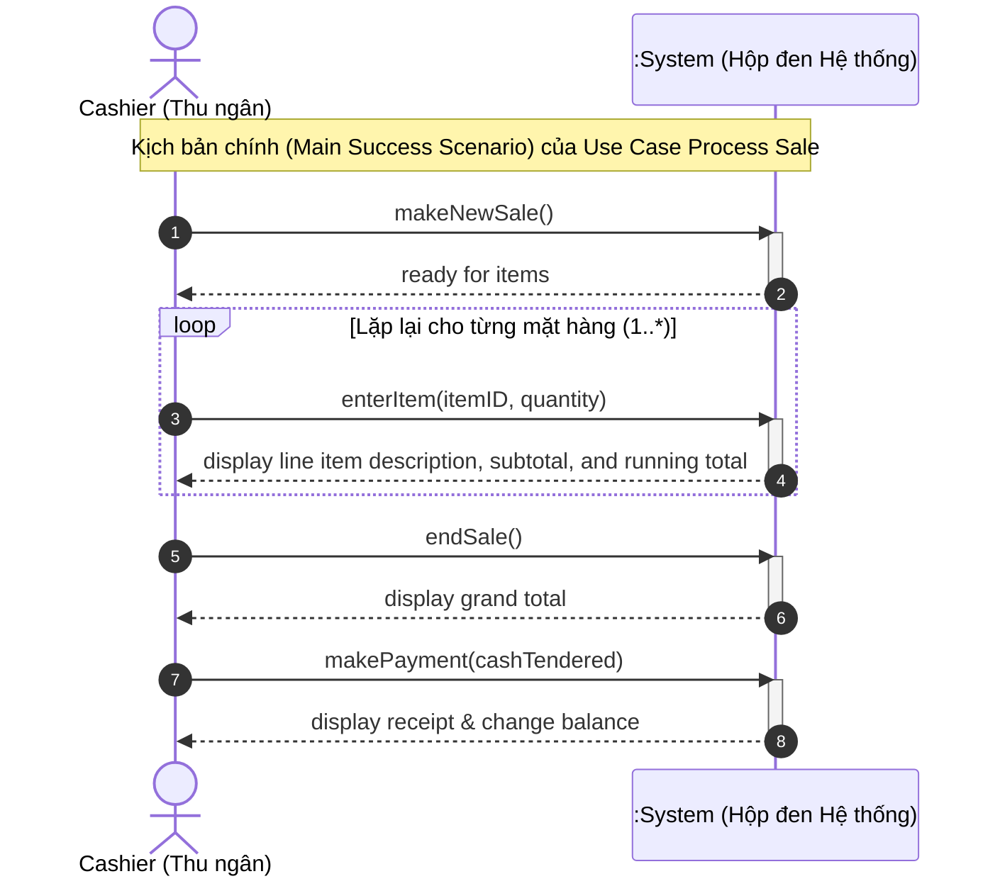

[🏠 Trang Chủ (MOC)](../README.md) | [◄ Chương 08: From Inception to Elaboration](./08_From_Inception_to_Elaboration.md) | [Chương 10: Domain Models Visualizing Concepts ►](./10_Domain_Models_Visualizing_Concepts.md)

---

## CHƯƠNG 9: USE-CASE MODEL: DRAWING SYSTEM SEQUENCE DIAGRAMS (SSDs)

### 1. ĐỀ MỤC & MỤC TIÊU CỐT LÕI (CORE PURPOSE)

#### Hệ thống đề mục (Heading Hierarchy)
* **9.1. System Sequence Diagrams (SSDs)** *(Sơ đồ Tuần tự Hệ thống)*
* **9.2. Motivation: Why Draw an SSD?** *(Động lực: Tại sao cần vẽ SSD?)*
* **9.3. Applying UML: Sequence Diagrams** *(Ứng dụng UML: Sơ đồ tuần tự)*
* **9.4. What Is an SSD?** *(SSD là gì? Mô hình hộp đen của hệ thống)*
* **9.5. SSDs and Use Cases** *(Mối quan hệ giữa SSD và Ca sử dụng)*
* **9.6. System Events and the System Boundary** *(Sự kiện hệ thống và Ranh giới hệ thống)*
* **9.7. Naming System Events and Operations** *(Quy tắc đặt tên Sự kiện và Thao tác hệ thống hướng ý định)*
* **9.8. Showing Use Case Text on SSDs** *(Hiển thị kịch bản ca sử dụng trên SSD)*
* **9.9. SSDs Within the UP** *(SSD trong bối cảnh Quy trình UP)*
* **9.10. UP Artifacts and Process Context** *(Mối liên hệ giữa SSD và các tạo tác khác)*
* **9.11. Further Readings** *(Tài liệu tham khảo)*

#### Vấn đề kỹ thuật thực tế & Thảm họa kiến trúc được ngăn chặn
Chương 9 giải quyết sự nhập nhằng nguy hiểm giữa **Hành vi Hộp đen của Hệ thống (*Black-Box System Behavior*)** và **Thiết kế Đối tượng Nội bộ (*White-Box Internal Object Design*)**.

Nếu một đội ngũ kỹ thuật bỏ qua SSD mà nhảy thẳng vào vẽ sơ đồ tương tác giữa các lớp nội bộ, họ sẽ đối mặt với các thảm họa:
* **Xâm lấn công nghệ giao diện vào API hệ thống (UI-Coupled System Operations):** Đặt tên các thao tác tiếp nhận sự kiện theo hành vi vật lý của phần cứng/UI như `clickBtnEnter()`, `scanBarcode()`, `swipeCreditCard()`. Khi hệ thống chuyển sang giao diện Web, Mobile, hoặc tự động hóa qua AI, toàn bộ tầng điều phối nghiệp vụ bị sụp đổ vì phụ thuộc vào cách thức nhập liệu cũ.
* **Mất kiểm soát giao diện biên (System Boundary Leakage):** Không định hình được ranh giới: Dữ liệu nào thực sự đi vào hệ thống và dữ liệu nào là kết quả trả ra. Hậu quả là tầng UI gửi bừa bãi các đối tượng giao diện thô vào tầng miền, gây dính chặt (*Tight Coupling*) giữa Tầng Trình diễn và Tầng Nghiệp vụ.
* **Thiếu vắng hợp đồng thao tác (Missing Operation Signatures):** Các lập trình viên backend không biết chính xác Controller của hệ thống cần cung cấp các hàm (methods) gì cho tầng Frontend/Client gọi, dẫn đến việc thiết kế API chắp vá, bất nhất và thiếu tham số đầu vào cần thiết.

---

### 2. PHÂN TÍCH LÝ THUYẾT & NGUYÊN LÝ CHUYÊN SÂU

```
+-----------------------------------------------------------------------------------------+
|                                    SYSTEM SEQUENCE DIAGRAM                              |
+-----------------------------------------------------------------------------------------+
|  ACTOR (External)                          SYSTEM BOUNDARY                  :System     |
|         |                                         |                            |        |
|         |--- 1. makeNewSale() ------------------->|===========================>|        |
|         |                                         |   (System Event)           |        |
|         |                                         |                            |        |
|         |--- 2. enterItem(itemID, quantity) ----->|===========================>|        |
|         |<-- display item description & total ----|----------------------------|        |
|         |                                         |   (System Response)        |        |
|         |                                         |                            |        |
|         |--- 3. endSale() ----------------------->|===========================>|        |
|         |<-- display grand total -----------------|----------------------------|        |
|         |                                         |                            |        |
|         |--- 4. makePayment(amount) ------------->|===========================>|        |
|         |<-- display receipt & change ------------|----------------------------|        |
+-----------------------------------------------------------------------------------------+
```

#### 2.1. Bản chất của SSD: Góc nhìn Hộp đen (The Black-Box View)
* SSD là một dạng **Sơ đồ Tuần tự UML (*UML Sequence Diagram*)**, nhưng được áp dụng ở cấp độ phân tích hệ thống.
* Trong SSD, toàn bộ hệ thống phần mềm được xem như một thực thể duy nhất: **Hộp đen `:System`**. Ta cố tình che giấu toàn bộ cấu trúc nội bộ (không có các đối tượng `Sale`, `Register`, `Database` bên trong SSD).
* SSD chỉ mô tả 2 thứ:
  1. **Sự kiện hệ thống (*System Events*):** Các thông điệp do Tác nhân bên ngoài (*Actor*) gửi vào `:System`.
  2. **Phản hồi của hệ thống (*System Responses*):** Dữ liệu hoặc thông báo mà `:System` trả về cho Actor.

#### 2.2. Sự kiện hệ thống và Thao tác hệ thống (System Events & System Operations)
* **System Event (Sự kiện hệ thống):** Một sự kiện kích hoạt từ bên ngoài vượt qua ranh giới hệ thống (ví dụ: Thu ngân thông báo có một mặt hàng vừa được chọn).
* **System Operation (Thao tác hệ thống):** Thao tác mà `:System` phải thực thi để đáp ứng sự kiện đó. Tập hợp tất cả các System Operations trong các SSD sẽ định nghĩa nên **Giao diện công khai (*Public Interface / Facade*)** của toàn bộ hệ thống.
* Đây chính là nguồn gốc trực tiếp để Kiến trúc sư xác định các phương thức của lớp **Controller (GRASP)** trong giai đoạn thiết kế hướng đối tượng tiếp theo.

#### 2.3. Nguyên tắc đặt tên Hướng Ý định (Intent-Based Naming)
Craig Larman đưa ra quy tắc vàng: **Đặt tên Thao tác Hệ thống ở mức độ trừu tượng diễn đạt Ý định (*Intent*), thay vì thao tác vật lý (*Physical Action*)**.
* **SAI (Thao tác vật lý/UI):** `scanBarcode()`, `pressEnterKey()`, `swipeCard()`.
* **ĐÚNG (Ý định nghiệp vụ):** `enterItem(id, quantity)`, `makePayment(amount)`.
* **Lý do kiến trúc:** Ý định "nhập một mặt hàng vào hóa đơn" là bất biến trong nghiệp vụ bán lẻ. Dù hôm nay thu ngân dùng máy quét mã vạch laser, ngày mai khách dùng điện thoại quét mã QR, hay ngày kia dùng cổng RFID tự động, sự kiện hệ thống vẫn luôn là `enterItem(id, quantity)`.

---

### 3. MỔ XẺ MÃ NGUỒN HOẶC ĐẶC TẢ THIẾT KẾ (DESIGN / CODE DEEP-DIVE)

Từ Sơ đồ Tuần tự Hệ thống (SSD) của ca sử dụng `Process Sale`, Kiến trúc sư chuyển hóa trực tiếp thành **Hợp đồng Giao diện Thao tác Hệ thống (*System Operations Contract Interface*)** làm ranh giới tách biệt giữa tầng Giao diện (UI) và tầng Miền (Domain):

```java
// ==================== SYSTEM OPERATIONS CONTRACT INTERFACE ====================
// Sinh ra trực tiếp từ các mũi tên System Events trong SSD của ca sử dụng Process Sale

public interface IProcessSaleSystemOperations {

    /**
     * Tương ứng với System Event 1: makeNewSale()
     * Tiền điều kiện: Không có phiên bán hàng nào đang dang dở trên quầy này.
     * Hậu điều kiện: Một phiên bán hàng mới (Sale) được khởi tạo.
     */
    void makeNewSale();

    /**
     * Tương ứng với System Event 2: enterItem(itemID, quantity)
     * Thao tác lặp: Thêm mặt hàng vào hóa đơn hiện tại.
     * @param itemID Mã nhận dạng sản phẩm (Value Object)
     * @param quantity Số lượng mua (phải > 0)
     * @return DTO chứa thông tin mô tả mặt hàng vừa nhập và tổng tiền tạm tính
     */
    LineItemDTO enterItem(ItemID itemID, int quantity);

    /**
     * Tương ứng với System Event 3: endSale()
     * Đánh dấu kết thúc việc nhập hàng và chốt danh sách.
     * @return Tổng số tiền cuối cùng phải thanh toán (Grand Total)
     */
    Money endSale();

    /**
     * Tương ứng với System Event 4: makePayment(amount)
     * Ghi nhận thanh toán tiền mặt và hoàn tất hóa đơn.
     * @param cashTendered Số tiền khách đưa
     * @return Biên lai giao dịch (Receipt DTO) chứa chi tiết thanh toán và tiền thừa
     */
    ReceiptDTO makePayment(Money cashTendered);
}
```

#### Bảng phân tích kỹ thuật và ý nghĩa thiết kế:

| Phương thức / Tham số trong Hợp đồng | Giải thích kỹ thuật & Ý nghĩa thiết kế kiến trúc |
| :--- | :--- |
| `void makeNewSale()` | Ánh xạ trực tiếp từ sự kiện bắt đầu giao dịch trong SSD. Thiết lập trạng thái ranh giới, bảo đảm nguyên tắc đóng gói của giao dịch. |
| `ItemID itemID, int quantity` | **Tham số kiểu dữ liệu chuẩn mực:** Không truyền `String itemId` thô; sử dụng Value Object `ItemID` để đảm bảo kiểm tra hợp lệ ngay tại cổng ranh giới hệ thống (*System Boundary Invariant*). |
| `LineItemDTO enterItem(...)` | **Dùng Data Transfer Object (DTO) cho dữ liệu trả về:** `:System` trả về DTO thuần dữ liệu cho tầng UI hiển thị, tuyệt đối không trả về đối tượng miền `Sale` hay `SalesLineItem` thật để chống rò rỉ trạng thái (*Information Leaking*). |
| `Money endSale()` | Chốt trạng thái giao dịch: Chuyển hóa trạng thái nội bộ của `Sale` từ *Đang nhập hàng (In-Progress)* sang *Chờ thanh toán (Awaiting-Payment)*. |
| `ReceiptDTO makePayment(...)` | Hoàn tất giao dịch: Đảm bảo nguyên lý giao dịch nguyên tử (*Atomic Operation*). Biên lai DTO chứa đầy đủ dữ liệu bất biến (*Immutable*) chứng minh giao dịch thành công. |

---

### 4. SƠ ĐỒ TRỰC QUAN HÓA (UML MERMAID)

Sơ đồ Tuần tự Hệ thống (SSD) chuẩn mực cho kịch bản chính của Use Case `Process Sale`:



---

### 5. ÁNH XẠ ỨNG DỤNG VÀO DỰ ÁN GAME OOP THỰC CHIẾN

* **Bối cảnh áp dụng:** Thiết kế Giao thức Sự kiện Mạng (Network RPC Protocol / Packet Contracts) trong Game 2.5D Multiplayer giữa Client và Server.
* **Thảm họa nếu thiếu tư duy SSD:** 
  Lập trình viên Client tự tiện tính toán: Nhân vật A đánh quái vật B, Client tự tính sát thương trừ đi 500 máu của quái, rồi gửi packet mạng lên máy chủ: `SetMonsterHP(monsterID, currentHP - 500)`. 
  $\to$ **Lỗ hổng gian lận chí mạng (Hacking/Cheating Disaster):** Bất kỳ hacker nào dùng phần mềm can thiệp gói tin (WPE Pro/Cheat Engine) cũng có thể gửi lệnh `SetMonsterHP(bossID, 0)` để tiêu diệt Boss trong 1 giây!
* **Ứng dụng mô hình SSD từ Chương 9:**
  1. *Xác lập Ranh giới Hộp đen (:GameServer):* Client đóng vai trò là External Actor; toàn bộ máy chủ là `:GameServer`. Client **tuyệt đối không được ra lệnh thay đổi trạng thái nội bộ của Server**.
  2. *System Operation duy nhất:* Thay vì gửi kết quả, Client chỉ được phép gửi một System Event thể hiện **Ý định hành động**:
     ```
     RequestCastSkill(skillID: int, targetEntityID: long, clientTimestamp: long)
     ```
  3. *Phản hồi của Hệ thống (System Response):* `:GameServer` tiếp nhận sự kiện, tự kiểm tra tầm đánh, thời gian hồi chiêu (*Cooldown*), tự tính toán công thức trừ máu, và phát sóng sự kiện kết quả (*Broadcast Result Event*) về lại cho tất cả các Client:
     ```
     SkillExecutedBroadcast(casterID, targetID, damageDealt, remainingHP, isCrit)
     ```

---

[🏠 Trang Chủ (MOC)](../README.md) | [◄ Chương 08: From Inception to Elaboration](./08_From_Inception_to_Elaboration.md) | [Chương 10: Domain Models Visualizing Concepts ►](./10_Domain_Models_Visualizing_Concepts.md)
