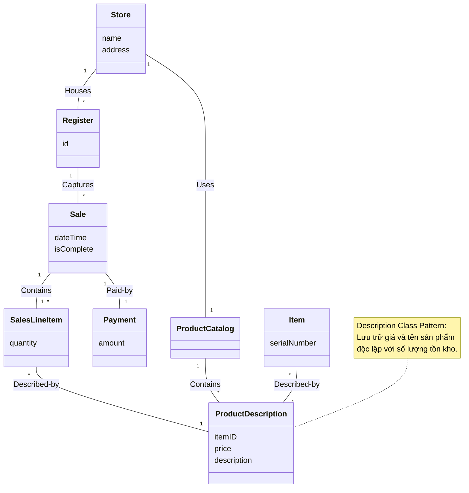

[🏠 Trang Chủ (MOC)](../README.md) | [◄ Chương 09: Use Case Model Drawing System Sequence Diagrams](./09_Use_Case_Model_Drawing_System_Sequence_Diagrams.md) | [Chương 11: Domain Model Adding Associations ►](./11_Domain_Model_Adding_Associations.md)

---

## CHƯƠNG 10: DOMAIN MODELS: VISUALIZING CONCEPTS

### 1. ĐỀ MỤC & MỤC TIÊU CỐT LÕI (CORE PURPOSE)

#### Hệ thống đề mục (Heading Hierarchy)
* **10.1. Domain Models: Visualizing Concepts** *(Mô hình Miền: Trực quan hóa các khái niệm)*
* **10.2. Conceptual Classes** *(Lớp khái niệm: Biểu tượng, Nội hàm và Ngoại diên)*
* **10.3. Domain Models Are Not Models of Software Objects** *(Mô hình Miền không phải là mô hình của các đối tượng phần mềm)*
* **10.4. Why Call Them "Domain Models"?** *(Tại sao gọi là Mô hình Miền?)*
* **10.5. Why Create a Domain Model? The Lower Representational Gap (LRG)** *(Tại sao cần tạo Mô hình Miền? Thu hẹp khoảng cách biểu diễn)*
* **10.6. How to Create a Domain Model** *(Quy trình 3 bước xây dựng Mô hình Miền)*
* **10.7. Three Strategies to Find Conceptual Classes** *(Ba chiến lược tìm kiếm lớp khái niệm)*
  * *Reusing existing models (Tái sử dụng mô hình có sẵn)*
  * *Using a Category List (Sử dụng danh mục phân loại)*
  * *Linguistic Noun Phrase Analysis (Phân tích ngữ pháp danh từ)*
* **10.8. Common Mistake: Representing Something as an Attribute Instead of a Concept** *(Sai lầm phổ biến: Biểu diễn một Khái niệm thành một Thuộc tính)*
* **10.9. Description or Specification Conceptual Classes** *(Mẫu hình Lớp mô tả / Đặc tả - Description Class Pattern)*
* **10.10. Example: The NextGen POS Domain Model** *(Ví dụ: Mô hình Miền cho hệ thống NextGen POS)*
* **10.11. Domain Models Within the UP** *(Mô hình Miền trong bối cảnh Quy trình UP)*
* **10.12. Further Readings** *(Tài liệu tham khảo)*

#### Vấn đề kỹ thuật thực tế & Thảm họa kiến trúc được ngăn chặn
Chương 10 giải quyết sai lầm kinh điển của lập trình viên: **Sáng tác ra cấu trúc lớp phần mềm một cách tùy tiện mà không có sự tương đồng với thế giới thực**, hoặc **Cài cắm chi tiết kỹ thuật phần mềm quá sớm vào mô hình nghiệp vụ**.

Nếu không xây dựng Domain Model chuẩn mực, hệ thống sẽ hứng chịu các thảm họa:
* **Khoảng cách biểu diễn khổng lồ (Huge Representational Gap):** Các lớp trong mã nguồn mang tên quái dị (`ProcessManagerHelper`, `DataHolderBean`, `GenericTransactionWorker`) không tương thích với ngôn ngữ của chuyên gia nghiệp vụ. Mỗi khi có thay đổi chính sách kinh doanh, đội ngũ kỹ thuật mất nhiều tuần chỉ để tìm xem đoạn logic đó nằm ở đâu trong hàng nghìn file code.
* **Thảm họa "Hết hàng xóa luôn giá" (The Missing Description Class Disaster):** Lưu trữ thuộc tính `price` và `description` trực tiếp vào đối tượng mặt hàng vật lý `Item`. Khi toàn bộ các sản phẩm thực tế của một mã hàng bị bán hết sạch (xóa hết các thể hiện `Item`), hệ thống mất luôn thông tin giá bán và tên sản phẩm, khiến khách hàng tiếp theo không thể tra cứu giá của sản phẩm đó.
* **Ô nhiễm tư duy phần mềm (Premature Software Contamination):** Vẽ phương thức (`methods`), cơ sở dữ liệu (`database tables`), khóa ngoại (`foreign keys`) vào Domain Model, làm méo mó bản chất thuần khiết của mô hình khái niệm.

---

### 2. PHÂN TÍCH LÝ THUYẾT & NGUYÊN LÝ CHUYÊN SÂU

```
+-----------------------------------------------------------------------------------------+
|                                 LOWER REPRESENTATIONAL GAP (LRG)                        |
+-----------------------------------------------------------------------------------------+
| REAL-WORLD DOMAIN      :   [Sale]  ------------ records-sale-of ----------->  [Item]    |
| (Thế giới thực)                  \                                           /          |
|                                   \ (Ánh xạ trực tiếp 1 - 1, khoảng cách hẹp)           |
|                                    v                                       v            |
| SOFTWARE DOMAIN CODE   :   class Sale {                                class Item {     |
| (Mã nguồn phần mềm)            private List<SalesLineItem> items;          ...          |
|                            }                                           }                |
+-----------------------------------------------------------------------------------------+
```

#### 2.1. Bản chất của Mô hình Miền (The Domain Model)
* Mô hình Miền là một **Từ điển Trực quan (*Visual Dictionary*)** thể hiện các trừu tượng hóa của thế giới thực trong miền bài toán. Nó bao gồm:
  1. Các **Lớp khái niệm (*Conceptual Classes / Domain Objects*)**.
  2. Các **Mối quan hệ (*Associations*)** giữa các khái niệm.
  3. Các **Thuộc tính (*Attributes*)** của các khái niệm.
* **QUY TẮC BẤT DI BẤT DỊCH:** **Domain Model TUYỆT ĐỐI KHÔNG CÓ PHƯƠNG THỨC (NO METHODS)!** Nếu bạn thấy một biểu đồ có các hàm như `calculateTotal()` hay `saveToDB()`, đó là Sơ đồ Thiết kế Lớp Phần mềm (*Design Class Diagram*), không phải là Domain Model.

#### 2.2. Lợi ích tối thượng: Thu hẹp khoảng cách biểu diễn (Lower Representational Gap - LRG)
* Giữa tư duy con người về thế giới thực (*Mental Model*) và mã nguồn phần mềm (*Software Model*) luôn có một khoảng cách biểu diễn.
* Hướng đối tượng mang lại sức mạnh vĩ đại nhất khi nó làm cho **khoảng cách này trở nên cực nhỏ (LRG)**: Nếu người bán hàng nói về `Sale`, `Register`, `Store`, `Payment`, thì trong mã nguồn của bạn cũng xuất hiện chính xác các class mang tên `Sale`, `Register`, `Store`, `Payment`. Điều này giúp việc bảo trì, tái cấu trúc và mở rộng hệ thống đạt độ trực quan tối đa.

#### 2.3. Ba chiến lược tìm kiếm Lớp khái niệm
1. **Tái sử dụng mô hình có sẵn:** Tận dụng các mô hình miền chuẩn đã được kiểm chứng trong ngành (ví dụ: mô hình bán lẻ, ngân hàng, vận tải).
2. **Sử dụng Danh mục Phân loại (*Category List*):**
   * *Giao dịch nghiệp vụ (*Business Transactions*):* `Sale`, `Payment`, `Reservation`.
   * *Dòng hàng giao dịch (*Transaction Line Items*):* `SalesLineItem`.
   * *Sản phẩm/Dịch vụ liên quan (*Product/Service*):* `Item`, `ProductDescription`.
   * *Nơi ghi nhận giao dịch (*Places of Transaction*):* `Register`, `Store`.
   * *Vai trò con người (*Roles*):* `Cashier`, `Customer`, `Manager`.
   * *Vật chứa (*Containers*):* `Store`, `Warehouse`.
   * *Danh mục (*Catalogs*):* `ProductCatalog`.
3. **Phân tích Ngữ pháp Danh từ (*Linguistic Noun Phrase Analysis*):** Đọc kỹ Use Case, gạch chân tất cả các danh từ và cụm danh từ. Danh từ có thể là một Lớp khái niệm hoặc một Thuộc tính.

#### 2.4. Mẫu hình Lớp mô tả (Description / Specification Class Pattern)
Craig Larman nhấn mạnh mẫu hình cốt lõi này để giải quyết bài toán tách biệt thực thể:
* **Vấn đề:** Khi nào cần tạo một lớp `ProductDescription` thay vì chỉ dùng một lớp `Item`?
* **Giải pháp:** Cần tạo một lớp mô tả riêng khi:
  1. Cần lưu trữ thông tin về một mặt hàng/dịch vụ **độc lập với việc có mặt hàng vật lý đó trong kho hay không**.
  2. Việc xóa các cá thể mặt hàng vật lý không được phép làm mất thông tin mô tả và giá của sản phẩm.
  3. Tránh việc nhân bản lãng phí dữ liệu (1.000 chai nước ngọt cùng loại trong kho không nên lặp lại chuỗi text "Nước ngọt Coca 330ml" và giá 10.000đ 1.000 lần trong bộ nhớ).

---

### 3. MỔ XẺ MÃ NGUỒN HOẶC ĐẶC TẢ THIẾT KẾ (DESIGN / CODE DEEP-DIVE)

Dưới đây là bảng phân tích ngữ pháp trích xuất thực tế từ kịch bản Use Case `Process Sale` sang các Lớp Khái niệm trong Domain Model, giải quyết chuẩn mực ranh giới giữa **Lớp Khái niệm (*Class*)** và **Thuộc tính (*Attribute*)**:

| Cụm từ trích xuất từ Use Case | Phân loại trong Domain Model | Giải thích kỹ thuật & Lý do phân loại |
| :--- | :--- | :--- |
| *Cashier (Thu ngân)* | **Conceptual Class (Role)** | Đại diện cho tác nhân con người thực hiện giao dịch, có trách nhiệm và định danh riêng. |
| *Register (Quầy/Máy thu ngân)* | **Conceptual Class (Place/Device)** | Nơi diễn ra sự kiện giao dịch, điều phối luồng bán hàng. |
| *Sale (Giao dịch bán hàng)* | **Conceptual Class (Transaction)** | Trái tim của bài toán; lưu giữ thời gian, trạng thái và tổng tiền. |
| *SalesLineItem (Dòng hàng)* | **Conceptual Class (Line Item)** | Cực kỳ quan trọng: Đại diện cho một dòng trong hóa đơn (số lượng mua của một mặt hàng cụ thể). |
| *ProductDescription (Mô tả SP)* | **Conceptual Class (Description)** | Áp dụng *Description Class Pattern*: Lưu trữ `price`, `description`, `itemID` độc lập với hàng tồn kho. |
| *Item (Mặt hàng cụ thể)* | **Conceptual Class (Physical Object)** | Đại diện cho một vật thể vật lý thực tế có số sê-ri xác định nằm trên kệ hàng. |
| *Total, Price, Quantity* | **Attributes (Thuộc tính)** | Không độc lập; là các giá trị dữ liệu thuần túy thuộc về `Sale`, `ProductDescription`, `SalesLineItem`. |

#### Đoạn mã Cấu trúc minh họa Mẫu hình Description Class:

```java
// ==================== DESCRIPTION CLASS PATTERN ====================
// Tách biệt thông tin mô tả tĩnh (Description) khỏi cá thể vật lý (Physical Item)

public class ProductDescription {
    private ItemID id;
    private Money price;
    private String description;

    public ProductDescription(ItemID id, Money price, String description) {
        this.id = id;
        this.price = price;
        this.description = description;
    }

    public ItemID getId() { return id; }
    public Money getPrice() { return price; }
    public String getDescription() { return description; }
}

public class Item {
    private SerialNumber serialNumber; // Định danh vật lý duy nhất của từng cá thể
    private ProductDescription description; // Tham chiếu tới lớp mô tả dùng chung

    public Item(SerialNumber serialNumber, ProductDescription description) {
        this.serialNumber = serialNumber;
        this.description = description;
    }

    public SerialNumber getSerialNumber() { return serialNumber; }
    public ProductDescription getDescription() { return description; }
}
```

#### Bảng phân tích kỹ thuật và ý nghĩa thiết kế:

| Dòng code / Đoạn code then chốt | Giải thích kỹ thuật & Ý nghĩa thiết kế kiến trúc |
| :--- | :--- |
| `public class ProductDescription` | Hiện thực hóa **Description Class Pattern**: Tách toàn bộ thông tin giá bán và tên gọi khỏi đối tượng vật lý. Nếu kho hết hàng (`Item` bị xóa sạch), `ProductDescription` vẫn tồn tại nguyên vẹn trong `ProductCatalog`. |
| `private ProductDescription description;` | Mối liên kết từ cá thể thực tế về lớp mô tả dùng chung: Hàng ngàn đối tượng `Item` chỉ giữ một con trỏ tham chiếu nhẹ tới một phiên bản `ProductDescription` duy nhất, tiết kiệm 90% bộ nhớ RAM (*Flyweight-like memory efficiency*). |
| `private SerialNumber serialNumber;` | Cá thể vật lý chỉ chịu trách nhiệm quản lý định danh vật lý duy nhất của chính nó (mã vạch sê-ri máy, hạn sử dụng riêng của từng hộp sữa). |

---

### 4. SƠ ĐỒ TRỰC QUAN HÓA (UML MERMAID)

Sơ đồ Lớp Khái niệm (Domain Model) ban đầu của Hệ thống NextGen POS thể hiện rõ các khái niệm cốt lõi và mẫu hình Description Class (Lưu ý: Không chứa bất kỳ phương thức nào!):



---

### 5. ÁNH XẠ ỨNG DỤNG VÀO DỰ ÁN GAME OOP THỰC CHIẾN

* **Bối cảnh áp dụng:** Thiết kế Hệ thống Vật phẩm & Kho đồ (*Inventory System*) trong Game 2.5D Multiplayer.
* **Thảm họa nếu vi phạm nguyên lý Description Class:**
  Lập trình viên tạo class `Item` chứa tất cả: `itemName`, `iconPath`, `baseDamage`, `loreText`, `durability`, `currentAmmo`.
  $\to$ **Thảm họa Tràn RAM Máy chủ (*Server Memory Out-of-Memory*):** Khi máy chủ có 100.000 người chơi đồng thời, mỗi người có 100 món đồ trong túi $\to$ Máy chủ phải cấp phát 10 triệu đối tượng `Item`. Chuỗi text mô tả thanh kiếm ("Thanh kiếm huyền thoại được rèn từ ngọn lửa rồng thiêng...") bị sao chép lặp lại 10 triệu lần trong RAM, ngốn hàng chục Gigabyte vô ích!
* **Ứng dụng Mô hình Miền từ Chương 10:**
  1. *ItemData / ItemTemplate (Description Class):* Là đối tượng bất biến (dùng ScriptableObject trong Unity hoặc Flyweight C++). Chứa: `ItemID`, `Name`, `BaseDamage`, `IconAssetReference`, `LoreText`. Toàn bộ máy chủ chỉ nạp đúng 1 phiên bản duy nhất vào RAM khi khởi động.
  2. *ItemInstance (Physical Item Concept):* Đại diện cho món đồ cụ thể nằm trong túi người chơi. Nó **chỉ chứa dữ liệu biến động**: `InstanceID` (UUID), `CurrentDurability` (Độ bền hiện tại: 85/100), `UpgradeLevel` (+7), và một con trỏ tham chiếu tới `ItemData`.
  3. *Lợi ích tối thượng:* Tiết kiệm 95% RAM máy chủ, đồng bộ gói tin mạng siêu nhẹ (chỉ cần gửi `ItemID` và `Durability` thay vì gửi toàn bộ text mô tả qua mạng).

---

[🏠 Trang Chủ (MOC)](../README.md) | [◄ Chương 09: Use Case Model Drawing System Sequence Diagrams](./09_Use_Case_Model_Drawing_System_Sequence_Diagrams.md) | [Chương 11: Domain Model Adding Associations ►](./11_Domain_Model_Adding_Associations.md)
