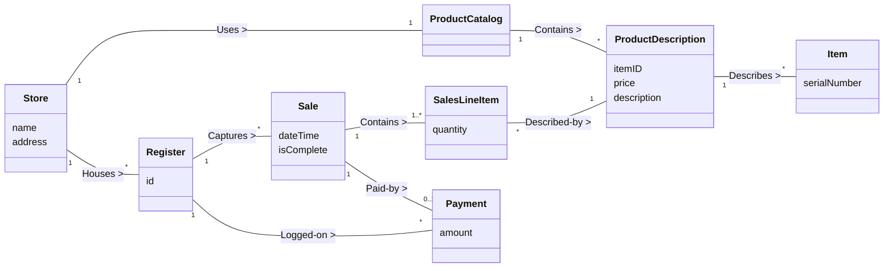

[🏠 Trang Chủ (MOC)](../README.md) | [◄ Chương 10: Domain Models Visualizing Concepts](./10_Domain_Models_Visualizing_Concepts.md) | [Chương 12: Domain Model Adding Attributes ►](./12_Domain_Model_Adding_Attributes.md)

---

## CHƯƠNG 11: DOMAIN MODEL: ADDING ASSOCIATIONS

### 1. ĐỀ MỤC & MỤC TIÊU CỐT LÕI (CORE PURPOSE)

#### Hệ thống đề mục (Heading Hierarchy)
* **11.1. Associations** *(Mối quan hệ kết hợp trong Mô hình Miền)*
* **11.2. The UML Association Notation** *(Ký hiệu quan hệ kết hợp trong UML: Đường nối, Tên, Mũi tên hướng đọc)*
* **11.3. Multiplicity** *(Bản số / Bội số: Ý nghĩa và các ràng buộc số lượng)*
* **11.4. Finding Associations - Common Associations List** *(Phương pháp tìm kiếm: Danh mục các quan hệ phổ biến)*
* **11.5. Association Guidelines: The Need-to-Know Principle** *(Nguyên tắc cốt tử: Chỉ đưa vào những liên kết "Cần-phải-biết")*
* **11.6. Roles** *(Tên vai trò ở các đầu mối liên kết)*
* **11.7. How Detailed Should Associations Be?** *(Mức độ chi tiết cần thiết của quan hệ)*
* **11.8. Naming Associations** *(Quy ước đặt tên quan hệ động từ / ngữ động từ)*
* **11.9. Multiple Associations Between Two Types** *(Đa quan hệ giữa hai lớp khái niệm)*
* **11.10. Associations and Implementation** *(Mối liên hệ giữa Association khái niệm và Hiện thực mã nguồn)*
* **11.11. NextGen POS Domain Model Associations** *(Xác định các quan hệ trong NextGen POS)*
* **11.12. NextGen POS Domain Model with Associations** *(Mô hình Miền hoàn chỉnh có quan hệ)*

#### Vấn đề kỹ thuật thực tế & Thảm họa kiến trúc được ngăn chặn
Chương 11 giải quyết thảm họa **Biểu đồ mạng nhện (*Spaghetti Association Diagram*)** và **Mơ hồ về ràng buộc số lượng phần tử (*Multiplicity Ambiguity*)**.

Nếu một đội ngũ thiết kế liên kết quan hệ sai lầm, họ sẽ đối mặt với các thảm họa:
* **Hội chứng "Nối tất cả với tất cả" (Over-Association Hell):** Vẽ đường liên kết giữa mọi lớp có thể nghĩ ra (ví dụ: nối `Cashier` với `Item`, nối `Customer` với `Register`), khiến mô hình miền trở thành một mớ dây nhợ rối rắm, che khuất hoàn toàn các luồng dữ liệu nghiệp vụ trọng tâm.
* **Khai báo sai cấu trúc dữ liệu trong Code (Data Structure Mismatch):** Không làm rõ Multiplicity dẫn đến việc lập trình viên dùng một biến đơn lẻ `private SalesLineItem item;` trong khi thực tế hóa đơn cần chứa nhiều dòng hàng (`1..*`), gây lỗi ghi đè dữ liệu hoặc crash chương trình.
* **Nhầm lẫn giữa Quan hệ khái niệm và Con trỏ bộ nhớ (Conceptual vs Memory Pointer Confusion):** Nghĩ rằng hễ vẽ một đường nối Association thì bắt buộc trong mã nguồn class A phải chứa biến con trỏ trỏ sang class B, làm mất đi sự tự do trong việc tối ưu hóa cấu trúc dữ liệu ở bước thiết kế phần mềm.

---

### 2. PHÂN TÍCH LÝ THUYẾT & NGUYÊN LÝ CHUYÊN SÂU

```
+-----------------------------------------------------------------------------------------+
|                                  UML ASSOCIATION ANATOMY                                |
+-----------------------------------------------------------------------------------------+
|                reading direction arrow (mũi tên hướng đọc)                              |
|                                     |                                                   |
|                                     v                                                   |
|   +--------------+             Paid-by >             +--------------+                   |
|   |     Sale     | 1 ----------------------------- 1 |   Payment    |                   |
|   +--------------+                                   +--------------+                   |
|                  ^                                   ^                                  |
|                  |                                   |                                  |
|            multiplicity                        multiplicity                             |
|          (1 đơn bán hàng)                   (1 lượt thanh toán)                         |
+-----------------------------------------------------------------------------------------+
```

#### 2.1. Bản chất của Association trong Mô hình Miền
* Association là một mối quan hệ ngữ nghĩa phản ánh **sự kết nối có ý nghĩa và cần ghi nhớ lâu dài** giữa các lớp khái niệm trong thế giới thực.
* Association **KHÔNG PHẢI là phát biểu về luồng dữ liệu, không phải là con trỏ phần mềm, không phải là câu lệnh truy vấn SQL**. Nó thuần túy là một phát biểu về tri thức ngữ nghĩa của nghiệp vụ (*Semantic Knowledge*).

#### 2.2. Nguyên tắc cốt tử: "Cần-phải-biết" (The Need-to-Know Principle)
Craig Larman đưa ra nguyên tắc sinh tử để tránh mô hình hóa rác:
* **Chỉ thêm một Association nếu hệ thống thực sự cần ghi nhớ mối liên kết này trong một khoảng thời gian dài (*Long-term Memory Need*)**.
* *Ví dụ phân tích:*
  * `Sale` cần liên kết với `Payment` $\to$ **CẦN**: Hệ thống phải lưu trữ vĩnh viễn bằng chứng đơn hàng này đã được thanh toán bằng khoản tiền nào để kiểm toán kế toán.
  * `Cashier` có cần liên kết với `Payment` không? $\to$ **KHÔNG**: Thu ngân chỉ là người thao tác tạm thời tại quầy. Mối quan hệ giữa Thu ngân và Tiền thanh toán là quan hệ thoáng qua trong vài giây, không có nhu cầu nghiệp vụ nào bắt hệ thống phải nhớ vĩnh viễn chiếc máy thu ngân đó do ai thu tiền của tờ tiền cụ thể nào.

#### 2.3. Cú pháp UML chuẩn mực cho Association
Một Association chuẩn mực gồm 4 thành phần:
1. **Đường nối liền nét (*Solid Line*)** giữa 2 lớp.
2. **Tên quan hệ (*Association Name*):** Bắt đầu bằng chữ hoa (CamelCase hoặc gạch nối), thường là động từ hoặc ngữ động từ: `Captures`, `Contains`, `Paid-by`.
3. **Mũi tên hướng đọc (*Reading Direction Arrow* $\blacktriangleright$):** Luôn đi kèm tên quan hệ để chỉ rõ cách đọc câu khẳng định (ví dụ: `Sale` $\blacktriangleright$ `Paid-by` `Payment`, không đọc ngược lại).
4. **Bản số / Bội số (*Multiplicity*):** Xác định có bao nhiêu thể hiện của lớp B có thể liên kết hợp lệ với 1 thể hiện của lớp A tại **một thời điểm bất kỳ**.
   * `1`: Đúng duy nhất 1 thể hiện.
   * `0..1`: Tùy chọn (0 hoặc 1).
   * `*` hoặc `0..*`: Từ 0 đến nhiều.
   * `1..*`: Tối thiểu 1, tối đa nhiều.
   * `n..m`: Phạm vi số lượng cố định.

#### 2.4. Đa quan hệ giữa hai lớp (Multiple Associations)
Hai lớp có thể có nhiều đường Association nối với nhau nếu giữa chúng tồn tại **nhiều vai trò ngữ nghĩa độc lập**.
* *Ví dụ trong ngành hàng không:* Giữa `Flight` (Chuyến bay) và `Airport` (Sân bay) có 2 quan hệ hoàn toàn tách biệt:
  * `Flight` [1] $\xrightarrow{\text{Departs-from}}$ [1] `Airport` (Sân bay khởi hành).
  * `Flight` [1] $\xrightarrow{\text{Lands-at}}$ [1] `Airport` (Sân bay hạ cánh).
* *Ví dụ trong NextGen POS:* Giữa `Store` và `Cashier`: `Store` $\xrightarrow{\text{Employs}}$ `Cashier` (Tuyển dụng) và `Store` $\xrightarrow{\text{Houses}}$ `Register` (Chứa quầy thu ngân).

---

### 3. MỔ XẺ MÃ NGUỒN HOẶC ĐẶC TẢ THIẾT KẾ (DESIGN / CODE DEEP-DIVE)

Dưới đây là Bảng trích xuất Danh mục Quan hệ Phổ biến (*Common Associations List*) của Craig Larman áp dụng vào NextGen POS, chứng minh lý do kỹ thuật tại sao từng liên kết được chấp nhận hoặc bị từ chối:

| Mẫu quan hệ trong Danh mục | Cặp Lớp Khái niệm | Tên Association & Multiplicity | Lý do nghiệp vụ & Quyết định thiết kế |
| :--- | :--- | :--- | :--- |
| **A ghi nhận B (A records B)** | `Register` -- `Sale` | `Register` [1] -- [*] `Sale` (`Captures`) | **CHẤP NHẬN:** Quầy thu ngân cần ghi nhận lịch sử các đơn hàng được thực hiện tại quầy đó. |
| **A chứa dòng con B (A contains B)** | `Sale` -- `SalesLineItem` | `Sale` [1] -- [1..*] `SalesLineItem` (`Contains`) | **CHẤP NHẬN:** Một đơn hàng không thể rỗng; nó bắt buộc phải chứa tối thiểu 1 dòng hàng. |
| **A mô tả B (A describes B)** | `ProductDescription` -- `Item` | `ProductDescription` [1] -- [*] `Item` (`Describes`) | **CHẤP NHẬN:** Một mô tả sản phẩm dùng chung cho nhiều mặt hàng vật lý cùng loại trong kho. |
| **A giao tiếp tạm với B (Transitory)** | `Cashier` -- `Payment` | Không tạo Association! | **TỪ CHỐI:** Vi phạm nguyên tắc *Need-to-Know*. Đây chỉ là tương tác thoáng qua, không có nhu cầu lưu trữ lâu dài. |

#### Mã nguồn Java minh họa cách thức Hiện thực hóa Association với Multiplicity Guard:

```java
// Hiện thực hóa Association: Sale [1] ---- (Contains) ----> [1..*] SalesLineItem
public class Sale {
    // Multiplicity [1..*] được biểu diễn bằng một Collection không được phép rỗng
    private final List<SalesLineItem> lineItems = new ArrayList<>();
    private Payment payment; // Multiplicity [0..1] chuyển thành [1] khi hoàn tất

    public void addSalesLineItem(ProductDescription desc, int quantity) {
        lineItems.add(new SalesLineItem(desc, quantity));
    }

    // MULTIPLICITY GUARD: Kiểm tra tính bất biến của bản số [1..*] trước khi kết thúc
    public void endSale() {
        if (lineItems.isEmpty()) {
            throw new IllegalStateException("Vi phạm bất biến: Đơn hàng bắt buộc phải có ít nhất 1 dòng hàng (Multiplicity 1..*)");
        }
    }

    // MULTIPLICITY GUARD: Kiểm tra quan hệ 1-1 với Payment
    public void setPayment(Payment payment) {
        if (this.payment != null) {
            throw new IllegalStateException("Vi phạm bất biến: Đơn hàng này đã được thanh toán rồi (Multiplicity 1-1)");
        }
        this.payment = payment;
    }
}
```

#### Bảng phân tích kỹ thuật và ý nghĩa thiết kế:

| Dòng code / Đoạn code then chốt | Giải thích kỹ thuật & Ý nghĩa thiết kế kiến trúc |
| :--- | :--- |
| `private final List<SalesLineItem> lineItems` | **Hiện thực hóa Multiplicity `*`:** Dùng cấu trúc `List` được bảo vệ đóng gói để lưu trữ quan hệ 1-nhiều. |
| `if (lineItems.isEmpty()) throw...` | **Bảo vệ Tính bất biến của Bội số (*Multiplicity Invariant Guard*):** Ngăn chặn hệ thống tạo ra một đơn hàng "ma" có 0 sản phẩm, hiện thực hóa nghiêm ngặt ràng buộc `1..*` đã định nghĩa trong Domain Model. |
| `if (this.payment != null) throw...` | **Bảo vệ Bội số `0..1` chuyển hóa sang `1`:** Đảm bảo một đơn hàng không bao giờ bị thanh toán 2 lần, giữ vững tính toàn vẹn tài chính. |

---

### 4. SƠ ĐỒ TRỰC QUAN HÓA (UML MERMAID)

Sơ đồ Lớp Khái niệm thể hiện đầy đủ mạng lưới Associations của NextGen POS với đầy đủ Tên quan hệ, Reading Direction Arrows, Bản số (Multiplicities) và Tên vai trò (Role Names):



---

### 5. ÁNH XẠ ỨNG DỤNG VÀO DỰ ÁN GAME OOP THỰC CHIẾN

* **Bối cảnh áp dụng:** Thiết kế Mô hình Quan hệ Đội nhóm (*Party*), Bang hội (*Guild*) và Nhân vật (*PlayerCharacter*) trong Game 2.5D Multiplayer.
* **Thảm họa nếu hiểu sai Multiplicity trong Game:**
  Lập trình viên không định nghĩa rõ bội số: Thiết kế một `Player` lưu mảng `List<Party> parties`. Kết quả là một người chơi có thể gia nhập cùng lúc 5 Party khác nhau, nhận gấp 5 lần điểm kinh nghiệm (*EXP Duplication Bug*). Hoặc ngược lại, hệ thống cho phép tạo một Party có 0 thành viên, làm treo luồng giải phóng bộ nhớ của Server (*Memory Leak*).
* **Ứng dụng từ Chương 11 vào Game Architecture:**
  1. *Ràng buộc Multiplicity nghiêm ngặt:*
     * `PlayerCharacter` [0..1] $\longleftrightarrow$ [2..5] `Party`: Một người chơi chỉ có thể tham gia tối đa 1 Party tại một thời điểm; một Party hợp lệ bắt buộc phải có từ 2 đến 5 thành viên.
     * `Guild` [1] $\longleftrightarrow$ [1..50] `PlayerCharacter`: Bang hội có giới hạn từ 1 đến 50 thành viên.
  2. *Hiện thực hóa Đa quan hệ (Multiple Associations):*
     * Giữa `PlayerCharacter` và `Party` tồn tại 2 liên kết độc lập:
       * `PlayerCharacter` [1] $\xrightarrow{\text{Leads}}$ [1] `Party` (Đội trưởng - đúng 1 người).
       * `PlayerCharacter` [2..5] $\xrightarrow{\text{Member-of}}$ [1] `Party` (Thành viên - danh sách 2 đến 5 người).
  3. *Nguyên tắc Need-to-Know:* Khi người chơi đánh một con quái vật, quan hệ giữa `Player` và `Monster` là quan hệ tương tác thoáng qua (*Transient Combat Interaction*); tuyệt đối không tạo liên kết lưu trữ vĩnh viễn giữa 2 đối tượng này vào database để tránh làm phình to dữ liệu.

---

[🏠 Trang Chủ (MOC)](../README.md) | [◄ Chương 10: Domain Models Visualizing Concepts](./10_Domain_Models_Visualizing_Concepts.md) | [Chương 12: Domain Model Adding Attributes ►](./12_Domain_Model_Adding_Attributes.md)
