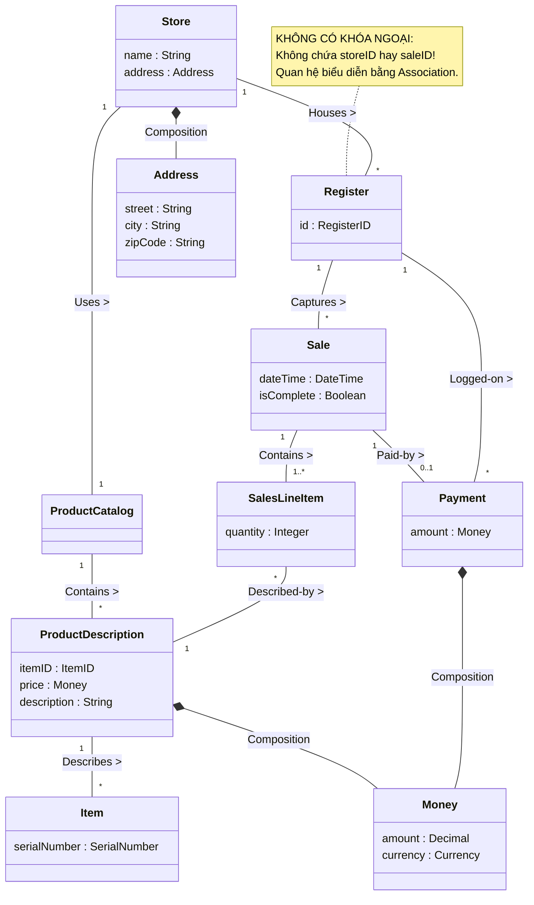

[🏠 Trang Chủ (MOC)](../README.md) | [◄ Chương 11: Domain Model Adding Associations](./11_Domain_Model_Adding_Associations.md) | [Chương 13: Use Case Model Adding Detail with Operation Contracts ►](./13_Use_Case_Model_Adding_Detail_with_Operation_Contracts.md)

---

## CHƯƠNG 12: DOMAIN MODEL: ADDING ATTRIBUTES

### 1. ĐỀ MỤC & MỤC TIÊU CỐT LÕI (CORE PURPOSE)

#### Hệ thống đề mục (Heading Hierarchy)
* **12.1. Attributes** *(Thuộc tính trong Mô hình Miền)*
* **12.2. UML Attribute Notation** *(Ký hiệu thuộc tính trong UML)*
* **12.3. Valid Attribute Types** *(Các kiểu dữ liệu thuộc tính hợp lệ: Kiểu nguyên thủy và Value Objects)*
* **12.4. Non-primitive Data Type Classes** *(Khi nào chuyển một Thuộc tính thành một Lớp Khái niệm riêng biệt)*
* **12.5. Common Mistake: Attributes as Foreign Keys** *(Sai lầm tai hại: Đưa Khóa Ngoại vào làm Thuộc tính đối tượng)*
* **12.6. Modeling Attribute Quantities and Units** *(Mô hình hóa Đại lượng và Đơn vị đo lường)*
* **12.7. Design Creed: Representing Things as Concepts vs Attributes** *(Tuyên ngôn thiết kế: Biểu diễn một thực thể thành Khái niệm hay Thuộc tính)*
* **12.8. The NextGen Domain Model with Attributes** *(Mô hình Miền hoàn chỉnh của NextGen POS có đầy đủ thuộc tính)*
* **12.9. Multiplicity from SalesLineItem to Item** *(Mối quan hệ bản số từ SalesLineItem tới Item)*
* **12.10. Domain Model Conclusion** *(Tổng kết toàn bộ kỹ thuật xây dựng Mô hình Miền)*

#### Vấn đề kỹ thuật thực tế & Thảm họa kiến trúc được ngăn chặn
Chương 12 giải quyết hai căn bệnh kinh niên phá hủy kiến trúc hướng đối tượng: **Tư duy Khóa Ngoại của Cơ sở dữ liệu quan hệ (*The Relational Foreign Key Anti-Pattern*)** và **Hội chứng Ám ảnh Kiểu Dữ liệu Nguyên thủy (*Primitive Obsession*)**.

Nếu lập trình viên thiết kế thuộc tính theo lối mòn cơ sở dữ liệu quan hệ, hệ thống sẽ gặp các thảm họa:
* **Thảm họa Khóa Ngoại trong OOP (The Foreign Key Smell):** Thêm các thuộc tính như `currentSaleID`, `storeID`, `cashierID` vào các lớp đối tượng. Điều này biến các đối tượng thành các bản ghi dữ liệu phẳng thụ động, phá hủy hoàn toàn khả năng điều hướng tự nhiên của con trỏ đối tượng, biến code hướng đối tượng thành lập trình thủ tục biến tướng (*Procedural Code with Foreign Keys*).
* **Mất mát đơn vị đo lường (Unit Loss Disaster):** Lưu trữ thuộc tính `weight` bằng số thực `double` đơn thuần mà không gắn liền với đơn vị đo lường (Kilogram, Pound, Gram). Khi hệ thống kết nối với cân điện tử gửi đơn vị Ounce, toàn bộ công thức tính giá bị sai lệch hàng trăm lần.
* **Mã nguồn thiếu tính đóng gói (Leaky Data Integrity):** Dùng `String` để lưu địa chỉ, số điện thoại, mã vạch khiến logic kiểm tra hợp lệ (*Validation*) bị vương vãi khắp nơi trong code (kiểm tra rỗng, kiểm tra độ dài bị lặp lại ở 50 hàm khác nhau).

---

### 2. PHÂN TÍCH LÝ THUYẾT & NGUYÊN LÝ CHUYÊN SÂU

```
+-----------------------------------------------------------------------------------------+
|                  THE FOREIGN KEY ANTI-PATTERN VS. PURE OO ASSOCIATION                   |
+-----------------------------------------------------------------------------------------+
| [SAI - TƯ DUY KHÓA NGOẠI RDBMS]:                                                        |
|   class Register {                                                                      |
|       private int currentSaleID;  <-- SAI! Đây là tư duy bảng SQL, phá vỡ OOP!          |
|       private int storeID;        <-- SAI! Bắt đối tượng phải tự đi truy vấn DB         |
|   }                                                                                     |
+-----------------------------------------------------------------------------------------+
| [ĐÚNG - HƯỚNG ĐỐI TƯỢNG THUẦN KHIẾT]:                                                   |
|   class Register {                                                                      |
|       private Sale currentSale;   <-- ĐÚNG! Tham chiếu trực tiếp tới đối tượng          |
|       // Liên kết với Store được thể hiện bằng Association, không cần trường ID!         |
|   }                                                                                     |
+-----------------------------------------------------------------------------------------+
```

#### 2.1. Cú pháp và Định dạng Thuộc tính chuẩn trong Domain Model
* Trong Mô hình Miền khái niệm, thuộc tính được viết theo cú pháp giản lược:
  $$\text{name} : \text{Type}$$
* **TUYỆT ĐỐI KHÔNG CÓ DẤU PHÂN QUYỀN TRUY CẬP (+, -, #):** Vì đây là mô hình khái niệm thế giới thực, không phải mã nguồn Java hay C++. Khái niệm "private" hay "public" không tồn tại trong thế giới thực.

#### 2.2. Tuyên ngôn Tối thượng: TUYỆT ĐỐI KHÔNG DÙNG KHÓA NGOẠI (NO Foreign Keys!)
Craig Larman đưa ra cảnh báo nghiêm khắc nhất trong cuốn sách:
* **Khóa ngoại (*Foreign Keys*) chỉ tồn tại trong thế giới Cơ sở dữ liệu quan hệ (RDBMS)** để phục vụ việc liên kết các bảng thông qua câu lệnh `JOIN`.
* Trong Thiết kế Hướng đối tượng và Domain Model: **Tuyệt đối không bao giờ dùng thuộc tính để đóng vai trò khóa ngoại kết nối hai lớp!**
* Thay vì viết `destinationAirportID` trong class `Flight`, ta vẽ một đường **Association** nối từ `Flight` sang `Airport`. Khi chuyển sang code, đường nối đó sẽ trở thành một tham chiếu đối tượng trực tiếp: `private Airport destinationAirport;`.
* Dùng khóa ngoại trong OOP là bằng chứng rõ nhất của việc chưa thoát khỏi tư duy lập trình cấu trúc dữ liệu phẳng.

#### 2.3. Tiêu chuẩn chuyển đổi: Khi nào một Thuộc tính phải biến thành một Lớp riêng?
Lập trình viên thường băn khoăn: *Một thực thể nên là Thuộc tính hay là một Lớp Khái niệm riêng?*
Craig Larman đưa ra các tiêu chí vàng: Hãy biến nó thành một **Lớp Khái niệm riêng (*Non-Primitive Value Object Class*)** nếu:
1. Nó có **cấu trúc con bên trong** (ví dụ: `Address` gồm số nhà, tên đường, thành phố; `PersonName` gồm họ, tên đệm, tên chính).
2. Nó có **các phép toán hoặc quy tắc kiểm tra hợp lệ riêng** (ví dụ: `ItemID` phải tuân theo thuật toán mã vạch UPC/EAN; `CreditCardNumber` phải vượt qua thuật toán kiểm tra Luhn checksum).
3. Nó có **đơn vị đo lường đi kèm** (ví dụ: `Money` gồm số tiền và loại tệ; `Weight` gồm số đo và đơn vị kg/lb; `Dimensions` gồm dài, rộng, cao).
4. Nó đại diện cho một khái niệm có vị thế độc lập trong thế giới nghiệp vụ.

---

### 3. MỔ XẺ MÃ NGUỒN HOẶC ĐẶC TẢ THIẾT KẾ (DESIGN / CODE DEEP-DIVE)

Dưới đây là đoạn mã Java đối đầu trực tiếp: Minh họa sự chuyển hóa từ thảm họa dùng Khóa ngoại và Kiểu nguyên thủy thô sang kiến trúc **Hướng đối tượng thuần khiết kết hợp Value Objects tự đóng gói**:

```java
// ==================== [SAI] KHÓA NGOẠI & PRIMITIVE OBSESSION ====================
// Vi phạm nghiêm trọng nguyên lý đóng gói của OOA/D
public class BadRegister {
    private int id;
    private int currentSaleId; // [SMELL]: Dùng khóa ngoại thay vì tham chiếu đối tượng!
    private double currentSaleTotal; // [SMELL]: Sai số dấu phẩy động!
    private String storeAddress; // [SMELL]: Dùng chuỗi thô, không có kiểm tra hợp lệ!
}

// ==================== [ĐÚNG] PURE OOP & VALUE OBJECT ARCHITECTURE ====================
// Tuân thủ 100% nguyên lý Domain Modeling của Craig Larman

public class Register {
    private RegisterID id; // Value Object định danh
    private Sale currentSale; // [PURE OO]: Tham chiếu trực tiếp tới đối tượng, KHÔNG dùng ID!

    public Register(RegisterID id) {
        this.id = id;
    }

    public void startNewSale() {
        this.currentSale = new Sale();
    }

    public Sale getCurrentSale() {
        return currentSale;
    }
}

// Value Object phức hợp có đơn vị đo lường tự bảo vệ tính toàn vẹn dữ liệu
public final class Weight {
    public enum Unit { GRAM, KILOGRAM, POUND, OUNCE }
    
    private final BigDecimal value;
    private final Unit unit;

    public Weight(double value, Unit unit) {
        if (value < 0) throw new IllegalArgumentException("Khối lượng không thể âm!");
        this.value = BigDecimal.valueOf(value);
        this.unit = unit;
    }

    public Weight toKilograms() {
        switch (unit) {
            case GRAM: return new Weight(value.divide(BigDecimal.valueOf(1000)).doubleValue(), Unit.KILOGRAM);
            case POUND: return new Weight(value.multiply(BigDecimal.valueOf(0.453592)).doubleValue(), Unit.KILOGRAM);
            case OUNCE: return new Weight(value.multiply(BigDecimal.valueOf(0.0283495)).doubleValue(), Unit.KILOGRAM);
            default: return this;
        }
    }

    public BigDecimal getValue() { return value; }
    public Unit getUnit() { return unit; }
}
```

#### Bảng phân tích kỹ thuật và ý nghĩa thiết kế:

| Dòng code / Đoạn code then chốt | Giải thích kỹ thuật & Ý nghĩa thiết kế kiến trúc |
| :--- | :--- |
| `private Sale currentSale;` | **Loại bỏ hoàn toàn Foreign Key:** Thay thế biến `int currentSaleId` bằng tham chiếu đối tượng trực tiếp. Cho phép gọi hàm hướng đối tượng tự nhiên: `currentSale.getTotal()` thay vì phải viết câu lệnh query cơ sở dữ liệu `SELECT * FROM sales WHERE id = currentSaleId`. |
| `public final class Weight` | Hiện thực hóa **Lớp Thuộc tính có Đơn vị đo lường**: Tự động chuyển đổi đơn vị an toàn (`toKilograms()`). Bảo vệ hệ thống khỏi các thảm họa tính toán sai lệch đơn vị giữa các quốc gia. |
| `if (value < 0) throw...` | **Bảo vệ Tính toàn vẹn tại Cội nguồn (*Self-Validating Invariant*):** Không một đối tượng `Weight` nào có thể tồn tại trên đời với giá trị âm. Lập trình viên không cần viết lại câu lệnh kiểm tra `if (weight < 0)` ở 100 màn hình khác nhau. |

---

### 4. SƠ ĐỒ TRỰC QUAN HÓA (UML MERMAID)

Sơ đồ Lớp Khái niệm hoàn chỉnh của Hệ thống NextGen POS tích hợp đầy đủ các Lớp Khái niệm, Thuộc tính định kiểu, các Value Objects phức hợp, tuyệt đối không có khóa ngoại, kèm hệ thống Associations chuẩn mực:



---

### 5. ÁNH XẠ ỨNG DỤNG VÀO DỰ ÁN GAME OOP THỰC CHIẾN

* **Bối cảnh áp dụng:** Thiết kế Thuộc tính Thực thể Nhân vật (*Character Attributes*) và Hệ tọa độ (*Coordinates*) trong Game 2.5D Multiplayer.
* **Thảm họa Khóa ngoại và Kiểu nguyên thủy trong Game:**
  1. *Lỗi Khóa ngoại:* Class `Character` lưu biến `int currentTargetID`. Khi người chơi bấm nút đánh, code phải gọi hàm toàn cục `EntityManager.FindEntityById(currentTargetID)` để lấy mục tiêu. Nếu mạng lag, con quái đó đã bị người chơi khác đánh chết và xóa khỏi bộ nhớ, lệnh tìm kiếm trả về `null` gây sập máy chủ (*NullReferenceException Crash*).
  2. *Lỗi Kiểu nguyên thủy:* Tọa độ nhân vật được lưu bằng 2 biến `float posX`, `float posY`. Lập trình viên nhầm lẫn giữa tọa độ ô cờ (*Grid Tile Coordinates: [12, 45]*) và tọa độ thực tế thế giới (*World Metric Space: [12.5f, 45.8f]*), khiến nhân vật dịch chuyển xuyên qua tường (*Wall Clip Exploit*).
* **Ứng dụng từ Chương 12 vào Game:**
  1. *Triệt tiêu Khóa ngoại:* `Character` giữ tham chiếu trực tiếp tới đối tượng mục tiêu:
     ```csharp
     private Character currentTarget; // Tham chiếu trực tiếp, không dùng ID!
     ```
  2. *Đóng gói Thuộc tính phức hợp thành Value Objects bất biến:*
     * Tạo lớp `WorldPosition2D(float x, float y)` có sẵn các hàm tính toán khoảng cách hình học `DistanceTo(other)`, kiểm tra nằm trong tầm nhìn `IsInSightRange()`.
     * Tạo lớp `GridTileCoordinate(int tileX, int tileY)` đại diện cho ô cờ trên bản đồ lưới 2.5D.
     * Cung cấp hàm chuyển đổi rõ ràng giữa 2 hệ tọa độ: `GridTileCoordinate.FromWorldPosition(pos)`, loại bỏ 100% nguy cơ nhầm lẫn đơn vị giữa Client và Server.

---

[🏠 Trang Chủ (MOC)](../README.md) | [◄ Chương 11: Domain Model Adding Associations](./11_Domain_Model_Adding_Associations.md) | [Chương 13: Use Case Model Adding Detail with Operation Contracts ►](./13_Use_Case_Model_Adding_Detail_with_Operation_Contracts.md)
