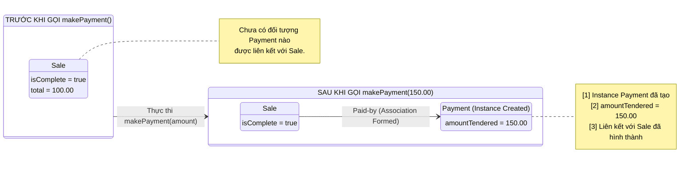

[🏠 Trang Chủ (MOC)](../README.md) | [◄ Chương 12: Domain Model Adding Attributes](./12_Domain_Model_Adding_Attributes.md) | [Chương 14: From Requirements to Design in this Iteration ►](./14_From_Requirements_to_Design_in_this_Iteration.md)

---

## CHƯƠNG 13: USE-CASE MODEL: ADDING DETAIL WITH OPERATION CONTRACTS

### 1. ĐỀ MỤC & MỤC TIÊU CỐT LÕI (CORE PURPOSE)

#### Hệ thống đề mục (Heading Hierarchy)
* **13.1. Contracts** *(Khái niệm Hợp đồng Vận hành Hệ thống)*
* **13.2. Example Contract: enterItem** *(Ví dụ kinh điển: Hợp đồng cho thao tác enterItem)*
* **13.3. Contract Sections** *(Các phần cấu thành một hợp đồng chuẩn mực)*
  * *Name (Tên thao tác & Tham số)*
  * *Responsibilities (Trách nhiệm nghiệp vụ)*
  * *Cross References (Tham chiếu chéo tới Use Cases)*
  * *Exceptions (Các trường hợp ngoại lệ)*
  * *Preconditions (Tiền điều kiện)*
  * *Postconditions (Hậu điều kiện – Trọng tâm cốt tử)*
* **13.4. Postconditions** *(Hậu điều kiện: Bốn loại biến đổi trạng thái trong Miền)*
  * *Instance Creation and Deletion (Khởi tạo và Tiêu hủy thể hiện)*
  * *Attribute Modification (Sửa đổi giá trị thuộc tính)*
  * *Associations Formed and Broken (Hình thành và Phá vỡ liên kết)*
* **13.5. Discussion: enterItem Postconditions** *(Thảo luận chuyên sâu về hậu điều kiện enterItem)*
* **13.6. Writing Contracts Leads to Domain Model Updates** *(Viết hợp đồng dẫn xuất việc cập nhật Mô hình Miền)*
* **13.7. When Are Contracts Useful? Contracts vs. Use Cases?** *(Khi nào cần dùng Hợp đồng? So sánh với Ca sử dụng)*
* **13.8. Guidelines: Contracts** *(Các nguyên tắc chỉ đạo: Tư duy khai báo, dùng thì quá khứ)*
* **13.9. NextGen POS Example: Contracts** *(Hệ thống hợp đồng cho NextGen POS: makeNewSale, enterItem, endSale, makePayment)*
* **13.10. Changes to the Domain Model** *(Các biến chuyển bổ sung cho Mô hình Miền)*
* **13.11. Contracts, Operations, and the UML** *(Hợp đồng, Thao tác hệ thống và chuẩn UML)*
* **13.12. Operation Contracts Within the UP** *(Hợp đồng vận hành trong Quy trình UP)*
* **13.13. Further Readings** *(Tài liệu tham khảo)*

#### Vấn đề kỹ thuật thực tế & Thảm họa kiến trúc được ngăn chặn
Chương 13 giải quyết sự mơ hồ chết người của **Ngôn ngữ tự nhiên trong Ca sử dụng (*Use Case Natural Language Ambiguity*)**. Một câu văn trong Use Case như *"Hệ thống ghi nhận mặt hàng và tính toán tiền"* nghe rất trôi chảy nhưng lại hoàn toàn vô định hình đối với một kỹ sư phần mềm khi thiết kế trạng thái đối tượng.

Nếu bỏ qua Hợp đồng Vận hành (Operation Contracts), hệ thống sẽ hứng chịu các thảm họa:
* **Tác dụng phụ ngoài dự kiến (Uncontrolled Side-Effects):** Lập trình viên chỉ tập trung tính toán giá tiền mà quên mất việc hình thành liên kết bền vững giữa `Payment` và `Sale`, hoặc quên trừ số lượng hàng trong kho, dẫn đến thất thoát dữ liệu và sai lệch báo cáo tài chính.
* **Tư duy thủ tục xâm lấn thiết kế (Procedural Thinking in OO):** Lập trình viên viết tài liệu mô tả luồng xử lý theo kiểu giải thuật tuần tự (*"Hệ thống chạy vòng lặp for, gọi hàm X, kiểm tra if-else..."*), làm mất đi tính độc lập khai báo (*Declarative*) của trạng thái nghiệp vụ.
* **Thiếu tiêu chí nghiệm thu kiểm thử giao dịch (Missing Test Assertions):** Đội ngũ QA không thể viết được các bài test tự động cấp độ Domain/Integration vì không có một định nghĩa toán học chính xác: Sau khi gọi hàm `makePayment()`, những đối tượng nào bắt buộc phải được sinh ra và những cờ trạng thái nào bắt buộc phải đổi sang `true`.

---

### 2. PHÂN TÍCH LÝ THUYẾT & NGUYÊN LÝ CHUYÊN SÂU

```
+-----------------------------------------------------------------------------------------+
|                              OPERATION CONTRACT TRANSFORMATION                          |
+-----------------------------------------------------------------------------------------+
| SYSTEM OPERATION : enterItem(itemID: ItemID, quantity: integer)                         |
+-----------------------------------------------------------------------------------------+
| PRECONDITIONS    : An ongoing Sale exists.                                              |
| (Tiền điều kiện)   (Một phiên bán hàng Sale đang diễn ra).                              |
+-----------------------------------------------------------------------------------------+
| POSTCONDITIONS   : [1] Instance Creation: A SalesLineItem instance 'sli' was created.   |
| (Hậu điều kiện)    [2] Association Formed: 'sli' was associated with the current Sale.  |
|                    [3] Attribute Modified: 'sli.quantity' became quantity.              |
|                    [4] Association Formed: 'sli' was associated with a                  |
|                        ProductDescription based on itemID match.                        |
+-----------------------------------------------------------------------------------------+
|                     TRẠNG THÁI TRƯỚC (Pre)  ===>  TRẠNG THÁI SAU (Post)                 |
|                     [Sale] (chưa có sli)    ===>  [Sale] ---> [sli:SalesLineItem]       |
|                                                                    |                    |
|                                                                    v                    |
|                                                           [ProductDescription]          |
+-----------------------------------------------------------------------------------------+
```

#### 2.1. Bản chất của Hợp đồng Vận hành (Operation Contract)
* Một Operation Contract là tài liệu đặc tả chi tiết nhất về **sự biến đổi trạng thái của Mô hình Miền (*Domain State Transformation*)** khi một Thao tác Hệ thống (*System Operation*) được thực thi.
* Hợp đồng không mô tả *làm thế nào (*How*)* để đạt được kết quả, mà mô tả **kết quả trạng thái sau cùng (*What state changes occurred*)**.

#### 2.2. Trọng tâm cốt tử: Hậu điều kiện (Postconditions)
Craig Larman khẳng định: Hậu điều kiện là phần quan trọng nhất của hợp đồng. Chúng **KHÔNG PHẢI là những hành động thủ tục** (không phải là *"hệ thống mở kết nối database"*, *"hệ thống tính tiền"*). Hậu điều kiện luôn được viết ở **thì quá khứ (*Past Tense*)** để thể hiện trạng thái đã hoàn tất của thế giới đối tượng.

Mọi hậu điều kiện trong vũ trụ OOA/D đều quy về **4 loại biến đổi trạng thái duy nhất**:
1. **Khởi tạo hoặc Tiêu hủy Thể hiện (*Instance Creation and Deletion*):**
   * *Ví dụ:* Một thể hiện `SalesLineItem` (gọi là `sli`) **đã được khởi tạo** (`sli was created`).
2. **Sửa đổi Giá trị Thuộc tính (*Attribute Modification*):**
   * *Ví dụ:* Thuộc tính `sli.quantity` **đã trở thành** `quantity` (`sli.quantity became quantity`); `Sale.isComplete` **đã trở thành** `true`.
3. **Hình thành Liên kết (*Associations Formed*):**
   * *Ví dụ:* `sli` **đã được liên kết với** `Sale` hiện tại (`sli was associated with the current Sale`).
   * `sli` **đã được liên kết với** `ProductDescription` tương ứng (`sli was associated with ProductDescription`).
4. **Phá vỡ Liên kết (*Associations Broken*):**
   * *Ví dụ:* Thể hiện thanh toán cũ đã bị hủy liên kết khỏi đơn hàng hiện tại.

#### 2.3. Tư duy Khai báo (Declarative Thinking) vs. Tư duy Thủ tục (Procedural Thinking)
* **Tư duy Thủ tục (SAI):** "Thu ngân quét mã, hệ thống tìm trong bảng database, nếu thấy thì tạo mảng, nhét sản phẩm vào mảng, rồi cộng dồn tổng tiền".
* **Tư duy Khai báo (ĐÚNG):** "Một thể hiện `SalesLineItem` đã được tạo ra; nó đã được gắn vào `Sale`; số lượng của nó đã được gán bằng `qty`; nó đã được kết nối với `ProductDescription`".
* **Tác động ngược tới Mô hình Miền (Domain Model Feedback):** Quá trình viết hợp đồng buộc Kiến trúc sư phải rà soát lại Domain Model. Nếu trong hợp đồng ta viết: *"sli was associated with ProductDescription"*, nhưng trên Domain Model trước đó chưa có đường Association nối giữa `SalesLineItem` và `ProductDescription`, thì **Domain Model bắt buộc phải được bổ sung ngay lập tức!**

---

### 3. MỔ XẺ MÃ NGUỒN HOẶC ĐẶC TẢ THIẾT KẾ (DESIGN / CODE DEEP-DIVE)

Dưới đây là bản đặc tả Hợp đồng Vận hành cho hai thao tác cốt lõi: `enterItem` và `makePayment`, kèm theo đoạn mã Java kiểm chứng việc hiện thực hóa chính xác 4 loại hậu điều kiện thông qua các bài kiểm thử tự động (*Automated Contract Assertion Test*):

```java
// ==================== HỢP ĐỒNG ĐẶC TẢ (CONTRACT SPECIFICATION) ====================
/*
Contract CO2: enterItem
Operation:      enterItem(itemID: ItemID, quantity: integer)
Cross Ref:      Use Cases: Process Sale
Preconditions:  An ongoing Sale exists.
Postconditions: 
    - A SalesLineItem instance 'sli' was created (Instance Creation).
    - 'sli' was associated with the current Sale (Association Formed).
    - 'sli.quantity' became quantity (Attribute Modification).
    - 'sli' was associated with a ProductDescription, based on itemID match (Association Formed).

Contract CO4: makePayment
Operation:      makePayment(amount: Money)
Cross Ref:      Use Cases: Process Sale
Preconditions:  An ongoing Sale exists, all items entered, sale is ended (isComplete is true).
Postconditions:
    - A Payment instance 'p' was created (Instance Creation).
    - 'p.amountTendered' became amount (Attribute Modification).
    - 'p' was associated with the current Sale (Association Formed).
    - The current Sale was associated with the Store to record completed sale (Association Formed).
*/

// ==================== MÃ NGUỒN KIỂM CHỨNG HẬU ĐIỀU KIỆN (JAVA TEST) ====================
public class OperationContractVerificationTest {

    @Test
    public void verify_enterItem_Postconditions() {
        // [PRECONDITION]: Khởi tạo phiên bán hàng sẵn sàng
        Register register = new Register(new ProductCatalog());
        register.makeNewSale();
        Sale currentSale = register.getCurrentSale();
        ItemID targetID = new ItemID("ITEM-001");

        // [ACTION]: Thực thi System Operation
        register.enterItem(targetID, 3);

        // [POSTCONDITION 1 & 2]: 'sli' was created AND associated with current Sale
        List<SalesLineItem> items = currentSale.getLineItems();
        assertEquals(1, items.size(), "Hậu điều kiện vi phạm: sli chưa được tạo hoặc chưa gắn vào Sale!");

        SalesLineItem sli = items.get(0);

        // [POSTCONDITION 3]: 'sli.quantity' became quantity
        assertEquals(3, sli.getQuantity(), "Hậu điều kiện vi phạm: sli.quantity không khớp!");

        // [POSTCONDITION 4]: 'sli' was associated with ProductDescription based on itemID match
        assertNotNull(sli.getProductDescription(), "Hậu điều kiện vi phạm: sli chưa gắn với ProductDescription!");
        assertEquals(targetID, sli.getProductDescription().getId(), "Hậu điều kiện vi phạm: Sai ProductDescription!");
    }
}
```

#### Bảng phân tích kỹ thuật và ý nghĩa thiết kế:

| Đoạn mã kiểm thử / Assertion | Hậu điều kiện được hiện thực hóa & Ý nghĩa thiết kế |
| :--- | :--- |
| `register.makeNewSale();` | Thiết lập **Tiền điều kiện (Precondition):** Hệ thống phải ở trạng thái hợp lệ thì mới cho phép thực thi thao tác tiếp theo. |
| `assertEquals(1, items.size());` | Kiểm chứng đồng thời **Instance Creation** và **Association Formed**: Chứng minh rằng một đối tượng `SalesLineItem` mới đã thực sự được cấp phát bộ nhớ và được đưa vào danh sách quản lý của `Sale`. |
| `assertEquals(3, sli.getQuantity());` | Kiểm chứng **Attribute Modification**: Đảm bảo giá trị thuộc tính số lượng được ghi nhận chính xác, không bị thất thoát hoặc gán nhầm giá trị mặc định. |
| `assertEquals(targetID, sli.getProductDescription().getId());` | Kiểm chứng **Association Formed**: Đảm bảo liên kết điều hướng từ `SalesLineItem` sang `ProductDescription` đã được thiết lập đúng đắn dựa trên mã sản phẩm. |

---

### 4. SƠ ĐỒ TRỰC QUAN HÓA (UML MERMAID)

Sơ đồ trạng thái đối tượng thể hiện sự biến chuyển của Mô hình Miền trước và sau khi thực thi Thao tác Hệ thống `makePayment(amount)`:



---

### 5. ÁNH XẠ ỨNG DỤNG VÀO DỰ ÁN GAME OOP THỰC CHIẾN

* **Bối cảnh áp dụng:** Đặc tả Hợp đồng Vận hành cho thao tác `ExecuteSkill(casterID, targetID, skillID)` trong Game 2.5D Multiplayer.
* **Thảm họa nếu lập trình viên làm theo cảm tính:**
  Lập trình viên chỉ viết hàm trừ máu đơn thuần: `target.hp -= skill.damage;`.
  $\to$ **Hậu quả thảm họa (Grave Side-Effects):**
  * Quên trừ mana của người tung chiêu $\to$ Người chơi spam chiêu vô hạn (*Infinite Mana Exploit*).
  * Quên kích hoạt trạng thái "Đang chiến đấu" (*In-Combat State*) $\to$ Người chơi vừa đánh nhau vừa cưỡi ngựa hoặc dịch chuyển tức thời về thành.
  * Quên tạo sự kiện kiểm toán chiến đấu (*CombatLogEvent*) $\to$ Không thể phát hiện hacker buff sát thương ảo.
* **Xây dựng Operation Contract chuẩn mực cho Game:**
  ```
  Contract GC01: ExecuteSkill
  Operation:      ExecuteSkill(casterID: EntityID, targetID: EntityID, skillID: SkillID)
  Preconditions:  
      - Caster và Target đều đang tồn tại và còn sống (isAlive == true).
      - Caster không trong trạng thái bị khống chế (isStunned == false, isSilenced == false).
      - Caster.currentMana >= Skill.manaCost.
      - Khoảng cách giữa Caster và Target <= Skill.castRange.
  Postconditions:
      - Caster.currentMana đã bị giảm đi một lượng đúng bằng Skill.manaCost (Attribute Modification).
      - Caster.isInCombat và Target.isInCombat đã trở thành true (Attribute Modification).
      - Một thể hiện DamageEvent 'de' đã được tạo ra (Instance Creation).
      - 'de.amount' đã được tính toán bằng [Caster.AttackPower * Skill.Multiplier - Target.Armor] (Attribute Modification).
      - Target.currentHP đã bị giảm đi đúng bằng 'de.amount' (Attribute Modification).
      - 'de' đã được liên kết với CombatAuditLog của máy chủ (Association Formed).
      - Nếu Target.currentHP <= 0: Target.isAlive đã trở thành false và một thể hiện DeathEvent đã được tạo ra (Instance Creation).
  ```

---

[🏠 Trang Chủ (MOC)](../README.md) | [◄ Chương 12: Domain Model Adding Attributes](./12_Domain_Model_Adding_Attributes.md) | [Chương 14: From Requirements to Design in this Iteration ►](./14_From_Requirements_to_Design_in_this_Iteration.md)
