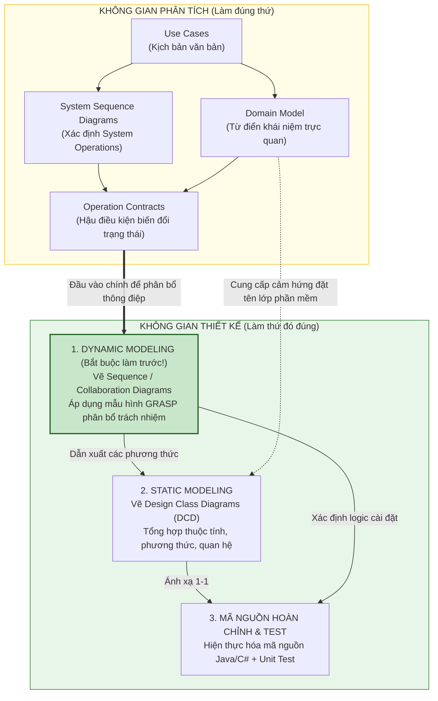

[🏠 Trang Chủ (MOC)](../README.md) | [◄ Chương 13: Use Case Model Adding Detail with Operation Contracts](./13_Use_Case_Model_Adding_Detail_with_Operation_Contracts.md) | [Chương 15: Interaction Diagram Notation ►](./15_Interaction_Diagram_Notation.md)

---

## CHƯƠNG 14: FROM REQUIREMENTS TO DESIGN IN THIS ITERATION

### 1. ĐỀ MỤC & MỤC TIÊU CỐT LÕI (CORE PURPOSE)

#### Hệ thống đề mục (Heading Hierarchy)
* **14.1. Do the Thing Right** *(Làm thứ đó đúng: Bước chuyển từ Phân tích sang Thiết kế)*
* **14.2. Provocation: Think Before Coding** *(Lời cảnh tỉnh: Hãy suy nghĩ trước khi gõ phím)*
* **14.3. On to Object Design** *(Tiến vào giai đoạn Thiết kế Đối tượng)*
* **14.4. Two Artifacts in Object Design: Dynamic vs. Static Modeling** *(Hai tạo tác cốt lõi: Mô hình Động và Mô hình Tĩnh)*
  * *Dynamic Modeling: Interaction Diagrams (Mô hình Động: Sơ đồ tương tác)*
  * *Static Modeling: Design Class Diagrams - DCD (Mô hình Tĩnh: Sơ đồ lớp thiết kế)*
  * *The Golden Rule: Dynamic Modeling First! (Quy tắc vàng: Mô hình Động đi trước!)*
* **14.5. Upfront Design Time: Agile Modeling Mindset** *(Thời lượng thiết kế ban đầu: Tư duy mô hình hóa linh hoạt)*
* **14.6. Designing Objects: What Skills Are Needed?** *(Kỹ năng cần thiết: Phân bổ trách nhiệm qua GRASP & GoF)*

#### Vấn đề kỹ thuật thực tế & Thảm họa kiến trúc được ngăn chặn
Chương 14 là cây cầu chuyển giao quyết định giữa **Miền Yêu cầu / Phân tích (*Analysis Space*)** và **Miền Giải pháp / Thiết kế (*Design Space*)**. Nó giải quyết sự giằng xé giữa hai thái cực sai lầm: **Lập trình bừa bãi không thiết kế (*Cowboy Coding*)** và **Thiết kế đồ sộ trên giấy trước khi code (*Big Design Up Front - BDUF*)**.

Nếu không có phương pháp luận chuyển giao chuẩn xác từ Chương 14, dự án sẽ gặp thảm họa:
* **Hội chứng Thiết kế Tĩnh chết (*Static-First Modeling Disaster*):** Ngồi vẽ sơ đồ lớp thiết kế (DCD) trước khi biết các đối tượng tương tác với nhau ra sao. Kết quả là tạo ra hàng loạt class với các getter/setter vô bổ, đẩy toàn bộ logic vào một hàm `main` hoặc `Controller` khổng lồ, vi phạm trắng trợn tính đóng gói.
* **Bẫy BDUF (Big Design Up Front):** Nhóm dành 3 tuần vẽ biểu đồ UML chi tiết đến từng biến private và dấu chấm phẩy. Khi bắt đầu viết mã, họ phát hiện ra thiết kế không thể chạy được trong thực tế, biến 3 tuần vẽ biểu đồ thành công cốc.
* **Bẫy Cowboy Coding (Nhảy vào gõ code ngay):** Lập trình viên mở IDE lên gõ code ngay lập tức mà không dành 15-30 phút tư duy trên bảng trắng. Kết quả là tạo ra kiến trúc mì ăn liền (*Spaghetti Architecture*), các class dính chặt vào nhau, không thể viết được Unit Test.

---

### 2. PHÂN TÍCH LÝ THUYẾT & NGUYÊN LÝ CHUYÊN SÂU

```
+-----------------------------------------------------------------------------------------+
|                         THE OBJECT DESIGN WORKFLOW (ELABORATION 1)                      |
+-----------------------------------------------------------------------------------------+
|  INPUT ARTIFACTS:                                                                       |
|    - Use Cases (Kịch bản hành vi)                                                       |
|    - Operation Contracts (Hậu điều kiện biến đổi trạng thái)                            |
|    - Domain Model (Cảm hứng đặt tên lớp khái niệm)                                      |
+-----------------------------------------------------------------------------------------+
                                         |
                                         | [BƯỚC 1: DYNAMIC MODELING FIRST - QUAN TRỌNG NHẤT]
                                         v
+-----------------------------------------------------------------------------------------+
|  DYNAMIC MODELING: INTERACTION DIAGRAMS (Sequence / Collaboration)                      |
|    - Thảo luận: Đối tượng nào nhận thông điệp trước?                                    |
|    - Áp dụng các mẫu hình GRASP để PHÂN BỔ TRÁCH NHIỆM (Assign Responsibilities).       |
|    - Quyết định: Phương thức foo() thuộc về Class nào?                                  |
+-----------------------------------------------------------------------------------------+
                                         |
                                         | [BƯỚC 2: DẪN XUẤT STATIC MODEL TỪ DYNAMIC MODEL]
                                         v
+-----------------------------------------------------------------------------------------+
|  STATIC MODELING: DESIGN CLASS DIAGRAMS (DCD)                                           |
|    - Thu thập toàn bộ các phương thức đã xuất hiện trong Interaction Diagrams.          |
|    - Bổ sung thuộc tính, kiểu dữ liệu, quan hệ điều hướng (Navigability).               |
+-----------------------------------------------------------------------------------------+
                                         |
                                         | [BƯỚC 3: HIỆN THỰC MÃ NGUỒN]
                                         v
+-----------------------------------------------------------------------------------------+
|  WORKING SOURCE CODE & AUTOMATED UNIT TESTS (TDD)                                       |
+-----------------------------------------------------------------------------------------+
```

#### 2.1. Quy tắc Vàng: Mô hình Động đi trước Mô hình Tĩnh (Dynamic First!)
Craig Larman nhấn mạnh một quy tắc thiết kế có tính cách mạng:
* **Không bao giờ ngồi vẽ Design Class Diagram (DCD) trước!**
* Tại sao? Vì một lớp phần mềm không thể tự nhiên biết nó cần phương thức gì nếu ta chưa đặt nó vào **bối cảnh tương tác truyền thông điệp (*Message Collaboration*)** để giải quyết một ca sử dụng cụ thể.
* **Quy trình chuẩn:**
  1. Vẽ **Sơ đồ Tương tác (*Interaction Diagrams*)**: Trong quá trình vẽ các mũi tên thông điệp giữa các đối tượng (nhờ sự dẫn đường của các nguyên lý **GRASP**), ta mới phát hiện ra: *"À, lớp `Sale` cần có phương thức `getTotal()`, lớp `SalesLineItem` cần có phương thức `getSubtotal()`"*.
  2. Vẽ **Sơ đồ Lớp Thiết kế (*DCD*)**: Đơn giản chỉ là việc tổng hợp lại toàn bộ các phương thức đã được khám phá từ Sơ đồ Tương tác và định hình thuộc tính điều hướng.

#### 2.2. Thời lượng Thiết kế: Tư duy Mô hình hóa Linh hoạt (Agile Modeling)
* UP và Craig Larman **tuyệt đối không cổ xúy cho việc vẽ UML kéo dài nhiều ngày**.
* **Thực hành chuẩn mực:** Nhóm 2-3 lập trình viên đứng trước bảng trắng (*Whiteboard*), dành từ **15 phút đến tối đa 1-2 giờ** để phác thảo nhanh các Sơ đồ Tương tác và DCD cho các ca sử dụng phức tạp của vòng lặp hiện tại.
* Ngay sau khi đạt được sự đồng thuận về kiến trúc trên bảng trắng, nhóm quay trở về bàn làm việc và bắt tay ngay vào việc viết mã nguồn và kiểm thử tự động (*Test-Driven Development - TDD*). Bản vẽ bảng trắng có thể được chụp ảnh lại hoặc xóa đi sau khi code đã chạy.

#### 2.3. Hai loại Trách nhiệm trong Thiết kế Hướng Đối tượng (RDD)
Thiết kế hướng đối tượng là nghệ thuật phân bổ trách nhiệm:
1. **Trách nhiệm Thực hiện (*Doing Responsibilities*):**
   * Tự mình làm một việc (ví dụ: `SalesLineItem` tự tính thành tiền của chính nó).
   * Khởi tạo một đối tượng khác (ví dụ: `Sale` tạo `SalesLineItem`).
   * Điều phối hoạt động của các đối tượng khác.
2. **Trách nhiệm Hiểu biết (*Knowing Responsibilities*):**
   * Biết về dữ liệu đóng gói riêng tư của chính nó.
   * Biết về các đối tượng liên quan (ví dụ: `Sale` biết danh sách các `SalesLineItem` của nó).
   * Biết về những điều mà nó có thể suy luận hoặc tính toán được.

---

### 3. MỔ XẺ MÃ NGUỒN HOẶC ĐẶC TẢ THIẾT KẾ (DESIGN / CODE DEEP-DIVE)

Dưới đây là minh chứng cho việc **Mã nguồn Bộ khung Lớp Thiết kế (*Class Skeleton*)** được sinh ra một cách tự nhiên và chính xác 100% từ quyết định phân bổ trách nhiệm trong Sơ đồ Tương tác, thay vì được bịa ra một cách tùy tiện:

```java
// ==================== DESIGN SKELETON DERIVED FROM INTERACTION ====================
// Bộ khung mã nguồn này là KẾT QUẢ TRỰC TIẾP của Sơ đồ Tương tác ở Bước 1

public class Register {
    private ProductCatalog catalog;
    private Sale currentSale;

    // Trách nhiệm Điều phối (Controller): Nhận System Operation từ UI
    public void enterItem(ItemID itemID, int quantity) {
        // 1. Gửi thông điệp tra cứu tới Catalog (Information Expert về sản phẩm)
        ProductDescription desc = catalog.getProductDescription(itemID);
        
        // 2. Gửi thông điệp tạo dòng hàng tới Sale (Creator của SalesLineItem)
        currentSale.makeLineItem(desc, quantity);
    }
}

public class Sale {
    private List<SalesLineItem> lineItems = new ArrayList<>();

    // Trách nhiệm Khởi tạo (Creator): Sale chứa SalesLineItem nên Sale tạo nó
    public void makeLineItem(ProductDescription desc, int quantity) {
        lineItems.add(new SalesLineItem(desc, quantity));
    }

    // Trách nhiệm Tính toán (Information Expert): Sale nắm danh sách nên Sale tính tổng
    public Money getTotal() {
        Money total = new Money(0.0);
        for (SalesLineItem lineItem : lineItems) {
            // Ủy thác trách nhiệm tính thành tiền con cho từng dòng hàng
            total = total.add(lineItem.getSubtotal());
        }
        return total;
    }
}

public class SalesLineItem {
    private int quantity;
    private ProductDescription description;

    public SalesLineItem(ProductDescription desc, int quantity) {
        this.description = desc;
        this.quantity = quantity;
    }

    // Trách nhiệm Chuyên gia Thông tin: Tự tính tiền của chính mình
    public Money getSubtotal() {
        return description.getPrice().multiply(quantity);
    }
}
```

#### Bảng phân tích kỹ thuật và ý nghĩa thiết kế:

| Dòng code / Phương thức | Nguồn gốc quyết định thiết kế từ Sơ đồ Tương tác |
| :--- | :--- |
| `register.enterItem(...)` | Sinh ra trực tiếp từ mũi tên System Operation `enterItem` trên SSD (Chương 9). |
| `catalog.getProductDescription(...)` | Kết quả của việc phân bổ trách nhiệm tra cứu cho `ProductCatalog` vì nó nắm giữ tập hợp các mô tả sản phẩm (*Information Expert*). |
| `currentSale.makeLineItem(...)` | Kết quả của mẫu hình **Creator (GRASP)**: Trách nhiệm tạo `SalesLineItem` được trao cho `Sale`, không để `Register` làm việc này nhằm bảo vệ tính gắn kết (*High Cohesion*). |
| `lineItem.getSubtotal()` | Kết quả của nguyên lý **Tell, Don't Ask**: `Sale` không tự lấy `quantity` và `price` ra để nhân; nó yêu cầu `lineItem` tự hoàn thành nhiệm vụ tính toán của nó. |

---

### 4. SƠ ĐỒ TRỰC QUAN HÓA (UML MERMAID)

Sơ đồ dòng chảy phương pháp luận chuyển tiếp từ Yêu cầu sang Thiết kế trong Vòng lặp Elaboration 1:



---

### 5. ÁNH XẠ ỨNG DỤNG VÀO DỰ ÁN GAME OOP THỰC CHIẾN

* **Bối cảnh áp dụng:** Chuyển giao từ Yêu cầu sang Thiết kế cho tính năng Nhặt vật phẩm rơi trên mặt đất (*Loot Dropped Item*) trong Game 2.5D Multiplayer.
* **Sai lầm thường gặp của lập trình viên Unity/Game Engine:**
  Nhảy bổ vào viết script ngay trong `PlayerController.cs`: Viết một hàm `OnTriggerEnter2D(Collider2D col)` dài 300 dòng kiêm luôn việc: kiểm tra tag có phải là đồ không, tự cộng vào danh sách, tự phát âm thanh, tự phá hủy game object `Destroy(col.gameObject)`, và tự gửi socket lên server. 
  $\to$ **Hậu quả:** Không thể tái sử dụng cho quái vật nhặt đồ, không thể chạy trên Server không có đồ họa (*Headless Server*), và không thể viết Unit Test kiểm tra túi đồ có bị đầy hay không.
* **Áp dụng Phương pháp luận Chương 14 vào Game:**
  1. *Dynamic Modeling First (15 phút trên bảng trắng):*
     * Thảo luận: Khi sự kiện `PickupLoot(itemID)` xảy ra, ai nên chịu trách nhiệm?
     * `Inventory` chịu trách nhiệm kiểm tra xem còn chỗ trống không (*Information Expert*).
     * `LootEntity` chịu trách nhiệm cung cấp thông tin `ItemInstance` và tự kích hoạt trạng thái tiêu hủy của nó.
     * `InventoryController` đóng vai trò điều phối luồng giữa Input và Domain Logic.
  2. *Dẫn xuất Static DCD:*
     * Từ sơ đồ tương tác trên bảng, xác định rõ: `Inventory` cần có hàm `bool CanAddItem(ItemInstance item)` và `bool AddItem(ItemInstance item)`.
  3. *Viết Mã C# thuần khiết (Pure C#):* Tách rời hoàn toàn logic thêm đồ vào túi khỏi component hiển thị đồ họa của Unity, đảm bảo mã nguồn chạy được trên cả Client lẫn Server console.

---

[🏠 Trang Chủ (MOC)](../README.md) | [◄ Chương 13: Use Case Model Adding Detail with Operation Contracts](./13_Use_Case_Model_Adding_Detail_with_Operation_Contracts.md) | [Chương 15: Interaction Diagram Notation ►](./15_Interaction_Diagram_Notation.md)
