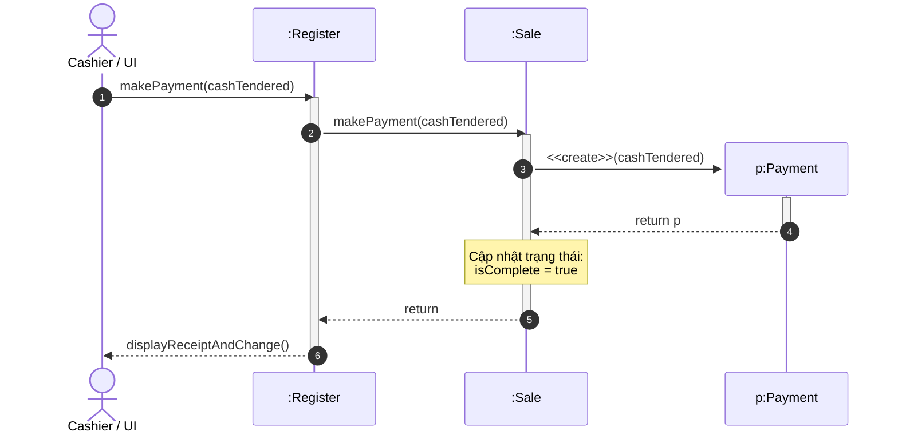

[🏠 Trang Chủ (MOC)](../README.md) | [◄ Chương 14: From Requirements to Design in this Iteration](./14_From_Requirements_to_Design_in_this_Iteration.md) | [Chương 16: GRASP Designing Objects with Responsibilities ►](./16_GRASP_Designing_Objects_with_Responsibilities.md)

---

## CHƯƠNG 15: INTERACTION DIAGRAM NOTATION

### 1. ĐỀ MỤC & MỤC TIÊU CỐT LÕI (CORE PURPOSE)

#### Hệ thống đề mục (Heading Hierarchy)
* **15.1. Interaction Diagrams** *(Tổng quan về Sơ đồ Tương tác)*
* **15.2. Sequence and Collaboration Diagrams** *(Hai thái cực: Sơ đồ Tuần tự vs. Sơ đồ Cộng tác/Giao tiếp)*
  * *Comparison of Strengths and Weaknesses (So sánh ưu và nhược điểm)*
* **15.3. Example Collaboration Diagram: makePayment** *(Ví dụ Sơ đồ Cộng tác: Thao tác makePayment)*
* **15.4. Example Sequence Diagram: makePayment** *(Ví dụ Sơ đồ Tuần tự: Thao tác makePayment)*
* **15.5. Common Interaction Diagram Notation** *(Ký hiệu chung trong sơ đồ tương tác)*
  * *Classes vs. Instances (Quy ước phân biệt Lớp và Thể hiện)*
  * *Basic Message Syntax (Cú pháp thông điệp cơ bản)*
* **15.6. Basic Collaboration Diagram Notation** *(Ký hiệu Sơ đồ Cộng tác chi tiết)*
  * *Links (Liên kết đường dẫn)*
  * *Messages (Thông điệp và Hướng mũi tên)*
  * *Sequence Numbering (Đánh số thứ tự lồng nhau: 1, 1.1, 1.2)*
  * *Conditional Messages (Thông điệp có điều kiện rẽ nhánh)*
  * *Iteration (Thông điệp lặp lại)*
* **15.7. Basic Sequence Diagram Notation** *(Ký hiệu Sơ đồ Tuần tự chi tiết)*
  * *Lifelines and Execution Specification / Activation Boxes (Đường đời và Hộp kích hoạt)*
  * *Creation of Instances (Ký hiệu khởi tạo thể hiện: <<create>>)*
  * *Object Destruction (Ký hiệu tiêu hủy đối tượng)*
  * *Return Values (Giá trị trả về và Mũi tên nét đứt)*
  * *Frames: Loop, Alt, Opt (Khung điều khiển trong UML 2.0)*

#### Vấn đề kỹ thuật thực tế & Thảm họa kiến trúc được ngăn chặn
Chương 15 cung cấp **Ngữ pháp và Ký hiệu trực quan hóa (*Visual Syntax*)** để các kỹ sư phần mềm giao tiếp với nhau về hành vi động của hệ thống. 

Nếu không làm chủ cú pháp Sơ đồ Tương tác, đội ngũ kỹ thuật sẽ hứng chịu các thảm họa:
* **Hội chứng "Bất đồng Ngôn ngữ Kiến trúc" (Architectural Miscommunication):** Mỗi lập trình viên vẽ một kiểu ký hiệu tự phát, gây hiểu lầm tai hại về thứ tự gọi hàm, luồng dữ liệu trả về và cơ chế khởi tạo đối tượng.
* **Bỏ sót các vòng lặp thông điệp vô tận (Invisible Infinite Call Loops):** Thiết kế luồng gọi hàm gián tiếp dẫn đến việc Class A gọi Class B, Class B gọi Class C, rồi Class C lại gọi ngược lại Class A, gây lỗi tràn ngăn xếp (*StackOverflowError*) khi chạy thực tế.
* **Mất kiểm soát vòng đời đối tượng (Object Lifecycle Leakage):** Không thể hiện rõ đối tượng nào chịu trách nhiệm khởi tạo (`create`) và tiêu hủy đối tượng khác, dẫn đến việc rò rỉ bộ nhớ (*Memory Leak*) hoặc sử dụng các con trỏ rác đã bị giải phóng (*Dangling Pointers*).

---

### 2. PHÂN TÍCH LÝ THUYẾT & NGUYÊN LÝ CHUYÊN SÂU

```
+-----------------------------------------------------------------------------------------+
|                  SEQUENCE DIAGRAM VS. COLLABORATION (COMMUNICATION) DIAGRAM             |
+-----------------------------------------------------------------------------------------+
| [SEQUENCE DIAGRAM - ƯU TIÊN THỜI GIAN]:                                                 |
|   :Register              :Sale                   :Payment                               |
|       |                     |                        |                                  |
|       |--- 1: makePayment ->|                        |                                  |
|       |                     |--- 2: create(amount) ->|                                  |
|       |                     |                        |-- (init)                         |
|       |                     |<-- (payment ref) ------|                                  |
+-----------------------------------------------------------------------------------------+
| [COLLABORATION DIAGRAM - ƯU TIÊN MỐI QUAN HỆ KHÔNG GIAN & VỊ TRÍ]:                     |
|                      1: makePayment(amount)                                             |
|        +-----------+ ------------------------> +-----------+                            |
|        | :Register |                           |   :Sale   |                            |
|        +-----------+                           +-----------+                            |
|                                                      | 1.1: create(amount)              |
|                                                      v                                  |
|                                                +-----------+                            |
|                                                | :Payment  |                            |
|                                                +-----------+                            |
+-----------------------------------------------------------------------------------------+
```

#### 2.1. Hai diện mạo của Sơ đồ Tương tác: Sequence vs. Collaboration
Craig Larman phân tích sâu sắc sự đánh đổi (*Trade-offs*) giữa hai loại sơ đồ:
1. **Sơ đồ Tuần tự (Sequence Diagram):**
   * *Ưu điểm:* Thể hiện **trật tự thời gian (*Time Ordering*)** vô cùng rõ ràng theo trục dọc từ trên xuống dưới. Rất trực quan để theo dõi luồng thực thi phức tạp của một kịch bản ca sử dụng.
   * *Nhược điểm:* Tốn diện tích theo chiều ngang khi có nhiều đối tượng tham gia.
2. **Sơ đồ Cộng tác / Giao tiếp (Collaboration / Communication Diagram):**
   * *Ưu điểm:* Thể hiện **mối quan hệ cấu trúc không gian (*Spatial Layout & Links*)** giữa các đối tượng một cách tự nhiên. Cực kỳ nhỏ gọn, là công cụ số một để vẽ phác thảo nhanh trên bảng trắng (*Whiteboard Modeling*).
   * *Nhược điểm:* Khó theo dõi trật tự thời gian vì phải dò theo các con số thứ tự lồng nhau (`1, 1.1, 1.2, 2, 2.1`).

#### 2.2. Quy ước Phân biệt Lớp (Class) và Thể hiện (Instance) trong UML
Một quy tắc cú pháp tối quan trọng thường bị vẽ sai:
* **Thể hiện đối tượng cụ thể (Instance):** Bắt buộc phải có **dấu gạch chân (*Underline*)** dưới tên và đi kèm dấu hai chấm `:`.
  * `:Sale` (Một thể hiện vô danh của lớp Sale).
  * `s1 : Sale` (Một thể hiện có tên là s1 thuộc lớp Sale).
* **Lớp (Class):** Không có dấu gạch chân, không có dấu hai chấm đứng trước: `Sale`.

#### 2.3. Quy tắc Đánh số Thứ tự Lồng nhau trong Sơ đồ Cộng tác (Sequence Numbering)
* Thông điệp đầu tiên: `1: doSomething()`.
* Mọi thông điệp được gửi đi **bên trong quá trình thực thi** của thông điệp 1 sẽ được đánh số lồng cấp độ con:
  * `1.1: getSubtotal()`
  * `1.2: calculateTax()`
* Nếu hàm `getSubtotal()` lại tiếp tục gọi hàm khác, nó sẽ thành cấp độ 3: `1.1.1: getPrice()`.
* Khi thông điệp 1 hoàn tất, thông điệp độc lập tiếp theo sẽ là `2: notifyUser()`.

#### 2.4. Ký hiệu Khởi tạo và Tiêu hủy Đối tượng
* Trong Sơ đồ Tuần tự:
  * **Khởi tạo:** Mũi tên thông điệp tạo mới (có nhãn `create` hoặc `new`) sẽ **đâm thẳng trực tiếp vào đỉnh của Hộp Đối tượng (*Instance Box*)**, thay vì đâm vào đường đời (*Lifeline*). Điều này thể hiện đối tượng đó trước thời điểm này chưa hề tồn tại trong bộ nhớ.
  * **Tiêu hủy (Explicit Destruction):** Được đánh dấu bằng một **dấu X lớn** nằm ở cuối đường đời của đối tượng, thể hiện việc giải phóng vùng nhớ trong C++ hoặc sẵn sàng cho Garbage Collector trong Java/C#.

---

### 3. MỔ XẺ MÃ NGUỒN HOẶC ĐẶC TẢ THIẾT KẾ (DESIGN / CODE DEEP-DIVE)

Dưới đây là sự đối chiếu giải phẫu chính xác 1-1 giữa **Sơ đồ Tương tác của ca sử dụng thanh toán (`makePayment`)** và **Mã nguồn Hiện thực hóa trong Java**, chứng minh cách thức chuyển dịch từng mũi tên thông điệp thành các dòng lệnh thực thi:

```java
// ==================== TẦNG CONTROLLER: REGISTER ====================
public class Register {
    private Sale currentSale;

    // THÔNG ĐIỆP 1: makePayment(cashTendered) từ UI gửi tới Register
    public void makePayment(Money cashTendered) {
        // THÔNG ĐIỆP 1.1: Register chuyển tiếp thông điệp tới currentSale
        currentSale.makePayment(cashTendered);
    }
}

// ==================== TẦNG DOMAIN: SALE & PAYMENT ====================
public class Sale {
    private Payment payment;
    private boolean isComplete = false;

    // THÔNG ĐIỆP 1.1: makePayment(cashTendered) thực thi bên trong Sale
    public void makePayment(Money cashTendered) {
        // THÔNG ĐIỆP 1.1.1: Khởi tạo đối tượng mới: new Payment(cashTendered)
        // Mũi tên <<create>> đâm vào đỉnh của đối tượng Payment
        this.payment = new Payment(cashTendered);

        // THÔNG ĐIỆP 1.1.2: Cập nhật trạng thái nội bộ của Sale
        this.isComplete = true;
    }

    public Payment getPayment() {
        return this.payment;
    }
}

public class Payment {
    private Money amount;

    // Constructor được gọi khi nhận thông điệp <<create>>
    public Payment(Money cashTendered) {
        this.amount = cashTendered;
    }

    public Money getAmount() {
        return this.amount;
    }
}
```

#### Bảng phân tích kỹ thuật và ý nghĩa thiết kế:

| Mã số Thông điệp trên Sơ đồ | Dòng mã nguồn tương ứng trong Java | Bản chất kỹ thuật & Ý nghĩa thiết kế |
| :--- | :--- | :--- |
| **Thông điệp 1** | `register.makePayment(cashTendered)` | **Điểm tiếp nhận sự kiện hệ thống (Controller):** `Register` nhận thông điệp từ giao diện người dùng, không tự xử lý mà đóng vai trò điều phối. |
| **Thông điệp 1.1** | `currentSale.makePayment(cashTendered)` | **Chuyển tiếp thẩm quyền (Delegation):** `Register` biết rằng `Sale` là đối tượng làm chủ giao dịch, do đó ủy thác trách nhiệm thanh toán cho `currentSale`. |
| **Thông điệp 1.1.1** | `this.payment = new Payment(...)` | Hiện thực hóa ký hiệu **`<<create>>`** trên sơ đồ: `Sale` thực thi mẫu hình **Creator (GRASP)** bằng việc khởi tạo phiên bản `Payment` và lưu giữ liên kết tham chiếu. |
| **Thông điệp 1.1.2** | `this.isComplete = true;` | Hiện thực hóa **Attribute Modification Postcondition**: Đóng dấu giao dịch đã hoàn tất hợp lệ. |

---

### 4. SƠ ĐỒ TRỰC QUAN HÓA (UML MERMAID)

Sơ đồ Tuần tự (Sequence Diagram) chuẩn mực thể hiện chi tiết luồng tương tác của thao tác `makePayment`, bao gồm hộp kích hoạt (*Activation Bars*), ký hiệu khởi tạo đối tượng `<<create>>`, và các thông điệp phản hồi:



---

### 5. ÁNH XẠ ỨNG DỤNG VÀO DỰ ÁN GAME OOP THỰC CHIẾN

* **Bối cảnh áp dụng:** Thiết kế Sơ đồ Tương tác cho sự kiện Gây sát thương và Xử lý Tử vong (*ApplyDamage and Death Handling*) trong Game 2.5D Multiplayer.
* **Vấn đề thực tế nếu không vẽ Sơ đồ Tương tác:**
  Lập trình viên viết hàm trừ máu trong `Character.cs`:
  ```csharp
  // CODE NGUY HIỂM: Vòng lặp đệ quy vô tận gây treo game
  void TakeDamage(int dmg) {
      this.hp -= dmg;
      if (this.hp <= 0) {
          Die();
      }
  }
  void Die() {
      // Bắn sự kiện ra ngoài
      EventManager.TriggerDeathEvent(this); // Lắng nghe sự kiện này, một script khác lại gọi:
      // DropLoot() -> LootManager lại gọi: Killer.AddExp() -> Killer lên cấp phát nổ hào quang ->
      // Hào quang lại gây sát thương lên quái xung quanh -> Lại gọi TakeDamage()!
  }
  ```
  $\to$ **Thảm họa Treo Server (*Server Freeze / StackOverflowException*):** Do không trực quan hóa các mũi tên thông điệp tương tác, các sự kiện bắn vòng tròn tạo thành một vòng xoáy đệ quy không có hồi kết giữa các hệ thống Gameplay.
* **Ứng dụng Sơ đồ Tương tác (Chương 15) để kiểm soát Kiến trúc Game:**
  1. *Trực quan hóa luồng thông điệp tuyến tính trên Sequence Diagram:*
     * `CombatManager` $\xrightarrow{\text{1. ApplyDamage}}$ `TargetCharacter`.
     * `TargetCharacter` $\xrightarrow{\text{1.1. ReduceHP}}$ `HealthComponent`.
     * `HealthComponent` $\xrightarrow{\text{1.1.1. CheckDeath}}$ kiểm tra nếu HP $\le 0$ thì trả về cờ `isDead = true`.
     * `CombatManager` nhận cờ `isDead`, sau đó mới chủ động gửi lệnh tách biệt: `2. ProcessDeath(target)`.
  2. *Tách rời hoàn toàn các luồng:* Luồng tính sát thương và Luồng xử lý phần thưởng chết được ngắt thành 2 thông điệp tuần tự độc lập (1 và 2), triệt tiêu hoàn toàn nguy cơ đệ quy vòng tròn, bảo vệ tính ổn định tuyệt đối cho Game Loop của máy chủ.

---

[🏠 Trang Chủ (MOC)](../README.md) | [◄ Chương 14: From Requirements to Design in this Iteration](./14_From_Requirements_to_Design_in_this_Iteration.md) | [Chương 16: GRASP Designing Objects with Responsibilities ►](./16_GRASP_Designing_Objects_with_Responsibilities.md)
