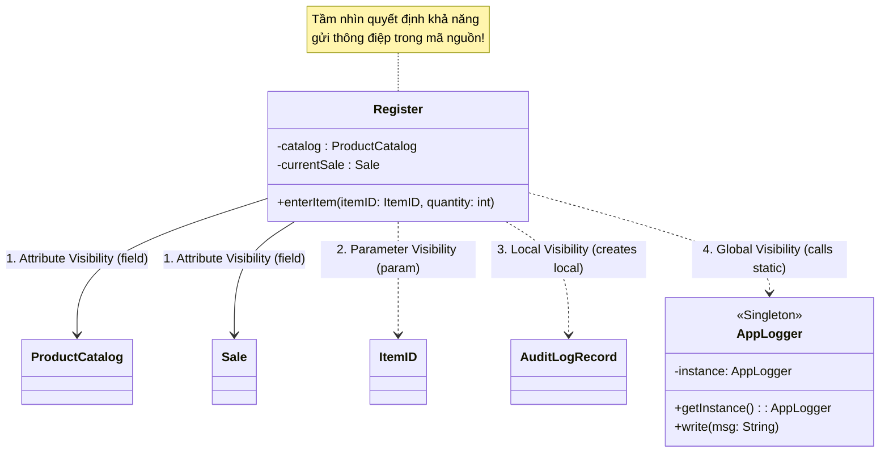

[🏠 Trang Chủ (MOC)](../README.md) | [◄ Chương 17: Design Model Use Case Realizations with GRASP](./17_Design_Model_Use_Case_Realizations_with_GRASP.md) | [Chương 19: Design Model Creating Design Class Diagrams ►](./19_Design_Model_Creating_Design_Class_Diagrams.md)

---

## CHƯƠNG 18: DESIGN MODEL: DETERMINING VISIBILITY

### 1. ĐỀ MỤC & MỤC TIÊU CỐT LÕI (CORE PURPOSE)

#### Hệ thống đề mục (Heading Hierarchy)
* **18.1. Visibility Between Objects** *(Khái niệm Tầm nhìn giữa các đối tượng)*
* **18.2. Four Kinds of Visibility** *(Bốn loại tầm nhìn kinh điển trong thiết kế)*
  * *Attribute Visibility (Tầm nhìn Thuộc tính – Bền vững)*
  * *Parameter Visibility (Tầm nhìn Tham số – Tạm thời)*
  * *Local Visibility (Tầm nhìn Cục bộ – Trong phạm vi phương thức)*
  * *Global Visibility (Tầm nhìn Toàn cục – Static / Singleton)*
* **18.3. Illustrating Visibility in UML** *(Biểu diễn Tầm nhìn trong ký hiệu UML)*
* **18.4. Relating Visibility to Interaction Diagrams and Code** *(Ánh xạ từ Sơ đồ Tương tác sang Khả năng Tầm nhìn trong Mã nguồn)*

#### Vấn đề kỹ thuật thực tế & Thảm họa kiến trúc được ngăn chặn
Chương 18 giải quyết tiền đề kỹ thuật tối quan trọng để biến bản vẽ UML thành code: **Để Đối tượng A có thể gửi một thông điệp (gọi hàm) tới Đối tượng B, thì B BẮT BUỘC PHẢI NẰM TRONG TẦM NHÌN (*VISIBLE*) CỦA A**.

Nếu lập trình viên thiếu hiểu biết về Tầm nhìn (Visibility), họ sẽ gây ra các thảm họa:
* **Lạm dụng Biến Toàn cục & Singleton (Global State Pollution):** Không biết cách truyền đối tượng qua tham số, lập trình viên biến mọi lớp thành Singleton (`Instance`) hoặc biến tĩnh toàn cục (`public static`). Hậu quả: Xung đột dữ liệu đa luồng (*Race Conditions*), không thể viết Unit Test độc lập vì trạng thái rác bị lưu lại giữa các test case.
* **Rò rỉ Bộ nhớ do Lưu trữ Thuộc tính Bừa bãi (Memory Leaks via Attribute Visibility):** Một đối tượng chỉ cần dùng tạm thời trong 1 phương thức nhưng lại bị khai báo thành biến thuộc tính của Class (`field`). Kết quả: Đối tượng tạm thời đó bị giữ lại trong bộ nhớ suốt vòng đời của lớp chứa nó, Garbage Collector không thể giải phóng vùng nhớ.
* **Khớp nối quá mức (Unnecessary Coupling):** Biến những liên kết thoáng qua thành liên kết thuộc tính vĩnh viễn, làm phình to biểu đồ phụ thuộc của hệ thống.

---

### 2. PHÂN TÍCH LÝ THUYẾT & NGUYÊN LÝ CHUYÊN SÂU

```
+-----------------------------------------------------------------------------------------+
|                               BỐN LOẠI TẦM NHÌN (FOUR KINDS OF VISIBILITY)               |
+-----------------------------------------------------------------------------------------+
| 1. ATTRIBUTE VISIBILITY (Bền vững nhất):                                                |
|    B là một biến trường (field / attribute) nằm bên trong A.                            |
|    Vòng đời của tầm nhìn: Tồn tại suốt vòng đời của đối tượng A.                        |
+-----------------------------------------------------------------------------------------+
| 2. PARAMETER VISIBILITY (Linh hoạt, khớp nối lỏng):                                     |
|    B được truyền vào làm tham số của một phương thức foo(B b) trong A.                  |
|    Vòng đời của tầm nhìn: Chỉ tồn tại trong thời gian hàm foo() đang thực thi.         |
+-----------------------------------------------------------------------------------------+
| 3. LOCAL VISIBILITY (Cục bộ, tạm thời):                                                 |
|    B được khai báo là biến cục bộ bên trong phương thức foo() của A,                   |
|    hoặc B được trả về từ một lời gọi hàm cục bộ.                                        |
|    Vòng đời của tầm nhìn: Chấm dứt ngay khi thoát khỏi khối lệnh { }.                  |
+-----------------------------------------------------------------------------------------+
| 4. GLOBAL VISIBILITY (Toàn cục, nguy hiểm nhất):                                        |
|    B là một biến toàn cục, biến static, hoặc một mẫu hình Singleton có thể truy cập     |
|    từ bất kỳ đâu mà không cần truyền tham chiếu.                                        |
+-----------------------------------------------------------------------------------------+
```

#### 2.1. Bản chất của Tầm nhìn (Visibility)
* Sơ đồ Tương tác vẽ một mũi tên `A` $\to$ `B: doSomething()`. Đó là ý muốn thiết kế.
* Nhưng để mã nguồn có thể biên dịch được câu lệnh `b.doSomething();` bên trong class `A`, **ngôn ngữ lập trình bắt buộc phải có một con đường để `A` nhìn thấy `B`**.
* Nếu không có tầm nhìn, bản thiết kế tương tác chỉ là một ảo tưởng không thể hiện thực hóa.

#### 2.2. Chi tiết 4 Loại Tầm nhìn & Chiến lược Lựa chọn của Kiến trúc sư:

##### 1. Attribute Visibility (Tầm nhìn Thuộc tính)
* `B` là một thuộc tính thành viên (`private B b;`) của `A`.
* Đây là loại tầm nhìn phổ biến và bền vững nhất.
* **Khi nào dùng:** Khi mối quan hệ giữa `A` và `B` là quan hệ lâu dài, cần ghi nhớ qua nhiều phương thức khác nhau (ví dụ: `Register` giữ tham chiếu thuộc tính tới `ProductCatalog`).

##### 2. Parameter Visibility (Tầm nhìn Tham số)
* `B` được truyền qua chữ ký hàm: `public void doWork(B b) { b.execute(); }`.
* **Khi nào dùng:** Khi `A` chỉ cần tương tác với `B` trong chốc lát để hoàn thành một nhiệm vụ cụ thể, sau đó không cần nhớ `B` nữa.
* **Đặc tính:** Giúp duy trì **Khớp nối Lỏng (*Low Coupling*)** ở mức tối đa.

##### 3. Local Visibility (Tầm nhìn Cục bộ)
* `B` được tạo mới hoặc lấy về từ một factory ngay trong thân hàm:
  `public void doWork() { B b = new B(); b.execute(); }`.
* **Đặc tính:** Phạm vi cực hẹp, giải phóng bộ nhớ ngay lập tức sau khi hàm kết thúc.

##### 4. Global Visibility (Tầm nhìn Toàn cục)
* Truy cập qua biến tĩnh: `GlobalRegistry.getB().execute();` hoặc `B.getInstance().execute();`.
* **Cảnh báo của Kiến trúc sư:** Đây là loại tầm nhìn nên **hạn chế tối đa**. Nó tạo ra các phụ thuộc ẩn (*Hidden Dependencies*), làm biến mất các tham số rõ ràng trong chữ ký hàm, gây khó khăn cho việc kiểm thử tự động và dễ tạo lỗi race conditions trong môi trường đa luồng.

---

### 3. MỔ XẺ MÃ NGUỒN HOẶC ĐẶC TẢ THIẾT KẾ (DESIGN / CODE DEEP-DIVE)

Dưới đây là đoạn mã Java tổng hợp phô diễn chuẩn mực cả 4 loại Tầm nhìn trong cùng một ngữ cảnh kiến trúc của hệ thống bán hàng:

```java
public class Register {
    // 1. ATTRIBUTE VISIBILITY:
    // catalog tồn tại bền vững cùng vòng đời của Register
    private ProductCatalog catalog; 
    private Sale currentSale;

    public Register(ProductCatalog catalog) {
        this.catalog = catalog;
    }

    // 2. PARAMETER VISIBILITY:
    // itemID chỉ xuất hiện dưới dạng tham số trong lúc thực thi enterItem()
    public void enterItem(ItemID itemID, int quantity) {
        // Sử dụng Attribute Visibility để gửi thông điệp tới catalog
        ProductDescription desc = catalog.getProductDescription(itemID); 

        // 3. LOCAL VISIBILITY:
        // logRecord là biến cục bộ, chỉ sống trong vài nano-giây bên trong hàm này
        AuditLogRecord logRecord = new AuditLogRecord("ENTER_ITEM", itemID);
        logRecord.stampTime();

        // 4. GLOBAL VISIBILITY:
        // Truy cập dịch vụ Logging toàn cục qua Singleton pattern
        AppLogger.getInstance().write(logRecord.getSummary());

        currentSale.makeLineItem(desc, quantity);
    }
}
```

#### Bảng phân tích kỹ thuật và ý nghĩa thiết kế:

| Thành phần mã nguồn | Loại Tầm nhìn (Visibility) | Đánh giá Kiến trúc & Ảnh hưởng Bộ nhớ |
| :--- | :--- | :--- |
| `private ProductCatalog catalog;` | **Attribute Visibility** | Khớp nối bền vững. `Register` cần tra cứu hàng trăm lần trong nhiều giao dịch, do đó giữ tham chiếu thuộc tính là tối ưu nhất. |
| `ItemID itemID` (trong tham số) | **Parameter Visibility** | Khớp nối lỏng tuyệt đối. `Register` không cần lưu trữ vĩnh viễn mã sản phẩm của lượt quét trước. Hạn chế chiếm dụng bộ nhớ. |
| `AuditLogRecord logRecord = new...` | **Local Visibility** | Bộ nhớ được cấp phát trên Stack/Heap tạm thời. Ngay khi hàm `enterItem` kết thúc, biến `logRecord` sẵn sàng được thu hồi bộ nhớ. |
| `AppLogger.getInstance()` | **Global Visibility** | Tiện lợi cho các dịch vụ hạ tầng cắt ngang (*Cross-Cutting Technical Services*), nhưng không nên dùng cho logic nghiệp vụ miền. |

---

### 4. SƠ ĐỒ TRỰC QUAN HÓA (UML MERMAID)

Sơ đồ Lớp Thiết kế thể hiện rõ ràng 4 hình thái Tầm nhìn trong quan hệ cấu trúc giữa `Register` và các đối tượng cộng tác:



---

### 5. ÁNH XẠ ỨNG DỤNG VÀO DỰ ÁN GAME OOP THỰC CHIẾN

* **Bối cảnh áp dụng:** Quản lý Tầm nhìn giữa các Hệ thống Gameplay trong Game 2.5D Multiplayer: Hệ thống Nhận sát thương (`DamageSystem`), Hiệu ứng Âm thanh (`AudioSystem`) và Chỉ số Nhân vật (`CharacterStats`).
* **Thảm họa thiết kế Tầm nhìn sai lầm trong Game:**
  1. *Lạm dụng Global Visibility:* Lập trình viên biến tất cả mọi thứ thành Singleton: `PlayerManager.Instance`, `UIManager.Instance`, `MonsterManager.Instance`, `SoundManager.Instance`. Khi muốn tạo tính năng Đấu trường 2vs2 (chạy 2 trận đấu song song trên cùng một Server Process), hệ thống sụp đổ hoàn toàn vì các biến Singleton dùng chung làm lẫn lộn dữ liệu giữa 2 trận đấu!
  2. *Biến Parameter thành Attribute:* Mỗi khi nhân vật bị chém, ta cần tính toán hiệu ứng giảm trừ sát thương. Lập trình viên lại lưu `private DamagePacket lastDamageTaken;` thành biến thuộc tính của class `Character`. Kết quả: Dữ liệu đòn đánh cũ của 5 phút trước vẫn nằm lù lù trong bộ nhớ, dễ gây bug tính nhầm sát thương cho đòn đánh mới.
* **Ứng dụng chuẩn mực 4 loại Tầm nhìn từ Chương 18 vào Game:**
  1. *Parameter Visibility cho Sự kiện Chiến đấu:*
     ```csharp
     // Tham số chỉ sống trong thời gian hàm thực thi -> Tuyệt đối an toàn đa luồng
     public void TakeDamage(DamageContext context) {
         int finalDmg = context.rawAmount - this.armor;
         this.currentHP -= finalDmg;
     }
     ```
  2. *Attribute Visibility cho Thành phần Cấu trúc:*
     * Nhân vật sở hữu lâu dài bộ quản lý trang bị: `private EquipmentComponent equipment;`.
  3. *Local Visibility cho Hiệu ứng Tạm thời:*
     * Tạo hiệu ứng văng máu (*Blood Splatter*): Tạo biến cục bộ `GameObject fx = Instantiate(bloodFX);`, gán vị trí, thiết lập tự hủy sau 1 giây.
  4. *Giới hạn Global Visibility:* Tuyệt đối không dùng Singleton cho Game Logic. Chỉ dùng Service Locator hoặc Dependency Injection cho các dịch vụ thuần hạ tầng kỹ thuật: `IAudioEngine`, `INetworkSocket`.

---

[🏠 Trang Chủ (MOC)](../README.md) | [◄ Chương 17: Design Model Use Case Realizations with GRASP](./17_Design_Model_Use_Case_Realizations_with_GRASP.md) | [Chương 19: Design Model Creating Design Class Diagrams ►](./19_Design_Model_Creating_Design_Class_Diagrams.md)
