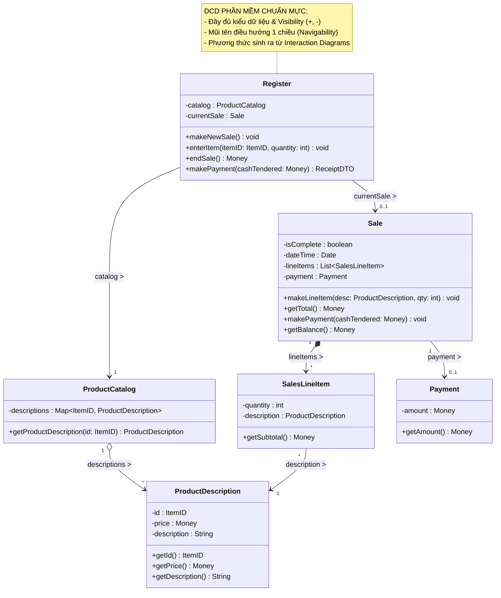

[🏠 Trang Chủ (MOC)](../README.md) | [◄ Chương 18: Design Model Determining Visibility](./18_Design_Model_Determining_Visibility.md) | [Chương 20: Implementation Model Mapping Designs to Code ►](./20_Implementation_Model_Mapping_Designs_to_Code.md)

---

## CHƯƠNG 19: DESIGN MODEL: CREATING DESIGN CLASS DIAGRAMS (DCDs)

### 1. ĐỀ MỤC & MỤC TIÊU CỐT LÕI (CORE PURPOSE)

#### Hệ thống đề mục (Heading Hierarchy)
* **19.1. When to Create DCDs** *(Thời điểm thiết lập Sơ đồ Lớp Thiết kế: Sau Sơ đồ Tương tác)*
* **19.2. Example DCD** *(Ví dụ kinh điển về một DCD hoàn chỉnh trong NextGen POS)*
* **19.3. DCDs and Other Artifacts** *(Mối liên hệ giữa DCD với Domain Model và Interaction Diagrams)*
* **19.4. How to Create a DCD: A Step-by-Step Procedure** *(Quy trình 5 bước xây dựng DCD chuẩn mực)*
  * *Step 1: Identify Software Classes (Xác định các lớp phần mềm)*
  * *Step 2: Draw Them in a UML Class Diagram (Vẽ khung lớp)*
  * *Step 3: Add Method Signatures from Interaction Diagrams (Thu hoạch phương thức từ Sơ đồ Tương tác)*
  * *Step 4: Add Attributes from Domain Model and Visibility (Bổ sung thuộc tính và kiểu dữ liệu)*
  * *Step 5: Add Associations and Directed Navigability (Xác định đường liên kết và hướng điều hướng)*
* **19.5. Method Signatures and Return Types** *(Cú pháp chữ ký phương thức và kiểu dữ liệu trả về)*
* **19.6. Navigability and Software References** *(Hướng điều hướng: Mũi tên ánh xạ con trỏ thuộc tính)*
* **19.7. Visibility of Attributes and Methods (+, -, #, ~)** *(Quy ước đóng gói thuộc tính và phương thức)*
* **19.8. Mapping Associations to Attributes / Avoid Redundancy** *(Quy tắc chống trùng lặp: Thuộc tính vs. Đường điều hướng)*
* **19.9. Notation for Member Methods, Interfaces, and Abstract Classes** *(Ký hiệu phương thức, giao diện và lớp trừu tượng)*
* **19.10. NextGen POS DCD Example** *(Mô hình DCD tổng thể cho Vòng lặp 1)*

#### Vấn đề kỹ thuật thực tế & Thảm họa kiến trúc được ngăn chặn
Chương 19 cung cấp bản thiết kế kỹ thuật tĩnh cuối cùng (**Design Class Diagram - DCD**) trước khi lập trình viên bắt đầu gõ code. Nó giải quyết triệt để sự mơ hồ giữa **Khái niệm thế giới thực (*Domain Concept*)** và **Lớp thực thi phần mềm (*Software Class*)**.

Nếu một đội ngũ kỹ thuật không tạo DCD hoặc tạo DCD cẩu thả, hệ thống sẽ gặp các thảm họa:
* **Hỗn loạn chữ ký phương thức (Inconsistent Method Signatures):** Mỗi lập trình viên trong nhóm tự bịa ra tên phương thức, kiểu tham số và kiểu trả về (người đặt `calcTotal()`, người đặt `getTotal()`, người trả về `double`, người trả về `Money`). Khi ghép code, các module hoàn toàn không tương thích với nhau.
* **Thảm họa Phụ thuộc Hai chiều Vòng tròn (Uncontrolled Bidirectional Coupling):** Do không xác định rõ **Hướng điều hướng (*Navigability Arrows*)**, lập trình viên cho Class A tham chiếu Class B, đồng thời Class B cũng giữ con trỏ trỏ ngược lại Class A. Kết quả: Tạo ra sự phụ thuộc vòng (*Circular Dependency*), rò rỉ bộ nhớ, và không thể tách rời một lớp ra để kiểm thử độc lập.
* **Phá vỡ Tính Đóng gói (Broken Encapsulation):** Để tất cả thuộc tính ở chế độ `public` để các lớp khác tùy tiện truy cập, biến hệ thống thành một cấu trúc dữ liệu phẳng không có ranh giới bảo vệ.

---

### 2. PHÂN TÍCH LÝ THUYẾT & NGUYÊN LÝ CHUYÊN SÂU

```
+-----------------------------------------------------------------------------------------+
|                  SỰ KHÁC BIỆT BẢN CHẤT: DOMAIN MODEL VS. DESIGN CLASS DIAGRAM           |
+-----------------------------------------------------------------------------------------+
| ĐẶC TÍNH                  DOMAIN MODEL (Khái niệm)         DESIGN CLASS DIAGRAM (DCD)   |
+-----------------------------------------------------------------------------------------+
| Bản chất thực tế          Thực thể đời thực (Con người, đồ vật)  Lớp phần mềm (Java/C# Class)|
| Phương thức (Methods)     TUYỆT ĐỐI KHÔNG CÓ METHODS       BẮT BUỘC CÓ (Chữ ký đầy đủ)  |
| Hướng mũi tên liên kết    Đường thẳng vô hướng (---)       Mũi tên có hướng (-->)       |
| Phân quyền (+, -)         Không có (Thế giới thực ko có)   Có (+ public, - private)     |
| Kiểu dữ liệu              Khái niệm chung (Text, Number)   Kiểu cụ thể (ItemID, Money)  |
+-----------------------------------------------------------------------------------------+
```

#### 2.1. Quy trình 5 bước Xây dựng DCD từ các Tạo tác trước đó
Craig Larman chuẩn hóa việc tạo lập DCD thành một chuỗi thao tác cơ học, khoa học và chặt chẽ:
1. **Bước 1: Xác định các Lớp Phần mềm (*Software Classes*):** 
   * Lấy cảm hứng từ các Lớp Khái niệm trong Mô hình Miền (*Domain Model*) có tham gia vào ca sử dụng của vòng lặp hiện tại.
2. **Bước 2: Vẽ khung lớp trong UML Class Diagram:**
   * Tạo 3 ngăn chuẩn mực: Ngăn tên lớp, Ngăn thuộc tính, và Ngăn phương thức.
3. **Bước 3: Thu hoạch Phương thức từ Sơ đồ Tương tác (*Harvesting Methods*):**
   * **Nguyên tắc vàng:** *Bất kỳ thông điệp nào mà Đối tượng A gửi tới Đối tượng B trong Sơ đồ Tương tác (Sequence/Collaboration) $\to$ Thông điệp đó BẮT BUỘC trở thành một PHƯƠNG THỨC CÔNG KHAI (`+ public method`) của Lớp B trong DCD!*
4. **Bước 4: Bổ sung Thuộc tính từ Domain Model & Tầm nhìn (*Attributes*):**
   * Bổ sung các thuộc tính cần thiết, gắn kiểu dữ liệu phần mềm chính xác và quy ước đóng gói (luôn là `- private`).
5. **Bước 5: Thêm Hướng Điều hướng (*Directed Navigability*):**
   * Chuyển các đường Association vô hướng thành **Mũi tên có hướng ($\longrightarrow$)** dựa trên mối quan hệ Tầm nhìn Thuộc tính (*Attribute Visibility*).

#### 2.2. Hướng Điều hướng và Tham chiếu Phần mềm (Navigability)
* Trong DCD, mũi tên điều hướng có ý nghĩa kỹ thuật vô cùng chuẩn xác:
  $$\text{Lớp } A \xrightarrow{\quad \text{items} \quad} \text{Lớp } B$$
  Điều này có nghĩa là: **Lớp A sở hữu một biến thuộc tính (attribute / field) tham chiếu trực tiếp tới Lớp B**.
* **Định luật Điều hướng Một chiều (*Unidirectional Navigability*):** Luôn ưu tiên thiết kế điều hướng 1 chiều (A trỏ tới B, nhưng B không biết gì về A). Điều này bảo vệ nguyên lý **Khớp nối Lỏng (*Low Coupling*)**, cho phép tái sử dụng và kiểm thử Lớp B hoàn toàn độc lập với Lớp A.

#### 2.3. Quy tắc Chống Trùng lặp (Rule of Avoiding Redundancy)
Craig Larman đưa ra khuyến cáo nghiêm khắc về ký hiệu UML:
* Nếu bạn đã vẽ một đường mũi tên điều hướng từ `Sale` sang `SalesLineItem` với tên vai trò (*role name*) là `lineItems` và bản số `*` $\dots$
* $\dots$ thì **TUYỆT ĐỐI KHÔNG ĐƯỢC VIẾT** dòng chữ `lineItems : List<SalesLineItem>` bên trong ngăn thuộc tính của lớp `Sale` nữa!
* Việc ghi cả hai là lỗi trùng lặp dữ liệu (*Diagram Redundancy*), làm biểu đồ trở nên chật chội và dễ gây mâu thuẫn khi cập nhật.

---

### 3. MỔ XẺ MÃ NGUỒN HOẶC ĐẶC TẢ THIẾT KẾ (DESIGN / CODE DEEP-DIVE)

Dưới đây là bản đặc tả đối chiếu 1-1 giữa **Ký hiệu trên DCD** và **Khai báo Mã nguồn trong Java**, thể hiện rõ ràng tính đóng gói và điều hướng:

```java
// ==================== DCD SPECIFICATION IN JAVA CODE ====================

// Ánh xạ từ DCD: Register có quan hệ điều hướng 1 chiều tới ProductCatalog và Sale
public class Register {
    // Navigability Arrow: Register ----> ProductCatalog
    private ProductCatalog catalog;

    // Navigability Arrow: Register ----> Sale (0..1)
    private Sale currentSale;

    // Method harvested from Interaction Diagram: enterItem
    public void enterItem(ItemID itemID, int quantity) {
        ProductDescription desc = catalog.getProductDescription(itemID);
        currentSale.makeLineItem(desc, quantity);
    }

    // Method harvested from Interaction Diagram: endSale
    public Money endSale() {
        return currentSale.getTotal();
    }
}

// Ánh xạ từ DCD: Sale có quan hệ Composition (*) tới SalesLineItem
public class Sale {
    // Navigability Arrow: Sale ----* lineItems ----> SalesLineItem
    private List<SalesLineItem> lineItems = new ArrayList<>();
    
    // Navigability Arrow: Sale ----0..1 payment ----> Payment
    private Payment payment;
    
    private boolean isComplete = false;
    private Date dateTime = new Date();

    // Method harvested from Interaction Diagram: makeLineItem
    public void makeLineItem(ProductDescription desc, int quantity) {
        lineItems.add(new SalesLineItem(desc, quantity));
    }

    // Method harvested from Interaction Diagram: getTotal
    public Money getTotal() {
        Money total = new Money(0.0);
        for (SalesLineItem sli : lineItems) {
            total = total.add(sli.getSubtotal());
        }
        return total;
    }
}
```

#### Bảng phân tích kỹ thuật và ý nghĩa thiết kế:

| Phần tử trên DCD | Cú pháp Mã nguồn Java | Ý nghĩa Kiến trúc & Kỹ thuật |
| :--- | :--- | :--- |
| `Register --> ProductCatalog` | `private ProductCatalog catalog;` | **Attribute Visibility:** Mũi tên điều hướng 1 chiều chuyển hóa thành biến trường private. `Register` điều hướng tới `Catalog`, nhưng `Catalog` hoàn toàn độc lập, không biết `Register` là ai. |
| `Sale *--> lineItems [*] SalesLineItem` | `private List<SalesLineItem> lineItems;` | **Composition & Multiplicity `*`:** Mũi tên điều hướng với bội số nhiều chuyển hóa thành cấu trúc dữ liệu `List`. Vòng đời của `SalesLineItem` phụ thuộc hoàn toàn vào `Sale`. |
| `+ enterItem(itemID: ItemID, quantity: int)` | `public void enterItem(...)` | **Chữ ký hàm từ Interaction Diagram:** Phương thức công khai được thu hoạch trực tiếp từ thông điệp tiếp nhận trong Sơ đồ Tuần tự. |
| Dấu trừ `-` trước các trường thuộc tính | `private` keyword | **Đóng gói thuộc tính (Information Hiding):** Bảo vệ toàn bộ dữ liệu nội bộ khỏi sự can thiệp trực tiếp từ bên ngoài. |

---

### 4. SƠ ĐỒ TRỰC QUAN HÓA (UML MERMAID)

Sơ đồ Lớp Thiết kế (Design Class Diagram - DCD) hoàn chỉnh cho Vòng lặp 1 của Hệ thống NextGen POS:



---

### 5. ÁNH XẠ ỨNG DỤNG VÀO DỰ ÁN GAME OOP THỰC CHIẾN

* **Bối cảnh áp dụng:** Thiết lập Sơ đồ Lớp Thiết kế (DCD) cho Hệ thống Trang bị & Chỉ số Nhân vật (*Character Equipment & Stat System*) trong Game 2.5D Multiplayer.
* **Thảm họa nếu thiết kế DCD thiếu kiểm soát Hướng Điều hướng (Bidirectional Leak):**
  Lập trình viên cho `Character` giữ tham chiếu tới `Inventory`, đồng thời trong `Inventory` lại giữ biến `private Character owner;`. Trong mỗi `ItemSlot` lại giữ con trỏ trỏ ngược lại `Inventory`.
  $\to$ **Thảm họa Phụ thuộc Vòng & Rò rỉ Bộ nhớ (Circular Reference & Memory Leak):**
  * Trong C++, việc phụ thuộc vòng tròn giữa các `std::shared_ptr` tạo ra chu trình tham chiếu (*Reference Cycle*), khiến bộ nhớ của nhân vật không bao giờ được giải phóng khi người chơi thoát game.
  * Trong C#, khi tuần tự hóa (*Serialization*) gói tin qua mạng để lưu vào Redis/Database, thư viện JSON bị lỗi đệ quy vô tận (*Self-referencing loop detected*), gây sập máy chủ ngay lập tức.
* **Ứng dụng Chuẩn mực DCD từ Chương 19 vào Game:**
  1. *Thiết lập Điều hướng Một chiều Tuyệt đối (Strict Unidirectional Navigability):*
     * `Character` $\longrightarrow$ `EquipmentManager` $\longrightarrow$ `EquipmentSlot` $\longrightarrow$ `ItemInstance`.
     * `ItemInstance` tuyệt đối không giữ tham chiếu ngược về `EquipmentSlot` hay `Character`. Nó là một đối tượng dữ liệu độc lập.
  2. *Thu hoạch Phương thức chuẩn xác:*
     * Phương thức `CalculateTotalDefense()` của `EquipmentManager` được thu hoạch trực tiếp từ Sơ đồ Tuần tự tính sát thương, đảm bảo không có phương thức thừa thãi (*No YAGNI violation*).

---

[🏠 Trang Chủ (MOC)](../README.md) | [◄ Chương 18: Design Model Determining Visibility](./18_Design_Model_Determining_Visibility.md) | [Chương 20: Implementation Model Mapping Designs to Code ►](./20_Implementation_Model_Mapping_Designs_to_Code.md)
