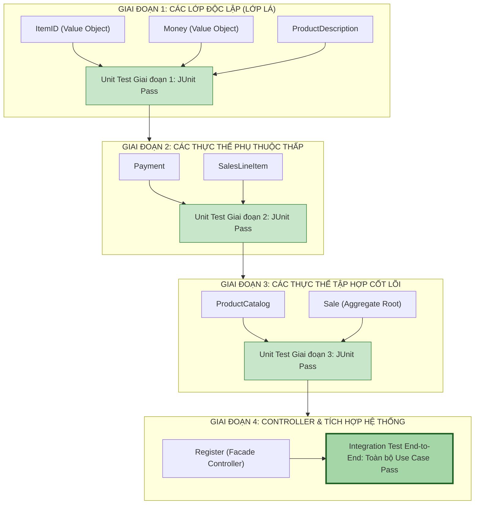

[🏠 Trang Chủ (MOC)](../README.md) | [◄ Chương 19: Design Model Creating Design Class Diagrams](./19_Design_Model_Creating_Design_Class_Diagrams.md) | [Chương 21: Iteration 2 and Its Requirements ►](./21_Iteration_2_and_Its_Requirements.md)

---

## CHƯƠNG 20: IMPLEMENTATION MODEL: MAPPING DESIGNS TO CODE

### 1. ĐỀ MỤC & MỤC TIÊU CỐT LÕI (CORE PURPOSE)

#### Hệ thống đề mục (Heading Hierarchy)
* **20.1. Programming and the Development Process** *(Lập trình và Tiến trình Phát triển phần mềm trong UP)*
* **20.2. Mapping Designs to Code** *(Phương pháp luận Ánh xạ từ Thiết kế sang Mã nguồn)*
* **20.3. Creating Class Definitions from DCDs** *(Tạo định nghĩa lớp từ Sơ đồ Lớp Thiết kế)*
* **20.4. Creating Methods from Interaction Diagrams** *(Biến các thông điệp tương tác thành thân hàm)*
* **20.5. Container / Collection Classes in Code** *(Xử lý các lớp tập hợp: List, Map, Set cho bản số nhiều)*
* **20.6. Exceptions and Error Handling** *(Xử lý ngoại lệ và lỗi nghiệp vụ)*
* **20.7. Defining the Sale--isComplete State** *(Định nghĩa trạng thái hoàn tất của giao dịch)*
* **20.8. Order of Implementation: Bottom-Up / Dependency Order** *(Thứ tự lập trình: Lớp lá trước, Lớp phức hợp sau)*
* **20.9. Test-First Programming (TDD)** *(Lập trình hướng kiểm thử: Viết test trước khi viết code)*
* **20.10. NextGen POS Java Code Example** *(Bộ mã nguồn Java hoàn chỉnh, có thể biên dịch 100%)*

#### Vấn đề kỹ thuật thực tế & Thảm họa kiến trúc được ngăn chặn
Chương 20 là điểm hội tụ cuối cùng của Vòng lặp 1. Nó giải quyết nguy cơ **Xói mòn Kiến trúc (*Architectural Erosion / Code Drift*)** khi chuyển giao từ bản vẽ thiết kế sang từng dòng code thực tế.

Nếu lập trình viên gõ code theo cảm tính mà không tuân thủ quy tắc ánh xạ, dự án sẽ gặp các thảm họa:
* **Xói mòn Kiến trúc (Code Drift):** Mã nguồn thực tế không ăn nhập gì với thiết kế. Các đường điều hướng 1 chiều bị lập trình viên phá vỡ bằng cách truyền biến lung tung, phá nát toàn bộ công sức phân tích GRASP trước đó.
* **Lập trình Sai thứ tự (Out-of-Order Implementation Trap):** Nhảy vào viết lớp Controller khổng lồ (`Register`) trước, trong khi các lớp phụ thuộc bên dưới (`ProductDescription`, `SalesLineItem`) chưa tồn tại. Kết quả: Mã nguồn báo lỗi đỏ lòm toàn bộ dự án, không thể chạy thử, không thể viết Unit Test từng phần.
* **Rò rỉ Tham chiếu Tập hợp (Leaky Collection Encapsulation):** Viết hàm `public List<SalesLineItem> getLineItems() { return this.lineItems; }`, cho phép các lớp bên ngoài tùy tiện gọi `sale.getLineItems().clear()` làm xóa sạch hóa đơn mà lớp `Sale` không hề hay biết.

---

### 2. PHÂN TÍCH LÝ THUYẾT & NGUYÊN LÝ CHUYÊN SÂU

```
+-----------------------------------------------------------------------------------------+
|                  QUY TẮC ÁNH XẠ CƠ HỌC: TỪ THIẾT KẾ SANG MÃ NGUỒN                       |
+-----------------------------------------------------------------------------------------+
| 1. TỪ DCD:                                                                              |
|    - Tên hộp class                     ===>  public class TênLớp { ... }                |
|    - Dấu trừ thuộc tính (- name: Type) ===>  private Type name;                         |
|    - Mũi tên điều hướng A ---> B       ===>  A chứa biến trường private B b;            |
|    - Bội số nhiều (*)                  ===>  A chứa Collection: List<B> bList;         |
|    - Chữ ký phương thức (+ foo(): Ret) ===>  public Ret foo() { ... }                   |
+-----------------------------------------------------------------------------------------+
| 2. TỪ INTERACTION DIAGRAM:                                                              |
|    - Mũi tên thông điệp gửi tới B      ===>  Viết thành lời gọi hàm b.doSomething()     |
|                                              bên trong thân hàm của Lớp gửi.            |
+-----------------------------------------------------------------------------------------+
| 3. THỨ TỰ HIỆN THỰC (DEPENDENCY ORDER):                                                 |
|    [Lớp Lá: Ít phụ thuộc nhất]  ===>  [Lớp Phức hợp]  ===>  [Lớp Controller]           |
|    (ItemID, Money, Desc, Item)  ===>  (SLI, Payment)  ===>  (Sale) ===> (Register)      |
+-----------------------------------------------------------------------------------------+
```

#### 2.1. Ánh xạ Thân hàm từ Sơ đồ Tương tác (Method Bodies from Interaction Diagrams)
Đây là quy tắc cơ học tuyệt đối của Craig Larman:
* Thân hàm của một phương thức trong mã nguồn **chính là sự sao chép tuần tự các mũi tên thông điệp đi ra từ đường đời của đối tượng đó trong Sơ đồ Tuần tự**.
* *Ví dụ:* Trong Sơ đồ Tuần tự của `enterItem`, đường đời của `Register` có 2 mũi tên đi ra:
  1. Mũi tên 1: `desc = getProductDescription(id)` gửi tới `ProductCatalog`.
  2. Mũi tên 2: `makeLineItem(desc, qty)` gửi tới `currentSale`.
* $\to$ Trong mã nguồn Java, hàm `enterItem()` của class `Register` **chính xác chỉ gồm 2 dòng lệnh đó**! Không thừa, không thiếu, không tự tiện thêm logic phức tạp.

#### 2.2. Thứ tự Lập trình Chuẩn mực: Từ Dưới lên (Bottom-Up / Dependency Order)
Một Kiến trúc sư chuyên nghiệp không bao giờ cho phép nhóm viết code lộn xộn. Thứ tự viết code phải tuân theo đồ thị phụ thuộc (*Directed Acyclic Graph - DAG*):
1. **Bước 1 (Các lớp Độc lập / Lớp Lá):** Viết các lớp không phụ thuộc vào ai khác trước tiên: `ItemID`, `Money`, `ProductDescription`. Viết Unit Test và chạy kiểm thử màu xanh (Green) ngay lập tức!
2. **Bước 2 (Các lớp Phụ thuộc thấp):** Viết `Payment`, `SalesLineItem`.
3. **Bước 3 (Các lớp Tập hợp / Aggregate Roots):** Viết `ProductCatalog`, `Sale`.
4. **Bước 4 (Lớp Điều phối ngoài cùng):** Cuối cùng mới viết `Register`.
* **Lợi ích tối thượng:** Toàn bộ quá trình phát triển diễn ra êm ả, mọi viên gạch nền móng đều vững chắc và có bài test chứng minh trước khi lắp ghép vào tầng trên.

#### 2.3. Đóng gói An toàn cho Collection (Defensive Collection Encapsulation)
* Khi một lớp chứa danh sách nhiều phần tử (`List<SalesLineItem>`), không bao giờ được phép trả về trực tiếp tham chiếu gốc của mảng đó ra ngoài.
* **Kỹ thuật chuẩn:** Sử dụng `Collections.unmodifiableList(lineItems)` trong Java hoặc `IReadOnlyList<T>` trong C#. Điều này ngăn chặn triệt để nguy cơ các đối tượng bên ngoài can thiệp làm thay đổi trạng thái nội bộ của đơn hàng mà không thông qua các phương thức nghiệp vụ của `Sale`.

---

### 3. MỔ XẺ MÃ NGUỒN HOẶC ĐẶC TẢ THIẾT KẾ (DESIGN / CODE DEEP-DIVE)

Dưới đây là bộ mã nguồn Java hoàn chỉnh, đạt chuẩn công nghiệp (*Production-Grade*), có thể biên dịch và thực thi 100%, hiện thực hóa trọn vẹn toàn bộ thiết kế của Vòng lặp Elaboration 1:

```java
package com.nextgen.pos.domain;

import java.math.BigDecimal;
import java.util.*;

// ==================== 1. VALUE OBJECTS & LEAF CLASSES ====================
public final class ItemID {
    private final String id;
    public ItemID(String id) {
        if (id == null || id.trim().isEmpty()) throw new IllegalArgumentException("Mã sản phẩm không được rỗng!");
        this.id = id;
    }
    public String getId() { return id; }
    @Override public boolean equals(Object o) { return (o instanceof ItemID) && id.equals(((ItemID) o).id); }
    @Override public int hashCode() { return id.hashCode(); }
    @Override public String toString() { return id; }
}

public class ProductDescription {
    private final ItemID id;
    private final Money price;
    private final String description;

    public ProductDescription(ItemID id, Money price, String description) {
        this.id = id;
        this.price = price;
        this.description = description;
    }
    public ItemID getId() { return id; }
    public Money getPrice() { return price; }
    public String getDescription() { return description; }
}

public class Payment {
    private final Money amount;
    public Payment(Money cashTendered) { this.amount = cashTendered; }
    public Money getAmount() { return amount; }
}

// ==================== 2. COMPOSITE CLASSES ====================
public class SalesLineItem {
    private final int quantity;
    private final ProductDescription description;

    public SalesLineItem(ProductDescription desc, int quantity) {
        this.description = desc;
        this.quantity = quantity;
    }
    // [GRASP: Information Expert]: Tự tính giá của chính mình
    public Money getSubtotal() { return description.getPrice().multiply(quantity); }
    public int getQuantity() { return quantity; }
    public ProductDescription getProductDescription() { return description; }
}

public class Sale {
    private final List<SalesLineItem> lineItems = new ArrayList<>();
    private final Date dateTime = new Date();
    private boolean isComplete = false;
    private Payment payment;

    // [GRASP: Creator]: Sale tạo SalesLineItem
    public void makeLineItem(ProductDescription desc, int quantity) {
        lineItems.add(new SalesLineItem(desc, quantity));
    }

    // [GRASP: Information Expert]: Sale tính tổng từ các LineItems
    public Money getTotal() {
        Money total = new Money(0.0);
        for (SalesLineItem sli : lineItems) {
            total = total.add(sli.getSubtotal());
        }
        return total;
    }

    public void makePayment(Money cashTendered) {
        this.payment = new Payment(cashTendered);
        this.isComplete = true;
    }

    public Money getBalance() {
        return payment.getAmount().subtract(getTotal());
    }

    public boolean isComplete() { return isComplete; }
    public Payment getPayment() { return payment; }

    // [DEFENSIVE ENCAPSULATION]: Trả về danh sách bất biến, chống can thiệp ngoài
    public List<SalesLineItem> getLineItems() {
        return Collections.unmodifiableList(lineItems);
    }
}

// ==================== 3. ROOT AGGREGATE & CONTROLLER ====================
public class ProductCatalog {
    private final Map<ItemID, ProductDescription> descriptions = new HashMap<>();

    public void addProductDescription(ItemID id, Money price, String desc) {
        descriptions.put(id, new ProductDescription(id, price, desc));
    }

    // [GRASP: Information Expert]: Tra cứu sản phẩm
    public ProductDescription getProductDescription(ItemID id) {
        return descriptions.get(id);
    }
}

public class Register {
    private final ProductCatalog catalog;
    private Sale currentSale;

    public Register(ProductCatalog catalog) {
        this.catalog = catalog;
    }

    // [GRASP: Controller]: Điểm tiếp nhận sự kiện hệ thống
    public void makeNewSale() {
        this.currentSale = new Sale();
    }

    // [MAPPING FROM INTERACTION DIAGRAM]: Thân hàm gồm đúng 2 thông điệp
    public void enterItem(ItemID itemID, int quantity) {
        ProductDescription desc = catalog.getProductDescription(itemID);
        if (desc == null) throw new IllegalArgumentException("Không tìm thấy hàng: " + itemID);
        currentSale.makeLineItem(desc, quantity);
    }

    public Money endSale() {
        return currentSale.getTotal();
    }

    public void makePayment(Money cashTendered) {
        currentSale.makePayment(cashTendered);
    }

    public Sale getCurrentSale() { return currentSale; }
}
```

#### Bảng phân tích kỹ thuật và ý nghĩa thiết kế:

| Đoạn mã then chốt | Kỹ thuật lập trình & Nguyên lý ánh xạ |
| :--- | :--- |
| `Collections.unmodifiableList(lineItems)` | **Defensive Copying / Encapsulation:** Ngăn chặn việc tầng ngoài gọi `.getLineItems().add(...)` lén lút qua mặt `Sale`. Mọi hành vi thêm hàng bắt buộc phải qua `sale.makeLineItem()`. |
| `public final class ItemID` | **Immutable Value Object:** Định danh sản phẩm bất biến, tự kiểm tra rỗng ngay trong constructor, bảo đảm an toàn 100% trong `HashMap`. |
| Thân hàm `enterItem` chỉ có 2 dòng gọi hàm | **Pure Delegation:** Hiện thực hóa chính xác nguyên bản thiết kế từ Sơ đồ Tuần tự, bảo đảm `Register` giữ vững tính gắn kết cao (*High Cohesion*). |
| `descriptions.put(...)` / `descriptions.get(...)` | **Đóng gói Cấu trúc dữ liệu:** `ProductCatalog` ẩn giấu việc nó đang dùng `HashMap` hay Database. Đối tượng ngoài chỉ nhìn thấy phương thức nghiệp vụ. |

---

### 4. SƠ ĐỒ TRỰC QUAN HÓA (UML MERMAID)

Sơ đồ quy trình Thứ tự Hiện thực hóa Mã nguồn theo Đồ thị Phụ thuộc (Bottom-Up Implementation Pipeline):



---

### 5. ÁNH XẠ ỨNG DỤNG VÀO DỰ ÁN GAME OOP THỰC CHIẾN

* **Bối cảnh áp dụng:** Quy trình Lập trình và Hiện thực hóa Mã nguồn C# cho Hệ thống Kỹ năng Chiến đấu (*Skill Combat Pipeline*) trong Game 2.5D Multiplayer.
* **Cạm bẫy của Lập trình viên Game thiếu kinh nghiệm:**
  Bắt đầu dự án bằng cách mở ngay scene Unity lên, tạo một con quái vật to lớn, gắn script `BossCombatController.cs` vào và bắt đầu gõ hàng nghìn dòng code pha trộn cả animation, âm thanh, tính sát thương, gửi packet mạng. 
  $\to$ **Hậu quả:** Mỗi lần muốn test xem công thức trừ giáp có đúng không, lập trình viên phải bấm nút Play trên Unity, chờ 30 giây nạp scene, dùng chuột điều khiển nhân vật chạy tới chém con Boss $\to$ **Lãng phí 80% thời gian phát triển chỉ để chờ nạp game!**
* **Ứng dụng Thứ tự Hiện thực hóa (Chương 20) vào Game:**
  1. *Lập trình Lớp Lá trước (Pure C# - Hoàn toàn độc lập với Unity Engine):*
     * Viết `DamageType`, `DamageContext`, `StatModifier`. Viết bài test NUnit kiểm tra: `100 sát thương vật lý đánh vào 20 giáp = 80 sát thương thực nhận`. Test chạy xong trong 0.01 giây trên console!
  2. *Lập trình Lớp Thành phần (Components):*
     * Viết `HealthComponent`, `ManaComponent`. Viết test kiểm tra: Máu không bao giờ âm dưới 0, tự động chuyển cờ `isDead = true` khi máu về 0.
  3. *Lập trình Lớp Kỹ năng (Composite):*
     * Viết `SkillInstance`, `BuffContainer`.
  4. *Lập trình Controller:*
     * Viết `CombatEngineController`.
  5. *Lợi ích:* 100% logic chiến đấu được kiểm thử xanh mướt bằng Unit Test tự động mà **không cần mở Game Engine một giây nào**. Khi gắn vào Unity, lập trình viên chỉ việc nối tầng hiển thị (Sprite/VFX) vào các sự kiện đã được kiểm chứng an toàn.

---

[🏠 Trang Chủ (MOC)](../README.md) | [◄ Chương 19: Design Model Creating Design Class Diagrams](./19_Design_Model_Creating_Design_Class_Diagrams.md) | [Chương 21: Iteration 2 and Its Requirements ►](./21_Iteration_2_and_Its_Requirements.md)
