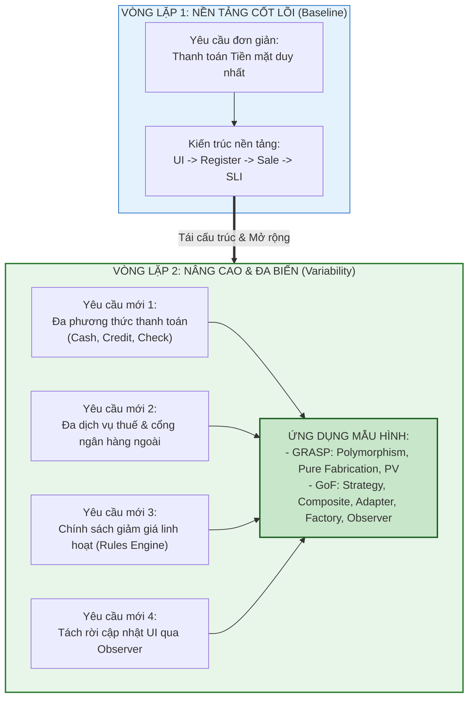

[🏠 Trang Chủ (MOC)](../README.md) | [◄ Chương 20: Implementation Model Mapping Designs to Code](./20_Implementation_Model_Mapping_Designs_to_Code.md) | [Chương 22: GRASP More Patterns for Assigning Responsibilities ►](./22_GRASP_More_Patterns_for_Assigning_Responsibilities.md)

---

## CHƯƠNG 21: ITERATION 2 AND ITS REQUIREMENTS

### 1. ĐỀ MỤC & MỤC TIÊU CỐT LÕI (CORE PURPOSE)

#### Hệ thống đề mục (Heading Hierarchy)
* **21.1. Iteration 2 Emphasis: More Patterns and Refactoring** *(Trọng tâm Vòng lặp 2: Mẫu hình nâng cao và Tái cấu trúc mã nguồn)*
* **21.2. From Iteration 1 to 2** *(Bước chuyển dịch từ Vòng lặp 1 sang Vòng lặp 2: Gia tăng tính phức tạp)*
* **21.3. Iteration 2 Requirements in the NextGen POS** *(Các yêu cầu mới của Vòng lặp 2 trong NextGen POS)*
  * *Support for multiple, external third-party services (Hỗ trợ đa dịch vụ bên thứ ba: Thuế, Kế toán, Ngân hàng)*
  * *Support for different payment types (Hỗ trợ đa phương thức thanh toán: Tiền mặt, Thẻ tín dụng, Séc)*
  * *Pluggable business rules and discount policies (Chính sách giảm giá và quy tắc kinh doanh cắm rút)*
  * *Decoupled UI notification and observation (Thông báo cập nhật giao diện không phụ thuộc)*
* **21.4. Refactoring** *(Tái cấu trúc mã nguồn: Khái niệm, Dấu hiệu mã bốc mùi - Code Smells, Quy trình Refactoring)*
* **21.5. Planning the Next Iteration** *(Lập kế hoạch chuyển tiếp)*

#### Vấn đề kỹ thuật thực tế & Thảm họa kiến trúc được ngăn chặn
Chương 21 đưa hệ thống từ trạng thái "phòng thí nghiệm đơn giản" của Vòng lặp 1 (chỉ thanh toán tiền mặt) bước vào **thế giới thực với đầy đủ sự biến động, tích hợp đa dạng và thay đổi chính sách liên tục**.

Nếu không có sự chuẩn bị kiến trúc bài bản cho Vòng lặp 2, dự án sẽ gặp các thảm họa:
* **Bùng nổ câu lệnh điều kiện (Switch-Case / If-Else Explosion):** Khi xuất hiện nhiều phương thức thanh toán hoặc nhiều nhà cung cấp thuế, lập trình viên chắp vá code bằng cách nhét hàng chục câu lệnh `switch (paymentType)` hoặc `if (vendor == GoodAsGold)` vào giữa logic nghiệp vụ bán hàng.
* **Tê liệt vì Phụ thuộc vào Đối tác Thứ ba (Third-Party Volatility):** Mỗi nhà cung cấp dịch vụ ngoài (Ngân hàng A, Ngân hàng B, Dịch vụ Thuế X) sử dụng một chuẩn API, cấu trúc dữ liệu và giao thức mạng khác nhau. Việc gọi trực tiếp SDK của đối tác làm ô nhiễm toàn bộ Tầng Miền nghiệp vụ.
* **Xói mòn Kiến trúc do Bỏ quên Refactoring (Architectural Decay):** Lập trình viên chỉ biết "viết thêm code mới" mà không dành thời gian tái cấu trúc code cũ. Sau vài vòng lặp, hệ thống biến thành một quả cầu bùn khổng lồ (*Big Ball of Mud*), không ai dám chạm vào vì sợ gây lỗi dây chuyền.

---

### 2. PHÂN TÍCH LÝ THUYẾT & NGUYÊN LÝ CHUYÊN SÂU

```
+-----------------------------------------------------------------------------------------+
|                  SỰ TIẾN HÓA KIẾN TRÚC TỪ VÒNG LẶP 1 SANG VÒNG LẶP 2                    |
+-----------------------------------------------------------------------------------------+
| ĐẶC ĐIỂM             VÒNG LẶP 1 (Basics)               VÒNG LẶP 2 (Advanced Patterns)   |
+-----------------------------------------------------------------------------------------+
| Thanh toán           Duy nhất Tiền mặt (Cash only)     Đa phương thức: Cash, Credit, Check|
| Tích hợp ngoài       Không có (Standalone)             Đa đối tác: Thuế, Cấp phép thẻ   |
| Quy tắc giảm giá     Cố định, đơn giản                 Chiến lược giảm giá động lồng nhau|
| Cập nhật UI          Gọi trực tiếp hoặc Polling        Mẫu hình Observer hướng sự kiện  |
| Mẫu hình áp dụng     GRASP cơ bản (Creator, Expert...) GRASP nâng cao & GoF Patterns    |
+-----------------------------------------------------------------------------------------+
```

#### 2.1. Chiến lược Mở rộng Phạm vi trong Phát triển Lặp
* Craig Larman chỉ ra: **Đừng bao giờ cố gắng giải quyết mọi sự phức tạp trong vòng lặp đầu tiên.**
* Vòng lặp 1 đã hoàn thành xuất sắc nhiệm vụ: Thiết lập bộ khung xương sống kiến trúc (*Architectural Baseline*) thông suốt từ UI $\to$ Controller $\to$ Domain $\to$ Code.
* Vòng lặp 2 là lúc đưa vào các **Yêu cầu biến thể (*Variability Requirements*)**:
  1. *Đa phương thức thanh toán:* Không chỉ có `CashPayment`, xuất hiện thêm `CreditPayment` và `CheckPayment`.
  2. *Đa đối tác dịch vụ ngoài:* Hệ thống phải tích hợp với nhiều dịch vụ tính thuế và cổng thanh toán khác nhau tùy theo cửa hàng hoặc quốc gia triển khai.
  3. *Chính sách định giá linh hoạt:* Giảm giá theo phần trăm, giảm giá cho khách hàng thân thiết, giảm giá theo ngưỡng tổng tiền.

#### 2.2. Kỷ luật Tái cấu trúc Mã nguồn (Refactoring)
* **Định nghĩa chuẩn (Martin Fowler):** Tái cấu trúc là quá trình thay đổi cấu trúc nội bộ của phần mềm nhằm làm cho nó dễ hiểu hơn, dễ sửa đổi hơn mà **KHÔNG LÀM THAY ĐỔI HÀNH VI BÊN NGOÀI** của nó.
* **Quy tắc Bất di bất dịch của Refactoring:**
  * **Chỉ tái cấu trúc khi đã có Bộ kiểm thử tự động (*Automated Unit Tests*) vững chắc!**
  * Chu trình chuẩn: *Red $\to$ Green $\to$ Refactor*.
  * Nếu không có unit test bảo vệ, việc "tái cấu trúc" thực chất chỉ là hành vi xáo trộn code và gieo rắc thêm bug tiềm ẩn.

---

### 3. MỔ XẺ MÃ NGUỒN HOẶC ĐẶC TẢ THIẾT KẾ (DESIGN / CODE DEEP-DIVE)

Dưới đây là màn đối đầu trực tiếp: Minh họa sự thoái hóa kiến trúc do dùng câu lệnh điều kiện thủ tục (*Switch-Case Smell*) và giải pháp chuyển hóa sang thiết kế mở rộng bằng Tái cấu trúc:

```java
// ==================== [SAI] MÃ NGUỒN BỐC MÙI: SWITCH-CASE EXPLOSION ====================
// Vi phạm nghiêm trọng Open-Closed Principle và Protected Variations
public class BadPaymentProcessor {
    public void processPayment(Sale sale, int paymentType, double amount, Object paymentDetails) {
        switch (paymentType) {
            case 1: // Tiền mặt
                sale.setPayment(new CashPayment(amount));
                break;
            case 2: // Thẻ tín dụng
                CreditCardDetails card = (CreditCardDetails) paymentDetails;
                // Gọi trực tiếp SDK ngân hàng A -> Khớp nối chặt với bên thứ ba!
                BankAService bank = new BankAService();
                if (!bank.authorize(card.getNumber(), amount)) {
                    throw new PaymentException("Thẻ bị từ chối!");
                }
                sale.setPayment(new CreditPayment(amount, card));
                break;
            case 3: // Séc
                // Lại thêm logic kiểm tra séc...
                break;
            default:
                throw new IllegalArgumentException("Loại thanh toán không hỗ trợ!");
        }
    }
}
```

#### Bảng phân tích kỹ thuật và ý nghĩa thiết kế:

| Dòng code / Đoạn code then chốt | Dấu hiệu Bốc mùi (Code Smell) & Nguy cơ Kiến trúc |
| :--- | :--- |
| `switch (paymentType)` | **Switch Statements Smell:** Mỗi khi siêu thị chấp nhận thêm thanh toán bằng Ví điện tử (Momo, Apple Pay), lập trình viên bắt buộc phải mở class này ra sửa, vi phạm trực tiếp nguyên lý **Open-Closed Principle (OCP)**. |
| `BankAService bank = new BankAService();` | **Hardcoded Vendor Dependency:** Gắn chặt logic nghiệp vụ vào SDK của Ngân hàng A. Nếu đổi sang Ngân hàng B, toàn bộ khối mã này bị phá vỡ. |
| `(CreditCardDetails) paymentDetails` | **Downcasting / Type Safety Loss:** Ép kiểu không an toàn, dễ dẫn đến ngoại lệ `ClassCastException` trong thời gian chạy. |

---

### 4. SƠ ĐỒ TRỰC QUAN HÓA (UML MERMAID)

Sơ đồ chuyển dịch tiến hóa từ Vòng lặp 1 sang Vòng lặp 2 trong Quy trình Phát triển Lặp:



---

### 5. ÁNH XẠ ỨNG DỤNG VÀO DỰ ÁN GAME OOP THỰC CHIẾN

* **Bối cảnh áp dụng:** Bước chuyển dịch từ Prototype sang Alpha Test trong Game 2.5D Multiplayer: Hệ thống Vũ khí và Thuộc tính Sát thương (*Weapons & Elemental Damage System*).
* **Diễn tiến thực tế giữa hai vòng lặp:**
  1. *Vòng lặp 1 (Prototype):* Nhân vật chỉ có 1 cây kiếm gỗ cơ bản, gây sát thương vật lý thô duy nhất (`hp -= 10`). Mục đích: Thông luồng di chuyển và đồng bộ mạng.
  2. *Vòng lặp 2 (Gia tăng biến thể nghiệp vụ Game):*
     * Hỗ trợ đa dạng loại vũ khí với cơ chế bắn khác nhau: Kiếm (chém cận chiến góc quạt 90 độ), Cung tên (bắn đạn bay theo đường thẳng có va chạm hitbox), Gậy phép (triệu hồi tia sét rơi từ trên trời xuống).
     * Hỗ trợ đa nguyên tố sát thương: Sát thương Lửa (gây thiêu đốt rút máu theo thời gian), Băng (làm chậm tốc độ chạy 50%), Sấm sét (gây choáng 1 giây).
* **Bài học kiến trúc:** Tuyệt đối không nhét `switch (weaponType)` và `switch (elementalType)` vào hàm tấn công của nhân vật. Chuẩn bị sẵn sàng tinh thần áp dụng **GRASP Polymorphism** và **GoF Strategy** ở Chương 22 & 23 để giải quyết bài toán đa biến này một cách thanh lịch.

---

[🏠 Trang Chủ (MOC)](../README.md) | [◄ Chương 20: Implementation Model Mapping Designs to Code](./20_Implementation_Model_Mapping_Designs_to_Code.md) | [Chương 22: GRASP More Patterns for Assigning Responsibilities ►](./22_GRASP_More_Patterns_for_Assigning_Responsibilities.md)
