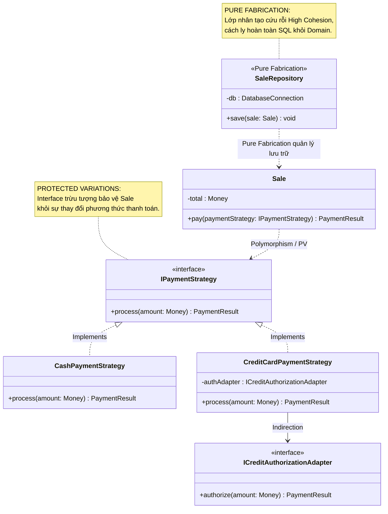

[🏠 Trang Chủ (MOC)](../README.md) | [◄ Chương 21: Iteration 2 and Its Requirements](./21_Iteration_2_and_Its_Requirements.md) | [Chương 23: Designing Use Case Realizations with GoF Patterns ►](./23_Designing_Use_Case_Realizations_with_GoF_Patterns.md)

---

## CHƯƠNG 22: GRASP: MORE PATTERNS FOR ASSIGNING RESPONSIBILITIES

### 1. ĐỀ MỤC & MỤC TIÊU CỐT LÕI (CORE PURPOSE)

#### Hệ thống đề mục (Heading Hierarchy)
* **22.1. Polymorphism** *(Đa hình – Xử lý các biến thể hành vi dựa trên kiểu)*
* **22.2. Pure Fabrication** *(Chế tác Thuần túy / Sáng tạo Nhân tạo – Cứu tinh của High Cohesion)*
* **22.3. Indirection** *(Chỉ định Gián tiếp – Trung gian hòa giải giảm khớp nối)*
* **22.4. Protected Variations (PV)** *(Bảo vệ khỏi Biến đổi – Mẫu hình Đại sư phụ của Kiến trúc Phần mềm)*
  * *Points of Variation vs. Points of Evolution (Điểm biến đổi hiện tại vs. Điểm tiến hóa tương lai)*
  * *The Mechanism of Protected Variations (Cơ chế bảo vệ: Interface, Indirection, Data-Driven)*
* **22.5. Information Expert vs. Pure Fabrication** *(Sự giằng xé giữa Chuyên gia Thông tin và Chế tác Thuần túy)*
* **22.6. Summary of all 9 GRASP Patterns** *(Bảng tổng kết toàn diện 9 mẫu hình GRASP)*

#### Vấn đề kỹ thuật thực tế & Thảm họa kiến trúc được ngăn chặn
Chương 22 cung cấp 4 mẫu hình GRASP nâng cao để giải quyết bài toán hóc búa nhất của ngành kỹ nghệ phần mềm: **Sự thay đổi không ngừng (*Constant Change*)**.

Nếu không thấu hiểu 4 nguyên lý này, hệ thống sẽ gặp các thảm họa:
* **Sụp đổ cấu trúc khi có yêu cầu mới (Fragile Architecture):** Mỗi khi đối tác thay đổi chuẩn dữ liệu hoặc khách hàng thêm chính sách mới, hệ thống bị rung chuyển dữ dội, lập trình viên phải sửa đổi hàng chục file code hiện có (*Violating Open-Closed Principle*).
* **Ô nhiễm Tầng Miền bằng Chi tiết Hạ tầng (Domain Contamination):** Ép buộc các đối tượng nghiệp vụ thuần túy như `Sale` phải tự mình mở kết nối JDBC, tự viết câu lệnh SQL `INSERT INTO SALES...`. Hậu quả: Lớp `Sale` bị kéo tụt độ gắn kết (*Low Cohesion*), dính chặt vào công nghệ cơ sở dữ liệu.
* **Gia tăng sự phụ thuộc trực tiếp (Direct Coupling Tangle):** Hai thành phần lớn của hệ thống nói chuyện trực tiếp với nhau mà không có tầng trung gian, khiến việc thay thế một thành phần đòi hỏi phải viết lại thành phần kia.

---

### 2. PHÂN TÍCH LÝ THUYẾT & NGUYÊN LÝ CHUYÊN SÂU

```
+-----------------------------------------------------------------------------------------+
|                                4 MẪU HÌNH GRASP NÂNG CAO                                |
+-----------------------------------------------------------------------------------------+
| [POLYMORPHISM]        : Thay thế rẽ nhánh điều kiện (if-else/switch) bằng các phương    |
|                         thức đa hình trên các lớp con hoặc interface chung.             |
+-----------------------------------------------------------------------------------------+
| [PURE FABRICATION]    : Tạo ra một lớp nhân tạo không có trong thế giới thực            |
|                         (như DAO, Service, Adapter) để giữ High Cohesion & Low Coupling.|
+-----------------------------------------------------------------------------------------+
| [INDIRECTION]         : Đặt một đối tượng trung gian làm cầu nối giữa 2 thành phần      |
|                         để chúng không bị phụ thuộc trực tiếp vào nhau.                 |
+-----------------------------------------------------------------------------------------+
| [PROTECTED VARIATIONS]: Nhận diện các điểm bất ổn/dễ biến đổi; dựng một giao diện       |
|                         ổn định bọc quanh chúng để che chắn cho phần còn lại.           |
+-----------------------------------------------------------------------------------------+
```

#### 2.1. Polymorphism (Đa hình)
* **Vấn đề:** Làm thế nào để xử lý các hành vi biến thể dựa trên kiểu dữ liệu mà không dùng các câu lệnh rẽ nhánh phức tạp?
* **Giải pháp:** Gán trách nhiệm xử lý hành vi biến thể đó cho các lớp cụ thể thông qua các **phương thức đa hình (*Polymorphic Operations*)** kế thừa từ một Interface hoặc Abstract Class chung.
* **Quy tắc vàng:** Mỗi khi bạn thấy một câu lệnh `switch (type)` hoặc chuỗi `if-else if-else` kiểm tra loại đối tượng, hãy nghĩ ngay đến **GRASP Polymorphism**.

#### 2.2. Pure Fabrication (Chế tác Thuần túy)
* **Vấn đề:** Nếu áp dụng nguyên tắc *Information Expert*, lớp `Sale` nắm giữ toàn bộ dữ liệu đơn hàng, vậy `Sale` có nên chịu trách nhiệm tự lưu chính nó vào Database không?
  * *Trả lời:* **TUYỆT ĐỐI KHÔNG!** Nếu bắt `Sale` tự lưu vào Database, `Sale` sẽ bị khớp nối với SQL, JDBC, kết nối mạng. Độ gắn kết (*Cohesion*) của `Sale` sẽ bị tụt dốc thảm hại.
* **Giải pháp:** Tạo ra một lớp nhân tạo hoàn toàn **không tồn tại trong thế giới thực** (không có trong Domain Model), ví dụ: `SaleRepository` hoặc `PersistentStorageFacade`.
* Lớp nhân tạo này được "bịa ra" (*Fabricated*) thuần túy vì mục tiêu kỹ thuật phần mềm: Giữ cho Tầng Miền trong sáng, duy trì tính gắn kết cao (*High Cohesion*) và khớp nối lỏng (*Low Coupling*).

#### 2.3. Indirection (Chỉ định Gián tiếp)
* **Vấn đề:** Làm sao tránh sự phụ thuộc trực tiếp giữa hai lớp A và B?
* **Giải pháp:** Gán trách nhiệm cho một **đối tượng trung gian hòa giải (*Intermediate Object*)** đứng ở giữa điều phối.
* Câu châm ngôn kinh điển của ngành khoa học máy tính (David Wheeler): *"Mọi vấn đề trong khoa học máy tính đều có thể giải quyết được bằng cách thêm một tầng gián tiếp"*. Các mẫu hình Adapter, Facade, Proxy đều là hiện thân của Indirection.

#### 2.4. Protected Variations (Bảo vệ khỏi Biến đổi) - Mẫu hình Tối thượng
Craig Larman gọi Protected Variations (PV) là **nguyên lý cội nguồn (*Root Principle*)** khai sinh ra hầu hết các mẫu hình thiết kế và nguyên lý kiến trúc trong lịch sử phần mềm:
* **Vấn đề:** Làm sao thiết kế hệ thống để sự thay đổi hoặc tính bất ổn ở một module không gây ảnh hưởng tiêu cực tới các module khác?
* **Giải pháp:**
  1. Nhận diện các **Điểm biến đổi (*Points of Variation*)** hoặc **Điểm tiến hóa tiềm năng (*Points of Evolution*)**.
  2. Thiết lập một **Giao diện Trừu tượng Ổn định (*Stable Interface*)** bọc quanh điểm biến đổi đó.
* **Mối liên hệ vĩ mô:**
  * Nguyên lý Đóng/Mở (*Open-Closed Principle - OCP*): Chính là Protected Variations.
  * Nguyên lý Đảo ngược Phụ thuộc (*DIP*): Chính là Protected Variations.
  * Tính đóng gói thông tin (*Information Hiding* của David Parnas): Chính là Protected Variations.

---

### 3. MỔ XẺ MÃ NGUỒN HOẶC ĐẶC TẢ THIẾT KẾ (DESIGN / CODE DEEP-DIVE)

Dưới đây là đoạn mã Java phô diễn sự kết hợp hoàn hảo giữa cả 4 mẫu hình GRASP nâng cao: **Protected Variations** (tạo Interface trừu tượng), **Polymorphism** (hiện thực hóa đa hình), **Pure Fabrication** (tạo lớp Repository lưu trữ), và **Indirection** (trung gian điều phối):

```java
// ==================== 1. PROTECTED VARIATIONS & POLYMORPHISM ====================
// Điểm biến đổi: Các phương thức thanh toán có quy trình xử lý hoàn toàn khác nhau.
// Dựng một Interface ổn định để bảo vệ hệ thống khỏi sự biến đổi này.
public interface IPaymentStrategy {
    PaymentResult process(Money amount);
}

public class CashPaymentStrategy implements IPaymentStrategy {
    @Override
    public PaymentResult process(Money amount) {
        // [Polymorphic Behavior 1]: Xử lý tiền mặt đơn giản tại quầy
        return new PaymentResult(true, "Thanh toán tiền mặt thành công", Money.ZERO);
    }
}

public class CreditCardPaymentStrategy implements IPaymentStrategy {
    private final ICreditAuthorizationAdapter authAdapter; // Indirection tới ngân hàng

    public CreditCardPaymentStrategy(ICreditAuthorizationAdapter authAdapter) {
        this.authAdapter = authAdapter;
    }

    @Override
    public PaymentResult process(Money amount) {
        // [Polymorphic Behavior 2]: Ủy thác qua Adapter để gọi dịch vụ ngân hàng ngoài
        return authAdapter.authorize(amount);
    }
}

// ==================== 2. PURE FABRICATION ====================
// Khái niệm "SaleRepository" không hề tồn tại trong thế giới thực bán lẻ.
// Nó là một Chế tác Thuần túy nhằm cứu rỗi High Cohesion cho lớp Sale.
public class SaleRepository {
    private final DatabaseConnection db;

    public SaleRepository(DatabaseConnection db) {
        this.db = db;
    }

    // Đảm nhiệm toàn bộ việc ghi dữ liệu phức tạp, giải phóng Sale khỏi gánh nặng SQL
    public void save(Sale sale) {
        db.executeInsert("INSERT INTO sales (id, total, date) VALUES (?, ?, ?)", 
                         sale.getId(), sale.getTotal().getAmount(), sale.getDateTime());
        for (SalesLineItem sli : sale.getLineItems()) {
            db.executeInsert("INSERT INTO sale_lines (sale_id, item_id, qty) VALUES (?, ?, ?)",
                             sale.getId(), sli.getProductDescription().getId(), sli.getQuantity());
        }
    }
}
```

#### Bảng phân tích kỹ thuật và ý nghĩa thiết kế:

| Thành phần mã nguồn | Mẫu hình GRASP áp dụng | Ý nghĩa Kiến trúc & Tránh thảm họa |
| :--- | :--- | :--- |
| `public interface IPaymentStrategy` | **Protected Variations** | Bảo vệ hệ thống lõi khỏi sự thay đổi phương thức thanh toán. Thêm thanh toán Crypto hay Momo chỉ việc tạo class mới, không đụng vào 1 dòng code cũ. |
| `CashPaymentStrategy` vs `CreditCardPaymentStrategy` | **Polymorphism** | Tiêu diệt hoàn toàn câu lệnh `switch (paymentType)`. Trình biên dịch tự động điều phối hàm `process()` tương ứng theo kiểu thực tế. |
| `private final ICreditAuthorizationAdapter authAdapter;` | **Indirection** | Không gọi trực tiếp thư viện ngân hàng; gọi qua một Adapter trung gian làm cầu nối cách ly. |
| `public class SaleRepository` | **Pure Fabrication** | Ngăn chặn việc làm vỡ tính gắn kết của `Sale`. `Sale` giữ 100% sự thuần khiết nghiệp vụ miền, `SaleRepository` chịu trách nhiệm hạ tầng kỹ thuật. |

---

### 4. SƠ ĐỒ TRỰC QUAN HÓA (UML MERMAID)

Sơ đồ Lớp Thiết kế thể hiện sự phối hợp chặt chẽ giữa 4 mẫu hình GRASP nâng cao để bảo vệ Tầng Miền:



---

### 5. ÁNH XẠ ỨNG DỤNG VÀO DỰ ÁN GAME OOP THỰC CHIẾN

* **Bối cảnh áp dụng:** Thiết kế Hệ thống Trí tuệ Nhân tạo cho Quái vật (*Monster AI Behavior System*) và Cơ chế Tìm đường (*Pathfinding*) trong Game 2.5D Multiplayer.
* **Thảm họa nếu thiếu 4 mẫu GRASP nâng cao:**
  Lập trình viên viết hàm `UpdateAI()` bên trong class `Monster`:
  ```csharp
  // CODE THẢM HỌA: Thiếu Polymorphism và Pure Fabrication
  void UpdateAI() {
      if (type == MonsterType.Zombie) {
          // Đi thẳng tới người chơi
      } else if (type == MonsterType.Archer) {
          // Lùi lại giữ khoảng cách rồi bắn tên
      } else if (type == MonsterType.HealerBoss) {
          // Tìm đồng minh thấp máu nhất để hồi máu
      }
      // Tự viết thuật toán tìm đường A* dài 500 dòng ngay trong class Monster!
  }
  ```
* **Ứng dụng GRASP nâng cao từ Chương 22:**
  1. *Polymorphism:* Tạo interface `IArtificialIntelligence`. Các lớp con: `MeleeAggressiveAI`, `RangedKitingAI`, `SupportHealerAI` hiện thực hóa phương thức `ExecuteBehavior(Monster self)`. Khi thêm Boss mới, chỉ cần viết thêm 1 class AI mới mà không sửa class `Monster` cũ.
  2. *Pure Fabrication:* Thuật toán tìm đường ma trận A* (*A-Star Navigation*) **không phải là bản chất sinh học của con quái vật**. Ta tạo một lớp nhân tạo `AStarPathfindingService` (Pure Fabrication) chuyên xử lý toán học lưới 2.5D. `Monster` chỉ việc gọi dịch vụ này để lấy danh sách tọa độ cần đi.
  3. *Protected Variations:* Bọc toàn bộ hệ thống giao tiếp mạng đằng sau interface `INetworkMessageBroker`. Dù sau này game chuyển từ UDP sang WebSockets, logic AI của quái vật không hề bị lay chuyển.

---

[🏠 Trang Chủ (MOC)](../README.md) | [◄ Chương 21: Iteration 2 and Its Requirements](./21_Iteration_2_and_Its_Requirements.md) | [Chương 23: Designing Use Case Realizations with GoF Patterns ►](./23_Designing_Use_Case_Realizations_with_GoF_Patterns.md)
