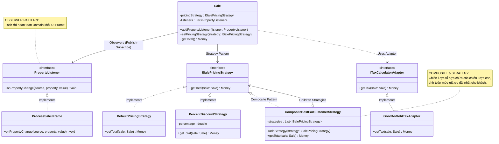

[🏠 Trang Chủ (MOC)](../README.md) | [◄ Chương 22: GRASP More Patterns for Assigning Responsibilities](./22_GRASP_More_Patterns_for_Assigning_Responsibilities.md) | [Chương 24: Iteration 3 and Its Requirements ►](./24_Iteration_3_and_Its_Requirements.md)

---

## CHƯƠNG 23: DESIGNING USE-CASE REALIZATIONS WITH GOF DESIGN PATTERNS

### 1. ĐỀ MỤC & MỤC TIÊU CỐT LÕI (CORE PURPOSE)

#### Hệ thống đề mục (Heading Hierarchy)
* **23.1. Adapter (GoF)** *(Bộ chuyển đổi: Thích ứng các dịch vụ bên ngoài có giao diện bất đồng)*
* **23.2. Factory (GoF)** *(Nhà máy: Đóng gói logic khởi tạo đối tượng động)*
* **23.3. Singleton (GoF)** *(Đơn thực thể: Điểm truy cập toàn cục duy nhất an toàn)*
* **23.4. Strategy (GoF)** *(Chiến lược: Đóng gói các giải thuật định giá và chiết khấu có thể tráo đổi)*
* **23.5. Composite (GoF)** *(Hỗn hợp: Cấu trúc cây xử lý các chính sách giảm giá lồng nhau)*
* **23.6. Facade (GoF)** *(Mặt tiền: Cung cấp giao diện cấp cao đơn giản hóa cho hệ thống con phức tạp)*
* **23.7. Observer / Publish-Subscribe (GoF)** *(Người quan sát: Tách rời Tầng Miền khỏi Tầng Giao diện)*
* **23.8. Conclusion: GRASP as the Foundational Grammar of GoF** *(Kết luận: GRASP là ngữ pháp nền tảng kiến tạo nên các mẫu hình GoF)*

#### Vấn đề kỹ thuật thực tế & Thảm họa kiến trúc được ngăn chặn
Chương 23 hiện thực hóa các yêu cầu phức tạp của Vòng lặp 2 bằng cách kết hợp **6 mẫu hình GoF (Gang of Four) kinh điển nhất**. Nó giải quyết bài toán biến một hệ thống phần mềm đơn điệu thành một **Cỗ máy linh hoạt, có thể cắm rút (*Pluggable Enterprise System*)**.

Nếu không áp dụng đúng các mẫu hình GoF này, hệ thống sẽ gặp các thảm họa:
* **Khóa chết vào giao diện của nhà cung cấp (API Incompatibility Disaster):** Ngân hàng A trả về kết quả kiểu XML qua Socket; Ngân hàng B trả về JSON qua REST. Không có *Adapter*, mã nguồn nghiệp vụ bán hàng sẽ ngập tràn các đoạn code parse chuỗi dị hợm của từng đối tác.
* **Thảm họa Chính sách Chiết khấu phức tạp (Pricing Rules Chaos):** Khách hàng có thẻ VIP được giảm 10%, nếu mua vào ngày sinh nhật giảm thêm 5%, nếu đơn hàng trên 1 triệu thì áp dụng chính sách giảm giá cao nhất nhưng không vượt quá 200k. Không có *Strategy & Composite*, logic tính tiền sẽ biến thành ma trận `if-else` lồng nhau 10 tầng không thể gỡ lỗi.
* **Rò rỉ ngược từ Giao diện vào Nghiệp vụ (Reverse Coupling):** Để cập nhật thanh hiển thị tiền thừa trên màn hình, lập trình viên cho lớp `Sale` import thư viện đồ họa Swing/JavaFX để gọi hàm `ui.updateBalanceText()`. Khi đưa hệ thống lên web hoặc chạy test ngầm, toàn bộ tầng miền sụp đổ vì thiếu môi trường đồ họa.

---

### 2. PHÂN TÍCH LÝ THUYẾT & NGUYÊN LÝ CHUYÊN SÂU

```
+-----------------------------------------------------------------------------------------+
|                                6 MẪU HÌNH GOF CỐT LÕI TRONG UP                          |
+-----------------------------------------------------------------------------------------+
| [ADAPTER]   : Chuyển đổi giao diện của đối tác bên ngoài thành giao diện chuẩn của ta.   |
|               (Áp dụng: Thuế GoodAsGold/TaxMaster; Cổng thanh toán thẻ ngân hàng).       |
+-----------------------------------------------------------------------------------------+
| [FACTORY]   : Tạo ra các đối tượng cụ thể dựa trên cấu hình (Reflection) mà không       |
|               làm lộ tên lớp thực thi ra ngoài tầng gọi.                                |
+-----------------------------------------------------------------------------------------+
| [SINGLETON] : Đảm bảo ServicesFactory chỉ có duy nhất 1 thể hiện trong toàn bộ bộ nhớ.  |
+-----------------------------------------------------------------------------------------+
| [STRATEGY]  : Biến các giải thuật tính giá (Chiết khấu VIP, giảm giá số lượng lớn)     |
|               thành các đối tượng thuật toán có thể hoán đổi linh hoạt lúc chạy.        |
+-----------------------------------------------------------------------------------------+
| [COMPOSITE] : Cho phép một Chiến lược Giảm giá được tạo thành từ nhiều chiến lược con,  |
|               được đối xử đồng nhất qua cùng một giao diện (Cấu trúc cây).               |
+-----------------------------------------------------------------------------------------+
| [OBSERVER]  : Tầng Miền (Subject) bắn sự kiện khi trạng thái thay đổi; Tầng Giao diện   |
|               (Observer) tự động lắng nghe để vẽ lại màn hình mà Miền ko phụ thuộc UI.  |
+-----------------------------------------------------------------------------------------+
```

#### 2.1. Adapter kết hợp Factory & Singleton
* **Bản chất của Adapter:** Đóng vai trò là một "bộ chuyển đổi phích cắm điện". Hệ thống của ta chỉ nói chuyện với giao diện chuẩn `ITaxCalculatorAdapter`. Mỗi nhà cung cấp dịch vụ bên ngoài sẽ có một Adapter riêng (`GoodAsGoldTaxAdapter`, `TaxMasterAdapter`) chịu trách nhiệm dịch ngôn ngữ của ta sang API của họ.
* **Tại sao cần Factory & Singleton?**
  * Làm sao `Register` lấy được Adapter mà không phải viết lệnh `new GoodAsGoldTaxAdapter()`?
  * Ta dùng **ServicesFactory**. Factory này đọc file cấu hình (`pos.properties`). Nếu file ghi `tax.adapter = com.pos.TaxMasterAdapter`, Factory sẽ dùng cơ chế phản chiếu (*Reflection*) để nạp lớp đó động.
  * Bản thân `ServicesFactory` được thiết kế theo mẫu **Singleton** để toàn bộ hệ thống chia sẻ chung một điểm truy cập cấu hình duy nhất.

#### 2.2. Sự kết hợp hoàn mỹ giữa Strategy và Composite
* **Strategy Pattern:** Mỗi chính sách giảm giá là một đối tượng cài đặt interface `ISalePricingStrategy` với phương thức `Money getTotal(Sale sale)`.
  * `AbsoluteDiscountPricingStrategy`: Giảm thẳng 50.000đ.
  * `PercentDiscountPricingStrategy`: Giảm 10%.
* **Composite Pattern:** Điều gì xảy ra khi siêu thị có chính sách: *"Áp dụng tất cả các ưu đãi và chọn mức giá có lợi nhất cho khách hàng"*?
  * Ta tạo ra một `CompositeBestForCustomerPricingStrategy` kế thừa chính interface `ISalePricingStrategy`, bên trong nó chứa một danh sách `List<ISalePricingStrategy>`.
  * Khi hàm `getTotal()` được gọi, nó duyệt qua các chiến lược con, lấy kết quả nhỏ nhất trả về.
  * **Sức mạnh tối thượng:** Đối tượng `Sale` hoàn toàn không biết nó đang nói chuyện với một chiến lược đơn lẻ hay một cây chiến lược lồng nhau 5 tầng!

#### 2.3. Observer / Publish-Subscribe: Giải bài toán Ngăn cách Giao diện
* **Vấn đề cốt tử:** Khi thu ngân quét mã sản phẩm, phương thức `sale.enterItem()` làm thay đổi tổng tiền. Màn hình máy tính tiền cần cập nhật con số hiển thị ngay lập tức. Làm sao làm được điều này mà `Sale` không được phép import `JFrame` hay bất kỳ thư viện UI nào?
* **Cơ chế Observer:**
  * Lớp `Sale` đóng vai trò là **Subject / Publisher**. Nó sở hữu danh sách các người quan sát trừu tượng `List<PropertyListener>`.
  * Lớp giao diện `ProcessSaleFrame` cài đặt giao diện `PropertyListener` (Observer).
  * Khi tổng tiền thay đổi, `Sale` chỉ việc duyệt danh sách và gọi: `listener.onPropertyChange(this, "total", newTotal)`.
  * **Kết quả:** Giao diện tự động cập nhật mượt mà theo thời gian thực, trong khi Tầng Miền giữ vững 100% sự độc lập thuần khiết, tuân thủ tuyệt đối Quy tắc Phụ thuộc Một Chiều (*One-Way Dependency Rule*).

---

### 3. MỔ XẺ MÃ NGUỒN HOẶC ĐẶC TẢ THIẾT KẾ (DESIGN / CODE DEEP-DIVE)

Dưới đây là bản hiện thực hóa mã nguồn Java kết hợp liên hoàn các mẫu hình GoF cốt lõi: **Strategy + Composite** cho định giá, và **Observer** cho cập nhật giao diện không phụ thuộc:

```java
// ==================== 1. STRATEGY & COMPOSITE PATTERN ====================
public interface ISalePricingStrategy {
    Money getTotal(Sale sale);
}

// Chiến lược thông thường: Không giảm giá
public class DefaultPricingStrategy implements ISalePricingStrategy {
    @Override
    public Money getTotal(Sale sale) {
        Money total = new Money(0.0);
        for (SalesLineItem sli : sale.getLineItems()) {
            total = total.add(sli.getSubtotal());
        }
        return total;
    }
}

// Chiến lược giảm giá theo tỷ lệ phần trăm
public class PercentDiscountStrategy implements ISalePricingStrategy {
    private final double percentage;
    public PercentDiscountStrategy(double percentage) { this.percentage = percentage; }

    @Override
    public Money getTotal(Sale sale) {
        Money rawTotal = new DefaultPricingStrategy().getTotal(sale);
        return rawTotal.multiply(1.0 - percentage);
    }
}

// COMPOSITE PATTERN: Chiến lược tổ hợp chọn mức giá có lợi nhất cho khách hàng
public class CompositeBestForCustomerStrategy implements ISalePricingStrategy {
    private final List<ISalePricingStrategy> strategies = new ArrayList<>();

    public void addStrategy(ISalePricingStrategy strategy) {
        strategies.add(strategy);
    }

    @Override
    public Money getTotal(Sale sale) {
        if (strategies.isEmpty()) return new DefaultPricingStrategy().getTotal(sale);

        Money lowestTotal = new Money(Double.MAX_VALUE);
        for (ISalePricingStrategy strategy : strategies) {
            Money currentTotal = strategy.getTotal(sale);
            // Chọn tổng tiền nhỏ nhất (Ưu đãi nhất cho người mua)
            if (currentTotal.getAmount().compareTo(lowestTotal.getAmount()) < 0) {
                lowestTotal = currentTotal;
            }
        }
        return lowestTotal;
    }
}

// ==================== 2. OBSERVER PATTERN (DECOUPLED UI) ====================
public interface PropertyListener {
    void onPropertyChange(Object source, String propertyName, Object newValue);
}

public class Sale {
    private final List<SalesLineItem> lineItems = new ArrayList<>();
    private final List<PropertyListener> listeners = new ArrayList<>();
    private ISalePricingStrategy pricingStrategy = new DefaultPricingStrategy();

    public void addPropertyListener(PropertyListener listener) {
        listeners.add(listener);
    }

    public void setPricingStrategy(ISalePricingStrategy strategy) {
        this.pricingStrategy = strategy;
        notifyListeners("pricingStrategy", this.pricingStrategy);
    }

    public void makeLineItem(ProductDescription desc, int quantity) {
        lineItems.add(new SalesLineItem(desc, quantity));
        // Phát sự kiện thông báo cho tầng UI mà KHÔNG cần biết UI là ai
        notifyListeners("total", getTotal());
    }

    public Money getTotal() {
        return pricingStrategy.getTotal(this);
    }

    private void notifyListeners(String propertyName, Object newValue) {
        for (PropertyListener listener : listeners) {
            listener.onPropertyChange(this, propertyName, newValue);
        }
    }
}
```

#### Bảng phân tích kỹ thuật và ý nghĩa thiết kế:

| Đoạn mã then chốt | Mẫu hình GoF áp dụng | Lợi ích Kiến trúc & Đánh giá Chất lượng |
| :--- | :--- | :--- |
| `public interface ISalePricingStrategy` | **Strategy Pattern** | Đóng gói thuật toán tính giá thành các đối tượng có thể tráo đổi lúc chạy (*Runtime Polymorphic Swapping*). |
| `public class CompositeBestForCustomerStrategy` | **Composite Pattern** | Xử lý cấu trúc cây đệ quy: Một Composite chứa nhiều Strategy con nhưng bên ngoài nhìn vào vẫn đối xử như một Strategy duy nhất. |
| `private final List<PropertyListener> listeners;` | **Observer Pattern** | Triệt tiêu 100% sự phụ thuộc từ Domain ngược lên UI. Tầng Domain chỉ biết gửi sự kiện tới Interface `PropertyListener`. |
| `notifyListeners("total", getTotal());` | **Publish-Subscribe / Event-Driven** | Giao diện đăng ký lắng nghe sự kiện sẽ tự động nhận được giá tiền mới để vẽ lại màn hình mà không cần chạy vòng lặp thăm dò (*No Polling Overhead*). |

---

### 4. SƠ ĐỒ TRỰC QUAN HÓA (UML MERMAID)

Sơ đồ Lớp Thiết kế tích hợp toàn diện 4 mẫu hình GoF then chốt (Strategy, Composite, Adapter và Observer) trong Tầng Miền NextGen POS:



---

### 5. ÁNH XẠ ỨNG DỤNG VÀO DỰ ÁN GAME OOP THỰC CHIẾN

* **Bối cảnh áp dụng:** Thiết kế Hệ thống Hiệu ứng Tăng/Giảm Chỉ số (*Buff/Debuff System*) và Cập nhật Giao diện Thanh máu HUD trong Game 2.5D Multiplayer.
* **Thảm họa nếu không áp dụng GoF Patterns:**
  * Nhân vật dính cùng lúc 3 hiệu ứng: Tăng 20% tốc độ chạy (Buff tốc độ), Mang ba lô nặng giảm 5 đơn vị tốc độ (Debuff gánh nặng), và Vùng đầm lầy giảm 50% tốc độ di chuyển. Lập trình viên viết một hàm tính tốc độ dài 500 dòng với hàng tá biến cờ boolean `isSlowed`, `isBuffed`, `isCarryingHeavy`... Code liên tục xung đột thứ tự cộng/nhân chỉ số, gây ra bug nhân vật chạy giật lùi hoặc tốc độ chạy biến thành số âm!
  * Để thanh máu HUD trên màn hình tụt xuống khi bị đánh, class `Character` gọi thẳng: `GameObject.Find("HUD_HealthBar").GetComponent<Image>().fillAmount = hp / maxHp;` $\to$ Mã nguồn dính chết vào cấu trúc Hierarchy của scene Unity, không thể chạy được trên Dedicated Server.
* **Ứng dụng GoF Patterns từ Chương 23 vào Game:**
  1. *Strategy & Composite Patterns cho Hệ thống Buff/Debuff:*
     * Interface: `IStatModifierStrategy` với hàm `float Apply(float baseValue)`.
     * Các Strategy con: `FlatModifier(+10)`, `PercentModifier(* 1.2f)`.
     * Composite: `CompositeBuffContainer` chứa danh sách tất cả các buff/debuff mà nhân vật đang có trên người. Khi cần lấy tốc độ di chuyển hiện tại, chỉ cần gọi: `currentSpeed = buffContainer.Apply(baseSpeed)`. Thứ tự ưu tiên tính toán (cộng trước, nhân sau) được đóng gói hoàn hảo trong Composite.
  2. *Observer Pattern cho UI HUD:*
     * `Character` là Subject, cung cấp C# Event: `public event Action<float, float> OnHealthChanged;`.
     * Script hiển thị thanh máu trên giao diện chỉ việc đăng ký lắng nghe: `player.OnHealthChanged += UpdateHealthBar;`.
     * `Character` hoàn toàn trong sạch, không chứa một dòng code nào của Game Engine GUI, có thể chạy mượt mà trên Headless Linux Server.

---

[🏠 Trang Chủ (MOC)](../README.md) | [◄ Chương 22: GRASP More Patterns for Assigning Responsibilities](./22_GRASP_More_Patterns_for_Assigning_Responsibilities.md) | [Chương 24: Iteration 3 and Its Requirements ►](./24_Iteration_3_and_Its_Requirements.md)
