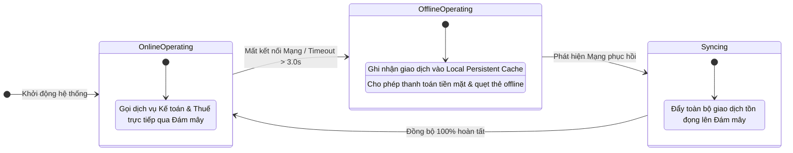

[🏠 Trang Chủ (MOC)](../README.md) | [◄ Chương 23: Designing Use Case Realizations with GoF Patterns](./23_Designing_Use_Case_Realizations_with_GoF_Patterns.md) | [Chương 25: Relating Use Cases ►](./25_Relating_Use_Cases.md)

---

## CHƯƠNG 24: ITERATION 3 AND ITS REQUIREMENTS

### 1. ĐỀ MỤC & MỤC TIÊU CỐT LÕI (CORE PURPOSE)

#### Hệ thống đề mục (Heading Hierarchy)
* **24.1. Iteration 3 Emphasis: Architectural Analysis and Complex Topics** *(Trọng tâm Vòng lặp 3: Phân tích kiến trúc chuyên sâu và các chủ đề phức tạp)*
* **24.2. NextGen POS Requirements for Iteration 3** *(Các yêu cầu mới của Vòng lặp 3 trong NextGen POS)*
  * *Failover to local cache when remote services fail (Dung sai lỗi: Tự động chuyển vùng nhớ đệm cục bộ khi mất mạng)*
  * *Advanced integration: Inventory, Accounting, and HR (Tích hợp nâng cao: Kho hàng, Kế toán và Nhân sự)*
  * *Gift card payment and store credit (Thanh toán thẻ quà tặng và tín dụng cửa hàng)*
  * *Persistence framework design (Thiết kế khung lưu trữ dữ liệu đối tượng)*
* **24.3. Progression of Iterations in the Unified Process** *(Tiến trình tiến hóa của các vòng lặp trong UP)*

#### Vấn đề kỹ thuật thực tế & Thảm họa kiến trúc được ngăn chặn
Chương 24 đánh dấu bước chuyển mình mang tính quyết định của dự án: Chuyển từ **Logic ứng dụng nghiệp vụ đơn thuần (*Application Logic*)** sang **Năng lực Kiến trúc Bền bỉ và Chịu lỗi (*Architectural Resilience & Fault Tolerance*)**.

Nếu không có sự chuẩn bị kỹ thuật cho Vòng lặp 3, hệ thống sẽ gặp các thảm họa:
* **Tê liệt toàn diện khi mất kết nối mạng (Network Outage Catastrophe):** Hệ thống được thiết kế với giả định ngây thơ rằng internet luôn hoạt động 100%. Khi đường truyền đứt, quầy thu ngân của toàn bộ chuỗi siêu thị ngừng trệ, khách hàng bỏ đi, gây tổn thất hàng triệu USD doanh thu.
* **Nghẽn cổ chai tích hợp (Integration Bottleneck):** Các hệ thống phụ trợ (Kho, Kế toán) phản hồi chậm kéo theo toàn bộ giao dịch bán lẻ bị treo cứng (*Synchronous Blocking Disaster*).
* **Kiến trúc vỡ vụn khi scale (Scalability Breakdown):** Không có kiến trúc phân tầng lưu trữ đối tượng (*Persistence Framework*), mã nguồn SQL bị rải rác khắp nơi, làm tăng chi phí bảo trì lên 500%.

---

### 2. PHÂN TÍCH LÝ THUYẾT & NGUYÊN LÝ CHUYÊN SÂU

```
+-----------------------------------------------------------------------------------------+
|                  KIẾN TRÚC CHỊU LỖI NGOẠI TUYẾN (STORE-AND-FORWARD RESILIENCE)          |
+-----------------------------------------------------------------------------------------+
|                                    [Register]                                           |
|                                         |                                               |
|               +-------------------------+-------------------------+                     |
|               | (Online: Bình thường)                             | (Offline: Mất mạng) |
|               v                                                   v                     |
|     [RemoteServicesAdapter]                             [OfflineQueueManager]           |
|               |                                                   |                     |
|               v (REST / Socket)                                   v (Local Cache)       |
|    (( ĐÁM MÂY DỊCH VỤ NGOÀI ))                           [( SQLite / Local File )]      |
|    (Ngân hàng, Kế toán, Thuế)                            (Tự động đồng bộ khi có mạng)  |
+-----------------------------------------------------------------------------------------+
```

#### 2.1. Trọng tâm của Vòng lặp 3: Khắc phục các Rủi ro Kiến trúc Nặng đô
* Nếu Vòng lặp 1 giải quyết kỹ năng OOA/D cơ bản, Vòng lặp 2 giải quyết biến thể nghiệp vụ (GoF Patterns), thì Vòng lặp 3 tập trung giải quyết các **Yêu cầu Phi chức năng sống còn (*Architectural Quality Attributes*)**:
  1. **Khả năng chịu lỗi (*Fault Tolerance & Graceful Degradation*):** Hoạt động ngoại tuyến khi mất mạng internet.
  2. **Tích hợp hệ thống phân tán (*Distributed System Integration*):** Giao tiếp bất đồng bộ qua hàng đợi thông điệp (*Store-and-Forward*).
  3. **Khung lưu trữ độc lập (*Persistence Framework*):** Tách biệt hoàn toàn Tầng Miền khỏi Cơ sở dữ liệu quan hệ (RDBMS).

#### 2.2. Cơ chế Lưu trữ và Chuyển tiếp (Store-and-Forward Pattern)
* Khi quầy thu ngân thực hiện thanh toán mà kết nối tới dịch vụ kế toán/kho hàng bị gián đoạn:
  * Hệ thống **không báo lỗi làm hủy giao dịch của khách**.
  * Thay vào đó, giao dịch được đóng gói thành một thông điệp tự chứa (*Self-contained Message*) và ghi xuống hàng đợi lưu trữ cục bộ (*Local Persistent Queue*).
  * Một tiến trình chạy ngầm (*Background Daemon*) sẽ liên tục thăm dò kết nối; ngay khi mạng phục hồi, toàn bộ giao dịch tồn đọng sẽ được đẩy lên hệ thống trung tâm mà không mất một byte dữ liệu.

---

### 3. MỔ XẺ MÃ NGUỒN HOẶC ĐẶC TẢ THIẾT KẾ (DESIGN / CODE DEEP-DIVE)

Dưới đây là mã nguồn Java hiện thực hóa kiến trúc **Dung sai lỗi Ngoại tuyến (Offline Failover)** sử dụng mẫu hình *Proxy & Store-and-Forward*:

```java
public class ResilientAccountingAdapter implements IAccountingAdapter {
    private final IAccountingAdapter remoteService; // Kết nối đám mây
    private final LocalOfflineQueue offlineQueue;   // Bộ đệm lưu trữ cục bộ

    public ResilientAccountingAdapter(IAccountingAdapter remote, LocalOfflineQueue queue) {
        this.remoteService = remote;
        this.offlineQueue = queue;
    }

    @Override
    public void postSale(Sale sale) {
        try {
            // [THỬ NGHIỆM ONLINE]: Cố gắng gọi dịch vụ đám mây thời gian thực
            remoteService.postSale(sale);
        } catch (NetworkException | TimeoutException e) {
            // [FAILOVER OFFLINE]: Gặp sự cố mạng -> Kích hoạt cơ chế Store-and-Forward
            System.err.println("Mất kết nối máy chủ kế toán! Tự động chuyển sang chế độ Offline Cache.");
            offlineQueue.enqueue(new AccountingMessage(sale));
        }
    }
}
```

#### Bảng phân tích kỹ thuật và ý nghĩa thiết kế:

| Dòng code / Đoạn code then chốt | Kỹ thuật Kiến trúc & Ý nghĩa thiết kế |
| :--- | :--- |
| `public class ResilientAccountingAdapter` | Mẫu hình **Proxy / Decorator (GoF)**: Bọc ngoài dịch vụ kế toán thật để bổ sung năng lực chịu lỗi mà không làm thay đổi chữ ký hàm của `IAccountingAdapter`. |
| `try { remoteService.postSale(sale); }` | Ưu tiên gửi dữ liệu thời gian thực nếu đường truyền thông suốt. |
| `catch (NetworkException ...)` | Bắt chính xác lỗi hạ tầng mạng, ngăn chặn lỗi mạng lan truyền lên Tầng Miền hoặc làm văng ứng dụng trước mặt người dùng. |
| `offlineQueue.enqueue(new AccountingMessage(sale));` | Hiện thực hóa **Store-and-Forward**: Lưu trữ giao dịch an toàn xuống đĩa cứng cục bộ, đảm bảo tính bất biến và độ tin cậy tuyệt đối (*Reliability*). |

---

### 4. SƠ ĐỒ TRỰC QUAN HÓA (UML MERMAID)

Sơ đồ trạng thái thích ứng của Hệ thống NextGen POS khi đối mặt với sự cố mạng trong Vòng lặp 3:



---

### 5. ÁNH XẠ ỨNG DỤNG VÀO DỰ ÁN GAME OOP THỰC CHIẾN

* **Bối cảnh áp dụng:** Cơ chế Lưu trữ Cục bộ và Bù trễ Gói tin Mạng (*Local Cache & Network Reconciliation*) trong Game 2.5D Multiplayer.
* **Thảm họa nếu thiếu kiến trúc Failover:**
  Người chơi đang đánh quái nhặt được vật phẩm huyền thoại quý hiếm. Đúng lúc đó mạng 4G chập chờn rớt gói tin trong 2 giây. Client không gửi được gói tin `PickupLoot` lên máy chủ $\to$ Game báo lỗi "Network Error", văng ra màn hình đăng nhập, mất sạch món đồ quý. Người chơi bức xúc xóa game và đánh giá 1 sao.
* **Ứng dụng từ Chương 24:**
  1. *Local State Buffer:* Khi mạng bị ngắt quãng, Client không lập tức văng game mà đưa sự kiện vào một `LocalActionQueue`.
  2. *Optimistic UI Updates:* Client hiển thị nhân vật nhặt đồ thành công lên màn hình để trải nghiệm không bị gián đoạn.
  3. *Auto-Reconciliation:* Khi mạng có lại sau 2 giây, Client tự động gửi gói tin bù trong `LocalActionQueue` lên Server để máy chủ xác thực và đối soát.

---

[🏠 Trang Chủ (MOC)](../README.md) | [◄ Chương 23: Designing Use Case Realizations with GoF Patterns](./23_Designing_Use_Case_Realizations_with_GoF_Patterns.md) | [Chương 25: Relating Use Cases ►](./25_Relating_Use_Cases.md)
