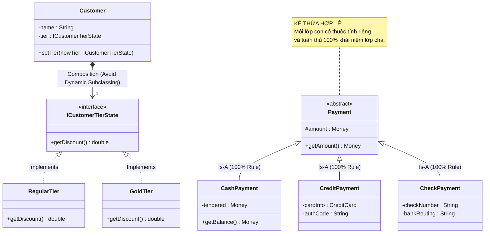

[🏠 Trang Chủ (MOC)](../README.md) | [◄ Chương 25: Relating Use Cases](./25_Relating_Use_Cases.md) | [Chương 27: Refining the Domain Model ►](./27_Refining_the_Domain_Model.md)

---

## CHƯƠNG 26: MODELING GENERALIZATION

### 1. ĐỀ MỤC & MỤC TIÊU CỐT LÕI (CORE PURPOSE)

#### Hệ thống đề mục (Heading Hierarchy)
* **26.1. New Concepts for the Domain Model** *(Các khái niệm mới trong Mô hình Miền)*
* **26.2. Generalization** *(Tổng quát hóa / Kế thừa Khái niệm: Lớp cha và Lớp con)*
* **26.3. Defining Conceptual Superclasses and Subclasses** *(Định nghĩa Lớp cha và Lớp con chuẩn mực)*
  * *The 100% Rule (Quy tắc 100%: Tuân thủ toàn vẹn thuộc tính và quan hệ)*
  * *The Is-a Rule (Quy tắc "Là-một": Tính tương thích ngữ nghĩa)*
* **26.4. When to Define a Conceptual Subclass** *(Khi nào nên tạo một Lớp con khái niệm?)*
* **26.5. When to Define a Conceptual Superclass** *(Khi nào nên tạo một Lớp cha khái niệm?)*
* **26.6. Modeling Changing States: Avoid Dynamic Subclassing** *(Mô hình hóa Trạng thái Thay đổi: Tuyệt đối tránh phân lớp động)*
* **26.7. Class Hierarchies and Inheritance in Software** *(Cây phả hệ lớp và Kế thừa trong Mã nguồn Phần mềm)*

#### Vấn đề kỹ thuật thực tế & Thảm họa kiến trúc được ngăn chặn
Chương 26 giải quyết việc lạm dụng hoặc hiểu sai cơ chế **Kế thừa (*Inheritance / Generalization*)**. Kế thừa là một trong những tính năng mạnh nhất của OOP nhưng cũng là cội nguồn của những thảm họa kiến trúc tồi tệ nhất nếu áp dụng sai chỗ.

Nếu lập trình viên thiếu hiểu biết về Generalization, hệ thống sẽ hứng chịu:
* **Vi phạm Nguyên lý Thay thế Liskov (LSP Violation):** Lớp con kế thừa lớp cha nhưng lại vứt bỏ hoặc quăng ngoại lệ `NotSupportedException` đối với các phương thức của lớp cha, làm gãy đổ tính đa hình.
* **Thảm họa Phân lớp theo Trạng thái Động (Dynamic Subclassing Disaster):** Tạo các lớp con dựa trên trạng thái biến đổi của đối tượng (ví dụ: tạo lớp `ActiveAccount` và `SuspendedAccount`). Trong hầu hết các ngôn ngữ OOP (Java, C#, C++), một đối tượng **không thể đổi Class của nó lúc đang chạy**! Kết quả: Phải viết code dị hợm sao chép dữ liệu để hủy đối tượng cũ và `new` đối tượng mới.
* **Cây Kế thừa Sâu Đáy biển (Deep Inheritance Tree Hell):** Cây kế thừa lồng nhau 7-8 tầng, lớp con chịu ảnh hưởng của hàng trăm dòng code thừa kế từ lớp cha (*Fragile Base Class Problem*), sửa một dòng ở lớp gốc làm sập toàn bộ các lớp con.

---

### 2. PHÂN TÍCH LÝ THUYẾT & NGUYÊN LÝ CHUYÊN SÂU

```
+-----------------------------------------------------------------------------------------+
|                               HAI NGUYÊN TẮC VÀNG CỦA GENERALIZATION                    |
+-----------------------------------------------------------------------------------------+
| [1. THE 100% RULE]    : Lớp con BẮT BUỘC phải kế thừa và tuân thủ 100% tất cả các       |
|                         thuộc tính và các mối quan hệ (associations) của Lớp cha.        |
+-----------------------------------------------------------------------------------------+
| [2. THE IS-A RULE]    : Về mặt ngữ nghĩa, Lớp con "Là-một" (Is-a) trường hợp chuyên biệt |
|                         của Lớp cha trong ngôn ngữ đời thực.                             |
|                         (Ví dụ: CreditPayment IS-A Payment: Hợp lệ).                    |
+-----------------------------------------------------------------------------------------+
| [CẢNH BÁO CỐT TỬ: KHÔNG PHÂN LỚP THEO TRẠNG THÁI BIẾN ĐỔI]:                             |
|   SAI:  class Customer  <|--  class RegularCustomer, class GoldCustomer                 |
|         (Vì khách hàng có thể nâng cấp/hạ cấp VIP liên tục trong thời gian chạy!)       |
|   ĐÚNG: Dùng Composition / State Pattern: Customer HAS-A CustomerTier                  |
+-----------------------------------------------------------------------------------------+
```

#### 2.1. Bản chất của Tổng quát hóa (Generalization)
* Generalization là mối quan hệ giữa một **Lớp cha tổng quát (*Superclass*)** và một hoặc nhiều **Lớp con chuyên biệt (*Subclasses*)**.
* Trong UML, nó được biểu diễn bằng một **mũi tên tam giác rỗng ($\triangle$)** trỏ từ lớp con lên lớp cha.

#### 2.2. Hai Bài kiểm tra Bắt buộc: 100% Rule & Is-a Rule
Craig Larman đặt ra 2 chốt chặn kiểm duyệt khắt khe:
1. **The 100% Rule (Quy tắc 100%):** Mọi thuộc tính và mọi liên kết của lớp cha đều phải có ý nghĩa hợp lý 100% đối với lớp con. Nếu bạn tạo lớp `Penguin` kế thừa `Bird`, nhưng `Bird` có phương thức `fly()` mà `Penguin` không bay được $\to$ **Vi phạm 100% Rule!** Đó là dấu hiệu của việc kế thừa sai lầm.
2. **The Is-a Rule (Quy tắc Là-một):** Phát biểu "Lớp con là một lớp cha" phải đúng trong ngữ cảnh nghiệp vụ tự nhiên (ví dụ: "Thanh toán bằng thẻ tín dụng là một hình thức thanh toán").

#### 2.3. Khi nào NÊN định nghĩa Lớp con?
Chỉ tạo một lớp con nếu nó đáp ứng **ít nhất một trong các tiêu chí sau**:
* Lớp con có **các thuộc tính bổ sung** mà lớp cha không có.
* Lớp con có **các mối quan hệ (associations) bổ sung** mà lớp cha không có.
* Lớp con vận hành theo **các quy tắc nghiệp vụ hoặc giải thuật chuyên biệt** (xử lý đa hình).
* *Phản ví dụ:* Nếu lớp `MaleCashier` và `FemaleCashier` không có thuộc tính hay hành vi nào khác biệt ngoài một chuỗi giới tính $\to$ **TUYỆT ĐỐI KHÔNG TẠO SUBCLASS!** Hãy biểu diễn nó bằng một thuộc tính `gender: Gender` đơn giản.

#### 2.4. Mô hình hóa Trạng thái Biến đổi: Tuyệt đối tránh Phân lớp Động!
* Một lỗi kinh điển: Khách hàng mua nhiều hàng thì trở thành khách VIP; nếu quỵt tiền thì trở thành khách Blacklist.
* Lập trình viên thiết kế: `class RegularCustomer`, `class VipCustomer`, `class BlacklistCustomer` kế thừa từ `Customer`.
* **Thảm họa:** Một đối tượng `Customer` một khi đã được cấp phát trên heap thì không thể tự biến hình đổi kiểu dữ liệu của nó được.
* **Giải pháp chuẩn:** **Thay thế Kế thừa bằng Hợp thành (*Favor Composition over Inheritance*)**. Lớp `Customer` giữ một tham chiếu tới đối tượng `CustomerTier` hoặc `CustomerState` (áp dụng State / Strategy Pattern). Việc thăng cấp VIP đơn giản là thay thế con trỏ trạng thái bên trong.

---

### 3. MỔ XẺ MÃ NGUỒN HOẶC ĐẶC TẢ THIẾT KẾ (DESIGN / CODE DEEP-DIVE)

Dưới đây là màn so sánh đối chiếu: Minh họa sai lầm dùng Kế thừa để quản lý trạng thái động và giải pháp Tái cấu trúc chuẩn mực bằng **Composition & State Pattern**:

```java
// ==================== [SAI]: KẾ THỪA QUẢN LÝ TRẠNG THÁI ĐỘNG ====================
// Thảm họa: Khi khách hàng tích đủ 1000 điểm, không thể ép kiểu Customer sang VipCustomer!
public class Customer { /* thuộc tính cơ bản */ }
public class VipCustomer extends Customer { 
    // Không thể đổi kiểu đối tượng lúc runtime!
}

// ==================== [ĐÚNG]: FAVOR COMPOSITION OVER INHERITANCE ====================
// Tuân thủ 100% nguyên tắc của Craig Larman: Trạng thái biến đổi được tách thành Composition

public interface ICustomerTierState {
    double getDiscountRate();
    String getTierName();
}

public class RegularTier implements ICustomerTierState {
    @Override public double getDiscountRate() { return 0.0; }
    @Override public String getTierName() { return "Thành viên Thường"; }
}

public class GoldTier implements ICustomerTierState {
    @Override public double getDiscountRate() { return 0.10; } // Giảm 10%
    @Override public String getTierName() { return "Hội viên Vàng"; }
}

public class Customer {
    private String name;
    private int loyaltyPoints;
    
    // COMPOSITION: Trạng thái cấp bậc có thể tráo đổi linh hoạt lúc chạy
    private ICustomerTierState tierState = new RegularTier();

    public void addPoints(int points) {
        this.loyaltyPoints += points;
        // Chuyển đổi trạng thái mượt mà lúc runtime mà KHÔNG cần tạo lại đối tượng Customer!
        if (this.loyaltyPoints >= 1000 && !(tierState instanceof GoldTier)) {
            System.out.println("Chúc mừng! Bạn đã được nâng cấp lên Hội viên Vàng.");
            this.tierState = new GoldTier();
        }
    }

    public double getDiscountRate() {
        return tierState.getDiscountRate();
    }
}
```

#### Bảng phân tích kỹ thuật và ý nghĩa thiết kế:

| Thành phần mã nguồn | Kỹ thuật Thiết kế áp dụng | Lợi ích Kiến trúc & Ngăn chặn lỗi |
| :--- | :--- | :--- |
| `private ICustomerTierState tierState;` | **Composition over Inheritance** | Biến trạng thái động thành một đối tượng thành viên. Giữ nguyên định danh (`id`) và bộ nhớ của `Customer` khi thăng cấp. |
| `this.tierState = new GoldTier();` | **State Pattern (GoF)** | Chuyển đổi trạng thái nghiệp vụ trong tích tắc mà không làm rò rỉ dữ liệu hoặc phải clone đối tượng. |
| `tierState.getDiscountRate()` | **Đa hình ủy thác (Delegation)** | `Customer` không cần viết câu lệnh `if (isGold)` lặp đi lặp lại ở khắp mọi nơi. |

---

### 4. SƠ ĐỒ TRỰC QUAN HÓA (UML MERMAID)

Sơ đồ Kế thừa Khái niệm chuẩn mực cho hệ thống Thanh toán (Tuân thủ 100% Rule & Is-a Rule), kết hợp với State Pattern cho trạng thái khách hàng:



---

### 5. ÁNH XẠ ỨNG DỤNG VÀO DỰ ÁN GAME OOP THỰC CHIẾN

* **Bối cảnh áp dụng:** Cây phả hệ Thực thể (*Entity Hierarchy*) và Trạng thái Nhân vật (*Character States*) trong Game 2.5D Multiplayer.
* **Cạm bẫy kế thừa chết người trong Game:**
  Lập trình viên thiết kế:
  `Entity` $\to$ `LivingEntity` $\to$ `Character` $\to$ `AliveCharacter` & `DeadCharacter` & `ZombieInfectedCharacter`.
  $\to$ **Thảm họa:** Khi nhân vật bị quái cắn và nhiễm độc biến thành Zombie, lập trình viên không thể ép kiểu biến `AliveCharacter` thành `ZombieInfectedCharacter` được. Kết quả: Họ phải `Destroy(playerGameObject)` rồi sinh ra một nhân vật Zombie mới, làm mất sạch trạng thái nhiệm vụ, hòm đồ và kết nối mạng của người chơi!
* **Ứng dụng từ Chương 26:**
  1. *Kế thừa Tĩnh cho Bản chất Thực thể:* `Entity` $\to$ `Character` $\to$ `Hero` (Bản chất bất biến: Hero luôn là một Character).
  2. *State Pattern cho Trạng thái Biến đổi:* 
     * `Hero` sở hữu một biến `private ICharacterState currentState;`.
     * Các trạng thái có thể hoán đổi: `NormalState`, `StunnedState`, `ZombieInfectedState`, `DeadState`.
     * Khi bị cắn: `hero.ChangeState(new ZombieInfectedState());`. Nhân vật lập tức thay đổi toàn bộ chiêu thức và hoạt ảnh mà ID mạng, hòm đồ và kết nối socket vẫn được bảo toàn nguyên vẹn 100%.

---

[🏠 Trang Chủ (MOC)](../README.md) | [◄ Chương 25: Relating Use Cases](./25_Relating_Use_Cases.md) | [Chương 27: Refining the Domain Model ►](./27_Refining_the_Domain_Model.md)
