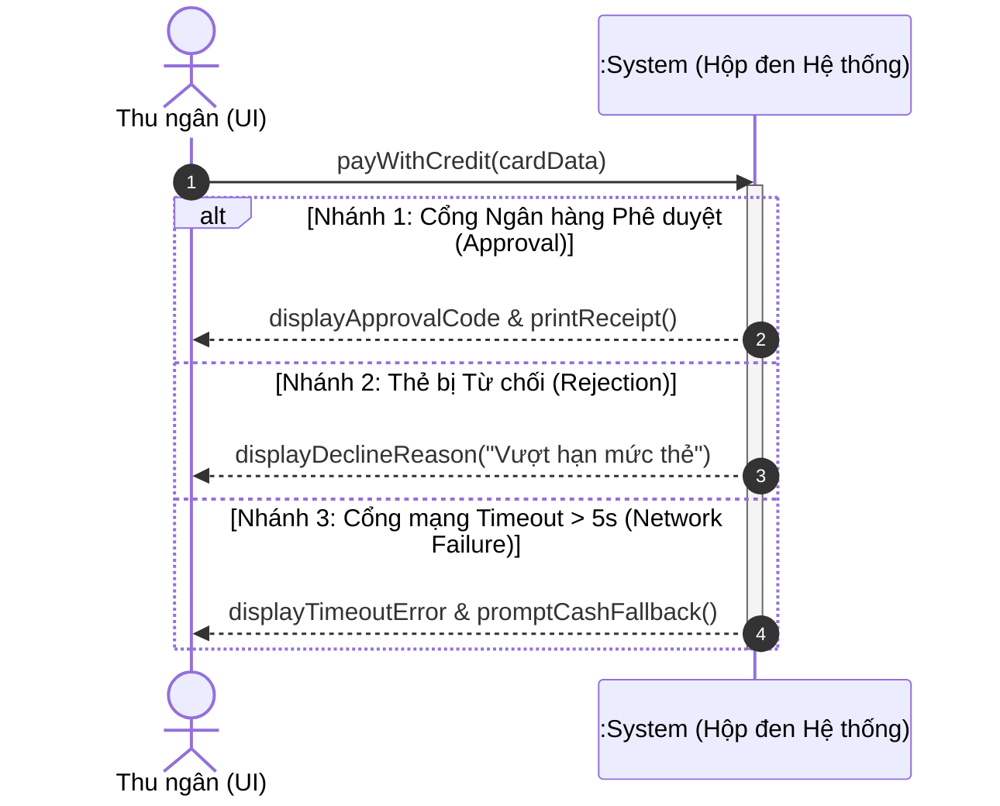

[🏠 Trang Chủ (MOC)](../README.md) | [◄ Chương 27: Refining the Domain Model](./27_Refining_the_Domain_Model.md) | [Chương 29: Modeling Behavior in Statechart Diagrams ►](./29_Modeling_Behavior_in_Statechart_Diagrams.md)

---

## CHƯƠNG 28: ADDING NEW SSDs AND CONTRACTS

### 1. ĐỀ MỤC & MỤC TIÊU CỐT LÕI (CORE PURPOSE)

#### Hệ thống đề mục (Heading Hierarchy)
* **28.1. New System Sequence Diagrams for Iteration 3** *(Các Sơ đồ Tuần tự Hệ thống mới trong Vòng lặp 3)*
* **28.2. NextGen POS New SSDs** *(Hệ thống SSD mới cho thanh toán Thẻ quà tặng và Xử lý ngoại tuyến)*
  * *Process Sale with Failover to Local Cache (SSD xử lý bán hàng khi mất mạng)*
  * *Gift Card and Store Credit Payment (SSD thanh toán thẻ quà tặng)*
* **28.3. New System Operations and Contracts** *(Các Thao tác Hệ thống và Hợp đồng mới)*
  * *authorizeCreditPayment (Cấp phép thanh toán thẻ)*
  * *authorizeCheckPayment (Xác thực thanh toán séc)*
  * *enterGiftCard (Nhập mã thẻ quà tặng)*
* **28.4. Handling Failure in Contracts: Exceptional State Transformations** *(Đặc tả xử lý lỗi và Thất bại trong Hợp đồng Vận hành)*
* **28.5. State Transformations in Complex Transactions** *(Biến đổi trạng thái trong các giao dịch phân tán phức tạp)*

#### Vấn đề kỹ thuật thực tế & Thảm họa kiến trúc được ngăn chặn
Chương 28 đưa kỹ thuật đặc tả hợp đồng lên cấp độ cao nhất: **Kiểm soát các kịch bản thất bại, thời gian chờ quá hạn (*Timeouts*) và Phục hồi trạng thái (*Rollback / Compensating Transactions*)**.

Nếu bỏ qua bước này, hệ thống sẽ gặp các thảm họa:
* **Hội chứng Treo Giao dịch Mồ côi (Orphan Pending Transactions):** Gửi yêu cầu trừ tiền thẻ tín dụng sang ngân hàng; ngân hàng đã trừ tiền của khách nhưng đường truyền phản hồi bị đứt mạng. Hệ thống không có đặc tả xử lý timeout, dẫn đến việc thu ngân hủy đơn, khách hàng bị mất tiền oan và khiếu nại kiện tụng.
* **Rung chấn Trạng thái Dữ liệu (Inconsistent Distributed State):** Hệ thống đã tạo thẻ quà tặng mới nhưng thao tác trừ điểm khách hàng bị lỗi. Dữ liệu rơi vào trạng thái nửa vời, không nhất quán.
* **Thiếu kịch bản phục hồi ngoại lệ (Missing Exception Specifications):** Lập trình viên chỉ viết code cho trường hợp thành công; khi cổng thanh toán trả về mã lỗi 403 hoặc 500, hệ thống crash trắng màn hình.

---

### 2. PHÂN TÍCH LÝ THUYẾT & NGUYÊN LÝ CHUYÊN SÂU

```
+-----------------------------------------------------------------------------------------+
|                  SSD & CONTRACT XỬ LÝ NGOẠI LỆ / THỜI GIAN CHỜ (TIMEOUT)                |
+-----------------------------------------------------------------------------------------+
|  ACTOR (Cashier)                                                    :System             |
|         |                                                              |                |
|         |--- 1. payWithCredit(cardNumber, expiryDate) ---------------->|                |
|         |                                                              |--- Gửi Bank API|
|         |    [KHUNG THAY THẾ (ALT): KẾT QUẢ XÁC THỰC NGÂN HÀNG]        |    (Wait...)   |
|         |                                                              |                |
|         |    [Nhánh A: Ngân hàng Phê duyệt Thành công]                 |                |
|         |<-- 1.1 displayApprovalCode & printReceipt -------------------|                |
|         |                                                              |                |
|         |    [Nhánh B: Thẻ bị Từ chối / Không đủ số dư]                |                |
|         |<-- 1.2 displayRejectionReason("Insufficient Funds") ---------|                |
|         |                                                              |                |
|         |    [Nhánh C: Timeout > 5 giây / Mất kết nối Cổng]            |                |
|         |<-- 1.3 displayNetworkError & promptRetryOrOffline -----------|                |
+-----------------------------------------------------------------------------------------+
```

#### 2.1. Nâng cấp SSD với các Khung Điều khiển UML 2.0 (Frames: Alt, Opt, Loop)
* Trong Vòng lặp 1, SSD chỉ vẽ đường thẳng màu hồng (*Happy Path*).
* Bước sang Vòng lặp 3, SSD bắt buộc phải sử dụng **Khung Thay thế (*Alt Frame - Alternatives*)** để trực quan hóa rõ ràng 3 nhánh sự kiện:
  1. *Thành công (Approval).*
  2. *Bị từ chối nghiệp vụ (Rejection).*
  3. *Lỗi hạ tầng mạng (Network Failure / Timeout).*

#### 2.2. Đặc tả Thất bại trong Hợp đồng Vận hành (Handling Failures in Contracts)
* Craig Larman nhấn mạnh: Hợp đồng cho các thao tác phức tạp không chỉ có phần *Postconditions (khi thành công)*, mà bắt buộc phải có phần **Exceptions (Ngoại lệ)** và **Failure Postconditions (Hậu điều kiện khi thất bại)**.
* **Quy tắc Giao dịch Nguyên tử (Atomic Rollback):** Nếu thao tác hệ thống bị thất bại ở bước cuối cùng, hậu điều kiện phải cam kết rõ ràng: **Tất cả các đối tượng đã khởi tạo tạm thời phải bị tiêu hủy, và trạng thái hệ thống phải được phục hồi nguyên vẹn như trước khi gọi hàm (*No Side-Effects on Failure*)**.

---

### 3. MỔ XẺ MÃ NGUỒN HOẶC ĐẶC TẢ THIẾT KẾ (DESIGN / CODE DEEP-DIVE)

Dưới đây là bản đặc tả Hợp đồng Vận hành nâng cao cho thao tác `payWithCredit` và mã nguồn Java kiểm soát giao dịch an toàn với cơ chế Tự động Rollback:

```java
// ==================== HỢP ĐỒNG ĐẶC TẢ NÂNG CAO ====================
/*
Contract CO5: payWithCredit
Operation:      payWithCredit(cardNumber: String, expiryDate: Date)
Cross Ref:      Use Cases: Process Sale (Extension 7a)
Preconditions:  An ongoing Sale exists, all items entered, total is calculated.
Postconditions:
    THÀNH CÔNG (Success):
    - A CreditPayment instance 'cp' was created.
    - 'cp.amount' became Sale.getTotal().
    - 'cp' was associated with the current Sale.
    - 'cp.authorizationCode' was set from the banking gateway response.
    - Sale.isComplete became true.
    
    THẤT BẠI (Failure / Timeout):
    - NO CreditPayment instance was associated with the Sale.
    - Sale.isComplete remained false.
    - An AuditFailureRecord was created and logged with error details.
*/

// ==================== MÃ NGUỒN KIỂM SOÁT GIAO DỊCH VÀ ROLLBACK ====================
public class PaymentController {
    private final ICreditAuthorizationAdapter bankAdapter;
    private final IAuditLogger auditLogger;

    public PaymentController(ICreditAuthorizationAdapter bank, IAuditLogger logger) {
        this.bankAdapter = bank;
        this.auditLogger = logger;
    }

    public PaymentResult payWithCredit(Sale sale, CreditCardInfo card) {
        Money total = sale.getTotal();
        PaymentResult result;

        try {
            // Bước 1: Gửi yêu cầu ra cổng ngân hàng ngoài
            result = bankAdapter.authorize(card, total);

            if (result.isApproved()) {
                // [SUCCESS POSTCONDITION]: Tạo Payment và liên kết an toàn
                CreditPayment cp = new CreditPayment(total, card, result.getAuthCode());
                sale.setPayment(cp);
                return result;
            } else {
                // [BUSINESS FAILURE]: Thẻ bị từ chối -> Ghi log kiểm toán
                auditLogger.logPaymentFailure(sale.getId(), result.getErrorMessage());
                return result;
            }
        } catch (NetworkTimeoutException e) {
            // [INFRASTRUCTURE FAILURE]: Quá hạn kết nối mạng -> ROLLBACK TOÀN DIỆN
            auditLogger.logSystemError(sale.getId(), "TIMEOUT_GATEWAY", e);
            // Cam kết Hậu điều kiện: Sale không bị đánh dấu thanh toán dở dang!
            sale.rollbackPaymentAttempt();
            return PaymentResult.createTimeoutFailure("Cổng thanh toán không phản hồi!");
        }
    }
}
```

#### Bảng phân tích kỹ thuật và ý nghĩa thiết kế:

| Dòng code / Đoạn code then chốt | Kỹ thuật Thiết kế & Hiện thực Hợp đồng |
| :--- | :--- |
| `result = bankAdapter.authorize(...)` | Gọi dịch vụ ngoài được bảo vệ đằng sau Adapter, cô lập lỗi giao thức. |
| `CreditPayment cp = new CreditPayment(...)` | Hiện thực hóa **Success Postcondition**: Khởi tạo phiên bản thanh toán và gán mã cấp phép `authCode` từ ngân hàng. |
| `catch (NetworkTimeoutException e)` | Kiểm soát rủi ro mạng: Đảm bảo giao dịch mạng chập chờn không làm sập ứng dụng. |
| `sale.rollbackPaymentAttempt();` | Hiện thực hóa **Failure Postcondition (Rollback)**: Bảo vệ tính toàn vẹn trạng thái (*In-Memory State Consistency*), không để lại rác trong bộ nhớ. |

---

### 4. SƠ ĐỒ TRỰC QUAN HÓA (UML MERMAID)

Sơ đồ Tuần tự Hệ thống (SSD) cho Thao tác `payWithCredit` tích hợp Khung Thay thế (*Alt Frame*) và xử lý Timeout:



---

### 5. ÁNH XẠ ỨNG DỤNG VÀO DỰ ÁN GAME OOP THỰC CHIẾN

* **Bối cảnh áp dụng:** Thiết kế SSD & Operation Contract cho Hệ thống Mua Vật phẩm Bằng Tiền Thật (*In-App Purchase - IAP / Gacha Transaction*) trong Game 2.5D Multiplayer.
* **Nguy cơ thảm họa tài chính nếu thiếu Hợp đồng Rollback:**
  Người chơi bỏ 100$ mua 1.000 Kim cương. Tiền trong tài khoản Apple/Google đã bị trừ, nhưng đường truyền về máy chủ Game bị đứt đúng thời điểm gói tin phản hồi đang bay trên mạng. Máy chủ game không nhận được xác nhận nên không cộng kim cương. Người chơi báo cáo ngân hàng khiếu nại lừa đảo (*Chargeback*), nhà phát hành game bị phạt tiền và khóa tài khoản nhà phát triển!
* **Ứng dụng từ Chương 28 vào Game IAP Architecture:**
  1. *Đặc tả Hợp đồng Thao tác `VerifyAndClaimIAPReceipt`:*
     * Precondition: Người chơi sở hữu Receipt hợp lệ từ App Store.
     * Postconditions (Thành công): Receipt được đánh dấu là `CONSUMED` trên cơ sở dữ liệu máy chủ để chống gian lận nạp lại nhiều lần (*Replay Attack*); Số dư kim cương được cộng chính xác; Tạo bản ghi giao dịch kế toán.
     * Postconditions (Thất bại / Timeout): Nếu máy chủ chưa đối soát được với Apple Store trong 10 giây, giao dịch được đưa vào trạng thái `PENDING_VERIFICATION` trên tài khoản người chơi.
  2. *Background Cron Worker:* Khi người chơi đăng nhập lại ở phiên sau, hệ thống tự động quét các giao dịch Pending và bù kim cương tức thì mà người chơi không cần bấm gửi khiếu nại.

---

[🏠 Trang Chủ (MOC)](../README.md) | [◄ Chương 27: Refining the Domain Model](./27_Refining_the_Domain_Model.md) | [Chương 29: Modeling Behavior in Statechart Diagrams ►](./29_Modeling_Behavior_in_Statechart_Diagrams.md)
