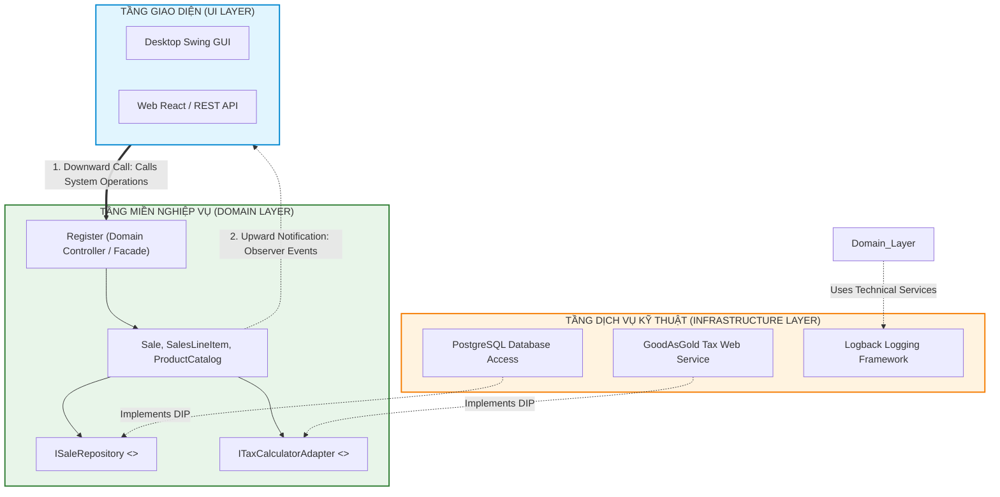

[🏠 Trang Chủ (MOC)](../README.md) | [◄ Chương 29: Modeling Behavior in Statechart Diagrams](./29_Modeling_Behavior_in_Statechart_Diagrams.md) | [Chương 31: Organizing Design and Implementation Model Packages ►](./31_Organizing_Design_and_Implementation_Model_Packages.md)

---

## CHƯƠNG 30: DESIGNING THE LOGICAL ARCHITECTURE WITH PATTERNS

### 1. ĐỀ MỤC & MỤC TIÊU CỐT LÕI (CORE PURPOSE)

#### Hệ thống đề mục (Heading Hierarchy)
* **30.1. Architecture** *(Khái niệm Kiến trúc Phần mềm: Cấu trúc vĩ mô và Quyết định cốt tử)*
* **30.2. Architectural Pattern: Layers** *(Mẫu hình Kiến trúc: Phân tầng vĩ mô)*
* **30.3. The Problem: Connecting Layers** *(Vấn đề kỹ thuật: Làm sao kết nối các tầng mà không làm hỏng ranh giới?)*
* **30.4. Solution: Logical Architecture Layers in NextGen POS** *(Kiến trúc Phân tầng chuẩn mực trong NextGen POS)*
  * *User Interface (Tầng Giao diện)*
  * *Application Logic and Domain Objects (Tầng Nghiệp vụ và Đối tượng Miền)*
  * *Technical Services / Infrastructure (Tầng Dịch vụ Kỹ thuật / Hạ tầng)*
* **30.5. Layer Collaboration: The Dependency Inversion Principle (DIP)** *(Cộng tác giữa các tầng qua Nguyên lý Đảo ngược Phụ thuộc)*
* **30.6. Relaxed Layered Architecture vs. Strict Layered Architecture** *(Kiến trúc Phân tầng Thoáng vs. Phân tầng Nghiêm ngặt)*
* **30.7. Facades for Subsystems** *(Mẫu hình Facade đại diện cho các hệ thống con)*
* **30.8. Upward Communication: Observer / Callbacks** *(Giao tiếp Ngược từ Dưới lên: Mẫu hình Observer và Callbacks)*
* **30.9. The Model-View Separation Principle** *(Nguyên lý Tách biệt Tuyệt đối giữa Mô hình và Hiển thị)*

#### Vấn đề kỹ thuật thực tế & Thảm họa kiến trúc được ngăn chặn
Chương 30 định hình **Tầm nhìn Vĩ mô (*Macroscopic Architectural Vision*)** của toàn bộ hệ thống. Nó giải quyết sự suy thoái thành kiến trúc "Quả cầu bùn khổng lồ" (*Big Ball of Mud Monolith*) khi số lượng lớp tăng lên hàng trăm.

Nếu không tuân thủ Kiến trúc Phân tầng và Nguyên lý Model-View Separation, hệ thống sẽ gặp các thảm họa:
* **Hội chứng Khớp nối Bòng bong (Spaghetti Layer Entanglement):** Tầng Giao diện tự tiện mở kết nối SQL query dữ liệu; Tầng Miền nghiệp vụ lại import các thư viện GUI của màn hình; Tầng Database lại gọi ngược lên logic xử lý nút bấm. Hệ thống trở thành một khối bê tông không thể tháo rời.
* **Bế tắc khi Thay thế Công nghệ (Technology Lock-in):** Khi công ty muốn chuyển từ Desktop App sang Web App hoặc Microservices, họ buộc phải đập bỏ và viết lại 100% mã nguồn vì logic kinh doanh bị trộn lẫn với mã nguồn giao diện đồ họa.
* **Không thể Kiểm thử Đơn vị Tự động (Impossible Headless Unit Testing):** Không thể viết được test case tự động chạy trên máy chủ CI/CD vì việc khởi tạo một lớp nghiệp vụ đòi hỏi phải khởi động toàn bộ màn hình đồ họa.

---

### 2. PHÂN TÍCH LÝ THUYẾT & NGUYÊN LÝ CHUYÊN SÂU

```
+-----------------------------------------------------------------------------------------+
|                  KIẾN TRÚC PHÂN TẦNG VÀ CHIỀU HƯỚNG GIAO TIẾP                           |
+-----------------------------------------------------------------------------------------+
| [USER INTERFACE LAYER (UI)]                                                             |
|   Màn hình đồ họa, Web Pages, REST Controllers (Không chứa logic nghiệp vụ)             |
+-----------------------------------------------------------------------------------------+
          |                                      ^
          | (1. Downward Call: Synchronous)      | (2. Upward Notification: Observer/Event)
          v                                      |
+-----------------------------------------------------------------------------------------+
| [DOMAIN LAYER (APPLICATION LOGIC)]             |                                        |
|   Register, Sale, SalesLineItem, ProductCatalog (Hoàn toàn độc lập với UI & DB)          |
+-----------------------------------------------------------------------------------------+
          |                                      ^
          | (3. Downward Call via Interface)     | (4. Upward Callback via Interface)
          v                                      |
+-----------------------------------------------------------------------------------------+
| [TECHNICAL SERVICES / INFRASTRUCTURE LAYER]                                             |
|   Database, Logging, Hardware Drivers, Third-Party Payment Adapters                     |
+-----------------------------------------------------------------------------------------+
```

#### 2.1. Mẫu hình Kiến trúc: Phân tầng (The Layers Pattern)
* Là mẫu hình kiến trúc phổ biến và quan trọng nhất. Nó phân chia các lớp phần mềm thành các **Tầng ngang vĩ mô (*Horizontal Layers*)**, trong đó mỗi tầng có một mức độ trừu tượng và trách nhiệm chuyên biệt.
* **Phân tầng Nghiêm ngặt (*Strict Layering*):** Một tầng chỉ được phép gọi tầng nằm ngay sát bên dưới nó ($N \to N-1$).
* **Phân tầng Thoáng (*Relaxed Layering*):** Một tầng có thể gọi bất kỳ tầng nào nằm bên dưới nó ($N \to N-1, N-2$). Trong thực tế phần mềm doanh nghiệp, UP thường áp dụng *Relaxed Layering*: Tầng Domain có thể gọi trực tiếp Tầng Technical Services (để ghi log hoặc lưu trữ) mà không cần đi qua tầng trung gian.

#### 2.2. Nguyên tắc Vàng: Model-View Separation Principle
Craig Larman nhấn mạnh đây là định luật căn bản nhất của kiến trúc hướng đối tượng:
1. **Các đối tượng thuộc Tầng Miền / Mô hình (Model) TUYỆT ĐỐI KHÔNG BIẾT GÌ về các đối tượng Tầng Giao diện (View).**
2. Không bao giờ lưu trữ tham chiếu trực tiếp tới một widget giao diện bên trong một lớp miền.
3. **Lợi ích:** 
   * Cho phép phát triển song song: Nhóm làm UI và nhóm làm Core Logic có thể làm việc độc lập.
   * Hỗ trợ đa giao diện: Cùng một Tầng Miền có thể chạy đồng thời với giao diện Web, Mobile, Console CLI và API.
   * Kiểm thử tự động không cần màn hình (*Headless Testing*).

#### 2.3. Cơ chế Giao tiếp: Gọi xuống và Bắn sự kiện lên
* **Chiều đi xuống (Downward Calls):** Tầng trên gọi trực tiếp các phương thức của tầng dưới thông qua giao diện hoặc Facade (đồng bộ, trực tiếp).
* **Chiều đi lên (Upward Communication):** Khi tầng dưới có dữ liệu mới cần thông báo cho tầng trên, nó **TUYỆT ĐỐI KHÔNG GỌI HÀM TRỰC TIẾP**. Nó bắt buộc phải dùng cơ chế gián tiếp: **Mẫu hình Observer (Publish-Subscribe)** hoặc **Sự kiện bất đồng bộ (Events/Callbacks)**.

---

### 3. MỔ XẺ MÃ NGUỒN HOẶC ĐẶC TẢ THIẾT KẾ (DESIGN / CODE DEEP-DIVE)

Dưới đây là mã nguồn Java phân ranh giới chuẩn mực giữa 3 tầng: **Tầng UI**, **Tầng Miền**, và **Tầng Hạ tầng**, bảo đảm sự độc lập tuyệt đối theo nguyên lý Model-View Separation:

```java
// ==================== TẦNG 3: INFRASTRUCTURE LAYER ====================
// Định nghĩa giao diện trừu tượng thuộc thẩm quyền của Tầng Miền
package com.nextgen.domain.repository;
public interface ISaleRepository {
    void save(Sale sale);
}

// Cài đặt cụ thể nằm ở Tầng Hạ tầng
package com.nextgen.infrastructure.persistence;
import com.nextgen.domain.model.Sale;
import com.nextgen.domain.repository.ISaleRepository;

public class SqlSaleRepository implements ISaleRepository {
    @Override
    public void save(Sale sale) {
        System.out.println("Ghi nhận hóa đơn #" + sale.getId() + " vào cơ sở dữ liệu PostgreSQL.");
    }
}

// ==================== TẦNG 2: DOMAIN LAYER ====================
package com.nextgen.domain.model;
import com.nextgen.domain.repository.ISaleRepository;

public class Sale {
    private final String id;
    private double totalAmount = 0.0;
    // Bắn sự kiện ngược lên mà không cần biết tầng trên là ai
    private Runnable onTotalChangedCallback;

    public Sale(String id) { this.id = id; }

    public void setOnTotalChangedCallback(Runnable callback) {
        this.onTotalChangedCallback = callback;
    }

    public void addItem(double price) {
        this.totalAmount += price;
        // Giao tiếp hướng lên (Upward Communication)
        if (onTotalChangedCallback != null) onTotalChangedCallback.run();
    }

    public void saveTo(ISaleRepository repository) {
        // Gọi xuống tầng dưới qua Interface trừu tượng (DIP)
        repository.save(this);
    }

    public String getId() { return id; }
    public double getTotalAmount() { return totalAmount; }
}

// ==================== TẦNG 1: UI LAYER ====================
package com.nextgen.ui;
import com.nextgen.domain.model.Sale;
import com.nextgen.infrastructure.persistence.SqlSaleRepository;

public class CashierConsoleView {
    private final Sale currentSale;

    public CashierConsoleView(Sale sale) {
        this.currentSale = sale;
        // Đăng ký nhận thông báo ngược từ tầng dưới
        this.currentSale.setOnTotalChangedCallback(this::renderUpdatedTotal);
    }

    public void onUserScanBarcode(double price) {
        // Gọi xuống tầng dưới (Downward Call)
        currentSale.addItem(price);
    }

    private void renderUpdatedTotal() {
        System.out.println("[UI Render]: Màn hình hiển thị tổng tiền mới: $" + currentSale.getTotalAmount());
    }
}
```

#### Bảng phân tích kỹ thuật và ý nghĩa thiết kế:

| Thành phần mã nguồn | Vị trí Tầng Kiến trúc | Kỹ thuật Bảo vệ Ranh giới |
| :--- | :--- | :--- |
| `public interface ISaleRepository` | Tầng Miền (Domain) | **Dependency Inversion Principle (DIP):** Tầng Miền làm chủ giao diện lưu trữ, không phụ thuộc vào thư viện SQL cụ thể của Tầng Hạ tầng. |
| `SqlSaleRepository` | Tầng Hạ tầng (Infrastructure) | Hiện thực hóa chi tiết kỹ thuật ở tầng thấp nhất; có thể tráo đổi bằng MongoSaleRepository mà Tầng Miền không hề hay biết. |
| `Runnable onTotalChangedCallback;` | Tầng Miền (Domain) | **Upward Decoupling:** Giao tiếp ngược từ dưới lên mà không hề import bất kỳ package nào của Tầng UI. |
| `CashierConsoleView` | Tầng Trình diễn (UI) | Đóng vai trò là View, lắng nghe Model và hiển thị dữ liệu mà không làm vấy bẩn logic tính tiền. |

---

### 4. SƠ ĐỒ TRỰC QUAN HÓA (UML MERMAID)

Sơ đồ Phân tầng Kiến trúc Logic vĩ mô của Hệ thống NextGen POS thể hiện rõ ranh giới các tầng và luồng giao tiếp:



---

### 5. ÁNH XẠ ỨNG DỤNG VÀO DỰ ÁN GAME OOP THỰC CHIẾN

* **Bối cảnh áp dụng:** Kiến trúc Phân tầng 3 lớp cho Game 2.5D Multiplayer (Tách biệt Engine Render $\leftrightarrow$ Game Simulation $\leftrightarrow$ Network Transport).
* **Thảm họa nếu vi phạm Model-View Separation trong Game:**
  Lập trình viên viết logic di chuyển nhân vật:
  ```csharp
  // CODE THẢM HỌA: Trộn lẫn Render vào Domain Logic
  void Move(float x, float y) {
      this.transform.position = new Vector3(x, y, 0); // Dính vào Unity Engine!
      this.animator.Play("WalkAnimation"); // Dính vào Animation!
      this.audioSource.PlayOneShot(stepSound); // Dính vào Audio!
  }
  ```
  $\to$ **Cái chết của Máy chủ Chống Hack (Headless Dedicated Server Crash):** Khi biên dịch mã nguồn này lên Server Linux không có card màn hình (để làm Authoritative Server tính toán chống hack), Server lập tức bị crash vì không thể nạp các class `Transform`, `Animator`, `AudioSource` của Game Engine!
* **Ứng dụng Kiến trúc Phân tầng từ Chương 30 vào Game:**
  1. *Domain / Simulation Layer (C# Thuần khiết):*
     * Chứa: `CharacterSimulation`, `Position2D`, `CombatRules`.
     * Hàm di chuyển: `sim.Move(Vector2D dir)` chỉ làm nhiệm vụ tính toán tọa độ toán học thuần túy. Hoàn toàn không biết Unity hay Godot là gì.
  2. *Upward Communication via Events:*
     * `CharacterSimulation` cung cấp C# Event: `public event Action<Vector2D> OnPositionChanged;`.
  3. *Presentation Layer (Unity Engine):*
     * Script `CharacterView.cs` đăng ký lắng nghe sự kiện: Nhận tọa độ mới $\to$ gán vào `transform` và kích hoạt `Animator`.
  4. *Lợi ích:* 100% tầng Domain được bê nguyên vẹn lên Linux Server để chạy mô phỏng vật lý chống hack với tốc độ siêu thanh mà không tốn 1MB RAM đồ họa nào.

---

[🏠 Trang Chủ (MOC)](../README.md) | [◄ Chương 29: Modeling Behavior in Statechart Diagrams](./29_Modeling_Behavior_in_Statechart_Diagrams.md) | [Chương 31: Organizing Design and Implementation Model Packages ►](./31_Organizing_Design_and_Implementation_Model_Packages.md)
