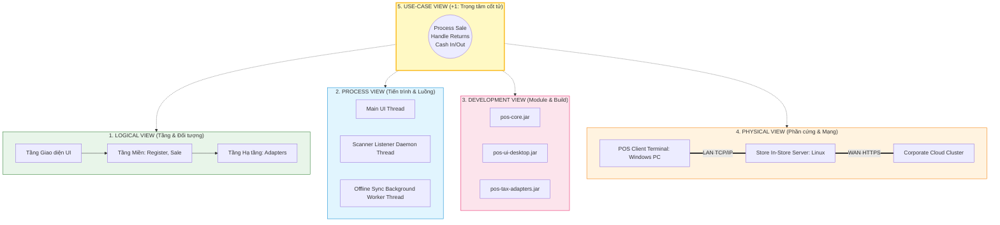

[🏠 Trang Chủ (MOC)](../README.md) | [◄ Chương 31: Organizing Design and Implementation Model Packages](./31_Organizing_Design_and_Implementation_Model_Packages.md) | [Chương 33: Designing for More Architectural Patterns ►](./33_Designing_for_More_Architectural_Patterns.md)

---

## CHƯƠNG 32: INTRODUCTION TO ARCHITECTURAL ANALYSIS AND THE SAD

### 1. ĐỀ MỤC & MỤC TIÊU CỐT LÕI (CORE PURPOSE)

#### Hệ thống đề mục (Heading Hierarchy)
* **32.1. Architectural Analysis** *(Phân tích Kiến trúc: Nhận diện và Giải quyết các Yếu tố Kiến trúc Cốt tử)*
* **32.2. Types and Views of Architecture: The 4+1 View Model** *(Các góc nhìn kiến trúc: Mô hình 4+1 View của Philippe Kruchten)*
  * *Logical View (Góc nhìn Logic: Tầng, Package, Lớp)*
  * *Process View (Góc nhìn Tiến trình: Đa luồng, Đồng bộ, IPC)*
  * *Development / Implementation View (Góc nhìn Hiện thực: Thư viện, Module, Build)*
  * *Physical / Deployment View (Góc nhìn Vật lý: Phần cứng, Mạng, Nodes)*
  * *Use-Case View (Góc nhìn Ca sử dụng: Trọng tâm gắn kết 4 góc nhìn)*
* **32.3. The Science: Identification and Analysis of Architectural Factors** *(Khoa học nhận diện các Yếu tố Kiến trúc - Quality Attributes / FURPS+)*
* **32.4. Summary of Themes in Architectural Analysis** *(Tổng kết các chủ đề then chốt trong phân tích kiến trúc)*
* **32.5. Architectural Analysis within the UP** *(Phân tích kiến trúc trong Quy trình UP)*
* **32.6. The Software Architecture Document (SAD)** *(Tài liệu Kiến trúc Phần mềm: Khung tài liệu chuẩn mực)*

#### Vấn đề kỹ thuật thực tế & Thảm họa kiến trúc được ngăn chặn
Chương 32 trang bị cho Kiến trúc sư tư duy ở tầng cao nhất: **Phân tích Kiến trúc (*Architectural Analysis*)**. Nó giải quyết sự thiển cận khi đội ngũ chỉ tập trung vào từng dòng code nhỏ lẻ mà bỏ quên **Bức tranh Kiến trúc Tổng thể (*Big-Picture Architecture*)**.

Nếu bỏ qua Phân tích Kiến trúc và tài liệu SAD, hệ thống sẽ gặp các thảm họa:
* **Hội chứng Góc nhìn Đơn độc (Single-Perspective Blindness):** Lập trình viên chỉ quan tâm đến Sơ đồ lớp (Logical View) mà bỏ qua Process View (đa luồng gây deadlock) và Physical View (độ trễ mạng giữa các server làm sập hệ thống).
* **Đổ vỡ do các Yếu tố Kiến trúc Tiềm ẩn (Unaddressed Quality Drivers):** Không xác định trước các ràng buộc phi chức năng khắt khe (bảo mật, thời gian phục hồi sau thảm họa, thông lượng giao dịch), khiến hệ thống phải đập bỏ toàn bộ khung gầm sau khi ra mắt.
* **Mất kiểm soát Quyết định Kỹ thuật (Architectural Amnesia):** Không ghi chép lại lý do tại sao chọn giải pháp này mà bỏ giải pháp kia (*Architecture Decision Records - ADR*), khiến các kỹ sư mới vào liên tục lặp lại các sai lầm cũ.

---

### 2. PHÂN TÍCH LÝ THUYẾT & NGUYÊN LÝ CHUYÊN SÂU

```
+-----------------------------------------------------------------------------------------+
|                         MÔ HÌNH 4+1 GÓC NHÌN KIẾN TRÚC (KRUCHTEN)                      |
+-----------------------------------------------------------------------------------------+
|      [LOGICAL VIEW]                             [PROCESS VIEW]                          |
|   (Tầng, Phân rã Lớp, GRASP)                 (Tiến trình, Đa luồng, Đồng bộ IPC)        |
|                  \                                     /                                |
|                   \                                   /                                 |
|                    v                                 v                                  |
|                               +---------------+                                         |
|                               | USE-CASE VIEW |                                         |
|                               |  (Trọng tâm)  |                                         |
|                               +---------------+                                         |
|                    ^                                 ^                                  |
|                   /                                   \                                 |
|                  /                                     \                                |
|    [DEVELOPMENT VIEW]                           [PHYSICAL VIEW]                         |
|  (Gói, Thư viện, Assembly, Build)            (Mạng, Phần cứng, Topology, Node)          |
+-----------------------------------------------------------------------------------------+
```

#### 2.1. Mô hình 4+1 Góc nhìn Kiến trúc (The 4+1 View Model of Architecture)
Philippe Kruchten và Craig Larman chỉ ra rằng: **Không có một sơ đồ duy nhất nào có thể mô tả trọn vẹn kiến trúc của một hệ thống**. Cần 5 lăng kính độc lập nhưng gắn kết chặt chẽ:
1. **Logical View (Góc nhìn Logic):** Mô tả cách thức phân rã bài toán thành các lớp, package và tầng nghiệp vụ (Sơ đồ lớp, DCD, Sơ đồ gói). Phục vụ lập trình viên hiểu cấu trúc hướng đối tượng.
2. **Process View (Góc nhìn Tiến trình):** Mô tả khía cạnh đồng thời (*Concurrency*), các luồng thực thi (*Threads*), tiến trình hệ điều hành (*OS Processes*), và cơ chế giao tiếp liên tiến trình (IPC). Phục vụ giải quyết bài toán hiệu năng, tranh chấp và deadlock.
3. **Development / Implementation View (Góc nhìn Phát triển):** Mô tả cấu trúc vật lý của mã nguồn: các module, thư viện JAR/DLL, quản lý phiên bản Git, và pipeline biên dịch. Phục vụ quản trị build và tích hợp liên tục (CI/CD).
4. **Physical / Deployment View (Góc nhìn Vật lý):** Mô tả cấu hình phần cứng, máy chủ, topology mạng, cách phân bổ các tiến trình phần mềm lên các node vật lý. Phục vụ kỹ sư triển khai và vận hành hệ thống (DevOps).
5. **Use-Case View (Góc nhìn Ca sử dụng - "+1"):** Là trái tim gắn kết 4 góc nhìn trên. Các ca sử dụng trọng yếu nhất đóng vai trò là kim chỉ nam để kiểm chứng xem 4 góc nhìn kia có đáp ứng được mục tiêu kinh doanh hay không.

#### 2.2. Tài liệu Kiến trúc Phần mềm (Software Architecture Document - SAD)
* SAD không phải là cuốn sách dày cộp vô bổ. Trong UP, SAD là một tài liệu sống động, súc tích (khoảng 20-40 trang) tóm tắt các **quyết định kỹ thuật cốt tử mang tính sống còn đối với sự thành bại của dự án**.
* Trọng tâm của SAD: Bảng phân tích các **Yếu tố Kiến trúc (*Architectural Factors Table*)**: Nêu rõ yêu cầu chất lượng (ví dụ: Chịu tải 10.000 req/s), rủi ro liên quan, và giải pháp kiến trúc được lựa chọn để hóa giải rủi ro đó.

---

### 3. MỔ XẺ MÃ NGUỒN HOẶC ĐẶC TẢ THIẾT KẾ (DESIGN / CODE DEEP-DIVE)

Dưới đây là bản đặc tả **Bảng Yếu tố Kiến trúc (*Architectural Factors Table*)** và mẫu **Biên bản Quyết định Kiến trúc (*Architecture Decision Record - ADR*)** trích từ tài liệu SAD của NextGen POS:

```markdown
# ARCHITECTURE DECISION RECORD (ADR-001): TÍCH HỢP DỊCH VỤ THUẾ NGOẠI TUYẾN

## Trạng thái: ĐÃ PHÊ DUYỆT (APPROVED)
## Ngày quyết định: 2026-11-04
## Kiến trúc sư chủ trì: Principal Software Architect

### 1. Bối cảnh & Bài toán (Context & Problem Statement)
Hệ thống NextGen POS cần tích hợp với nhiều dịch vụ tính thuế của bên thứ ba (GoodAsGold, TaxMaster). 
Tuy nhiên, đường truyền mạng internet tại các cửa hàng bán lẻ thường xuyên bị chập chờn hoặc gián đoạn.
Yêu cầu kiến trúc: Quầy thu ngân vẫn phải tiếp tục thanh toán được mà không bị treo hệ thống.

### 2. Các phương án xem xét (Considered Options)
- Phương án A: Gọi API trực tiếp qua HTTP REST mỗi lần quét hàng (Loại bỏ vì: Mất mạng là quầy chết).
- Phương án B: Tải toàn bộ bảng thuế về lưu cứng trong mã nguồn (Loại bỏ vì: Luật thuế thay đổi liên tục).
- Phương án C: Kết hợp Adapter Pattern với Local Store-and-Forward Cache (ĐƯỢC CHỌN).

### 3. Quyết định Kiến trúc (Decision)
Áp dụng mẫu hình Adapter (GoF) kết hợp với Cơ chế Lưu trữ và Chuyển tiếp (Store-and-Forward):
- Dựng interface ITaxCalculatorAdapter thuộc Tầng Miền.
- Khi mất mạng, ResilientTaxAdapter sử dụng bảng thuế ước lượng cục bộ gần nhất để tính tiền.
- Đóng gói giao dịch vào hàng đợi OfflineQueue để kiểm toán đối soát lại khi có mạng.

### 4. Hệ quả & Đánh đổi (Consequences & Trade-offs)
- Điểm lợi (+): Đạt 100% tính sẵn sàng ngoại tuyến (High Availability). Trải nghiệm thu ngân thông suốt.
- Điểm đánh đổi (-): Chấp nhận sai số tiền lẻ không đáng kể (< 0.1%) trong thời gian mất mạng, 
  cần quy trình kế toán xử lý lệch thuế định kỳ.
```

#### Bảng phân tích kỹ thuật và ý nghĩa thiết kế:

| Mục trong Tài liệu SAD / ADR | Ý nghĩa Kiến trúc & Giá trị Quản trị Kỹ thuật |
| :--- | :--- |
| **Bối cảnh & Bài toán** | Làm rõ động lực kỹ thuật (*Architectural Driver*), ngăn chặn việc đội ngũ áp dụng các giải pháp phức tạp một cách vô căn cứ. |
| **Các phương án xem xét** | Bằng chứng về tư duy phản biện đa chiều; ghi nhận lý do tại sao các phương án khác bị bác bỏ để tránh việc tranh cãi lại trong tương lai. |
| **Quyết định (Pattern C)** | Hiện thực hóa nguyên lý **Protected Variations**: Cách ly điểm biến đổi đằng sau giao diện ổn định. |
| **Đánh đổi (Trade-offs)** | Thể hiện sự chín muồi của kiến trúc sư: Không có giải pháp hoàn hảo tuyệt đối, chỉ có giải pháp cân bằng tối ưu giữa các thuộc tính chất lượng (Availability vs. Consistency). |

---

### 4. SƠ ĐỒ TRỰC QUAN HÓA (UML MERMAID)

Sơ đồ Mô hình 4+1 Góc nhìn Kiến trúc (Kruchten's 4+1 Architectural View Model) áp dụng vào Hệ thống NextGen POS:



---

### 5. ÁNH XẠ ỨNG DỤNG VÀO DỰ ÁN GAME OOP THỰC CHIẾN

* **Bối cảnh áp dụng:** Biên soạn Tài liệu Kiến trúc SAD cho Game 2.5D Online nhiều người chơi (Dedicated Server MMO).
* **Ứng dụng Mô hình 4+1 View vào Game:**
  1. *Logical View:* Cấu trúc phân tầng: `EnginePresentation` $\to$ `GameSimulation` $\to$ `NetworkTransport`.
  2. *Process View (Cực kỳ quan trọng trong Game):*
     * Luồng 1 (*Main Game Loop Thread - 60 FPS*): Xử lý Input, Animation, Audio trên Client.
     * Luồng 2 (*Physics Simulation Thread - FixedUpdate 50 Hz*): Tính toán va chạm hộp hitbox.
     * Luồng 3 (*Network Receive Thread*): Nhận gói tin UDP và giải mã thô trên luồng riêng để tránh giật khung hình game.
  3. *Development View:* Tổ chức thành các Unity Assembly Definitions (`.asmdef`) độc lập để tăng tốc độ build mã nguồn.
  4. *Physical View:* Mô hình cụm máy chủ: `Client PC/Mobile` kết nối UDP tới `Edge Gateway Server` $\to$ chuyển tiếp tới `Game Room Server (Linux Headless)` $\to$ lưu trữ qua `Redis Cache Cluster` và `PostgreSQL Master-Slave`.

---

[🏠 Trang Chủ (MOC)](../README.md) | [◄ Chương 31: Organizing Design and Implementation Model Packages](./31_Organizing_Design_and_Implementation_Model_Packages.md) | [Chương 33: Designing for More Architectural Patterns ►](./33_Designing_for_More_Architectural_Patterns.md)
