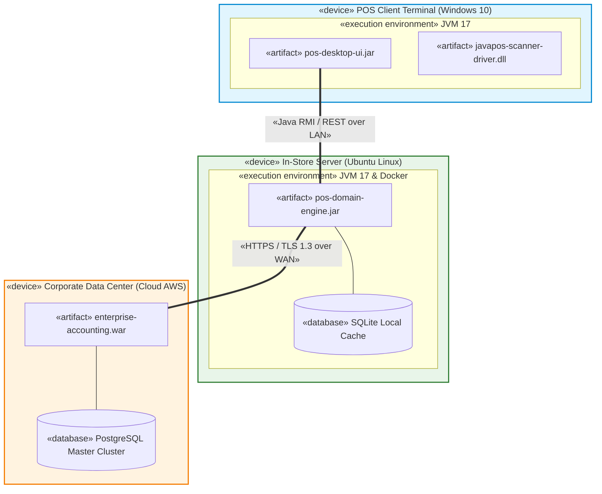

[🏠 Trang Chủ (MOC)](../README.md) | [◄ Chương 32: Introduction to Architectural Analysis and the SAD](./32_Introduction_to_Architectural_Analysis_and_the_SAD.md) | [Chương 34: Designing a Persistence Framework with Patterns ►](./34_Designing_a_Persistence_Framework_with_Patterns.md)

---

## CHƯƠNG 33: DESIGNING FOR MORE ARCHITECTURAL PATTERNS

### 1. ĐỀ MỤC & MỤC TIÊU CỐT LÕI (CORE PURPOSE)

#### Hệ thống đề mục (Heading Hierarchy)
* **33.1. More Architectural Patterns** *(Các mẫu hình kiến trúc mở rộng)*
* **33.2. Handling Failure and Centralized Exception Handling** *(Kiến trúc Xử lý Thất bại và Ngoại lệ Tập trung)*
* **33.3. Physical Architecture: Deployment and Component Diagrams** *(Kiến trúc Vật lý: Sơ đồ Triển khai và Sơ đồ Thành phần)*
  * *Deployment Diagram Notation (Ký hiệu Node, Artifact, Communication Path)*
  * *Component Diagram Notation (Ký hiệu Thành phần phần mềm, Giao diện Cung cấp và Yêu cầu)*
* **33.4. Distributed Systems and Remote Object Communication** *(Hệ thống Phân tán và Giao tiếp Đối tượng Từ xa)*

#### Vấn đề kỹ thuật thực tế & Thảm họa kiến trúc được ngăn chặn
Chương 33 giải quyết bài toán hiện thực hóa hệ thống trên **Môi trường Phần cứng Thực tế (*Physical Deployment Infrastructure*)** và thiết lập **Chiến lược Quản lý Lỗi Toàn cục (*Centralized Fault Tolerance Strategy*)**.

Nếu bỏ qua bước thiết kế này, hệ thống sẽ gặp các thảm họa:
* **Hội chứng Nuốt chửng Ngoại lệ (Pokemon Exception Handling - Gotta catch 'em all):** Lập trình viên viết các khối `try { ... } catch (Exception e) {}` rỗng rải rác khắp nơi để "chữa cháy". Kết quả: Lỗi bị giấu nhẹm, dữ liệu bị sai lệch âm thầm mà không ai biết, việc truy tìm nguyên nhân gốc rễ (*Root Cause Analysis*) trở thành ác mộng.
* **Bất nhất về Cấu hình Phần cứng Triển khai (Deployment Drift):** Không có Sơ đồ Triển khai (Deployment Diagram), nhóm phát triển không biết phần mềm sẽ chạy trên bao nhiêu máy chủ, băng thông mạng ra sao, dẫn đến việc thiết kế giao tiếp mạng quá tải làm sập hạ tầng phần cứng ngày khai trương.
* **Khóa chết Giao thức Mạng (Network Protocol Coupling):** Mã nguồn nghiệp vụ phụ thuộc thẳng vào socket TCP/IP thô hoặc giao thức độc quyền, khiến việc nâng cấp lên gRPC hay HTTPS đòi hỏi viết lại toàn bộ chương trình.

---

### 2. PHÂN TÍCH LÝ THUYẾT & NGUYÊN LÝ CHUYÊN SÂU

```
+-----------------------------------------------------------------------------------------+
|                  SƠ ĐỒ TRIỂN KHAI VẬT LÝ VÀ XỬ LÝ NGOẠI LỆ TẬP TRUNG                    |
+-----------------------------------------------------------------------------------------+
| [NODE: POS Terminal PC]                                                                 |
|   +-------------------------------------------------------------------------------+     |
|   | <<artifact>> pos-desktop.jar                                                  |     |
|   |   - CentralizedExceptionHandler (Bắt mọi lỗi chưa xử lý, ghi log, phục hồi)   |     |
|   +-------------------------------------------------------------------------------+     |
+-----------------------------------------------------------------------------------------+
          |
          | LAN (Ethernet 100Mbps - TCP/IP)
          v
+-----------------------------------------------------------------------------------------+
| [NODE: In-Store Server (Linux)]                                                         |
|   +-------------------------------------------------------------------------------+     |
|   | <<artifact>> store-services.jar                                               |     |
|   | <<database>> Local SQLite / PostgreSQL                                        |     |
|   +-------------------------------------------------------------------------------+     |
+-----------------------------------------------------------------------------------------+
```

#### 2.1. Sơ đồ Triển khai UML (Deployment Diagrams)
* Thể hiện **phần mềm chạy trên phần cứng nào**.
* Ký hiệu chuẩn:
  * **Node (Nút):** Hộp hình lập phương 3D đại diện cho tài nguyên tính toán vật lý (Máy tính, Server, Máy quẹt thẻ) hoặc môi trường thực thi ảo (JVM, Docker Container).
  * **Artifact (Tạo tác vật lý):** Hình chữ nhật có biểu tượng tờ giấy gập góc, đại diện cho file nhị phân cụ thể (`.jar`, `.exe`, `.dll`) được triển khai lên Node đó.
  * **Communication Path (Đường truyền thông):** Đường nối giữa các Node có ghi rõ giao thức mạng (ví dụ: `«TCP/IP»`, `«HTTPS»`, `«RS-232»`).

#### 2.2. Chiến lược Xử lý Ngoại lệ Tập trung (Centralized Exception Handling)
Craig Larman thiết lập quy tắc quản lý lỗi công nghiệp:
1. **Phân loại Ngoại lệ:**
   * *Ngoại lệ Nghiệp vụ (*Application / Business Exceptions*):* Lỗi dự đoán được (ví dụ: `ItemNotFoundException`, `InsufficientFundsException`). Được xử lý và thông báo thân thiện tới người dùng.
   * *Ngoại lệ Hệ thống (*System / Infrastructure Exceptions*):* Lỗi hạ tầng nghiêm trọng (ví dụ: `DatabaseCrashException`, `NetworkIOException`).
2. **Nguyên tắc: Không bao giờ nuốt chửng ngoại lệ!**
   * Tầng dưới gặp lỗi không tự xử lý được thì phải **đóng gói lại (*Exception Wrapping*)** thành một ngoại lệ cấp cao có ý nghĩa và ném tiếp lên trên.
   * Tại tầng ngoài cùng (UI hoặc Controller), một bộ xử lý ngoại lệ tập trung (**Centralized Exception Handler / Error Boundary**) sẽ tiếp nhận, ghi nhận nhật ký kiểm toán (*Audit Log*), hiển thị thông báo an toàn cho người dùng và kích hoạt cơ chế phục hồi trạng thái.

---

### 3. MỔ XẺ MÃ NGUỒN HOẶC ĐẶC TẢ THIẾT KẾ (DESIGN / CODE DEEP-DIVE)

Dưới đây là mã nguồn Java hiện thực hóa kiến trúc **Đóng gói Ngoại lệ (*Exception Wrapping*)** và **Bộ Xử lý Ngoại lệ Tập trung Toàn cục (*Global Centralized Exception Handler*)**:

```java
// ==================== 1. EXCEPTION WRAPPING TRONG DOMAIN ====================
public class Register {
    private ProductCatalog catalog;

    public void enterItem(ItemID id, int qty) {
        try {
            ProductDescription desc = catalog.getProductDescription(id);
            if (desc == null) {
                // Ngoại lệ nghiệp vụ có ngữ nghĩa rõ ràng
                throw new ItemNotFoundException("Không tìm thấy sản phẩm trong danh mục: " + id);
            }
            // Thao tác nghiệp vụ...
        } catch (DatabaseException dbErr) {
            // EXCEPTION WRAPPING: Biến lỗi kỹ thuật SQL thành lỗi hệ thống cấp cao
            throw new SystemFailureException("Hệ thống tra cứu dữ liệu tạm thời gián đoạn!", dbErr);
        }
    }
}

// ==================== 2. CENTRALIZED EXCEPTION HANDLER TẠI TẦNG UI ====================
public class GlobalExceptionHandler {
    private static final Logger logger = LoggerFactory.getLogger(GlobalExceptionHandler.class);

    // Điểm chốt chặn duy nhất tiếp nhận mọi ngoại lệ chưa được xử lý trong ứng dụng
    public static void handle(Throwable error) {
        if (error instanceof ItemNotFoundException) {
            // Lỗi nghiệp vụ -> Báo nhẹ nhàng cho thu ngân quét lại
            DialogBox.showWarning("CẢNH BÁO", error.getMessage());
        } else if (error instanceof SystemFailureException) {
            // Lỗi hệ thống -> Ghi log chi tiết và kích hoạt chế độ an toàn
            logger.error("CHÍ MẠNG: Lỗi hạ tầng hệ thống!", error);
            DialogBox.showError("LỖI HỆ THỐNG", "Đã xảy ra sự cố kỹ thuật. Đang chuyển sang chế độ ngoại tuyến...");
            FailoverManager.activateOfflineMode();
        } else {
            // Lỗi bất ngờ chưa từng lường trước (Bug tiềm ẩn)
            logger.fatal("FATAL UNEXPECTED CRASH:", error);
            DialogBox.showError("LỖI KHẨN CẤP", "Ứng dụng gặp lỗi không thể phục hồi. Vui lòng liên hệ Admin.");
        }
    }
}
```

#### Bảng phân tích kỹ thuật và ý nghĩa thiết kế:

| Đoạn mã then chốt | Kỹ thuật Kiến trúc áp dụng | Giá trị Bảo vệ Hệ thống |
| :--- | :--- | :--- |
| `throw new SystemFailureException(..., dbErr);` | **Exception Wrapping & Root Cause Chaining:** Giấu kín câu lệnh SQL nhạy cảm khỏi màn hình người dùng, nhưng bảo toàn nguyên vẹn nguyên nhân gốc `dbErr` trong stack trace để kỹ sư điều tra. |
| `GlobalExceptionHandler.handle(...)` | **Centralized Error Boundary:** Tập trung hóa 100% logic ứng phó sự cố tại một điểm duy nhất, loại bỏ việc viết 100 khối `catch` trùng lặp ở khắp các màn hình. |
| `FailoverManager.activateOfflineMode();` | **Tự phục hồi Thảm họa (*Graceful Degradation*):** Biến lỗi hệ thống thành hành động tự động kích hoạt chế độ dự phòng ngoại tuyến. |

---

### 4. SƠ ĐỒ TRỰC QUAN HÓA (UML MERMAID)

Sơ đồ Triển khai Vật lý (Deployment Diagram) của Hệ thống NextGen POS trên hạ tầng phân tán 3 cấp:



---

### 5. ÁNH XẠ ỨNG DỤNG VÀO DỰ ÁN GAME OOP THỰC CHIẾN

* **Bối cảnh áp dụng:** Sơ đồ Triển khai Hạ tầng Máy chủ Game (*Server Deployment Topology*) và Quản lý Lỗi Gói tin Mạng trong Game 2.5D Multiplayer.
* **Ứng dụng từ Chương 33 vào Game:**
  1. *Physical Deployment Architecture:*
     * **Client Node (PC/Mobile):** Chạy `GameClient.exe` (Unity Runtime) giao tiếp UDP qua Internet tới Gateway.
     * **Edge Gateway Server Node:** Làm nhiệm vụ cân bằng tải (*Load Balancer*), lọc tấn công DDoS và giải mã gói tin.
     * **Dedicated Room Server Node:** Máy chủ Linux chạy binary headless `GameSimulation.bin` (chứa logic trừ máu, di chuyển, hitbox 50 Hz).
     * **Central State Cluster:** Lưu trữ thông tin tài khoản qua Redis và MongoDB.
  2. *Centralized Packet Exception Handling:*
     * Khi Client cố tình gửi một gói tin dị dạng hoặc hack số âm (ví dụ: `CastSkill(skillID: -9999)`), tầng mạng không làm sập tiến trình Server (`RoomServer`).
     * `GlobalPacketExceptionHandler` bắt ngoại lệ, lập tức ngắt kết nối socket của client vi phạm (*Kick*), ghi lại IP vào danh sách đen (*Ban List*), và tiếp tục duy trì trận đấu bình thường cho các người chơi khác.

---

[🏠 Trang Chủ (MOC)](../README.md) | [◄ Chương 32: Introduction to Architectural Analysis and the SAD](./32_Introduction_to_Architectural_Analysis_and_the_SAD.md) | [Chương 34: Designing a Persistence Framework with Patterns ►](./34_Designing_a_Persistence_Framework_with_Patterns.md)
