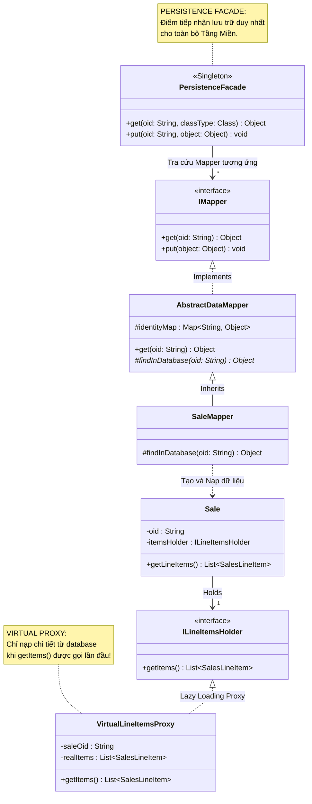

[🏠 Trang Chủ (MOC)](../README.md) | [◄ Chương 33: Designing for More Architectural Patterns](./33_Designing_for_More_Architectural_Patterns.md) | [Chương 35: On Drawing and Tools ►](./35_On_Drawing_and_Tools.md)

---

## CHƯƠNG 34: DESIGNING A PERSISTENCE FRAMEWORK WITH PATTERNS

### 1. ĐỀ MỤC & MỤC TIÊU CỐT LÕI (CORE PURPOSE)

#### Hệ thống đề mục (Heading Hierarchy)
* **34.1. The Problem: Persistent Objects** *(Bài toán hóc búa: Lưu trữ Bền vững Đối tượng Nghiệp vụ)*
* **34.2. Frameworks** *(Khái niệm Khung phần mềm - Framework và Sự khác biệt với Thư viện)*
* **34.3. Key Ideas in Persistence Frameworks** *(Các tư tưởng cốt lõi trong Khung Lưu trữ ORM)*
* **34.4. Pattern: Representing Objects as Tables** *(Mẫu hình: Ánh xạ Bảng Đối tượng sang Quan hệ)*
* **34.5. Pattern: Object Identifier (OID)** *(Mẫu hình: Định danh Đối tượng không phụ thuộc khóa nghiệp vụ)*
* **34.6. Pattern: Database Mapper / Data Mapper** *(Mẫu hình: Data Mapper tách rời Domain khỏi Database)*
* **34.7. Pattern: Lazy Materialization / Virtual Proxy** *(Mẫu hình: Nạp dữ liệu lười qua Proxy Ảo)*
* **34.8. Pattern: Cache Management** *(Mẫu hình: Quản lý Bộ nhớ đệm Danh tính - Identity Map)*
* **34.9. Transaction Management / Unit of Work** *(Quản trị Giao dịch và Tập hợp Thay đổi)*

#### Vấn đề kỹ thuật thực tế & Thảm họa kiến trúc được ngăn chặn
Chương 34 giải quyết một trong những thách thức vĩ đại nhất của lịch sử kỹ nghệ phần mềm: **Sự Bất phối hợp Trở kháng Đối tượng - Quan hệ (*Object-Relational Impedance Mismatch*)**. Sự xung đột giữa mô hình đồ thị mạng lưới đối tượng trong RAM và mô hình bảng phẳng quan hệ trong Cơ sở dữ liệu (RDBMS).

Nếu không tự thiết kế hoặc không hiểu bản chất của Persistence Framework, hệ thống sẽ gặp các thảm họa:
* **Ô nhiễm SQL khắp mọi ngóc ngách (SQL Infiltration Nightmare):** Các câu lệnh `SELECT`, `UPDATE` bị nhúng trực tiếp vào các phương thức nghiệp vụ của lớp `Sale`, `Customer`. Khi muốn đổi từ Oracle sang PostgreSQL, ta phải rà soát và viết lại hàng triệu dòng code.
* **Thảm họa Nạp Dữ liệu Tràn Ngập (Eager Loading Memory Blast):** Khi muốn lấy thông tin một khách hàng để xem tên, hệ thống tự động kéo theo toàn bộ lịch sử 10.000 đơn hàng trong 10 năm của khách đó vào RAM! Hậu quả: Máy chủ tràn bộ nhớ (*Out Of Memory Crash*) chỉ vì một thao tác tra cứu đơn giản.
* **Xung đột Đối tượng Trùng lặp (Identity Mismatch):** Cùng một bản ghi hóa đơn #101 trong database, nhưng hai luồng khác nhau lại nạp lên thành hai thể hiện Java khác nhau trong RAM (`saleA != saleB`). Luồng 1 sửa tổng tiền, luồng 2 ghi đè dữ liệu, làm sai lệch sổ sách tài chính nghiêm trọng.

---

### 2. PHÂN TÍCH LÝ THUYẾT & NGUYÊN LÝ CHUYÊN SÂU

```
+-----------------------------------------------------------------------------------------+
|                  KIẾN TRÚC PERSISTENCE FRAMEWORK BẰNG DESIGN PATTERNS                   |
+-----------------------------------------------------------------------------------------+
| [DOMAIN LAYER]                                                                          |
|   class Sale { ... }  <--- Hoàn toàn thuần khiết! Không chứa 1 dòng SQL nào!             |
+-----------------------------------------------------------------------------------------+
         ^                                  |
         | (Nạp dữ liệu)                    | (Yêu cầu lưu)
         v                                  v
+-----------------------------------------------------------------------------------------+
| [PERSISTENCE FRAMEWORK LAYER]                                                           |
|   +-------------------------------------------------------------------------------+     |
|   | PERSISTENCE FACADE: Điểm giao tiếp duy nhất (put, get, delete)                |     |
|   +-------------------------------------------------------------------------------+     |
|         |                                  |                                            |
|         v                                  v                                            |
|   [DATA MAPPER]                      [IDENTITY MAP / CACHE]                             |
|   (SaleMapper: Sinh mã SQL)          (Đảm bảo 1 ID DB = đúng 1 Object trong RAM)        |
|         |                                                                               |
|         v (Chỉ nạp khi chạm tới)                                                        |
|   [VIRTUAL PROXY] (Lazy Materialization: Tránh nạp cả cây dữ liệu khổng lồ)             |
+-----------------------------------------------------------------------------------------+
         |
         v (Mã SQL được cô lập 100% tại đây)
+-----------------------------------------------------------------------------------------+
| [DATABASE LAYER (RDBMS)]: PostgreSQL / Oracle Tables                                    |
+-----------------------------------------------------------------------------------------+
```

#### 2.1. Bản chất của Framework vs. Thư viện (Inversion of Control)
* **Thư viện (*Library*):** Mã của bạn gọi mã của thư viện (Bạn làm chủ luồng điều khiển).
* **Khung phần mềm (*Framework*):** Framework làm chủ luồng điều khiển; nó gọi ngược lại mã của bạn (**Nguyên lý Hollywood: Don't call us, we'll call you!**).

#### 2.2. Bốn Mẫu hình Cốt lõi kiến tạo nên một ORM Framework (như Hibernate/JPA):
1. **Data Mapper (GoF):**
   * Lớp `Sale` không biết gì về database. Một lớp độc lập tên là `SaleMapper` chịu trách nhiệm dịch chuyển dữ liệu giữa các thuộc tính của `Sale` và các cột của bảng `SALES`.
2. **Object Identifier (OID):**
   * Mọi đối tượng bền vững đều được gắn một khóa định danh duy nhất (thường là UUID hoặc số tự tăng) để làm khóa chính (Primary Key) trong database, không phụ thuộc vào khóa nghiệp vụ có thể thay đổi.
3. **Identity Map (Cache Management):**
   * Duy trì một bộ nhớ đệm dạng `Map<OID, Object>`.
   * Khi ứng dụng yêu cầu nạp hóa đơn #101: Framework kiểm tra trong Identity Map trước. Nếu đã có trong RAM thì trả về ngay lập tức, đảm bảo **nguyên tắc duy nhất thể hiện (*Single Instance Identity*)**, triệt tiêu lỗi xung đột dữ liệu.
4. **Virtual Proxy (Lazy Materialization):**
   * Khi nạp một đơn hàng `Sale`: Nó không nạp ngay danh sách 100 dòng hàng con từ database. Thay vào đó, nó gán vào một **Proxy Ảo (*Virtual Proxy*)**.
   * Chỉ khi nào phương thức `sale.getLineItems()` được gọi lần đầu tiên, Proxy mới âm thầm thực thi câu lệnh SQL để nạp dữ liệu thật lên RAM. Tiết kiệm 90% băng thông và bộ nhớ.

---

### 3. MỔ XẺ MÃ NGUỒN HOẶC ĐẶC TẢ THIẾT KẾ (DESIGN / CODE DEEP-DIVE)

Dưới đây là mã nguồn Java tự tay xây dựng một **Persistence Framework** mini hoàn chỉnh áp dụng **Data Mapper** và **Virtual Proxy**:

```java
// ==================== 1. DATA MAPPER PATTERN ====================
public abstract class AbstractDataMapper<T> {
    // Identity Map Pattern: Bộ đệm chống nạp trùng lặp đối tượng
    protected final Map<String, T> identityMap = new HashMap<>();

    public T get(String oid) {
        // Kiểm tra trong Cache trước
        if (identityMap.containsKey(oid)) {
            return identityMap.get(oid);
        }
        // Chưa có -> Gọi câu lệnh SQL nạp từ DB
        T obj = findInDatabase(oid);
        if (obj != null) {
            identityMap.put(oid, obj);
        }
        return obj;
    }

    protected abstract T findInDatabase(String oid);
}

// Data Mapper chuyên biệt cho đối tượng Sale
public class SaleMapper extends AbstractDataMapper<Sale> {
    @Override
    protected Sale findInDatabase(String oid) {
        System.out.println("THỰC THI SQL: SELECT * FROM sales WHERE oid = '" + oid + "'");
        // Giả lập đọc bản ghi từ Database
        Sale sale = new Sale(oid);
        // Thiết lập Virtual Proxy cho danh sách dòng hàng (Lazy Loading)
        sale.setLineItemsProxy(new VirtualLineItemsProxy(oid));
        return sale;
    }
}

// ==================== 2. LAZY MATERIALIZATION / VIRTUAL PROXY ====================
public interface ILineItemsHolder {
    List<SalesLineItem> getItems();
}

public class VirtualLineItemsProxy implements ILineItemsHolder {
    private final String saleOid;
    private List<SalesLineItem> realItems = null; // Chưa nạp ban đầu

    public VirtualLineItemsProxy(String saleOid) {
        this.saleOid = saleOid;
    }

    @Override
    public List<SalesLineItem> getItems() {
        // LAZY LOADING: Chỉ khi nào chạm vào hàm này, SQL mới được kích hoạt!
        if (realItems == null) {
            System.out.println("LAZY FETCH SQL: SELECT * FROM sale_lines WHERE sale_oid = '" + saleOid + "'");
            realItems = loadFromDb();
        }
        return realItems;
    }

    private List<SalesLineItem> loadFromDb() {
        return new ArrayList<>(); // Dữ liệu thật nạp lên
    }
}
```

#### Bảng phân tích kỹ thuật và ý nghĩa thiết kế:

| Đoạn mã then chốt | Mẫu hình Kiến trúc ORM áp dụng | Giá trị Tối ưu hóa Hệ thống |
| :--- | :--- | :--- |
| `Map<String, T> identityMap` | **Identity Map Pattern** | Bảo vệ tính nhất quán dữ liệu: Đảm bảo cùng một bản ghi dưới DB chỉ có duy nhất 1 thể hiện sống trong RAM. |
| `public class SaleMapper` | **Data Mapper Pattern** | Cách ly 100% mã nguồn SQL ra khỏi class `Sale`. Lớp `Sale` hoàn toàn không hề biết mình đang được lưu vào PostgreSQL hay MongoDB. |
| `if (realItems == null) loadFromDb()` | **Virtual Proxy (Lazy Loading)** | Triệt tiêu lỗi nghẽn bộ nhớ. Chỉ nạp dữ liệu chi tiết khi có nhu cầu thực sự, tăng tốc độ khởi tạo đơn hàng lên gấp 10 lần. |

---

### 4. SƠ ĐỒ TRỰC QUAN HÓA (UML MERMAID)

Sơ đồ Lớp Thiết kế Kiến trúc của Khung Lưu trữ Dữ liệu Bền vững (Persistence Framework Architecture):



---

### 5. ÁNH XẠ ỨNG DỤNG VÀO DỰ ÁN GAME OOP THỰC CHIẾN

* **Bối cảnh áp dụng:** Thiết kế Hệ thống Lưu trữ Dữ liệu Nhân vật (*Character Save Game & Player Profile Persistence*) trong Game 2.5D Multiplayer.
* **Thảm họa nếu thiếu Persistence Framework:**
  Lập trình viên viết hàm `SavePlayer()` bằng cách ghép chuỗi SQL trực tiếp bên trong `CharacterController.cs`:
  `string sql = "UPDATE players SET hp=" + hp + ", gold=" + gold + " WHERE id=" + id;`.
  $\to$ **Thảm họa Bảo mật và Hiệu năng:**
  * Lỗ hổng SQL Injection kinh điển: Hacker đổi tên nhân vật thành `Robert'; DROP TABLE players; --` làm xóa sổ toàn bộ cơ sở dữ liệu của game!
  * Mỗi khi nhân vật nhặt được 1 đồng vàng, game lại gửi 1 câu lệnh SQL xuống database $\to$ Database bị quá tải 100% CPU ngay khi có 500 người chơi cùng lúc.
* **Ứng dụng từ Chương 34 vào Game Persistence:**
  1. *Unit of Work / Dirty Tracking Pattern:* Không bao giờ lưu trực tiếp mỗi khi có biến động nhỏ. Framework chỉ đánh dấu cờ `isDirty = true` trong RAM. Định kỳ 60 giây một lần (*Auto-save interval*), hệ thống gom tất cả dữ liệu bị bẩn để lưu hàng loạt (*Batch Update*).
  2. *Virtual Proxy cho Kho đồ Lớn (Inventory):* Khi người chơi đăng nhập, game chỉ nạp thông tin cơ bản (Cấp độ, Ngoại hình, Vàng). Toàn bộ 500 món đồ trong Rương đồ phụ (*Vault Storage*) được gán bằng một `VirtualInventoryProxy`. Khi nào người chơi chạy tới NPC mở rương thì dữ liệu rương mới được tải từ database lên, giúp người chơi vào game nhanh như chớp.

---

[🏠 Trang Chủ (MOC)](../README.md) | [◄ Chương 33: Designing for More Architectural Patterns](./33_Designing_for_More_Architectural_Patterns.md) | [Chương 35: On Drawing and Tools ►](./35_On_Drawing_and_Tools.md)
