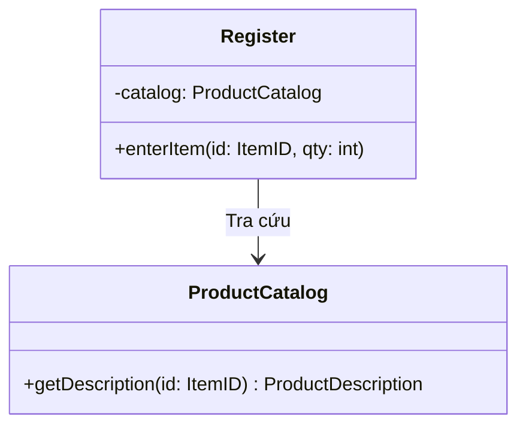
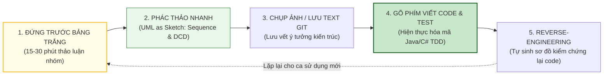

[🏠 Trang Chủ (MOC)](../README.md) | [◄ Chương 34: Designing a Persistence Framework with Patterns](./34_Designing_a_Persistence_Framework_with_Patterns.md) | [Chương 36: Introduction to Iterative Planning and Project Issues ►](./36_Introduction_to_Iterative_Planning_and_Project_Issues.md)

---

## CHƯƠNG 35: ON DRAWING AND TOOLS

### 1. ĐỀ MỤC & MỤC TIÊU CỐT LÕI (CORE PURPOSE)

#### Hệ thống đề mục (Heading Hierarchy)
* **35.1. On Drawing and Tools** *(Về việc Vẽ biểu đồ và Công cụ hỗ trợ)*
* **35.2. Forward-Engineering vs. Reverse-Engineering** *(Kỹ nghệ Thuận: Từ Biểu đồ sinh Mã vs. Kỹ nghệ Nghịch: Từ Mã sinh Biểu đồ)*
* **35.3. Round-Trip Engineering: The Myth and Reality** *(Kỹ nghệ Khứ hồi: Huyền thoại và Thực tế)*
* **35.4. Whiteboards and Low-Tech Tools vs. High-End CASE Tools** *(Bảng trắng giá rẻ vs. Công cụ CASE đắt tiền)*
* **35.5. Recommendations for Tool Selection** *(Các khuyến nghị thực dụng khi lựa chọn công cụ UML)*

#### Vấn đề kỹ thuật thực tế & Thảm họa kiến trúc được ngăn chặn
Chương 35 giải quyết căn bệnh **Sùng bái Công cụ (Tool Idolatry / CASE Tool Obsession)**. Rất nhiều dự án thất bại thảm hại không phải vì lập trình viên dốt, mà vì ban quản lý ép buộc họ phải sử dụng các phần mềm vẽ UML cồng kềnh, phức tạp và đắt tiền (như Rational Rose thời xưa).

Nếu hiểu sai về công cụ vẽ, đội ngũ sẽ hứng chịu các thảm họa:
* **Lãng phí Thời gian Vô ích (The CASE Tool Time Sink):** Các kỹ sư dành 80% thời gian để chỉnh sửa màu sắc, căn lề mũi tên, sửa lỗi cú pháp trong phần mềm CASE tool thay vì ngồi suy nghĩ về trách nhiệm và kiến trúc phần mềm.
* **Ảo tưởng Kỹ nghệ Khứ hồi (Round-Trip Engineering Illusion):** Tin vào lời hứa của các nhà cung cấp công cụ rằng: *"Chỉ cần vẽ UML là tool tự sinh code 100%, sửa code thì tool tự cập nhật biểu đồ"*. Trong thực tế, cơ chế này liên tục sinh mã rác, làm hỏng cấu trúc code, và không thể xử lý được các logic tinh tế của ngôn ngữ lập trình.
* **Triệt tiêu Tinh thần Cộng tác Nhóm (Collaboration Murder):** Khi mỗi người ngồi ôm một màn hình máy tính với công cụ CASE riêng, sự giao tiếp mặt-đối-mặt bị triệt tiêu hoàn toàn.

---

### 2. PHÂN TÍCH LÝ THUYẾT & NGUYÊN LÝ CHUYÊN SÂU

```
+-----------------------------------------------------------------------------------------+
|                  PHỔ CÔNG CỤ TỪ LINH HOẠT TỚI NẶNG NỀ (THE TOOLING CONTINUUM)           |
+-----------------------------------------------------------------------------------------+
| [BẢNG TRẮNG / GIẤY VẼ]                [CÔNG CỤ VẼ NHẸ (PLANTUML/MERMAID)]  [CASE TOOLS] |
| (Whiteboard / Post-it)               (Text-to-Diagram / Markdown)         (Rational...) |
+-----------------------------------------------------------------------------------------+
| - Chi phí: 0$                        - Chi phí: Miễn phí                  - Rất đắt     |
| - Tốc độ: Vài giây                   - Tốc độ: Vài phút                   - Rất chậm    |
| - Tính cộng tác: TỐI ĐA (Cả nhóm)    - Tính cộng tác: Lưu Git/Review PR   - Cá nhân     |
| - Mục đích: Sáng tạo & Thảo luận     - Mục đích: Tài liệu hóa sống động   - Burocracy   |
+-----------------------------------------------------------------------------------------+
```

#### 2.1. Lời khuyên Thực dụng của Craig Larman: Bảng trắng là Số 1!
* **Bảng trắng (*Whiteboard*) và Bút dạ là công cụ thiết kế UML tốt nhất từng được phát minh.**
* Nó cho phép 2-3 kỹ sư đứng cạnh nhau, vẽ một mũi tên trong 1 giây, xóa đi vẽ lại trong nửa giây, tranh luận sôi nổi về việc phân bổ trách nhiệm bằng GRASP.
* Không có menu dropdown phức tạp, không có pop-up cảnh báo lỗi cú pháp làm gián đoạn dòng chảy tư duy sáng tạo (*Creative Flow*).

#### 2.2. Kỹ nghệ Thuận (Forward) vs. Kỹ nghệ Nghịch (Reverse)
* **Kỹ nghệ Thuận (Forward-Engineering):** Vẽ biểu đồ trước $\to$ Sinh mã nguồn sau. Chỉ nên thực hiện ở mức độ phác thảo ý tưởng nhanh (*UML as sketch*), tuyệt đối không cố vẽ chi tiết từng dấu chấm phẩy.
* **Kỹ nghệ Nghịch (Reverse-Engineering):** Có mã nguồn chạy thật $\to$ Dùng công cụ dịch ngược mã nguồn thành Sơ đồ Lớp để nhìn lại bức tranh tổng thể (*Code Visualization*). Đây là tính năng có giá trị nhất của các công cụ hiện đại, giúp kỹ sư mới vào dự án nhanh chóng nắm bắt cấu trúc của hàng trăm file code có sẵn.

---

### 3. MỔ XẺ MÃ NGUỒN HOẶC ĐẶC TẢ THIẾT KẾ (DESIGN / CODE DEEP-DIVE)

Thay vì dùng các công cụ CASE đồ sộ độc quyền, xu hướng kiến trúc hiện đại (hiện thực hóa tư tưởng của Craig Larman) là sử dụng **Mô hình hóa dưới dạng Văn bản (Diagrams-as-Code / Text-to-Diagram)** như Mermaid hoặc PlantUML. Tài liệu thiết kế được lưu cùng kho mã nguồn Git và được review qua Pull Request:

```markdown
<!-- ĐẶC TẢ THIẾT KẾ DẠNG TEXT-AS-CODE ĐƯỢC VERSION CONTROL TRÊN GIT -->

<!-- LỢI ÍCH KIẾN TRÚC:
     1. Không phụ thuộc vào tool nhị phân đóng kín.
     2. Mọi thay đổi kiến trúc đều hiển thị rõ ràng qua Git Diff.
     3. Tự động render thành hình ảnh trực quan ngay trên GitHub/GitLab. -->
```

#### Bảng phân tích kỹ thuật và ý nghĩa thiết kế:

| Tiêu chí Lựa chọn Công cụ | Bảng trắng + Text-to-Diagram (Khuyên dùng) | Công cụ CASE hạng nặng (Cảnh báo né tránh) |
| :--- | :--- | :--- |
| **Tốc độ phản hồi tư duy** | Tức thì. Không cản trở luồng suy nghĩ sáng tạo của kỹ sư. | Chậm chạp. Phải chỉnh sửa hàng chục thông số kỹ thuật form mẫu. |
| **Tích hợp Quy trình Git** | Hoàn hảo. Lưu trữ dưới dạng plain text markdown, diff và merge dễ dàng. | Tồi tệ. Lưu dưới dạng file nhị phân độc quyền (`.rose`, `.eap`), không thể merge khi xung đột. |
| **Chi phí đầu tư** | 0 Đồng. Tiếp cận ngay lập tức cho toàn bộ đội ngũ. | Hàng ngàn USD tiền bản quyền cho mỗi lập trình viên. |

---

### 4. SƠ ĐỒ TRỰC QUAN HÓA (UML MERMAID)

Sơ đồ Luồng Công việc Mô hình hóa Thực dụng (Agile Modeling Workflow) theo khuyến nghị của Craig Larman:



---

### 5. ÁNH XẠ ỨNG DỤNG VÀO DỰ ÁN GAME OOP THỰC CHIẾN

* **Bối cảnh áp dụng:** Văn hóa Thiết kế và Lựa chọn Công cụ trong Studio Game phát triển Game 2.5D Multiplayer.
* **Thảm họa sùng bái công cụ trong Game Studio:**
  Lead Designer và Lead Tech ép toàn bộ đội ngũ phải cài phần mềm vẽ Enterprise Architect. Mỗi khi lập trình viên muốn thêm một kỹ năng cho nhân vật, họ phải mở tool lên vẽ đầy đủ 10 thuộc tính, nộp đơn duyệt. Đội ngũ mất 2 tuần chỉ để vẽ, không ai có hứng thú sáng tạo gameplay, game bị trễ tiến độ phát hành 6 tháng và bị đối thủ cướp mất thị trường!
* **Ứng dụng từ Chương 35 vào Game Studio:**
  1. *Phòng Chiến Lược Bảng Trắng (War Room):* Đặt 3 tấm bảng trắng lớn trong phòng phát triển. Khi cần thiết kế cơ chế Boss đánh diện rộng: Game Designer và Gameplay Programmer đứng lên bảng, vẽ các khối hộp nhân vật và mũi tên di chuyển trong 10 phút.
  2. *Chụp ảnh và Code ngay:* Dùng điện thoại chụp ảnh lại bản vẽ bảng trắng, đẩy lên kênh Slack của nhóm, sau đó mở Unity/C# lên viết code và test ngay trong ngày.
  3. *Tài liệu hóa bằng Markdown/Mermaid:* Lưu các biểu đồ chốt vào kho Git Markdown của dự án để làm tài liệu nội bộ sống động (*Living Documentation*).

---

[🏠 Trang Chủ (MOC)](../README.md) | [◄ Chương 34: Designing a Persistence Framework with Patterns](./34_Designing_a_Persistence_Framework_with_Patterns.md) | [Chương 36: Introduction to Iterative Planning and Project Issues ►](./36_Introduction_to_Iterative_Planning_and_Project_Issues.md)
