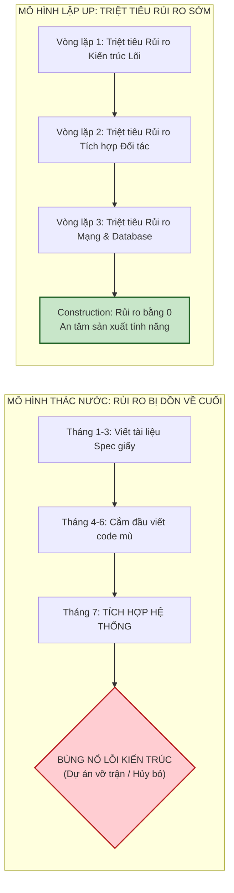

[🏠 Trang Chủ (MOC)](../README.md) | [◄ Chương 35: On Drawing and Tools](./35_On_Drawing_and_Tools.md) | [Chương 37: Comments on Iterative Development and the UP ►](./37_Comments_on_Iterative_Development_and_the_UP.md)

---

## CHƯƠNG 36: INTRODUCTION TO ITERATIVE PLANNING AND PROJECT ISSUES

### 1. ĐỀ MỤC & MỤC TIÊU CỐT LÕI (CORE PURPOSE)

#### Hệ thống đề mục (Heading Hierarchy)
* **36.1. Ranking Requirements: Early Iteration Drivers** *(Xếp hạng Yêu cầu: Bốn động lực định hình các vòng lặp đầu tiên)*
  * *Risk (Rủi ro kỹ thuật và kinh doanh)*
  * *Coverage (Độ bao phủ kiến trúc)*
  * *Criticality (Mức độ tối quan trọng với nghiệp vụ)*
  * *Skills Development (Đào tạo kỹ năng cho đội ngũ)*
* **36.2. Ranking Project Risks** *(Định lượng và Xếp hạng Rủi ro Dự án: Xác suất x Tác động)*
* **36.3. Phase Plans and Iteration Plans** *(Kế hoạch theo Pha vs. Kế hoạch theo Vòng lặp)*
* **36.4. Requirements Tracking Across Iterations** *(Theo dõi tiến độ yêu cầu xuyên suốt các vòng lặp)*
* **36.5. The (In)validity of Early Estimates: The Cone of Uncertainty** *(Sự ảo tưởng của các ước lượng ban đầu: Nón Bất định)*
* **36.6. Organizing Workspaces and Version Control** *(Tổ chức Không gian làm việc và Quản lý Phiên bản Git)*

#### Vấn đề kỹ thuật thực tế & Thảm họa kiến trúc được ngăn chặn
Chương 36 giải quyết sai lầm chết người trong quản lý dự án: **Bẫy Ảo tưởng về Kế hoạch Chi tiết Cố định (*The Illusion of Predictable Schedules*)**.

Nếu một nhà quản lý phần mềm điều hành theo tư duy Thác nước truyền thống, dự án sẽ gặp các thảm họa:
* **Hội chứng Ném Rủi ro về Cuối (Late-Risk Bomb Disaster):** Lập kế hoạch xếp những việc dễ làm lên trước (như màn hình giới thiệu, chọn màu da nhân vật). Đến tháng cuối cùng mới làm phần kết nối mạng và thanh toán, và phát hiện ra lỗi kiến trúc chí mạng khiến dự án nổ tung.
* **Ảo tưởng Ước lượng Sớm (Premature Estimating Delusion):** Bắt buộc kỹ sư phải cam kết ngày hoàn thành chính xác vào ngày thứ 3 của dự án. Thực tế chứng minh: Tại vạch xuất phát, độ sai số ước lượng có thể lên tới 400% (*The Cone of Uncertainty*).
* **Kế hoạch Tê liệt vì Cứng nhắc:** Không thể thích ứng khi thị trường thay đổi hoặc khi đối tác hủy hợp đồng dịch vụ.

---

### 2. PHÂN TÍCH LÝ THUYẾT & NGUYÊN LÝ CHUYÊN SÂU

```
+-----------------------------------------------------------------------------------------+
|                  NÓN BẤT ĐỊNH TRONG ƯỚC LƯỢNG (THE CONE OF UNCERTAINTY)                 |
+-----------------------------------------------------------------------------------------+
| Sai số ước lượng                                                                        |
|    4x  |  \                                                                             |
|        |   \  (Inception: Độ bất định cực đại, sai số 400%)                             |
|    2x  |    \                                                                           |
|        |     \  (Elaboration: Đã có code kiến trúc chạy thật, sai số giảm còn 25%)      |
|    1x  |------\==================================================== (Thực tế)           |
|        |       \                                                                        |
|  0.5x  |        \  (Construction: Rủi ro kỹ thuật triệt tiêu, ước lượng chính xác)      |
|        +---------------------------------------------------------------------> Thời gian|
|             Inception        Elaboration        Construction      Transition            |
+-----------------------------------------------------------------------------------------+
```

#### 2.1. Bốn Động lực Xếp hạng Yêu cầu cho các Vòng lặp Đầu tiên
Craig Larman đưa ra bộ tứ tiêu chí để quyết định tính năng nào BẮT BUỘC phải đưa vào Vòng lặp Elaboration 1 & 2:
1. **Risk (Rủi ro):** Tính năng nào chứa đựng sự mù mờ kỹ thuật lớn nhất? (Ví dụ: tích hợp cổng thanh toán lạ, đồng bộ mạng thời gian thực). Hãy làm nó đầu tiên!
2. **Coverage (Độ bao phủ Kiến trúc):** Tính năng nào buộc hệ thống phải chạm qua tất cả các tầng (UI $\to$ Domain $\to$ Database)? Đó là lý do kịch bản tiền mặt của `Process Sale` được chọn ở Vòng lặp 1 để thông suốt đường hầm kỹ thuật (*Tracer Bullet*).
3. **Criticality (Mức độ Cốt tử):** Tính năng cốt lõi tạo ra doanh thu và giá trị kinh doanh sống còn của sản phẩm.
4. **Skills Development (Rèn luyện Kỹ năng):** Giúp đội ngũ làm quen với các công nghệ mới và mẫu hình mới ngay từ đầu.

#### 2.2. Nón Bất định (The Cone of Uncertainty)
* Không có một nhà khoa học hay kỹ sư chân chính nào có thể đưa ra con số ước lượng chính xác tuyệt đối ở pha Inception.
* Tại Inception, mức độ sai lệch có thể dao động từ **0.25x đến 4.0x** (một dự án ước tính 3 tháng có thể kéo dài thành 12 tháng).
* **Chỉ sau khi kết thúc Pha Elaboration** – khi bộ khung xương sống kiến trúc đã được biên dịch thành công và vượt qua các bài kiểm tra rủi ro – độ bất định mới co hẹp lại ở mức chấp nhận được ($\pm 10\% - 20\%$).

---

### 3. MỔ XẺ MÃ NGUỒN HOẶC ĐẶC TẢ THIẾT KẾ (DESIGN / CODE DEEP-DIVE)

Dưới đây là bản đặc tả **Ma trận Định lượng Rủi ro Dự án (*Risk Assessment & Iteration Allocation Matrix*)** theo chuẩn UP để lập lịch thực thi:

```json
{
  "iterationPlanningMatrix": {
    "iteration1": {
      "focus": "Architectural Baseline & Fundamental OOA/D",
      "selectedDrivers": ["RISK-01 (End-to-End Tracing)", "COVERAGE (Touch all 3 layers)"],
      "scope": "Process Sale (Cash Only - Happy Path)",
      "exitCriteria": "Mã nguồn biên dịch thành công, test kiểm thử đạt 100% pass trên CI."
    },
    "iteration2": {
      "focus": "Business Variability & GoF Patterns",
      "selectedDrivers": ["CRITICALITY (Credit Payments)", "SKILLS (Design Patterns Training)"],
      "scope": "Support Credit/Check Payments + Adapters for GoodAsGold & TaxMaster",
      "exitCriteria": "Tráo đổi được cổng thanh toán qua file cấu hình mà không sửa code."
    },
    "iteration3": {
      "focus": "Resilience & Persistence Framework",
      "selectedDrivers": ["RISK-02 (Offline Network Dropouts)", "CRITICALITY (Database Mapping)"],
      "scope": "Offline Failover Cache + Custom ORM Persistence Framework",
      "exitCriteria": "Rút dây mạng ra hệ thống vẫn quẹt thẻ và lưu hóa đơn an toàn."
    }
  }
}
```

#### Bảng phân tích kỹ thuật và ý nghĩa thiết kế:

| Giai đoạn Kế hoạch | Trọng tâm Kỹ thuật (Drivers) | Thảm họa được ngăn chặn |
| :--- | :--- | :--- |
| **Vòng lặp 1** | Độ bao phủ 3 tầng (*Coverage*) | Triệt tiêu lỗi "ghép nối muộn": Chứng minh giao diện nói chuyện được với database ngay từ tháng đầu tiên. |
| **Vòng lặp 2** | Đa biến thể (*Variability*) | Triệt tiêu lỗi khóa cứng vào một nhà cung cấp bên thứ ba qua các mẫu hình GoF. |
| **Vòng lặp 3** | Chịu lỗi ngoại tuyến (*Resilience*) | Triệt tiêu thảm họa sập hệ thống khi mạng internet thực tế bị đứt. |

---

### 4. SƠ ĐỒ TRỰC QUAN HÓA (UML MERMAID)

Sơ đồ Đường cong Triệt tiêu Rủi ro Kỹ thuật: Mô hình Phát triển Lặp UP vs. Mô hình Thác nước (Waterfall):



---

### 5. ÁNH XẠ ỨNG DỤNG VÀO DỰ ÁN GAME OOP THỰC CHIẾN

* **Bối cảnh áp dụng:** Lập kế hoạch Phát triển Lặp và Quản trị Rủi ro trong Dự án Game 2.5D Multiplayer.
* **Xếp hạng Rủi ro chuẩn mực cho Game Studio:**
  1. *Rủi ro Kỹ thuật #1 (Làm ngay tại Vòng lặp Elaboration 1):* **Độ trễ Mạng và Đồng bộ Vị trí (Network Netcode)**. Nếu không giải quyết được cơ chế chống giật hình (*Client-side Prediction & Lag Compensation*) thì dù đồ họa có đẹp như phim Hollywood game cũng là một sản phẩm rác bị vứt bỏ.
  2. *Rủi ro #2 (Elaboration 2):* **Hiệu năng Chịu tải của Server**. Kiểm tra máy chủ có chịu nổi 100 người chơi thi triển chiêu thức cùng lúc mà không bị rớt khung hình (*Tick Rate 30Hz*) không?
  3. *Các tính năng rủi ro thấp (Dồn về Pha Construction):* Thêm 50 bộ trang phục, thêm 100 màn chơi, thêm nhạc nền, thêm hiệu ứng pháo hoa. Những việc này hoàn toàn không có rủi ro kiến trúc, có thể mở rộng quy mô sản xuất dễ dàng.

---

[🏠 Trang Chủ (MOC)](../README.md) | [◄ Chương 35: On Drawing and Tools](./35_On_Drawing_and_Tools.md) | [Chương 37: Comments on Iterative Development and the UP ►](./37_Comments_on_Iterative_Development_and_the_UP.md)
