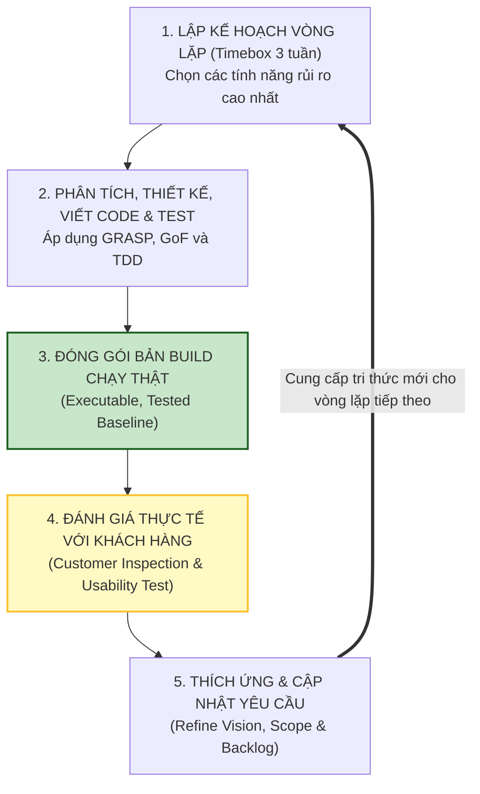

[🏠 Trang Chủ (MOC)](../README.md) | [◄ Chương 36: Introduction to Iterative Planning and Project Issues](./36_Introduction_to_Iterative_Planning_and_Project_Issues.md) | [Chương 38: More UML Notation ►](./38_More_UML_Notation.md)

---

## CHƯƠNG 37: COMMENTS ON ITERATIVE DEVELOPMENT AND THE UP

### 1. ĐỀ MỤC & MỤC TIÊU CỐT LÕI (CORE PURPOSE)

#### Hệ thống đề mục (Heading Hierarchy)
* **37.1. Additional UP Best Practices** *(Các thực hành tốt nhất bổ sung trong Quy trình UP)*
* **37.2. Motivations for Timeboxing an Iteration** *(Động lực tâm lý và kỹ thuật của việc Đóng khung Thời gian)*
* **37.3. The Sequential "Waterfall" Lifecycle - Why it Fails** *(Phân tích triết học và thực nghiệm: Tại sao Mô hình Thác nước thất bại?)*
  * *The Myth of Predictable Software Engineering (Huyền thoại về ngành kỹ nghệ phần mềm đoán trước)*
  * *Requirements Churn and Emergent Properties (Sự biến động yêu cầu và các thuộc tính tự sinh)*
* **37.4. Usability Engineering and User Interface Design in Iterative Development** *(Kỹ nghệ Trải nghiệm người dùng và Thiết kế UI trong vòng lặp)*
* **37.5. You Know You Didn't Understand the UP When... (Comprehensive Review)** *(Tổng kết toàn diện: Dấu hiệu nhận biết việc áp dụng sai UP)*

#### Vấn đề kỹ thuật thực tế & Thảm họa kiến trúc được ngăn chặn
Chương 37 cung cấp **Tầm nhìn Triết học và Cơ sở Thực nghiệm (*Empirical Evidence*)** để bảo vệ đội ngũ kỹ thuật trước áp lực quay trở lại lối mòn quản lý quan liêu Thác nước (*Water-Scrum-Fall*).

Nếu một tổ chức không thấu hiểu bản chất của UP, họ sẽ gặp các thảm họa:
* **Hội chứng Thác nước Trá hình (Fake Agile / Water-Scrum-Fall):** Nhóm tự xưng là làm "Agile" hay "UP", nhưng vẫn bắt các kỹ sư viết tài liệu đặc tả chi tiết 100% trước, không cho phép thay đổi phạm vi, và không release được bản build nào chạy thật sau mỗi 3 tuần.
* **Phình to Thời gian vì Không tuân thủ Timeboxing (Deadline Slippage Addiction):** Khi thấy công việc chưa xong, nhóm tự ý nới lỏng thời hạn từ 3 tuần lên 5 tuần, rồi 8 tuần. Kỷ luật bị phá vỡ, dự án trượt deadline vô hạn định.
* **Chối bỏ Thực tế Khách hàng (Rejecting Reality):** Cho rằng người dùng "dốt" vì họ liên tục thay đổi ý kiến sau khi nhìn thấy bản build đầu tiên, thay vì nhận thức rằng sự thay đổi yêu cầu là bản chất tự nhiên của tâm lý con người.

---

### 2. PHÂN TÍCH LÝ THUYẾT & NGUYÊN LÝ CHUYÊN SÂU

```
+-----------------------------------------------------------------------------------------+
|                  TẠI SAO THÁC NƯỚC THẤT BẠI TRONG PHẦN MỀM?                             |
+-----------------------------------------------------------------------------------------+
| XÂY DỰNG CẦU ĐƯỜNG (Predictable Manufacturing) | KỸ NGHỆ PHẦN MỀM (Empirical Discovery) |
| - Vật liệu sắt thép tuân theo định luật vật lý | - Phần mềm là sáng tạo tri thức thuần túy|
| - Yêu cầu không đổi: Cầu bắc qua sông          | - Yêu cầu thay đổi 25-50% trong dự án   |
| - Thiết kế bản vẽ trước 100% -> Thành công     | - Thiết kế trước 100% -> THẤT BẠI 100%  |
+-----------------------------------------------------------------------------------------+
```

#### 2.1. Bản chất Thực nghiệm của Phát triển Phần mềm (Empirical Process Control)
* Craig Larman khẳng định: **Viết phần mềm không phải là sản xuất hàng loạt trong nhà máy (Manufacturing), mà là quá trình Khám phá Tri thức Mới (*New Product Discovery*)**.
* Trong quá trình xây dựng, người dùng và lập trình viên **cùng học hỏi và cùng hiểu sâu hơn về bài toán**. Việc yêu cầu thay đổi không phải là lỗi lầm, mà là dấu hiệu của sự tiến hóa nhận thức.
* UP sử dụng mô hình **Kiểm soát Thực nghiệm (*Empirical Process Control*)**: Dựa trên 3 trụ cột: *Minh bạch (Transparency) $\to$ Kiểm tra (Inspection) $\to$ Thích ứng (Adaptation)*.

#### 2.2. Triết lý Tâm lý học của Timeboxing (2-6 tuần)
Tại sao bắt buộc phải cố định thời gian mà không được dời deadline?
1. **Quy luật Parkinson (*Work expands to fill the time available*):** Nếu cho 2 tháng, công việc sẽ tự phình to ra 2 tháng. Nếu đóng khung 3 tuần, đội ngũ sẽ tập trung cao độ vào những việc thực sự quan trọng nhất.
2. **Loại bỏ sự trì hoãn tích hợp (*Forced Integration*):** Timeboxing buộc nhóm phải tích hợp mã nguồn và chạy kiểm thử tự động định kỳ, không cho phép ai "ôm code riêng" quá 3 tuần.
3. **Phản hồi nhanh (*Rapid Feedback Loop*):** Thà nhận phản hồi tiêu cực của khách hàng sau 3 tuần còn hơn nhận lời phán xét tử hình sau 1 năm phát triển trong phòng kín.

---

### 3. MỔ XẺ MÃ NGUỒN HOẶC ĐẶC TẢ THIẾT KẾ (DESIGN / CODE DEEP-DIVE)

Dưới đây là bản đặc tả cấu hình **Quy trình Tích hợp Liên tục và Kiểm thử Tự động (*Continuous Integration & Automated Delivery Pipeline*)** – cỗ máy kỹ thuật sống còn bảo đảm tính khả thi của việc bàn giao sản phẩm sau mỗi vòng lặp Timeboxed:

```yaml
# ==================== CI/CD AUTOMATION PIPELINE (UP ITERATION ENGINE) ====================
name: UP Iteration Continuous Verification Pipeline

on:
  push:
    branches: [ main, develop ]
  schedule:
    - cron: '0 2 * * *' # Chạy bản build kiểm tra ngầm mỗi đêm (Nightly Build)

jobs:
  verify-iteration-baseline:
    runs-on: ubuntu-latest
    steps:
      - name: 1. Checkout Mã nguồn
        uses: actions/checkout@v3

      - name: 2. Thiết lập Môi trường JVM
        uses: actions/setup-java@v3
        with:
          java-version: '17'
          distribution: 'temurin'

      - name: 3. Biên dịch Mã nguồn thuần khiết (Strict Compiler Checks)
        run: javac -Werror -d bin src/com/nextgen/**/*.java

      - name: 4. Thực thi 100% Unit Tests & Hợp đồng Vận hành (Contract Assertions)
        run: java -jar junit-platform-console-standalone.jar --class-path bin --scan-classpath

      - name: 5. Đo lường Độ bao phủ Mã nguồn (Code Coverage Gate)
        run: |
          echo "Kiểm tra độ bao phủ kiểm thử: Bắt buộc >= 85% cho Tầng Miền (Domain Layer)"
          python check_coverage.py --threshold 85

      - name: 6. Đóng gói Bản build Chạy thực tế (Executable Baseline Delivery)
        run: jar cfe build/pos-iteration-baseline.jar com.nextgen.ui.Main -C bin .
```

#### Bảng phân tích kỹ thuật và ý nghĩa thiết kế:

| Bước trong Pipeline CI/CD | Nguyên lý UP tương ứng | Giá trị Kiến trúc Thực chiến |
| :--- | :--- | :--- |
| `javac -Werror` | **Không thỏa hiệp với cảnh báo (*Zero Warning Policy*)** | Đảm bảo mã nguồn luôn ở trạng thái chất lượng cao nhất, không có nợ kỹ thuật tồn đọng. |
| `junit --scan-classpath` | **Bảo vệ Tính bất biến của Hợp đồng (*Contract Verification*)** | Tự động kiểm tra lại hàng trăm hậu điều kiện đã thiết lập ở các vòng lặp trước, chống lỗi hồi quy (*Regression Bugs*). |
| `jar cfe pos-iteration-baseline.jar` | **Executable Baseline at Every Iteration** | Mỗi vòng lặp kết thúc bằng một file JAR chạy được thật 100%, sẵn sàng đưa cho khách hàng bấm thử. |

---

### 4. SƠ ĐỒ TRỰC QUAN HÓA (UML MERMAID)

Sơ đồ Vòng phản hồi Thực nghiệm (Empirical Feedback Loop) cốt lõi của Quy trình UP:



---

### 5. ÁNH XẠ ỨNG DỤNG VÀO DỰ ÁN GAME OOP THỰC CHIẾN

* **Bối cảnh áp dụng:** Triết lý Phát triển Lặp và Trải nghiệm Thử nghiệm (*Playtesting Discipline*) trong Game 2.5D Multiplayer.
* **Căn bệnh "Làm Game trong phòng tối" và Bài học thất bại:**
  Nhóm phát triển giấu kín game trong 2 năm, không cho bất kỳ ai chơi thử vì sợ "lộ ý tưởng" hoặc "chờ game thật hoàn hảo mới khoe". Đến ngày phát hành lên Steam: Người chơi vào chơi 5 phút đầu tiên thấy điều khiển quá khó chịu, góc camera 2.5D gây chóng mặt, cơ chế nhặt đồ nhàm chán $\to$ Game nhận hàng ngàn đánh giá tiêu cực và chết yểu chỉ sau 48 giờ!
* **Ứng dụng Triết lý UP từ Chương 37 vào Game:**
  1. *Playtesting sau mỗi vòng lặp 2 tuần:* Cứ sau mỗi bản build 2 tuần, studio mời 10 game thủ ngẫu nhiên vào văn phòng, đưa tay cầm cho họ chơi và quan sát nét mặt của họ mà không giải thích một lời nào.
  2. *Thích ứng ngay lập tức:* Nếu người chơi thấy chiêu thức này đánh không sướng tay (*Not Satisfying*), Game Designer sửa lại ngay trong vòng lặp tiếp theo. Sự thành bại của game được quyết định bởi cảm xúc thực tế của người chơi, không phải bởi những trang tài liệu thiết kế trên giấy!

---

[🏠 Trang Chủ (MOC)](../README.md) | [◄ Chương 36: Introduction to Iterative Planning and Project Issues](./36_Introduction_to_Iterative_Planning_and_Project_Issues.md) | [Chương 38: More UML Notation ►](./38_More_UML_Notation.md)
