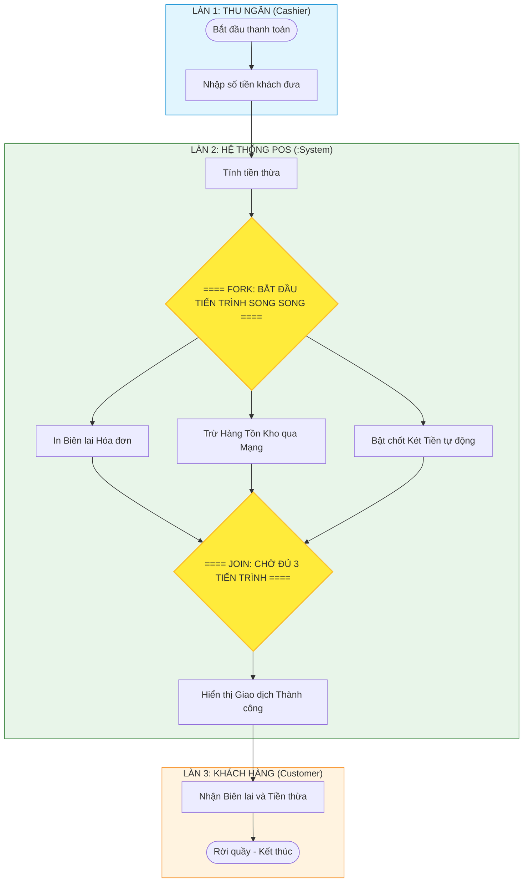

[🏠 Trang Chủ (MOC)](../README.md) | [◄ Chương 37: Comments on Iterative Development and the UP](./37_Comments_on_Iterative_Development_and_the_UP.md) | Cuối sách ►

---

## CHƯƠNG 38: MORE UML NOTATION

### 1. ĐỀ MỤC & MỤC TIÊU CỐT LÕI (CORE PURPOSE)

#### Hệ thống đề mục (Heading Hierarchy)
* **38.1. General Notation** *(Ký hiệu Tổng quát trong UML)*
  * *Stereotypes («...») - Định kiểu mở rộng*
  * *Tagged Values ({tag=value}) - Thuộc tính gắn nhãn*
  * *Constraints ({constraint}) - Ràng buộc ngữ nghĩa*
* **38.2. Implementation Diagrams: Component and Deployment Details** *(Sơ đồ Hiện thực: Chi tiết Thành phần và Triển khai)*
* **38.3. Activity Diagrams** *(Sơ đồ Hoạt động: Mô hình hóa luồng công việc song song và luồng dữ liệu)*
  * *Actions and Action States (Hành động và Trạng thái hành động)*
  * *Control Flows (Luồng điều khiển)*
  * *Forks and Joins (Phân nhánh song song và Hợp nhất luồng)*
  * *Swimlanes / Partitions (Phân vùng Trách nhiệm / Làn bơi)*
* **38.4. Conclusion on UML Usage: The Pragmatic Modeler** *(Tổng kết toàn bộ cuốn sách: Tư duy của một Nhà Mô hình hóa Thực dụng)*

#### Vấn đề kỹ thuật thực tế & Thảm họa kiến trúc được ngăn chặn
Chương 38 hoàn thiện bộ ngữ pháp UML với các công cụ mô hình hóa cao cấp: **Cơ chế Mở rộng Ngôn ngữ (*UML Extension Mechanisms*)** và **Mô hình hóa Tiến trình Song song (*Parallel Workflow Modeling*)**.

Nếu thiếu các công cụ này, hệ thống sẽ gặp các thảm họa:
* **Mơ hồ về Luồng Xử lý Bất đồng bộ / Song song (Concurrency Race Blindness):** Vẽ sơ đồ tuần tự cho một tiến trình xử lý đa luồng phân tán (ví dụ: vừa in hóa đơn, vừa gửi dữ liệu đám mây, vừa mở két tiền song song). Sơ đồ tuần tự bị rối loạn vì không có ký hiệu biểu diễn việc phân nhánh và đồng bộ luồng (*Fork / Join*).
* **Không thể Phân định Ranh giới Phân vùng Trách nhiệm (Unclear Organizational Boundaries):** Không rõ bước nào do Thu ngân làm, bước nào do Khách hàng làm, bước nào do Hệ thống Kế toán tự động làm, dẫn đến việc đùn đẩy trách nhiệm khi vận hành nghiệp vụ.
* **Ngôn ngữ UML Bị Đóng khung Cứng nhắc:** Không biết cách mở rộng UML để thể hiện các khái niệm chuyên biệt của công nghệ hiện đại (như `«interface»`, `«entity»`, `«REST_API»`).

---

### 2. PHÂN TÍCH LÝ THUYẾT & NGUYÊN LÝ CHUYÊN SÂU

```
+-----------------------------------------------------------------------------------------+
|                  BA CƠ CHẾ MỞ RỘNG KINH ĐIỂN CỦA UML (EXTENSION MECHANISMS)             |
+-----------------------------------------------------------------------------------------+
| 1. STEREOTYPE («...») : Phân loại lại hoặc mở rộng ngữ nghĩa của một phần tử UML.       |
|                         (Ví dụ: «interface», «control», «entity», «service»).           |
+-----------------------------------------------------------------------------------------+
| 2. TAGGED VALUE ({...}) : Bổ sung các cặp thuộc tính-giá trị siêu dữ liệu (Metadata).   |
|                         (Ví dụ: {version=2.1, author=Craig, threadSafe=true}).          |
+-----------------------------------------------------------------------------------------+
| 3. CONSTRAINT ({...})   : Thiết lập các quy tắc logic toán học hoặc bất biến (Invariant)|
|                         (Ví dụ: {ordered}, {amount >= 0}, {readOnly}).                  |
+-----------------------------------------------------------------------------------------+
```

#### 2.1. Bộ ba Mở rộng UML: Stereotypes, Tagged Values, Constraints
UML không phải là một ngôn ngữ chết cố định; nó có khả năng tự mở rộng thông qua các **UML Profiles**:
* **Stereotype (`«guillemets»`):** Biến đổi một phần tử cơ bản thành một khái niệm miền mới (ví dụ: gắn `«Controller»` lên lớp `Register`).
* **Tagged Value (`{tag=value}`):** Gắn metadata phục vụ sinh mã tự động hoặc quản lý dự án.
* **Constraint (`{rule}`):** Ràng buộc ngôn ngữ OCL (*Object Constraint Language*) hoặc biểu thức logic bắt buộc phải thỏa mãn.

#### 2.2. Sơ đồ Hoạt động (UML Activity Diagrams)
* Là công cụ số một để mô tả **Luồng quy trình công việc (*Workflows*)** và **Các thuật toán song song phức tạp**.
* **Các ký hiệu then chốt:**
  * *Hành động (*Action*):* Hình chữ nhật bo tròn góc.
  * *Phân nhánh Song song (*Fork Bar*):* Một thanh ngang dày chia 1 luồng thành nhiều luồng chạy đồng thời.
  * *Hợp nhất Song song (*Join Bar*):* Một thanh ngang dày gom nhiều luồng song song lại; luồng tiếp theo CHỈ ĐƯỢC CHẠY khi **tất cả các luồng con đã hoàn tất 100%**.
  * *Làn bơi (*Swimlanes / Partitions*):* Chia sơ đồ thành các cột dọc thể hiện đối tượng hoặc phòng ban nào chịu trách nhiệm cho hành động đó.

#### 2.3. Lời kết của Craig Larman: Nhà Mô hình hóa Thực dụng (The Pragmatic Modeler)
Khép lại 38 chương sách kinh điển, Craig Larman đúc kết kim chỉ nam tối thượng cho mọi Kiến trúc sư Phần mềm:
1. **Mã nguồn là Sự thật Tối thượng (*The Code is the Ultimate Truth*):** Biểu đồ chỉ là phương tiện hỗ trợ giao tiếp. Không có biểu đồ nào thay thế được mã nguồn chạy thực tế và có test bảo vệ.
2. **Mô hình hóa để Thấu hiểu, không phải để Lưu trữ (*Model to Understand, Not to Document*):** Đừng vẽ biểu đồ để cất vào tủ tài liệu. Hãy vẽ để khai sáng tư duy và triệt tiêu rủi ro kiến trúc!

---

### 3. MỔ XẺ MÃ NGUỒN HOẶC ĐẶC TẢ THIẾT KẾ (DESIGN / CODE DEEP-DIVE)

Dưới đây là mã nguồn Java hiện thực hóa trọn vẹn các khái niệm **UML Stereotypes và Tagged Values** thành các **Custom Annotations** trong mã nguồn hiện đại, kết hợp với cơ chế thực thi tiến trình song song tương ứng với Sơ đồ Hoạt động (*Fork/Join*):

```java
// ==================== 1. UML STEREOTYPES & TAGS AS JAVA ANNOTATIONS ====================
// Định nghĩa Stereotype: «Entity» và Tagged Values
@Retention(RetentionPolicy.RUNTIME)
@Target(ElementType.TYPE)
public @interface Entity {
    String version() default "1.0"; // Tagged Value: version
    boolean threadSafe() default false; // Tagged Value: threadSafe
}

// Ánh xạ lớp Domain áp dụng Stereotype và Constraint
@Entity(version = "2.1", threadSafe = true)
public class Sale {
    // Constraint: {amount >= 0}
    private Money total;
}

// ==================== 2. HIỆN THỰC HÓA FORK / JOIN WORKFLOW ====================
public class ParallelCheckoutProcessor {
    private final ExecutorService threadPool = Executors.newFixedThreadPool(3);

    public void completeSaleParallel(Sale sale) {
        System.out.println("BẮT ĐẦU FORK: Kích hoạt 3 tiến trình song song...");

        CompletableFuture<Void> task1 = CompletableFuture.runAsync(() -> {
            System.out.println("  [Thread 1]: Đang in biên lai hóa đơn giấy...");
        }, threadPool);

        CompletableFuture<Void> task2 = CompletableFuture.runAsync(() -> {
            System.out.println("  [Thread 2]: Đang gửi dữ liệu khấu trừ tồn kho lên máy chủ Kho...");
        }, threadPool);

        CompletableFuture<Void> task3 = CompletableFuture.runAsync(() -> {
            System.out.println("  [Thread 3]: Đang bắn tín hiệu mở két tiền tự động...");
        }, threadPool);

        // JOIN BAR: Đợi cả 3 tiến trình song song hoàn tất 100% mới đi tiếp
        CompletableFuture.allOf(task1, task2, task3).join();

        System.out.println("JOIN HOÀN TẤT: Toàn bộ quy trình bán hàng đã kết thúc an toàn.");
    }
}
```

#### Bảng phân tích kỹ thuật và ý nghĩa thiết kế:

| Cú pháp Mã nguồn Java | Khái niệm UML tương ứng | Giá trị Kiến trúc & Kỹ thuật |
| :--- | :--- | :--- |
| `@Entity(version = "2.1")` | **Stereotype & Tagged Value** | Chuyển hóa siêu dữ liệu UML thành Annotations để Framework tự động nhận diện và xử lý. |
| `CompletableFuture.runAsync(...)` | **Activity Diagram Fork Bar** | Phân nhánh luồng xử lý thành các tác vụ chạy song song đa luồng, tối ưu hóa thời gian chờ đợi của khách hàng. |
| `CompletableFuture.allOf(...).join()` | **Activity Diagram Join Bar** | Đồng bộ hóa luồng an toàn: Đảm bảo không có tiến trình nào bị bỏ rơi hoặc hoàn tất nửa vời. |

---

### 4. SƠ ĐỒ TRỰC QUAN HÓA (UML MERMAID)

Sơ đồ Hoạt động (Activity Diagram) với Làn bơi (Swimlanes / Partitions) và Phân nhánh/Hợp nhất song song (Fork/Join) cho quy trình Thanh toán:



---

### 5. ÁNH XẠ ỨNG DỤNG VÀO DỰ ÁN GAME OOP THỰC CHIẾN

* **Bối cảnh áp dụng:** Sơ đồ Hoạt động (Activity Diagram) mô hình hóa Tiến trình Ghép trận và Khởi tạo Phòng đấu (*Matchmaking & Dedicated Server Allocation*) trong Game 2.5D Multiplayer.
* **Ứng dụng từ Chương 38 vào Game Architecture:**
  1. *Làn bơi (Partitions):*
     * Cột 1: `Player Client` (Bấm nút tìm trận).
     * Cột 2: `Matchmaking Service` (Gom đủ 10 người chơi cùng trình độ ELO).
     * Cột 3: `Server Orchestrator (Kubernetes / Agones)` (Cấp phát pod server mới).
  2. *Fork / Join trong Game Loading:*
     * Khi 10 người chơi được ghép chung một phòng đấu $\to$ Kích hoạt **Fork Bar (Song song)**:
       * Luồng 1: Server nạp bản đồ màn chơi từ đĩa cứng.
       * Luồng 2: 10 máy Client bắt đầu tải dữ liệu asset 3D/Sprites vào RAM.
     * **Join Bar:** Máy chủ đứng chờ cho đến khi **cả 10 Client đều gửi tín hiệu `ClientLoadedComplete`** $\to$ Join Bar kích hoạt, máy chủ mới phát lệnh: `StartMatch321Go!`.
  3. *Lợi ích:* Tránh tình trạng người chơi máy mạnh vào game trước đi chém chết người chơi máy yếu đang còn kẹt ở màn hình loading!

---

[🏠 Trang Chủ (MOC)](../README.md) | [◄ Chương 37: Comments on Iterative Development and the UP](./37_Comments_on_Iterative_Development_and_the_UP.md) | Cuối sách ►
