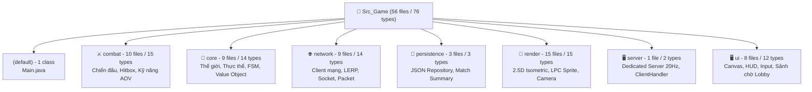
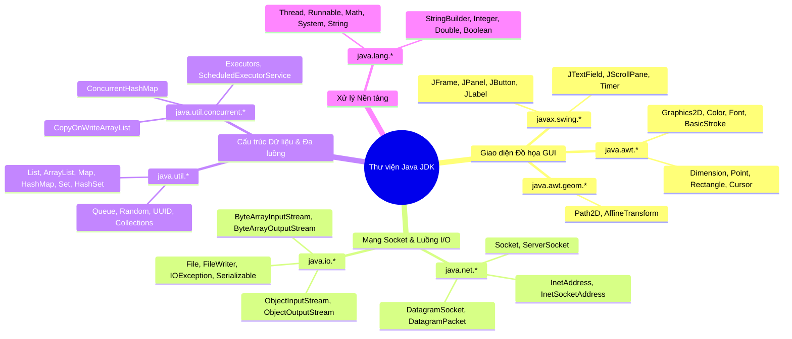

# 📚 DANH MỤC TOÀN BỘ CÁC CLASS TRONG THƯ MỤC `Src_Game`

> **Đề tài**: Hệ thống Trò chơi Đấu trường Hành động 3D Phối cảnh Đa nền tảng (PC & Android Multiplayer Action RPG)  
> **Nguyên tắc kỹ thuật**: **Pure OOP (Java 17/21 LTS)** — Tự cài đặt toàn bộ Game Loop, Va chạm AABB, Socket TCP/UDP, Đồng bộ LERP và Giao diện Đồ họa mà không phụ thuộc vào bất kỳ Game Engine hoặc thư viện ngoài (No Unity, No LibGDX, No Jackson/Gson).  
> **Phạm vi khảo sát**: Toàn bộ mã nguồn Java trong thư mục `Src_Game/`.

---

## 📊 1. BẢNG TỔNG QUAN ĐỊNH LƯỢNG

| Chỉ số thống kê                                       | Số lượng | Ghi chú chi tiết                                                                      |
| :---------------------------------------------------- | :------: | :------------------------------------------------------------------------------------ |
| **Tổng số tệp nguồn Java (`.java`)**                  |  **56**  | Nằm trong 7 package chức năng và 1 thư mục gốc                                        |
| **Tổng số Kiểu dữ liệu nội bộ được định nghĩa**       |  **76**  | Bao gồm Class, Abstract Class, Interface, Enum và Inner/Nested Class                  |
| ├── Class thông thường & Inner Class                  |    60    | Hiện thực hóa các logic nghiệp vụ, đối tượng game, DTO                                |
| ├── Abstract Class                                    |    1     | `LivingEntity` (Lớp trừu tượng cho thực thể sống)                                     |
| ├── Interface (Giao diện chuẩn GoF)                   |    8     | Đảm bảo tính lỏng lẻo (Loose Coupling) và nguyên lý SOLID                             |
| └── Enum (Tập hằng số nghiệp vụ)                      |    7     | Quản lý trạng thái, gói tin, loại quái vật, hướng nhìn, layer                         |
| **Các Class thư viện chuẩn Java (JDK) được tích hợp** | **~45**  | `java.awt`, `javax.swing`, `java.net`, `java.io`, `java.util`, `java.util.concurrent` |

---

## 📁 2. DANH SÁCH CHI TIẾT CÁC CLASS NỘI BỘ THEO PACKAGE

---

### 2.1. Thư mục gốc: Gói Mặc định `(default)` (1 Tệp / 1 Class)

| Tên Class | Loại | Tệp nguồn | Quan hệ kế thừa | Trách nhiệm & Mẫu thiết kế |
| :--- | :---: | :--- | :--- | :--- |
| `Main` | Class | `Src_Game/Main.java` | Không | **Điểm khởi chạy ứng dụng (Entry Point)**: Phân tích cờ dòng lệnh CLI (`--server`, `--client`, `--solo`, `--test`), thiết lập Look & Feel hệ thống và khởi tạo giao diện Sảnh chờ (`LobbyPanel`). |

---

### 2.2. Package `combat` — Động cơ Chiến đấu & Kỹ năng (10 Tệp / 15 Types)

| Tên Class / Type | Loại | Tệp nguồn | Quan hệ (`extends` / `implements`) | Trách nhiệm nghiệp vụ & Design Pattern |
| :--- | :---: | :--- | :--- | :--- |
| **`CombatEngine`** | Class | `Combat/CombatEngine.java` | Không | **Động cơ điều phối chiến đấu (SRP, OCP)**: Quản lý danh sách Hitbox, kiểm tra va chạm không gian qua `SpatialGridAoI`, ủy quyền tính sát thương qua `IDamageStrategy` và kích hoạt hiệu ứng qua `CombatEffects`. |
| **`IDamageStrategy`** | Interface | `Combat/IDamageStrategy.java` | Không | **Strategy Pattern (GoF)**: Định nghĩa hợp đồng tính toán sát thương thực tế giữa kẻ tấn công và mục tiêu. |
| **`PhysicalDamageStrategy`**| Class | `Combat/PhysicalDamageStrategy.java`| `implements IDamageStrategy` | **Concrete Strategy**: Cài đặt thuật toán sát thương vật lý: `effectiveDamage = max(1, baseDamage - defense/2)`. |
| **`ISkillAction`** | Interface | `Combat/ISkillAction.java` | Không | **Command / Strategy Pattern**: Định nghĩa chuẩn hành vi cho mọi kỹ năng chiến đấu (thi triển, hồi chiêu, tiêu hao năng lượng, vẽ hiệu ứng). |
| **`DashStrikeSkill`** | Class | `Combat/DashStrikeSkill.java` | `implements ISkillAction` | **Kỹ năng Chiêu 1 (Xung kích)**: Lướt nhanh 165px theo hướng 360°, gây sát thương chém xuyên mục tiêu dọc đường lướt. |
| **`FireWhirlwindSkill`** | Class | `Combat/FireWhirlwindSkill.java` | `implements ISkillAction` | **Kỹ năng Chiêu 2 (Vòng xoáy lửa)**: Chọn vùng tròn tầm trung 210px, kích nổ lửa bán kính 120px và hồi +18 HP cho người chơi. |
| **`MeteorUltimateSkill`** | Class | `Combat/MeteorUltimateSkill.java` | `implements ISkillAction` | **Kỹ năng Chiêu 3 (Thiên thạch hủy diệt - Ultimate)**: Triệu hồi thiên thạch diện rộng tầm xa 300px, nổ diện rộng 180px gây sát thương cực lớn. |
| **`Hitbox`** | Class | `Combat/Hitbox.java` | Không | **Information Expert**: Hộp bao va chạm trục song song (Axis-Aligned Bounding Box - AABB), tự kiểm tra giao cắt giữa hai hitbox chữ nhật. |
| **`SpatialGridAoI`** | Class | `Combat/SpatialGridAoI.java` | Không | **Spatial Partitioning Pattern**: Phân vùng không gian thế giới thành các ô lưới (Cell Grid) Area of Interest (AoI), tối ưu kiểm tra va chạm từ $O(N^2)$ xuống $O(N)$. |
| **`CombatEffects`** | Class | `Combat/CombatEffects.java` | Không | **SRP / Visual Manager**: Quản lý vòng đời và kết xuất toàn bộ hiệu ứng chiến đấu (chữ số sát thương, tia chớp, vòng sáng). |
| ├── `FloatingText` | Static Inner Class | `Combat/CombatEffects.java` | Không | Dữ liệu chữ số sát thương bay lên và mờ dần trên đầu thực thể trúng đòn. |
| ├── `HitParticle` | Static Inner Class | `Combat/CombatEffects.java` | Không | Hiệu ứng hạt tia lửa bung ra tại điểm va chạm. |
| ├── `SlashEffect` | Static Inner Class | `Combat/CombatEffects.java` | Không | Vệt chém hình vòng cung của đòn đánh thường hoặc chiêu lướt. |
| ├── `SkillRingEffect` | Static Inner Class | `Combat/CombatEffects.java` | Không | Vòng tròn năng lượng lan tỏa trên mặt đất khi kích hoạt chiêu thức. |
| └── `LightningBoltEffect`| Static Inner Class | `Combat/CombatEffects.java` | Không | Hiệu ứng tia sét ma thuật phóng ra từ gậy phép (chuỗi điểm zắc-zắc ngẫu nhiên kèm tia sét phụ). |

---

### 2.3. Package `core` — Thực thể Thế giới & Trạng thái (9 Tệp / 14 Types)

| Tên Class / Type | Loại | Tệp nguồn | Quan hệ (`extends` / `implements`) | Trách nhiệm nghiệp vụ & Design Pattern |
| :--- | :---: | :--- | :--- | :--- |
| **`Vector2D`** | Class (Final) | `Core/Vector2D.java` | Không | **Value Object (DDD)**: Biểu diễn tọa độ 2D $(x, y)$ bất biến (Immutable), hỗ trợ phép toán vector (cộng, trừ, nhân vô hướng, chuẩn hóa, tính khoảng cách). Tránh hoàn toàn lỗi Race Condition. |
| **`LivingEntity`** | Abstract Class| `Core/LivingEntity.java` | Không | **Template Method Pattern**: Lớp trừu tượng đóng gói thuộc tính sống (HP, MaxHP, Giáp, Vị trí, Hướng). Cung cấp khung phương thức `takeDamage()` và ủy quyền `onDeath()` cho lớp con. |
| **`Player`** | Class | `Core/Player.java` | `extends LivingEntity` | **State Pattern (GoF)**: Thực thể hiệp sĩ do người chơi điều khiển. Quản lý Level, EXP, Mana, Cooldown 3 chiêu thức AOV, máy trạng thái nhân vật. |
| ├── `IdleState` | Inner Class | `Core/Player.java` | `implements IPlayerState` | **Concrete State**: Trạng thái đứng yên sẵn sàng nhận lệnh mới. |
| ├── `MovingState` | Inner Class | `Core/Player.java` | `implements IPlayerState` | **Concrete State**: Trạng thái đang di chuyển tới tọa độ đích. |
| ├── `AttackingState`| Inner Class | `Core/Player.java` | `implements IPlayerState` | **Concrete State**: Trạng thái đang thi triển đòn đánh hoặc kỹ năng (khóa di chuyển tạm thời). |
| └── `DeadState` | Inner Class | `Core/Player.java` | `implements IPlayerState` | **Concrete State**: Trạng thái tử trận, vô hiệu hóa mọi hành vi điều khiển. |
| **`IPlayerState`** | Interface | `Core/IPlayerState.java` | Không | **State Pattern Interface**: Định nghĩa các phương thức xử lý hành vi theo trạng thái: `enter()`, `update()`, `handleInput()`. |
| **`Monster`** | Class | `Core/Monster.java` | `extends LivingEntity` | **Finite State Machine (FSM)**: Thực thể quái vật với AI máy hữu hạn: Tuần tra tự do (Patrol), đuổi theo người chơi trong tầm phát hiện (Chase), tấn công khi đủ gần (Attack). |
| └── `MonsterType` | Enum | `Core/Monster.java` | Không | Định nghĩa chủng loại quái: `SLIME`, `GOBLIN`, `SKELETON`, `ORC_BOSS` với chỉ số máu, giáp, tốc độ và màu sắc đặc trưng. |
| **`GameWorld`** | Class | `Core/GameWorld.java` | Không | **Façade Pattern / Domain Aggregate**: Quản lý toàn bộ thực thể trong thế giới game (Player, Monsters), ranh giới thế giới (Bounds), và phát thông báo sự kiện tới các Listener. |
| **`WaveManager`** | Class | `Core/WaveManager.java` | Không | **Wave Spawner**: Quản lý các đợt quái vật sinh ra theo thời gian, tăng dần độ khó và số lượng quái vật theo tiến trình chơi. |
| **`GameEngineLoop`** | Class | `Core/GameEngineLoop.java` | `implements Runnable` | **Game Loop Pattern (Robert Nystrom)**: Vòng lặp trò chơi độc lập với giao diện, chạy Fixed Timestep (60 TPS cho logic) và Variable Timestep cho Render, đảm bảo vật lý mượt mà và ổn định. |
| **`IEntityEventListener`**| Interface | `Core/IEntityEventListener.java` | Không | **Observer Pattern**: Giao diện tiếp nhận sự kiện vòng đời thực thể: nhận sát thương, hồi phục máu, tử trận, lên cấp. |

---

### 2.4. Package `network` — Giao tiếp Mạng & Đồng bộ (9 Tệp / 14 Types)

| Tên Class / Type | Loại | Tệp nguồn | Quan hệ (`extends` / `implements`) | Trách nhiệm nghiệp vụ & Design Pattern |
| :--- | :---: | :--- | :--- | :--- |
| **`NetworkGameClient`**| Class | `Network/NetworkGameClient.java` | Không | **Network Client (TCP Socket)**: Kết nối tới Dedicated Server, duy trì luồng nhận snapshot thế giới và luồng gửi lệnh người chơi 60Hz. |
| **`CloudServerBridge`** | Class | `Network/CloudServerBridge.java` | Không | Cầu nối máy chủ trung gian / Local loopback, hỗ trợ chuyển tiếp gói tin khi thử nghiệm không cần mạng ngoài. |
| └── `LocalLoopbackSession`| Static Inner Class | `Network/CloudServerBridge.java` | Không | Phiên truyền thông nội bộ giả lập Socket lặp để thử nghiệm độc lập. |
| **`LanDiscovery`** | Class | `Network/LanDiscovery.java` | Không | **UDP Broadcast Service**: Phát và lắng nghe gói tin UDP broadcast trên mạng LAN/Wi-Fi cục bộ để tự động tìm kiếm phòng chơi mà không cần gõ địa chỉ IP. |
| └── `DiscoveredRoom` | Static Inner Class | `Network/LanDiscovery.java` | Không | **DTO**: Đối tượng lưu thông tin phòng vừa quét được (Tên phòng, Mã phòng, IP Host, Port, Số người chơi). |
| **`MiniMqttClient`** | Class | `Network/MiniMqttClient.java` | Không | Bộ kết nối giao thức nhẹ mô phỏng MQTT bằng raw TCP Socket phục vụ Cloud Relay. |
| └── `MessageListener` | Inner Interface | `Network/MiniMqttClient.java` | Không | **Callback Observer**: Giao diện lắng nghe thông điệp MQTT trả về theo chủ đề (Topic). |
| **`GamePacket`** | Class | `Network/GamePacket.java` | `implements Serializable` | **Data Envelope**: Gói tin nhị phân chuẩn đóng gói `PacketType` và đối tượng `payload` gửi qua `ObjectOutputStream`. |
| **`PacketType`** | Enum | `Network/PacketType.java` | Không | Phân loại gói tin: `CONNECT`, `DISCONNECT`, `PLAYER_INPUT`, `WORLD_SNAPSHOT`, `CHAT`, `PING`, `PONG`. |
| **`PlayerInputPayload`**| Class | `Network/PlayerInputPayload.java` | `implements Serializable` | **Input DTO**: Gói tin chứa dữ liệu phím bấm, hướng di chuyển và vị trí chuột của client gửi lên máy chủ mỗi frame. |
| **`WorldSnapshotPayload`**| Class | `Network/WorldSnapshotPayload.java`| `implements Serializable` | **State DTO**: Gói trạng thái đồng bộ toàn cảnh (mốc thời gian, danh sách trạng thái của tất cả người chơi và quái vật) gửi từ Server về Client với chu kỳ 20Hz. |
| └── `EntityState` | Static Inner Class | `Network/WorldSnapshotPayload.java`| `implements Serializable` | Dữ liệu trạng thái của một thực thể cụ thể (ID, Tọa độ X/Y, Máu, Hướng, Trạng thái hành động). |
| **`SnapshotInterpolator`**| Class | `Network/SnapshotInterpolator.java`| Không | **LERP Interpolation Engine**: Bộ đệm và thuật toán nội suy vị trí tuyến tính giữa 2 snapshot liên tiếp, giúp chuyển động mượt mà ở 60 FPS dù server chỉ gửi dữ liệu ở 20Hz. |
| └── `EntityTransform` | Static Inner Class | `Network/SnapshotInterpolator.java`| Không | Lưu lịch sử biến đổi tọa độ theo tem thời gian (Timestamp) phục vụ phép tính nội suy. |

---

### 2.5. Package `persistence` — Lưu trữ Lịch sử Trận đấu (3 Tệp / 3 Types)

| Tên Class / Type | Loại | Tệp nguồn | Quan hệ (`extends` / `implements`) | Trách nhiệm nghiệp vụ & Design Pattern |
| :--- | :---: | :--- | :--- | :--- |
| **`IMatchRepository`** | Interface | `Persistence/IMatchRepository.java` | Không | **Repository Pattern (Martin Fowler)**: Định nghĩa hợp đồng trừu tượng lưu trữ và truy vấn kết quả các trận đấu gần nhất. |
| **`JsonFileMatchRepository`**| Class | `Persistence/JsonFileMatchRepository.java`| `implements IMatchRepository` | **Protected Variations (GRASP)**: Hiện thực hóa việc ghi lịch sử trận đấu ra định dạng tệp JSON thuần túy (không sử dụng thư viện thứ 3). Có bộ đệm InMemoryCache. |
| **`MatchSummary`** | Class | `Persistence/MatchSummary.java` | Không | **Data Transfer Object (DTO)**: Đối tượng lưu thông tin tổng kết trận đấu: Mã trận, Thời gian đấu (giây), Danh sách người tham gia, Người chiến thắng. |

---

### 2.6. Package `render` — Đồ họa 2.5D & Hoạt ảnh LPC (15 Tệp / 15 Types)

| Tên Class / Type | Loại | Tệp nguồn | Quan hệ (`extends` / `implements`) | Trách nhiệm nghiệp vụ & Design Pattern |
| :--- | :---: | :--- | :--- | :--- |
| **`Camera2D`** | Class | `Render/Camera2D.java` | Không | **Camera Smooth Tracking**: Quản lý khung nhìn, theo dõi mục tiêu bằng thuật toán nội suy LERP, chuyển đổi giữa tọa độ thế giới (World Space) và màn hình (Screen Space). |
| **`CharacterRenderer`** | Class | `Render/CharacterRenderer.java` | Không | Kết xuất đồ họa cơ bản của nhân vật (vòng tròn chọn mục tiêu, bóng đổ elip, thanh máu mini trên đầu). |
| **`CombatVisualRenderer`**| Class | `Render/CombatVisualRenderer.java` | Không | Kết xuất đồ họa trực quan cho 3 chiêu thức AOV: Vệt lướt chém Dash, Vòng lửa ma thuật Whirlwind, Thiên thạch rơi phát nổ Meteor. |
| **`CompositeCharacterVisual`**| Class | `Render/CompositeCharacterVisual.java`| Không | **Composite Pattern (GoF)**: Quản lý tập hợp nhiều lớp Sprite xếp chồng (Body, Tóc, Quần áo, Vũ khí) thành một thể thống nhất cho nhân vật. |
| **`Direction`** | Enum | `Render/Direction.java` | Không | Định nghĩa 8 hướng di chuyển và quay mặt: `UP`, `DOWN`, `LEFT`, `RIGHT`, `UP_LEFT`, `UP_RIGHT`, `DOWN_LEFT`, `DOWN_RIGHT`. |
| **`Environment25DRenderer`**| Class | `Render/Environment25DRenderer.java`| Không | Kết xuất nền đất địa hình phối cảnh 2.5D Dimetric (lưới ô cờ Isometric, đá cuội, mảng cỏ phối cảnh). |
| **`EnvironmentPropsRenderer`**| Class | `Render/EnvironmentPropsRenderer.java`| Không | Kết xuất các vật thể trang trí môi trường (cây cối, tảng đá, bia cổ) kèm hỗ trợ Z-sorting. |
| **`FrameBounds`** | Class | `Render/FrameBounds.java` | Không | Xác định kích thước và tọa độ cắt khung hình (bounding box) từ Sprite Sheet. |
| **`LayerType`** | Enum | `Render/LayerType.java` | Không | Thứ tự tầng đồ họa: `SHADOW`, `BODY`, `FEET`, `LEGS`, `TORSO`, `HAIR`, `WEAPON`, `HEAD`. |
| **`LpcAnimationType`** | Enum | `Render/LpcAnimationType.java` | Không | Phân loại hoạt ảnh theo chuẩn Liberated Pixel Cup: `IDLE`, `WALK`, `SLASH`, `SPELLCAST`, `HURT`, `DIE`. |
| **`LpcCanvasRenderer`** | Class | `Render/LpcCanvasRenderer.java` | Không | Bộ kết xuất hoạt ảnh nhân vật Pixel Art trực tiếp lên Java AWT `Graphics2D`. |
| **`LpcCharacterBuilder`**| Class | `Render/LpcCharacterBuilder.java` | Không | **Builder Pattern (GoF)**: Cho phép cấu hình và lắp ráp ngoại hình nhân vật từng bước (chọn màu da, kiểu tóc, vũ khí, trang phục). |
| **`LpcSpriteSheet`** | Class | `Render/LpcSpriteSheet.java` | Không | Trích xuất các khung hình hoạt ảnh tương ứng với từng hướng và trạng thái từ tệp ảnh Sprite Sheet LPC. |
| **`Renderable25D`** | Interface | `Render/Renderable25D.java` | Không | Giao diện cho mọi thực thể 2.5D, cung cấp `getSortY()` phục vụ thuật toán **Z-sorting** (vẽ đối tượng xa trước, gần sau). |
| **`SpriteLayer`** | Class | `Render/SpriteLayer.java` | `implements Comparable<SpriteLayer>` | Đại diện cho một lớp ảnh thành phần, có chỉ số ưu tiên chiều sâu (Z-index) để so sánh thứ tự kết xuất. |

---

### 2.7. Package `server` — Máy chủ Đấu mạng Dedicated (1 Tệp / 2 Types)

| Tên Class / Type | Loại | Tệp nguồn | Quan hệ (`extends` / `implements`) | Trách nhiệm nghiệp vụ & Design Pattern |
| :--- | :---: | :--- | :--- | :--- |
| **`DedicatedGameServer`**| Class | `Server/DedicatedGameServer.java` | Không | **Authoritative Dedicated Server**: Máy chủ điều khiển toàn quyền, lắng nghe TCP ServerSocket (cổng 7777), cập nhật vật lý thế giới và phát snapshot chu kỳ 20Hz bằng `ScheduledExecutorService`. |
| └── **`ClientHandler`** | Static Inner Class | `Server/DedicatedGameServer.java`| `implements Runnable` | **Worker Thread**: Luồng độc lập quản lý kết nối socket với một client cụ thể, xử lý gói tin đầu vào và gửi dữ liệu snapshot. |

---

### 2.8. Package `ui` — Giao diện Đồ họa & Điều khiển (8 Tệp / 12 Types)

| Tên Class / Type | Loại | Tệp nguồn | Quan hệ (`extends` / `implements`) | Trách nhiệm nghiệp vụ & Design Pattern |
| :--- | :---: | :--- | :--- | :--- |
| **`GameWindow`** | Class | `UI/GameWindow.java` | `extends JFrame` | Cửa sổ hiển thị chính của trò chơi (Java Swing), tích hợp `GameCanvas`, quản lý sự kiện đóng cửa sổ và chuyển đổi Solo/Multiplayer. |
| **`GameCanvas`** | Class | `UI/GameCanvas.java` | `extends JPanel` | **Trục kết xuất chính (Double Buffering)**: Thực hiện gom nhóm toàn bộ các thực thể thành danh sách `Renderable25D`, sắp xếp theo trục Y (Z-sorting) và kết xuất theo thứ tự chiều sâu. |
| ├── `MonsterRenderItem` | Static Inner Class | `UI/GameCanvas.java` | `implements Renderable25D` | Wrapper bao bọc quái vật hỗ trợ sắp xếp độ sâu trên canvas. |
| └── `MultiplayerEntityRenderItem` | Static Inner Class | `UI/GameCanvas.java` | `implements Renderable25D` | Wrapper bao bọc người chơi khác trong phòng mạng hỗ trợ sắp xếp độ sâu. |
| **`GameInputController`**| Class | `UI/GameInputController.java` | Không | **SRP / Input Manager**: Đóng gói toàn bộ cơ chế lắng nghe bàn phím (WASD, Phím kỹ năng Q/E/R, Space đánh thường) và chuột (di chuyển, khóa mục tiêu), tách rời khỏi GameCanvas. |
| **`DesktopHudRenderer`**| Class | `UI/DesktopHudRenderer.java` | Không | Kết xuất giao diện HUD trên máy tính: Thanh máu HP, Thanh mana MP, Vòng hiển thị thời gian hồi chiêu (Cooldown Overlay) của 3 chiêu thức, Bản đồ con Minimap. |
| **`HudObserver`** | Class | `UI/HudObserver.java` | `implements IEntityEventListener` | **Observer Pattern**: Quan sát viên nhận thông báo biến động máu và cấp độ của người chơi để cập nhật HUD mà không gây kết dính chặt. |
| **`IEntityEventListener`**| Interface | `UI/IEntityEventListener.java` | `extends core.IEntityEventListener` | Giao diện quan sát viên tương thích ngược ở tầng UI (đánh dấu `@Deprecated` để chuyển dịch lên gói `core`). |
| **`LobbyPanel`** | Class | `UI/LobbyPanel.java` | `extends JPanel` | **Giao diện Sảnh chờ Hiện đại**: Hỗ trợ Tạo phòng mới, Nhập mã phòng để tham gia, Tự động quét phòng qua mạng LAN/Wi-Fi, và Nút chơi đơn Offline. |
| **`NavigationMarkerManager`**| Class | `UI/NavigationMarkerManager.java` | Không | Quản lý và vẽ hiệu ứng gợn sóng khi nhấp chuột di chuyển trên mặt đất (Navigation Ping & Ripple System). |
| ├── `MarkerType` | Enum | `UI/NavigationMarkerManager.java` | Không | Phân loại hiệu ứng click: `MOVE` (màu xanh lá), `ATTACK` (màu đỏ), `TARGET` (màu vàng). |
| └── `ClickMarker` | Static Inner Class | `UI/NavigationMarkerManager.java` | Không | Lưu trữ tọa độ, thời gian tồn tại và bán kính mở rộng của hiệu ứng click chuột. |

---

## ☕ 3. DANH SÁCH CÁC CLASS THƯ VIỆN CHUẨN JAVA (JDK) ĐƯỢC SỬ DỤNG

Hệ thống tuân thủ triệt để nguyên tắc **Pure Java OOP**, khai thác trực tiếp các gói thư viện chuẩn của bộ công cụ JDK 17/21:

### Chi tiết các Class JDK theo phân nhóm chức năng:

1. **Nhóm Đồ họa & Hình học (`java.awt`, `java.awt.geom`, `java.awt.image`, `javax.imageio`)**:
   * `Graphics2D`, `Graphics`: Công cụ cọ vẽ đồ họa 2D chính trên canvas.
   * `Color`: Định nghĩa mã màu cho kỹ năng, thanh máu, hiệu ứng hạt và giao diện.
   * `Font`: Định dạng phông chữ hiển thị HUD và chữ số sát thương.
   * `BasicStroke`, `Stroke`: Thiết lập độ dày viền vẽ (đường bay kỹ năng, viền hitbox).
   * `Path2D`: Vẽ các hình dạng đa giác phức tạp (mũi tên định hướng, đa giác isometric).
   * `AffineTransform`: Phép biến đổi hình học (xoay góc, co giãn hình ảnh).
   * `BufferedImage`, `ImageIO`: Tải và xử lý tệp ảnh sprite sheet vào bộ nhớ đệm RAM.
   * `Rectangle`, `Point`, `Dimension`: Các đối tượng hình học hỗ trợ khung nhìn và kích thước cửa sổ.

2. **Nhóm Giao diện Người dùng Swing (`javax.swing`, `javax.swing.border`)**:
   * `JFrame`: Khung cửa sổ ứng dụng Windows/PC chính (`GameWindow`).
   * `JPanel`: Vùng chứa giao diện khung vẽ (`GameCanvas`) và sảnh chờ (`LobbyPanel`).
   * `JButton`, `JLabel`, `JTextField`, `JScrollPane`: Các thành phần điều khiển nhập liệu trên sảnh chờ.
   * `JOptionPane`: Hộp thoại thông báo khi ngắt kết nối hoặc nhập sai mã phòng.
   * `Timer` (`javax.swing.Timer`): Bộ định thời chu kỳ làm tươi giao diện.
   * `UIManager`: Áp dụng giao diện hiện đại của hệ điều hành.

3. **Nhóm Giao tiếp Mạng (`java.net`)**:
   * `ServerSocket`: Lắng nghe kết nối TCP từ các client tại máy chủ dedicated.
   * `Socket`: Thiết lập kênh truyền tin hai chiều TCP giữa máy khách và máy chủ.
   * `DatagramSocket`, `DatagramPacket`: Phát và nhận gói tin UDP Broadcast trong tính năng tự dò phòng LAN (`LanDiscovery`).
   * `InetAddress`, `InetSocketAddress`: Đại diện địa chỉ IP và cổng mạng.

4. **Nhóm Nhập/Xuất & Tuần tự hóa (`java.io`, `java.nio.charset`)**:
   * `Serializable`: Giao diện đánh dấu cho phép tuần tự hóa các gói tin `GamePacket`, `PlayerInputPayload`, `WorldSnapshotPayload`.
   * `ObjectOutputStream`, `ObjectInputStream`: Ghi và đọc luồng đối tượng Java nhị phân qua Socket TCP.
   * `ByteArrayOutputStream`, `ByteArrayInputStream`: Đệm nhị phân phục vụ giao thức MQTT nhẹ.
   * `File`, `FileWriter`, `IOException`: Ghi lịch sử kết quả trận đấu ra tệp JSON trong `JsonFileMatchRepository`.
   * `StandardCharsets`: Bảng mã UTF-8 chuyển đổi dữ liệu gói tin văn bản.

5. **Nhóm Cấu trúc Dữ liệu & Đa luồng (`java.util`, `java.util.concurrent`)**:
   * `List`, `ArrayList`: Danh sách mảng động quản lý thực thể, kỹ năng, hạt hiệu ứng.
   * `Map`, `HashMap`: Bản đồ băm tra cứu nhanh ô lưới AoI, sprite theo hướng.
   * `Set`, `HashSet`: Tập hợp lưu trữ phím bấm đang nhấn để chống kẹt phím.
   * `ConcurrentHashMap`: Bản đồ an toàn đa luồng quản lý danh sách client kết nối vào server.
   * `CopyOnWriteArrayList`: Danh sách an toàn đa luồng duyệt thực thể mà không gặp lỗi `ConcurrentModificationException` khi quái sinh ra hoặc tử trận.
   * `Executors`, `ScheduledExecutorService`: Hồ luồng (Thread Pool) điều phối vòng lặp mạng 20Hz trên Dedicated Server.
   * `Random`: Sinh số ngẫu nhiên cho vị trí quái, góc văng hạt hiệu ứng và mã phòng.
   * `UUID`: Sinh mã định danh duy nhất cho từng trận đấu và phiên kết nối.

6. **Nhóm Lớp Thử nghiệm Ngoại vi (`tests`)**:
   * `tests.GameUnitTestSuite`: Bộ kiểm thử tự động 15/15 kịch bản Unit Test (nằm tại thư mục `Tests/`, được `Main.java` gọi qua tham số `--test`).

---

## 🧩 4. CÁC MẪU THIẾT KẾ (DESIGN PATTERNS) ÁP DỤNG TRÊN CÁC CLASS

| Mẫu Thiết Kế | Phân loại | Các Class tham gia hiện thực | Lợi ích mang lại |
| :--- | :--- | :--- | :--- |
| **Strategy Pattern** | GoF Behavioral | `IDamageStrategy`, `PhysicalDamageStrategy` | Dễ dàng thay đổi hoặc thêm công thức sát thương phép/chuẩn mà không sửa code cũ. |
| **Command Pattern** | GoF Behavioral | `ISkillAction`, `DashStrikeSkill`, `FireWhirlwindSkill`, `MeteorUltimateSkill` | Đóng gói 3 kỹ năng AOV thành các đối tượng độc lập, dễ gán phím và mở rộng thêm kỹ năng mới. |
| **State Pattern** | GoF Behavioral | `IPlayerState`, `IdleState`, `MovingState`, `AttackingState`, `DeadState` | Loại bỏ chuỗi `if-else` lồng nhau phức tạp, giúp hành vi nhân vật rõ ràng theo từng trạng thái. |
| **Observer Pattern** | GoF Behavioral | `IEntityEventListener`, `GameWorld`, `HudObserver`, `MessageListener` | Tách biệt tầng logic thế giới khỏi tầng hiển thị HUD, đảm bảo nguyên lý Open/Closed. |
| **Builder Pattern** | GoF Creational | `LpcCharacterBuilder`, `CompositeCharacterVisual` | Cho phép lắp ráp nhân vật linh hoạt từ nhiều lớp sprite khác nhau (da, tóc, áo, vũ khí). |
| **Composite Pattern**| GoF Structural | `CompositeCharacterVisual`, `SpriteLayer` | Xếp chồng nhiều lớp hình ảnh của nhân vật và xử lý đồng nhất như một thực thể vẽ duy nhất. |
| **Template Method** | GoF Behavioral | `LivingEntity` (`takeDamage()`, trừ máu và gọi `onDeath()`) | Định hình khung thuật toán tính sát thương và cho phép lớp con tùy biến hành vi khi tử trận. |
| **Value Object** | Domain-Driven | `Vector2D` (Final & Immutable) | Đảm bảo an toàn bộ nhớ tuyệt đối, chống lỗi Race Condition trong môi trường đa luồng. |
| **Repository** | Architectural | `IMatchRepository`, `JsonFileMatchRepository` | Che giấu chi tiết lưu trữ tệp, giúp mã nguồn tầng trên độc lập với cơ chế đọc/ghi file. |
| **Game Loop** | Game Arch | `GameEngineLoop` (Robert Nystrom) | Tách biệt tần số xử lý vật lý (60 FPS) khỏi tần số vẽ, tránh phụ thuộc tốc độ CPU. |
| **Spatial Partition**| Optimization | `SpatialGridAoI`, `Hitbox` | Tối ưu kiểm tra va chạm không gian từ $O(N^2)$ xuống $O(N)$, duy trì độ mượt 60 FPS khi quái đông. |

---

## 📝 5. QUY ĐỊNH BẮT BUỘC & NHẬT KÝ CẬP NHẬT (CHANGELOG)

> ⚠️ **Quy chuẩn bắt buộc của dự án**: Từ thời điểm này, mọi thao tác **Thêm mới (Add)**, **Sửa đổi logic/thuộc tính (Modify)**, hoặc **Xóa bỏ (Remove)** bất kỳ Class, Interface hay Enum nào trong thư mục `Src_Game/` đều **bắt buộc phải cập nhật đồng thời vào tệp này**:
> 1. Cập nhật lại số liệu tại Bảng tổng quan (Mục 1).
> 2. Thêm hoặc sửa thông tin chi tiết của class trong bảng tương ứng của Package (Mục 2).
> 3. Ghi vết vào Bảng Nhật ký thay đổi bên dưới.

### Bảng Nhật ký thay đổi Class:

| Thời gian (Timestamp) | Tên Class / Interface / Enum | Package | Loại thao tác | Mô tả chi tiết thay đổi | Người / Agent thực hiện |
| :---: | :--- | :---: | :---: | :--- | :---: |
| 2026-11-04 10:20 | *Khởi tạo toàn bộ danh mục* | Toàn bộ 7 Packages | Khởi tạo | Thống kê và hệ thống hóa 62 Class, 8 Interface, 6 Enum ban đầu | Trung Kiên (Team Leader) & Antigravity Agent |

---

*Tài liệu được quản lý và bảo trì liên tục cùng mã nguồn thư mục `Src_Game`.*
