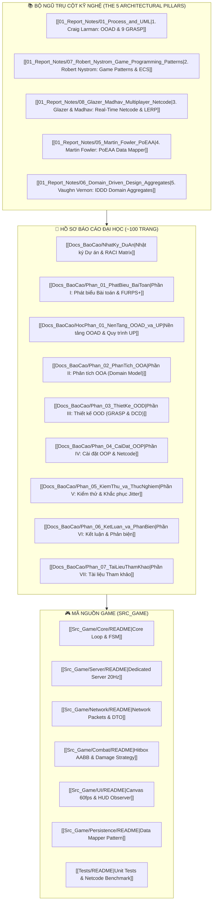

# 🌌 TRẠM CHỈ HUY TRI THỨC ĐỒ ÁN (OBSIDIAN SECOND BRAIN)
> **Đề tài**: Xây dựng Hệ thống Trò chơi Đấu trường Trực tuyến Nhiều người chơi (Multiplayer Action RPG)  
> **Phương pháp luận**: Unified Process (UP) & Nguyên lý Thiết kế Craig Larman (*Applying UML and Patterns*, 3rd Edition)  
> **Trưởng nhóm & Lead Architect**: `Tran1209` | **Repository**: `https://github.com/Tran1209/UML-Patterns-Mastery.git`

---

> [!IMPORTANT] ĐỌC FILE NÀY TRƯỚC NẾU BẠN ĐANG BỊ RỐI!
> 📍 **[[MASTER_MAP|MASTER_MAP.md — Bản đồ tổng thể dự án (Tất cả trong 1 trang)]]**  
> *Gom trọn: 5 thành viên · 5 cuốn sách · 7 chương báo cáo · 3 vấn đề kỹ thuật · Việc cần làm tiếp theo.*

---

> [!ABSTRACT] ẢNH BÌA BÁO CÁO KỸ THUẬT CHUẨN KIẾN TRÚC OOP (PURE TECH COVER)
> ![[Docs_BaoCao/images/Bia_BaoCao_OOP_Architecture.jpg|380]]
> *Tác phẩm bìa học thuật: Kiến trúc Phân tầng Hướng đối tượng 3D Isometric (Presentation $\rightarrow$ Core Domain Model $\rightarrow$ Distributed Network Synchronization $\rightarrow$ Persistence Data Layer).*

---

## 🗺️ BẢN ĐỒ ĐIỀU HƯỚNG TỔNG QUAN (MAP OF CONTENT - MOC)



---

## 📚 1. CƠ SỞ TRI THỨC HỌC THUẬT (KNOWLEDGE BASE)

> [!ABSTRACT] NGUỒN TÀI LIỆU KINH ĐIỂN ĐÃ BÓC TÁCH (SECOND BRAIN KNOWLEDGE BASES)
> Toàn bộ 5 cuốn sách kinh điển đã được bóc tách toàn văn theo từng chương độc lập (gồm file `content.md` và thư mục `images/` minh họa):
> - 🏛️ **Craig Larman**: `00_Raw_PDF/_Knowledge_Base_Larman/chapters_extracted/` (38 chương)
> - 🎮 **Robert Nystrom**: `00_Raw_PDF/_Knowledge_Base_Nystrom/chapters_extracted/` (21 chương)
> - 📡 **Glazer & Madhav**: `00_Raw_PDF/_Knowledge_Base_Glazer_Madhav/chapters_extracted/` (14 chương)
> - 💾 **Martin Fowler**: `00_Raw_PDF/_Knowledge_Base_Fowler/chapters_extracted/` (20 chương)
> - 🛡️ **Vaughn Vernon**: `00_Raw_PDF/_Knowledge_Base_Vernon/chapters_extracted/` (3 chương)

| Mã số  | Tên Chuyên đề Ghi chú                                                                               | Tác giả & Trụ cột             | Nội dung Học thuật Trọng tâm                                                                                       | Thẻ Phân loại                      |
| :----: | :-------------------------------------------------------------------------------------------------- | :---------------------------- | :----------------------------------------------------------------------------------------------------------------- | :--------------------------------- |
| **01** | [[01_Report_Notes/01_Process_and_UML\|01. Quy trình UP & Mô hình hóa UML]]                          | Craig Larman *(Trụ cột 1)*    | Vòng đời UP qua 4 pha; phân biệt rạch ròi giữa Domain Model (OOA) và DCD (OOD).                                    | `#up` `#uml` `#domain-model`       |
| **02** | [[01_Report_Notes/02_GRASP_9_Principles\|02. 9 Nguyên lý Thiết kế GRASP]]                           | Craig Larman *(Trụ cột 1)*    | Khắc sâu 9 nguyên lý phân bổ trách nhiệm: Information Expert, Creator, Controller, Low Coupling, High Cohesion,... | `#grasp` `#responsibility-driven`  |
| **03** | [[01_Report_Notes/03_GoF_Patterns_Applied\|03. Mẫu Thiết kế GoF Thực chiến]]                        | Gang of Four                  | Ứng dụng Strategy (Sát thương), Observer (HUD UI), State (FSM), Composite (Buffs).                                 | `#gof` `#patterns` `#architecture` |
| **04** | [[01_Report_Notes/04_NextGen_POS_Evolution\|04. Tiến hóa Ca học NextGen POS]]                       | Craig Larman *(Trụ cột 1)*    | Phân tích bài học kinh điển của Craig Larman qua 3 vòng lặp Iteration.                                             | `#larman` `#case-study`            |
| **05** | [[01_Report_Notes/05_Martin_Fowler_PoEAA\|05. Martin Fowler - PoEAA]]                               | Martin Fowler *(Trụ cột 4)*   | Mẫu kiến trúc lưu trữ: Data Mapper, Identity Map tách rời Domain Model khỏi Database.                              | `#fowler` `#poeaa` `#data-mapper`  |
| **06** | [[01_Report_Notes/06_Domain_Driven_Design_Aggregates\|06. Vaughn Vernon - DDD Aggregates]]          | Vaughn Vernon *(Trụ cột 5)*   | Thiết kế Aggregate Root, Entity, Value Object bảo toàn tính toàn vẹn nghiệp vụ Game.                               | `#ddd` `#aggregates` `#clean-code` |
| **07** | [[01_Report_Notes/07_Robert_Nystrom_Game_Programming_Patterns\|07. Robert Nystrom - Game Patterns]] | Robert Nystrom *(Trụ cột 2)*  | Game Loop (Fixed Timestep), Component Pattern (thay thế kế thừa sâu), Spatial Partition.                           | `#nystrom` `#ecs` `#game-loop`     |
| **08** | [[01_Report_Notes/08_Glazer_Madhav_Multiplayer_Netcode\|08. Glazer & Madhav - Real-time Netcode]]   | Glazer & Madhav *(Trụ cột 3)* | Dedicated Authoritative Server, Snapshot Interpolation (LERP 20Hz vs 60fps), Client Prediction.                    | `#netcode` `#lerp` `#jitter`       |

---

## 📑 2. HỒ SƠ BÁO CÁO CÔNG TRÌNH TỐT NGHIỆP (~100 TRANG)

> [!TIP] LIÊN KẾT TRUY VẾT YÊU CẦU (TRACEABILITY)
> Nhấn vào từng phần để đọc bản thảo, đối soát với các sơ đồ UML và trích dẫn mã nguồn thực tế.

1. **Văn bản Quản trị Dự án & Bìa Chính Thức**:
   * [[Docs_BaoCao/00_Trang_Bia_BaoCao_HUCE|🏛️ Trang Bìa Chính Thức ĐH Xây Dựng Hà Nội (HUCE)]] *(HTML in ấn: `Docs_BaoCao/Trang_Bia_HUCE.html`)*
   * [[Docs_BaoCao/NhatKy_DuAn|📋 Nhật ký Tiến độ & Đánh giá Đóng góp Thành viên (Work Log & RACI Matrix)]]
   * [[HUONG_DAN_GIT_CHO_NHOM|🚀 Cẩm nang Hướng dẫn Sử dụng Git/GitHub cho Nhóm 5 Người]]
2. **Nội dung Báo cáo Học thuật**:
   * [[Docs_BaoCao/HocPhan_01_NenTang_OOAD_va_UP|📖 Học phần 1: Nền tảng OOAD và Bản chất Quy trình Unified Process]]
   * [[Docs_BaoCao/Phan_01_PhatBieu_BaiToan|📝 Phần I: Bối cảnh, Phát biểu Bài toán & Phân loại Yêu cầu FURPS+]]
   * [[Docs_BaoCao/Phan_02_PhanTich_OOA|🔍 Phần II: Phân tích Hướng đối tượng (OOA) — Use Cases, SSD & Domain Model]]
   * [[Docs_BaoCao/Phan_03_ThietKe_OOD|📐 Phần III: Thiết kế Hướng đối tượng (OOD) — 9 GRASP, Mẫu GoF & Sơ đồ Lớp Chi tiết (DCD)]]
   * [[Docs_BaoCao/Phan_04_CaiDat_OOP|💻 Phần IV: Cài đặt Hướng đối tượng (OOP) — Hiện thực hóa Java, Netcode & LERP]]
   * [[Docs_BaoCao/Phan_05_KiemThu_va_ThucNghiem|🧪 Phần V: Kiểm thử Phần mềm & Thực nghiệm Netcode — 11/11 Unit Tests & Triệt tiêu Jitter LERP]]
   * [[Docs_BaoCao/Phan_06_KetLuan_va_PhanBien|🎓 Phần VI: Kết luận & Phản biện Học thuật — Đối thoại Larman 2004 vs Kỹ nghệ 2026]]
   * [[Docs_BaoCao/Phan_07_TaiLieuThamKhao|📚 Phần VII: Danh mục Tài liệu Tham khảo Chuẩn IEEE/APA (Bộ Ngũ Trụ Cột)]]

---

## 🎮 3. KIẾN TRÚC MÃ NGUỒN GAME (`Src_Game/`)

> [!INFO] PHÂN VÙNG LÃNH THỔ 5 THÀNH VIÊN
> Mỗi thành viên chịu trách nhiệm độc quyền một phân vùng, kiểm soát commit trên nhánh riêng:

* 🛡️ **TV1 (Leader)**: [[Src_Game/Core/README|Core Game Loop & Player State Machine]] (`feature/core-loop`)
* 🌐 **TV2 (Network)**: [[Src_Game/Server/README|Dedicated Server 20Hz]] & [[Src_Game/Network/README|Packet Serialization DTO]] (`feature/network-server`)
* ⚔️ **TV3 (Combat)**: [[Src_Game/Combat/README|Combat Engine, Hitbox AABB & Strategy Damage]] (`feature/combat-system`)
* 🎨 **TV4 (UI)**: [[Src_Game/UI/README|HTML5 Canvas 60fps & HUD Observer]] (`feature/client-ui`)
* 🧪 **TV5 (QA & Data)**: [[Src_Game/Persistence/README|Data Mapper Pattern]] & [[Tests/README|Automated Test Suite]] (`feature/data-testing`)

---

## 🧩 4. CÔNG CỤ TRỰC QUAN HOÁ TRONG OBSIDIAN

* 🗺️ **Bản đồ Kiến trúc Canvas**: Mở file [[Architecture_Canvas.canvas]] để xem tổng thể hệ thống dạng 2D trực quan.
* 🕸️ **Đồ thị Tri thức (Graph View)**: Nhấn tổ hợp phím `Ctrl + G` (hoặc mở thanh bên phải $\rightarrow$ Graph View) để thấy mạng lưới nơ-ron liên kết giữa các ghi chú lý thuyết và phần báo cáo.
* 🔖 **Thẻ Phân loại (Tags)**: Sử dụng các tag `#grasp`, `#gof`, `#netcode`, `#larman`, `#furps` để lọc nhanh nội dung.

---

```
   [ Craig Larman Theory ] ────────► [ Domain Model (OOA) ]
             │                                     │
             ▼                                     ▼
   [ 9 GRASP Principles  ] ────────► [ Design Class Diagram (OOD) ]
             │                                     │
             ▼                                     ▼
   [ Dedicated Netcode   ] ────────► [ Executable Game Baseline (OOP) ]
```
