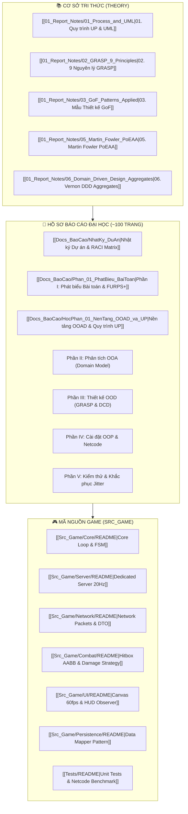

# 🌌 TRẠM CHỈ HUY TRI THỨC ĐỒ ÁN (OBSIDIAN SECOND BRAIN)
> **Đề tài**: Xây dựng Hệ thống Trò chơi Đấu trường Trực tuyến Nhiều người chơi (Multiplayer Action RPG)  
> **Phương pháp luận**: Unified Process (UP) & Nguyên lý Thiết kế Craig Larman (*Applying UML and Patterns*, 3rd Edition)  
> **Trưởng nhóm & Lead Architect**: `Tran1209` | **Repository**: `https://github.com/Tran1209/UML-Patterns-Mastery.git`

---

> [!ABSTRACT] ẢNH BÌA BÁO CÁO KỸ THUẬT CHUẨN CAPSTONE (TECHNICAL REPORT COVER)
> ![[Docs_BaoCao/images/Bia_BaoCao_Technical_Report.jpg|360]]
> *Tác phẩm bìa học thuật: Đấu trường phân tán thời gian thực (Distributed Real-time Combat Simulation Engine) tích hợp sơ đồ UML, Socket Topology và Finite State Machine.*

---

## 🗺️ BẢN ĐỒ ĐIỀU HƯỚNG TỔNG QUAN (MAP OF CONTENT - MOC)



---

## 📚 1. CƠ SỞ TRI THỨC HỌC THUẬT (KNOWLEDGE BASE)

> [!ABSTRACT] NGUỒN TÀI LIỆU KINH ĐIỂN
> Toàn bộ trích đoạn giáo trình 38 chương của Craig Larman đã được bóc tách và phân loại tại thư mục `00_Raw_PDF/_Knowledge_Base_Larman/`.

| Mã số | Tên Chuyên đề Ghi chú | Nội dung Học thuật Trọng tâm | Thẻ Phân loại |
|:---:|:---|:---|:---|
| **01** | [[01_Report_Notes/01_Process_and_UML\|01. Quy trình UP & Mô hình hóa UML]] | Vòng đời UP qua 4 pha (Inception, Elaboration, Construction, Transition); phân biệt rạch ròi giữa Domain Model và DCD. | `#up` `#uml` `#domain-model` |
| **02** | [[01_Report_Notes/02_GRASP_9_Principles\|02. 9 Nguyên lý Thiết kế GRASP]] | Khắc sâu 9 nguyên lý phân bổ trách nhiệm: Information Expert, Creator, Controller, Low Coupling, High Cohesion, Polymorphism, Pure Fabrication, Indirection, Protected Variations. | `#grasp` `#responsibility-driven` |
| **03** | [[01_Report_Notes/03_GoF_Patterns_Applied\|03. Mẫu Thiết kế GoF Thực chiến]] | Ứng dụng Strategy (Tính sát thương), Observer (Sự kiện HUD), State (FSM nhân vật), Composite (Bùa chú Buff), Factory. | `#gof` `#patterns` `#architecture` |
| **04** | [[01_Report_Notes/04_NextGen_POS_Evolution\|04. Tiến hóa Ca học NextGen POS]] | Phân tích bài học kinh điển của Craig Larman qua 3 vòng lặp Iteration. | `#larman` `#case-study` |
| **05** | [[01_Report_Notes/05_Martin_Fowler_PoEAA\|05. Martin Fowler - PoEAA]] | Mẫu kiến trúc lưu trữ doanh nghiệp: Data Mapper, Identity Map, Repository Pattern tách rời Domain Model khỏi Database. | `#fowler` `#poeaa` `#data-mapper` |
| **06** | [[01_Report_Notes/06_Domain_Driven_Design_Aggregates\|06. Vaughn Vernon - DDD Aggregates]] | Thiết kế Aggregate Root, Entity, Value Object bảo toàn tính toàn vẹn nghiệp vụ thế giới Game. | `#ddd` `#aggregates` `#clean-code` |

---

## 📑 2. HỒ SƠ BÁO CÁO CÔNG TRÌNH TỐT NGHIỆP (~100 TRANG)

> [!TIP] LIÊN KẾT TRUY VẾT YÊU CẦU (TRACEABILITY)
> Nhấn vào từng phần để đọc bản thảo, đối soát với các sơ đồ UML và trích dẫn mã nguồn thực tế.

1. **Văn bản Quản trị Dự án**:
   * [[Docs_BaoCao/NhatKy_DuAn|📋 Nhật ký Tiến độ & Đánh giá Đóng góp Thành viên (Work Log & RACI Matrix)]]
   * [[HUONG_DAN_GIT_CHO_NHOM|🚀 Cẩm nang Hướng dẫn Sử dụng Git/GitHub cho Nhóm 5 Người]]
2. **Nội dung Báo cáo Học thuật**:
   * [[Docs_BaoCao/HocPhan_01_NenTang_OOAD_va_UP|📖 Học phần 1: Nền tảng OOAD và Bản chất Quy trình Unified Process]]
   * [[Docs_BaoCao/Phan_01_PhatBieu_BaiToan|📝 Phần I: Bối cảnh, Phát biểu Bài toán & Phân loại Yêu cầu FURPS+]]
   * `Phần II: Phân tích Hướng đối tượng (OOA)` — Use Cases chi tiết, SSD, và Domain Model (Tuyệt đối không Method).
   * `Phần III: Thiết kế Hướng đối tượng (OOD)` — Áp dụng 9 GRASP, GoF Patterns, và Sơ đồ Lớp Chi tiết (DCD).
   * `Phần IV: Cài đặt Hướng đối tượng (OOP)` — Hiện thực hóa mã nguồn đa hình, Kiến trúc Server Authoritative.
   * `Phần V: Kiểm thử Phần mềm & Thực nghiệm Netcode` — Unit Test Suite, Benchmark độ trễ, Giải quyết triệt để lỗi giật hình (Micro-stutter / Jitter 20Hz vs 60fps).
   * `Phần VI: Đánh giá Giới hạn & Hướng Phát triển` — Đóng gói đồ án và kết luận.

---

## 🎮 3. KIẾN TRÚC MÃ NGUỒN GAME (`Src_Game/`)

> [!INFO] PHÂN VÙNG LÃNH THỔ 5 THÀNH VIÊN
> Mỗi thành viên chịu trách nhiệm độc quyền một phân vùng, kiểm soát commit trên nhánh riêng:

* 🛡️ **TV1 (Leader)**: [[Src_Game/Core/README|Core Game Loop & Player State Machine]] (`feature/core-loop`)
* 🌐 **TV2 (Network)**: [[Src_Game/Server/README|Dedicated Server 20Hz]] & [[Src_Game/Network/README|Packet Serialization DTO]] (`feature/network-server`)
* ⚔️ **TV3 (Combat)**: [[Src_Game/Combat/README|Combat Engine, Hitbox AABB & Strategy Damage]] (`feature/combat-system`)
* 🎨 **TV4 (UI)**: [[Src_Game/UI/README|HTML5 Canvas 60fps & HUD Observer]] (`feature/client-ui`)
* 🧪 **TV5 (QA & Data)**: [[Src_Game/Persistence/README|Data Mapper Pattern]] & [[Tests/README|Automated Test Suite]] (`feature/data-testing`)

---

## 🧩 4. CÔNG CỤ TRỰC QUAN HOÁ TRONG OBSIDIAN

* 🗺️ **Bản đồ Kiến trúc Canvas**: Mở file [[Architecture_Canvas.canvas]] để xem tổng thể hệ thống dạng 2D trực quan.
* 🕸️ **Đồ thị Tri thức (Graph View)**: Nhấn tổ hợp phím `Ctrl + G` (hoặc mở thanh bên phải $\rightarrow$ Graph View) để thấy mạng lưới nơ-ron liên kết giữa các ghi chú lý thuyết và phần báo cáo.
* 🔖 **Thẻ Phân loại (Tags)**: Sử dụng các tag `#grasp`, `#gof`, `#netcode`, `#larman`, `#furps` để lọc nhanh nội dung.

---

```
   [ Craig Larman Theory ] ────────► [ Domain Model (OOA) ]
             │                                     │
             ▼                                     ▼
   [ 9 GRASP Principles  ] ────────► [ Design Class Diagram (OOD) ]
             │                                     │
             ▼                                     ▼
   [ Dedicated Netcode   ] ────────► [ Executable Game Baseline (OOP) ]
```
