# 🌌 BẢN ĐỒ TOÀN CẢNH ĐỒ ÁN OOP NHÓM 5 (OBSIDIAN DASHBOARD)
> **Đề tài**: Hệ thống Trò chơi Đấu trường Hành động 3D Phối cảnh Đa nền tảng (PC & Android Multiplayer Action RPG)  
> **Nhóm trưởng**: **Trung Kiên (`KienEsto`)** | **Kiến trúc sư**: **Duy Nam (`Tran1209`)** | **Kỹ sư Mạng**: **Đức Huy (`duchuy462007`)**  
> **Kho lưu trữ GitHub**: [`https://github.com/Tran1209/UML-Patterns-Mastery`](https://github.com/Tran1209/UML-Patterns-Mastery)

---

## 🧭 CẤU TRÚC THƯ MỤC `Docs_BaoCao` (CHỈ GỒM 3 NGĂN RÕ RÀNG)

```mermaid
flowchart TD
    Root["📍 00_BAN_DO_TOAN_CANH.md<br>& 00_SoDo_KienTruc.canvas"] --> F1["📁 1_QuanLy_Nhom_Va_NhatKy<br>(Nơi 5 thành viên làm việc hàng ngày)"]
    Root --> F2["📁 2_BaoCao_ChinhThuc_7Chuong<br>(Quyển Báo cáo chính thức nộp Thầy/Cô)"]
    Root --> F3["📁 3_PhuLuc_UML_Va_LyThuyet<br>(Sơ đồ UML chi tiết & Ghi chú sách)"]

    F1 --> N1["[[Docs_BaoCao/1_QuanLy_Nhom_Va_NhatKy/01_NhatKy_TienDo_Va_SuaLoi|01. Nhật ký Tiến độ & 5 Ca Sửa Lỗi Kỹ Thuật]]"]
    F1 --> N2["[[Docs_BaoCao/1_QuanLy_Nhom_Va_NhatKy/02_CamNang_SuaCode_Cho_Nhom|02. Cẩm nang Sửa Code & Mở rộng cho Nhóm]]"]
    F1 --> N3["[[Docs_BaoCao/1_QuanLy_Nhom_Va_NhatKy/03_HuongDan_Git_Nhom|03. Hướng dẫn Git Nhóm]]"]
    F1 --> N4["[[Docs_BaoCao/1_QuanLy_Nhom_Va_NhatKy/04_KeHoach_PhanCong_9_HangMuc|04. Kế hoạch Chi tiết 9 Hạng mục Nâng cấp]]"]

    F2 --> C0["[[Docs_BaoCao/2_BaoCao_ChinhThuc_7Chuong/00_Trang_Bia_BaoCao_HUCE|00. Trang Bìa Báo Cáo HUCE]]"]
    F2 --> C1["[[Docs_BaoCao/2_BaoCao_ChinhThuc_7Chuong/Chuong_01_PhatBieu_BaiToan|Chương 1: Phát biểu Bài toán & FURPS+]]"]
    F2 --> C2["[[Docs_BaoCao/2_BaoCao_ChinhThuc_7Chuong/Chuong_02_PhanTich_OOA|Chương 2: Phân tích OOA (Use Case & Domain Model)]]"]
    F2 --> C3["[[Docs_BaoCao/2_BaoCao_ChinhThuc_7Chuong/Chuong_03_ThietKe_OOD|Chương 3: Thiết kế OOD (9 GRASP & GoF Patterns)]]"]
    F2 --> C4["[[Docs_BaoCao/2_BaoCao_ChinhThuc_7Chuong/Chuong_04_CaiDat_OOP|Chương 4: Cài đặt OOP, 3D Perspective & Netcode]]"]
    F2 --> C5["[[Docs_BaoCao/2_BaoCao_ChinhThuc_7Chuong/Chuong_05_KiemThu_va_ThucNghiem|Chương 5: Kiểm thử 15/15 Unit Tests & Thực nghiệm]]"]
    F2 --> C6["[[Docs_BaoCao/2_BaoCao_ChinhThuc_7Chuong/Chuong_06_KetLuan_va_PhanBien|Chương 6: Kết luận & Câu hỏi Phản biện]]"]
    F2 --> C7["[[Docs_BaoCao/2_BaoCao_ChinhThuc_7Chuong/Chuong_07_TaiLieuThamKhao|Chương 7: Tài liệu Tham khảo]]"]
```

---

## 📁 NGĂN 1: QUẢN LÝ NHÓM, NHẬT KÝ & HƯỚNG DẪN SỬA CHỮA (`1_QuanLy_Nhom_Va_NhatKy/`)
*(Mỗi khi thành viên vào làm việc hoặc chuẩn bị vấn đáp thì mở ngăn này)*

1. 📄 **[[Docs_BaoCao/1_QuanLy_Nhom_Va_NhatKy/01_NhatKy_TienDo_Va_SuaLoi|01_NhatKy_TienDo_Va_SuaLoi.md]]**:
   * Bảng phân vai RACI 5 thành viên (Nhóm trưởng **Trung Kiên**, **Duy Nam**, **Đức Huy**, **Đức Anh**, **Huy Hoàng**).
   * Nhật ký 5 ca sửa lỗi thực tế (Tối ưu Android 60 FPS, chống Crash đa luồng, sửa lệch tâm Camera, mạng 4G Cloud Relay, tái cấu trúc SOLID & nâng cấp góc nhìn 3D Phối cảnh).
   * Bảng đối soát lịch sử Git Commit.
2. 📄 **[[Docs_BaoCao/1_QuanLy_Nhom_Va_NhatKy/02_CamNang_SuaCode_Cho_Nhom|02_CamNang_SuaCode_Cho_Nhom.md]]**:
   * Bản đồ chỉ dẫn *"Muốn sửa tính năng X thì mở đúng dòng nào của file nào?"* (Chỉnh máu, hồi chiêu, sát thương 3 kỹ năng AOV, thêm quái vật, đổi góc nhìn 3D `[Phím V]`).
3. 📄 **[[Docs_BaoCao/1_QuanLy_Nhom_Va_NhatKy/03_HuongDan_Git_Nhom|03_HuongDan_Git_Nhom.md]]**:
   * Quy chuẩn làm việc chung không xung đột giữa các nhánh `main`, `Kien`, `Huy`.
4. 📋 **[[Docs_BaoCao/1_QuanLy_Nhom_Va_NhatKy/04_KeHoach_PhanCong_9_HangMuc|04_KeHoach_PhanCong_9_HangMuc.md]]**:
   * Bản kế hoạch phân công chi tiết 9 hạng mục nâng cấp (Sảnh chờ, Map lớn đi bộ 5 phút, Đồ họa 2.5D, 6 loại Mobs, 4 Hệ Nhân vật, Phím + Chuột chuẩn MOBA, Vòng Bo sinh tồn, Team đối địch & AI Bot) kèm câu lệnh mẫu cho từng thành viên.

---

## 📁 NGĂN 2: BÁO CÁO CHÍNH THỨC 7 CHƯƠNG (`2_BaoCao_ChinhThuc_7Chuong/`)
*(Đã đánh số thứ tự từ `00` đến `07` chuẩn chỉnh để xuất Word/PDF nộp bài)*

* 📄 **[[Docs_BaoCao/2_BaoCao_ChinhThuc_7Chuong/00_Trang_Bia_BaoCao_HUCE|00_Trang_Bia_BaoCao_HUCE.md]]** *(Kèm bản in màu A4 `00_Trang_Bia_InMau_A4.html`)*
* 📄 **[[Docs_BaoCao/2_BaoCao_ChinhThuc_7Chuong/Chuong_01_PhatBieu_BaiToan|Chuong_01_PhatBieu_BaiToan.md]]** — Bối cảnh kỹ thuật & Phân loại yêu cầu FURPS+.
* 📄 **[[Docs_BaoCao/2_BaoCao_ChinhThuc_7Chuong/Chuong_02_PhanTich_OOA|Chuong_02_PhanTich_OOA.md]]** — Use Case Fully Dressed, SSD & Domain Model (Không chứa Method).
* 📄 **[[Docs_BaoCao/2_BaoCao_ChinhThuc_7Chuong/Chuong_03_ThietKe_OOD|Chuong_03_ThietKe_OOD.md]]** — Áp dụng 9 nguyên lý GRASP, SOLID & GoF Design Patterns.
* 📄 **[[Docs_BaoCao/2_BaoCao_ChinhThuc_7Chuong/Chuong_04_CaiDat_OOP|Chuong_04_CaiDat_OOP.md]]** — Kiến trúc mã nguồn 7 Package, Đồ họa 3D Phối cảnh & Netcode 20Hz.
* 📄 **[[Docs_BaoCao/2_BaoCao_ChinhThuc_7Chuong/Chuong_05_KiemThu_va_ThucNghiem|Chuong_05_KiemThu_va_ThucNghiem.md]]** — Bộ 15/15 Unit Tests & Đo kiểm hiệu năng thực tế.
* 📄 **[[Docs_BaoCao/2_BaoCao_ChinhThuc_7Chuong/Chuong_06_KetLuan_va_PhanBien|Chuong_06_KetLuan_va_PhanBien.md]]** — Tổng kết & Ngân hàng câu hỏi vấn đáp bảo vệ đồ án.
* 📄 **[[Docs_BaoCao/2_BaoCao_ChinhThuc_7Chuong/Chuong_07_TaiLieuThamKhao|Chuong_07_TaiLieuThamKhao.md]]** — Danh mục sách giáo trình quốc tế.

---

## 📁 NGĂN 3: PHỤ LỤC SƠ ĐỒ UML & LÝ THUYẾT (`3_PhuLuc_UML_Va_LyThuyet/`)
* [[Docs_BaoCao/3_PhuLuc_UML_Va_LyThuyet/04_Full_UML_Diagrams|04_Full_UML_Diagrams.md]] — Toàn bộ sơ đồ UML Class, Sequence, State Machine.
* [[Docs_BaoCao/3_PhuLuc_UML_Va_LyThuyet/BaoCao_ThietKe_NhanVat_OOP_LPC|BaoCao_ThietKe_NhanVat_OOP_LPC.md]] — Chuyên đề Flyweight, Builder & Composite Pattern.
* [[Docs_BaoCao/3_PhuLuc_UML_Va_LyThuyet/MASTER_MAP|MASTER_MAP.md]] — Tóm tắt nhanh các trụ cột sách tham khảo.
