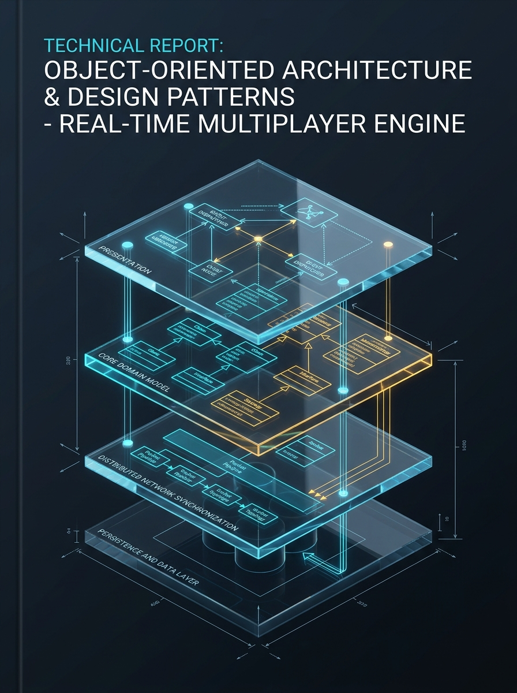

# BỘ GIÁO DỤC VÀ ĐÀO TẠO
## TRƯỜNG ĐẠI HỌC XÂY DỰNG HÀ NỘI (HUCE)
### KHOA CÔNG NGHỆ THÔNG TIN

---

  

---

# BÁO CÁO ĐỒ ÁN MÔN HỌC: LẬP TRÌNH HƯỚNG ĐỐI TƯỢNG (OOP)

> **ĐỀ TÀI**:  
> **THIẾT KẾ VÀ XÂY DỰNG HỆ THỐNG TRÒ CHƠI ĐẤU TRƯỜNG TRỰC TUYẾN NHIỀU NGƯỜI CHƠI (MULTIPLAYER ARPG) THEO TIẾN TRÌNH UNIFIED PROCESS VÀ NGUYÊN LÝ THIẾT KẾ CRAIG LARMAN**  
> *Dự án: **HAKHAN — ARENA OF AETHELGARD***

---

### THÔNG TIN HƯỚNG DẪN & NHÓM THỰC HIỆN:

* **Giảng viên hướng dẫn**: `[Họ và tên Thầy/Cô Bộ môn CNTT]`
* **Lớp sinh hoạt**: `[Ví dụ: 67CNTT...]` — **Khóa**: `[K67 / K68]`
* **Kho lưu trữ mã nguồn (GitHub)**: [`https://github.com/Tran1209/UML-Patterns-Mastery.git`](https://github.com/Tran1209/UML-Patterns-Mastery.git)

#### BẢNG DANH SÁCH 5 THÀNH VIÊN VÀ PHÂN VAI TRÁCH NHIỆM:

| STT | Họ và Tên Sinh Viên | Mã Sinh Viên | GitHub Account | Vai trò Kỹ thuật & Module Phụ trách | Tỷ lệ Đóng góp |
|:---:|:---|:---:|:---:|:---|:---:|
| **1** | **[Họ và tên] Nam** *(Trưởng nhóm)* | `...` | `Tran1209` | **Team Leader & Lead Software Architect** • Kiến trúc tổng thể, Core Game Loop, Player State Machine • Phân tích OOA/OOD & Tổng hợp Báo cáo | **100%** |
| **2** | **[Họ và tên] Kiên** | `...` | `...` | **Network & Distributed Systems Engineer** • Dedicated WebSocket Server, Packet Serialization DTO • Cơ chế đồng bộ trạng thái mạng thời gian thực (20Hz Tick) | **100%** |
| **3** | **[Họ và tên] Anh** | `...` | `...` | **Combat Mechanics & Physics Engineer** • Combat Engine, Hộp va chạm AABB hình chữ nhật giới hạn • Chiến lược tính sát thương (Strategy Pattern) | **100%** |
| **4** | **[Họ và tên] Huy** | `...` | `...` | **Client Graphics & UX Engineer** • HTML5 Canvas Renderer 60 FPS, Model-View Separation • Bắt sự kiện bàn phím & HUD UI (Observer Pattern) | **100%** |
| **5** | **[Họ và tên] Hoàng** | `...` | `...` | **Data Persistence & QA/QC Test Engineer** • Lưu trữ dữ liệu trận đấu (Data Mapper Pattern) • Bộ kiểm thử tự động Unit Test & Phân tích độ trễ Jitter | **100%** |

---

  <b>HÀ NỘI — 2026</b>

