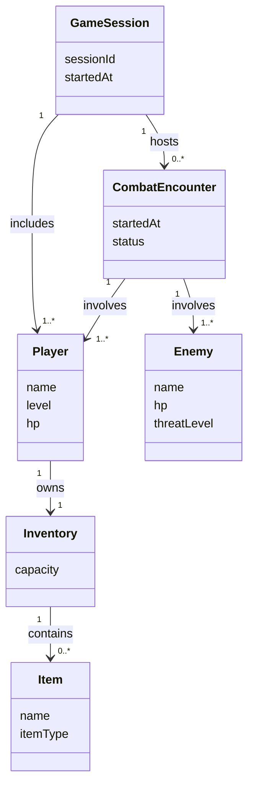

# 01. Use Case & Domain Model

> Báo cáo OOAD theo Craig Larman — ánh xạ sang Đồ án Game OOP trong `Src_Game/`.

## Liên kết
- [[02_GRASP_Principles_Analysis]]
- [[03_GoF_and_StateMachine_Design]]
- [[04_Full_UML_Diagrams]]

---

## 1. Use Cases (tóm tắt)

| Use Case                         | Actor  | Mục tiêu                            |
| -------------------------------- | ------ | ----------------------------------- |
| UC1 — Bắt đầu trận / phiên chơi  | Player | Khởi tạo session, spawn thực thể    |
| UC2 — Thực hiện hành động combat | Player | Tấn công / dùng skill / nhận damage |
| UC3 — Quản lý inventory          | Player | Nhặt, trang bị, dùng vật phẩm       |

*(Bổ sung preconditions / main success scenario khi chốt gameplay.)*

---

## 2. Domain Model (Conceptual — không có method)

### Quy tắc Domain Model (Larman Ch.9)
- Chỉ conceptual classes, attributes, associations + multiplicities.
- Không methods, không bảng DB, không class kỹ thuật (Repository, Controller…).

---

## 3. Ánh xạ sách → Game

| NextGen POS (Larman) | Game OOP |
|----------------------|----------|
| `Sale` | `CombatEncounter` / `GameSession` |
| `SalesLineItem` | `DamageEvent` / `LootDrop` |
| `ProductDescription` | `Item` / `EnemySpec` |
| `Register` | (thiết kế) `GameController` — không thuộc Domain Model thuần |
