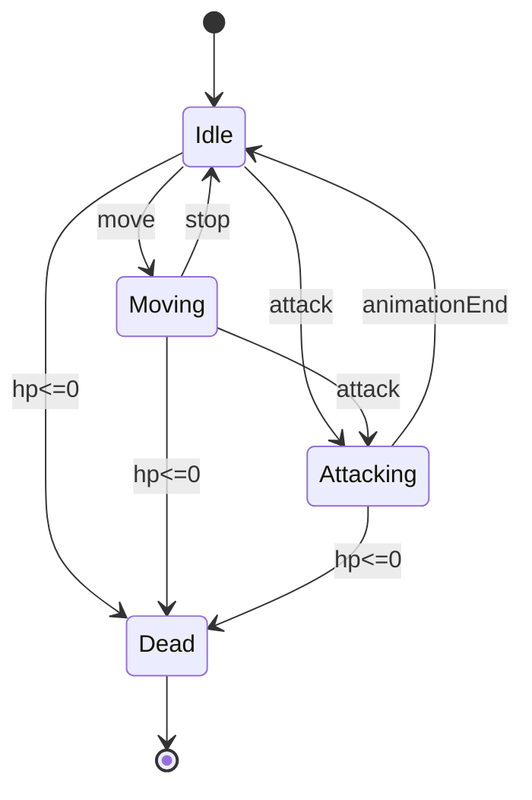

# 03. GoF Patterns & State Machine Design

> Ánh xạ mẫu thiết kế từ case study NextGen POS sang kiến trúc Game OOP.

## Liên kết
- [[01_UseCase_and_DomainModel]]
- [[02_GRASP_Principles_Analysis]]
- [[04_Full_UML_Diagrams]]

---

## 1. GoF trọng tâm

| GoF       | POS (Larman)               | Game OOP                        |
| --------- | -------------------------- | ------------------------------- |
| Strategy  | Pricing / Discount         | Damage formula, AI behavior     |
| Factory   | `ServicesFactory`          | `EnemyFactory`, `ItemFactory`   |
| Adapter   | Tax / Credit auth          | Input SDK, cloud save           |
| Composite | `CompositePricingStrategy` | Buff stack, quest conditions    |
| Observer  | Model ↔ UI                 | HP bar, achievement events      |
| State     | (mở rộng)                  | Player/Enemy/Game state machine |
| Facade    | Subsystem API              | `GameFacade` bootstrap scene    |

---

## 2. State Machine (Player / Game)



### Ánh xạ GRASP
- **Polymorphism + Protected Variations**: mỗi state là class/`IPlayerState` thay vì `switch`.
- **High Cohesion**: logic chuyển trạng thái nằm trong state machine, không rải trong UI.

---

## 3. Comment chuẩn trong code

```csharp
// [GRASP: Polymorphism] & [GoF: State]
public interface IPlayerState { void Enter(Player p); void Update(Player p); }
```
