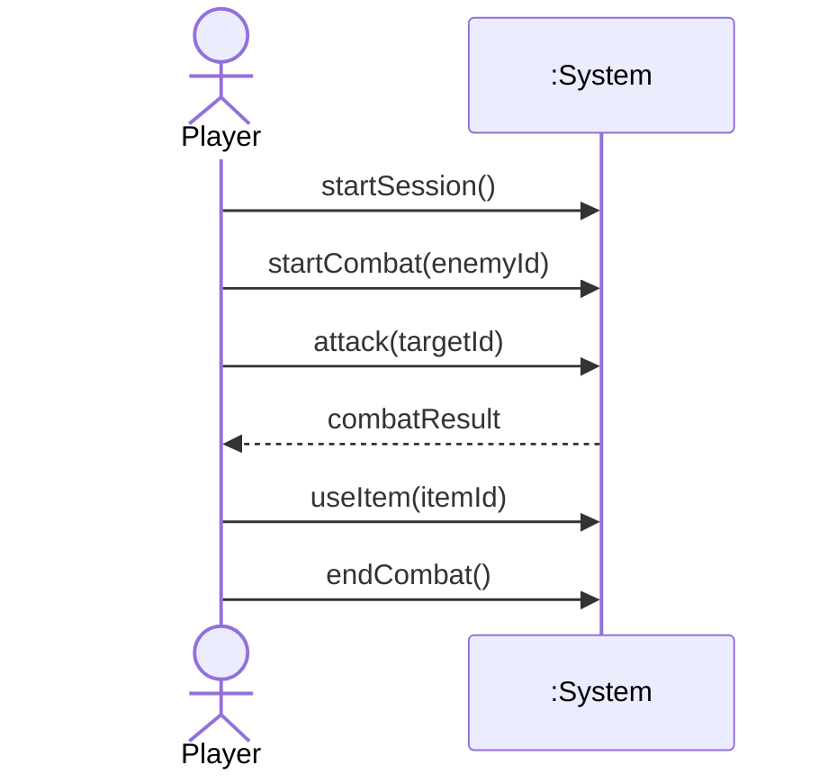
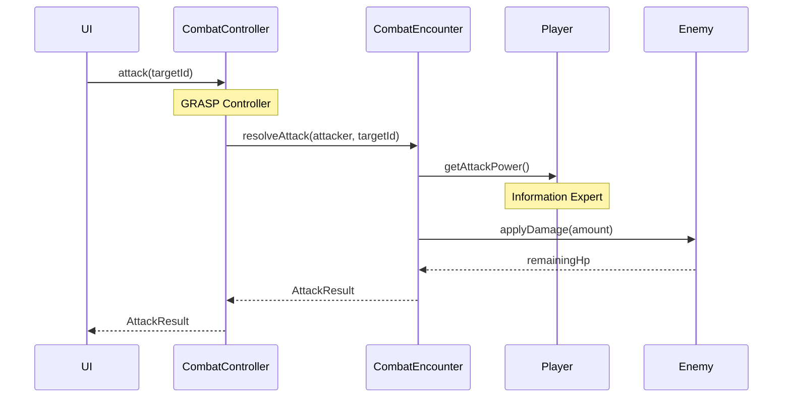
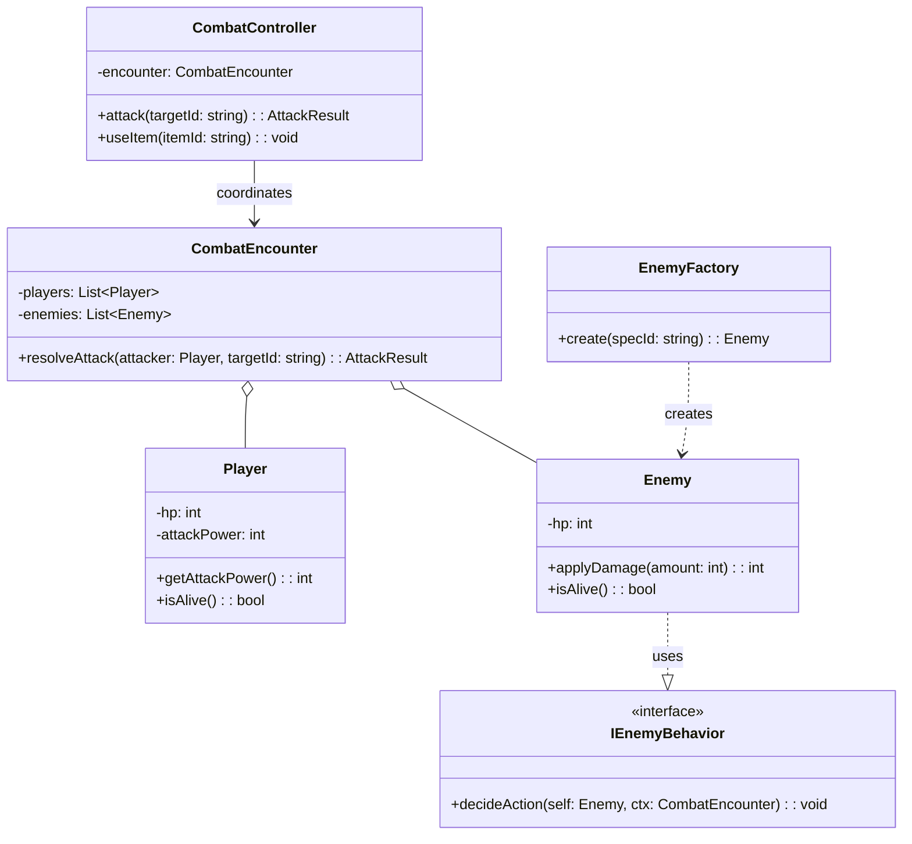

# 04. Full UML Diagrams (Mermaid)

> Phân biệt đúng 3 lớp sơ đồ theo Larman: Domain Model · SSD · DCD (+ Interaction).

## Liên kết
- [[01_UseCase_and_DomainModel]]
- [[02_GRASP_Principles_Analysis]]
- [[03_GoF_and_StateMachine_Design]]

---

## 1. Domain Model (Ch.9) — không method

Xem chi tiết tại [[01_UseCase_and_DomainModel#2. Domain Model]].

---

## 2. System Sequence Diagram — SSD (Ch.10)

Actor ↔ System (black box). Nhận diện system operations.

---

## 3. Interaction / Design Sequence (Ch.15)

Giải thích *vì sao* object A gọi B (RDD + GRASP).

---

## 4. Design Class Diagram — DCD (Ch.16)

Có types, method signatures, navigability, relationships.

---

## 5. Checklist báo cáo

- [ ] Domain Model không lẫn method / class kỹ thuật
- [ ] SSD chỉ Actor + `:System`
- [ ] Sequence design chỉ rõ GRASP trên từng message quan trọng
- [ ] DCD khớp 1:1 với code trong `Src_Game/`
