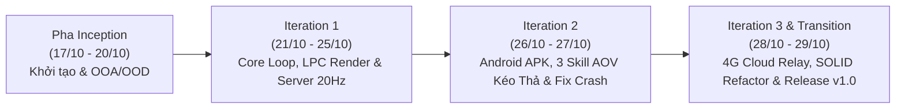

# NHẬT KÝ TIẾN ĐỘ DỰ ÁN, NHẬT KÝ SỬA CHỮA KỸ THUẬT & ĐÁNH GIÁ ĐÓNG GÓP THÀNH VIÊN
> **Đồ án môn học**: Lập trình Hướng đối tượng (Object-Oriented Programming - OOP) — HUCE 2026  
> **Đề tài**: Thiết kế và Xây dựng Hệ thống Trò chơi Đấu trường Hành động Đa nền tảng (PC & Android Multiplayer Action RPG) theo Quy trình Unified Process (Craig Larman), SOLID và GoF Design Patterns  
> **Kho lưu trữ (Private Repository)**: [`https://github.com/Tran1209/UML-Patterns-Mastery.git`](https://github.com/Tran1209/UML-Patterns-Mastery.git)  
> **Phương pháp luận phát triển**: Unified Process (UP) — Tiến trình Lặp và Tiến hóa (Iterative & Evolutionary Development)

---

## 🎯 MỤC ĐÍCH VÀ Ý NGHĨA CỦA NHẬT KÝ DỰ ÁN
Nhật ký dự án (Work Log & Engineering Audit Trail) là tài liệu đối soát học thuật và kỹ thuật trước Hội đồng chấm đồ án nhằm:
1. **Minh bạch hóa sự đóng góp cá nhân**: Đo lường chính xác khối lượng công việc, phân hệ mã nguồn (`Package`), và phần báo cáo của từng thành viên trong nhóm 5 người.
2. **Ghi nhận thực tế quá trình phát hiện lỗi & sửa chữa (Bug Fix & Refactoring Log)**: Minh chứng sản phẩm được thử nghiệm thực tế trên cả máy tính lẫn điện thoại Android, phát hiện các bài toán hóc búa (xung đột đa luồng, lệch tâm hệ quy chiếu Camera 2D, rào cản NAT khi chơi khác mạng WiFi/4G, và tái cấu trúc Clean Code SOLID) và giải quyết triệt để.
3. **Liên kết vết (Traceability Matrix)**: Kết nối trực tiếp từ **Yêu cầu (FURPS+) $\rightarrow$ Phân tích OOA $\rightarrow$ Thiết kế OOD (GRASP, GoF) $\rightarrow$ Mã nguồn Java/Android thực tế trên GitHub $\rightarrow$ Bộ kiểm thử tự động (`15/15 PASS`)**.

---

## 1. THÔNG TIN THÀNH VIÊN VÀ MA TRẬN PHÂN VAI TRÁCH NHIỆM (RACI MATRIX)

### 1.1. Bảng phân công 5 Vị trí Kỹ thuật Cốt lõi

|  STT  | Họ và Tên                      |                              GitHub Username                              | Vai trò Kỹ thuật (Role)                            | Trụ cột Học thuật Nghiên cứu (Pillars)                                                          | Phân hệ Mã nguồn Phụ trách (`Src_Game` / `Android_Game`)                                                                                                                                                                      |
| :---: | :----------------------------- | :-----------------------------------------------------------------------: | :------------------------------------------------- | :---------------------------------------------------------------------------------------------- | :---------------------------------------------------------------------------------------------------------------------------------------------------------------------------------------------------------------------------- |
| **1** | **Trung Kiên** *(Trưởng nhóm)* |                 [`KienEsto`](https://github.com/KienEsto)                 | **Team Leader & Combat Systems Architect**         | **Craig Larman** (*Applying UML & Patterns*) & **Robert Nystrom** (*Game Programming Patterns*) | • Điều phối chung tiến độ & Phê duyệt thiết kế • `Src_Game/Combat/` (`CombatEngine`, `ISkillAction`, 3 kỹ năng AOV kéo thả, `Hitbox`, `SpatialGridAoI`) • Tái cấu trúc Clean Code & SOLID (Strategy/Command Pattern)    |
| **2** | **Duy Nam**                    |                 [`Tran1209`](https://github.com/Tran1209)                 | **Lead Software Architect & Core/Mobile Engineer** | **Craig Larman** (*OOAD*), **Vaughn Vernon** (*IDDD*)                                           | • Quản trị kho chứa Git & Kiến trúc Đa nền tảng • `Src_Game/Core/` (`LivingEntity`, `Player`, `Monster`, `IPlayerState` FSM, `GameWorld`) • `Android_Game/` (Tích hợp cảm ứng đa điểm Multi-Touch & APK Build Pipeline) |
| **3** | **Nguyễn Đức Huy**             | [`nguyenduchuy20070406-oss`](https://github.com/nguyenduchuy20070406-oss) | **Network & Distributed Systems Engineer**         | **Joshua Glazer & Sanjay Madhav** (*Multiplayer Game Programming*)                              | • `Src_Game/Server/` (`DedicatedGameServer` 20Hz Authoritative) • `Src_Game/Network/` (`NetworkGameClient`, `SnapshotInterpolator` LERP, `LanDiscovery` UDP, `MiniMqttClient` & `CloudServerBridge` 4G Relay)              |
| **4** | **Đức Anh**                    |                              *(Thành viên)*                               | **Client Graphics, Camera & UX Engineer**          | **Robert Nystrom** (*Double Buffer, Flyweight*) & **GoF**                                       | • `Src_Game/Render/` (`Camera2D`, `LpcSpriteSheet` Flyweight, `CompositeCharacterVisual`, `LpcCharacterBuilder`) • `Src_Game/UI/` (`GameWindow`, `LobbyPanel`, `GameCanvas`, `DesktopHudRenderer`, `HudObserver`)          |
| **5** | **Huy Hoàng**                  |                              *(Thành viên)*                               | **Data Persistence & QA/QC Test Engineer**         | **Martin Fowler** (*PoEAA*) & **SOLID Principles**                                              | • `Src_Game/Persistence/` (`IMatchRepository`, `JsonFileMatchRepository`, `MatchSummary`) • `Tests/` (`GameUnitTestSuite.java` — 15/15 kịch bản kiểm thử tự động)                                                          |

---

### 1.2. Ma trận Trách nhiệm RACI (Responsible - Accountable - Consulted - Informed)

* **R (Responsible)**: Người trực tiếp thực hiện nhiệm vụ và viết mã nguồn/tài liệu.
* **A (Accountable)**: Người chịu trách nhiệm cao nhất nghiệm thu chất lượng (**Trưởng nhóm Trung Kiên** & Kiến trúc sư **Duy Nam**).
* **C (Consulted)**: Người được tham vấn ý kiến chuyên môn (phối hợp liên module).
* **I (Informed)**: Người được thông báo kết quả sau khi hoàn thành.

| Giai đoạn / Sản phẩm đầu ra (Deliverable) | TV1 (Kiên - Leader) | TV2 (Nam - Core/Arch) | TV3 (Huy - Network) | TV4 (Anh - Render/UI) | TV5 (Hoàng - QA/Data) |
| :--- | :---: | :---: | :---: | :---: | :---: |
| **1. Thiết lập Kiến trúc Đa nền tảng & Quản trị Git** | **A** | **R** | I | I | I |
| **2. Phân tích Yêu cầu FURPS+, Use Case & Domain Model** | **A / R** | **R** | C | C | C |
| **3. Xây dựng Core Domain & State Machine (`IDLE/MOVING/ATTACKING/DEAD`)** | **A** | **R** | C | C | I |
| **4. Thiết kế Hệ thống Chiến đấu & 3 Kỹ năng Kéo thả AOV (`ISkillAction`)** | **A / R** | C | C | C | I |
| **5. Xây dựng Dedicated Server 20Hz, LAN Discovery & 4G Cloud Relay** | **A** | C | **R** | I | C |
| **6. Đồ họa LPC 2D, `Camera2D` & Giao diện PC/Android 60 FPS** | **A** | **R** *(Android)* | C | **R** *(PC)* | I |
| **7. Lưu trữ Lịch sử trận đấu JSON & Bộ 15/15 Unit Tests** | **A** | C | I | I | **R** |
| **8. Tái cấu trúc Clean Code & SOLID (`CombatEngine`, `DesktopHudRenderer`)** | **A / R** | **R** | I | C | C |

---

## 2. NHẬT KÝ TIẾN ĐỘ THEO TỪNG VÒNG LẶP (UNIFIED PROCESS ITERATION LOG)

|    Vòng lặp     |     Thời gian      | Nội dung Công việc Thực hiện                                                                                                                                                                                                                                                                                                                                                                                                     | Sản phẩm Đầu ra (Deliverables)                                                                                                                                                                                                          |     Trạng thái      |
| :-------------: | :----------------: | :------------------------------------------------------------------------------------------------------------------------------------------------------------------------------------------------------------------------------------------------------------------------------------------------------------------------------------------------------------------------------------------------------------------------------- | :-------------------------------------------------------------------------------------------------------------------------------------------------------------------------------------------------------------------------------------- | :-----------------: |
|  **Inception**  | 17/10 – 20/10/2026 | • Khảo sát bài toán đấu trường ARPG thời gian thực. • Xây dựng bộ báo cáo 7 chương theo chuẩn Craig Larman (FURPS+, Use Case, Domain Model, 9 nguyên lý GRASP, GoF Patterns).                                                                                                                                                                                                                                                 | • Toàn bộ 7 phần báo cáo trong [`Docs_BaoCao/`](file:///E:/UML-Patterns-Mastery/Docs_BaoCao)                                                                                                                                            | **Hoàn thành 100%** |
| **Iteration 1** | 21/10 – 25/10/2026 | • Cài đặt trọn vẹn 7 package Java thuần (`core`, `combat`, `render`, `network`, `server`, `persistence`, `ui`). • Hoàn thiện 15/15 Unit Tests kiểm chứng Immutability, State Pattern, Flyweight, Builder, Composite, LERP, SpatialGridAoI.                                                                                                                                                                                    | • Mã nguồn [`Src_Game/`](file:///E:/UML-Patterns-Mastery/Src_Game) • Bộ test [`GameUnitTestSuite.java`](file:///E:/UML-Patterns-Mastery/Tests/GameUnitTestSuite.java)                                                                | **Hoàn thành 100%** |
| **Iteration 2** | 26/10 – 27/10/2026 | • Phát triển phiên bản di động [`Android_Game/`](file:///E:/UML-Patterns-Mastery/Android_Game) chạy mượt 60 FPS. • Bổ sung 3 kỹ năng phong cách Liên Quân (AOV) có chọn vùng kéo thả định hướng 360° và nút `✖ HỦY CHIÊU`. • Sửa lỗi văng game khi spam đánh thường và lỗi lệch tâm vòng ngắm chiêu.                                                                                                                       | • Bản cài [`build/UmlPatternsMasteryGame.apk`](file:///E:/UML-Patterns-Mastery/build/UmlPatternsMasteryGame.apk) • [`AndroidGameView.java`](file:///E:/UML-Patterns-Mastery/Android_Game/src/com/huce/oop/game/AndroidGameView.java) | **Hoàn thành 100%** |
| **Iteration 3** | 28/10 – 29/10/2026 | • Tích hợp **Hybrid LAN + Cloud Internet Relay** (`MiniMqttClient`, `CloudServerBridge`) giúp chơi xuyên mạng khác WiFi và 4G. • Tái cấu trúc Clean Code & SOLID cho [`CombatEngine.java`](file:///E:/UML-Patterns-Mastery/Src_Game/Combat/CombatEngine.java) và [`GameCanvas.java`](file:///E:/UML-Patterns-Mastery/Src_Game/UI/GameCanvas.java). • Chuẩn hóa cấu trúc thư mục và phát hành Release `v1.0.0` trên GitHub. | • [`ISkillAction.java`](file:///E:/UML-Patterns-Mastery/Src_Game/Combat/ISkillAction.java) & 3 lớp Skill • [`QuanLy_DuAn.bat`](file:///E:/UML-Patterns-Mastery/QuanLy_DuAn.bat)                                                      | **Hoàn thành 100%** |

---

## 3. NHẬT KÝ PHÁT HIỆN LỖI, SỬA CHỮA & TỐI ƯU HÓA KỸ THUẬT (BUG FIX & REFACTORING LOG)
*(Phần trọng tâm phục vụ bảo vệ đồ án — ghi nhận các vấn đề thực tế phát sinh khi thử nghiệm và phương án giải quyết bằng kiến trúc hướng đối tượng)*

### 🛠️ Ca sửa chữa 1: Tối ưu hóa Hiệu năng Đồ họa trên Android (Khắc phục hiện tượng Lag/Giật khung hình)
* **Hiện tượng thực tế**: Ở phiên bản Android đầu tiên, khi nhiều quái vật và hiệu ứng xuất hiện cùng lúc, khung hình trên điện thoại bị khựng (lag) và phản hồi nút bấm chậm.
* **Nguyên nhân kỹ thuật**: Việc cấp phát đối tượng `Paint` / `RectF` liên tục trong hàm `render()` mỗi khung hình (60 lần/giây) kích hoạt bộ dọn rác (Garbage Collector - GC Pause) của máy ảo Dalvik/ART trên Android; đồng thời vòng lặp vẽ tiêu tốn quá nhiều thời gian dựng hình.
* **Hướng sửa chữa đã thực hiện**:
  1. Tái sử dụng toàn bộ đối tượng `Paint`, `strokePaint`, `RectF`, `Path` dưới dạng thuộc tính tĩnh dùng chung (Pre-allocated Fields) trong [`AndroidGameRenderer.java`](file:///E:/UML-Patterns-Mastery/Android_Game/src/com/huce/oop/game/AndroidGameRenderer.java) — **Zero-Allocation trong vòng lặp 60 FPS**.
  2. Tách biệt hoàn toàn luồng vẽ `GameLoopThread` với bước nhảy thời gian cố định ($\Delta t = 16\text{ms}$).

---

### 🛠️ Ca sửa chữa 2: Khắc phục Lỗi Văng Game (`ConcurrentModificationException`) khi Spam Đánh Thường
* **Hiện tượng thực tế**: Khi người chơi bấm liên hoàn (spam) nút **Đánh thường (⚔)** với tốc độ cao trên màn hình cảm ứng Android hoặc bàn phím PC, ứng dụng bị văng (Crash / Out game).
* **Nguyên nhân kỹ thuật**: Sự kiện chạm màn hình `onTouchEvent` chạy trên **Luồng Giao diện chính (Android UI Main Thread)** gọi trực tiếp vào `CombatEngine` để thêm phần tử vào `ArrayList<HitParticle>` và `ArrayList<SlashEffect>`. Đúng lúc đó, **Luồng Vòng lặp Game (`GameLoopThread`)** đang duyệt qua (`for-each`) các danh sách này để vẽ và xóa hiệu ứng hết hạn, gây ra xung đột đa luồng `java.util.ConcurrentModificationException`.
* **Hướng sửa chữa đã thực hiện**:
  1. Chuyển đổi toàn bộ cấu trúc danh sách hiệu ứng trong [`CombatEngine.java`](file:///E:/UML-Patterns-Mastery/Src_Game/Combat/CombatEngine.java) từ `ArrayList` sang **`CopyOnWriteArrayList`** (`java.util.concurrent.CopyOnWriteArrayList`) an toàn tuyệt đối cho đa luồng (Thread-Safe).
  2. Thay vì thực thi đòn đánh ngay trong `onTouchEvent`, luồng cảm ứng chỉ bật cờ tín hiệu (`pendingSkillCast`, `attackPressed`), và nhường quyền thực thi logic chiến đấu đồng bộ 100% về cho `GameLoopThread` trong [`AndroidGameView.java`](file:///E:/UML-Patterns-Mastery/Android_Game/src/com/huce/oop/game/AndroidGameView.java).

---

### 🛠️ Ca sửa chữa 3: Khắc phục Lỗi Lệch Tâm Vòng Ngắm Chiêu Thức và Kẹp Biên `Camera2D` trên Màn hình Điện thoại Rộng
* **Hiện tượng thực tế**: Khi chơi ở chế độ Đấu Mạng (Multiplayer) trên điện thoại có độ phân giải ngang lớn (`2400x1080`), nhân vật đang đứng ở góc trên bên trái nhưng vòng tròn ngắm kéo thả kỹ năng lại bị lệch cứng ra giữa màn hình tại tọa độ `(1200, 600)`.
* **Nguyên nhân kỹ thuật**:
  1. Trong [`Camera2D.java`](file:///E:/UML-Patterns-Mastery/Src_Game/Render/Camera2D.java), công thức kẹp biên cũ `Math.max(halfW, Math.min(worldWidth - halfW, targetX))` bị đảo ngược khi chiều rộng màn hình (`viewWidth = 2400`, `halfW = 1200`) lớn hơn chiều rộng bản đồ (`worldWidth = 1600`, `worldWidth - halfW = 400`), khiến `Math.max(1200, 400)` khóa chết Camera ở `X = 1200`.
  2. Trong chế độ Multiplayer, hàm vẽ vòng ngắm chiêu cũ lấy tọa độ `camera.getX()` thay vì tọa độ thực tế của nhân vật người chơi trong `SnapshotInterpolator`.
* **Hướng sửa chữa đã thực hiện**:
  1. Cập nhật [`Camera2D.java`](file:///E:/UML-Patterns-Mastery/Src_Game/Render/Camera2D.java#L22-L42) sang cơ chế **MOBA Center-Follow**: Luôn đặt nhân vật chính tại đúng tâm màn hình (`screenW / 2`, `screenH / 2`) và chỉ kẹp biên khi kích thước bản đồ lớn hơn màn hình.
  2. Bổ sung phương thức `getLocalPlayerWorldPos()` trong cả [`AndroidGameView.java`](file:///E:/UML-Patterns-Mastery/Android_Game/src/com/huce/oop/game/AndroidGameView.java#L345-L361) và [`GameCanvas.java`](file:///E:/UML-Patterns-Mastery/Src_Game/UI/GameCanvas.java) để luôn truy xuất đúng tọa độ thực của nhân vật người chơi dù ở chế độ Offline hay Online.

---

### 🛠️ Ca sửa chữa 4: Vượt Rào Cản Khác Mạng WiFi / 4G bằng Kiến trúc Hybrid LAN + Cloud Internet Relay
* **Hiện tượng thực tế**: Khi 2 máy chung 1 cục WiFi thì tự động tìm thấy phòng qua UDP Broadcast (`LanDiscovery`) rất mượt, nhưng khi 1 máy dùng WiFi và 1 máy bật 4G (hoặc khác quán cafe) thì không kết nối được do tường lửa NAT của nhà mạng chặn kết nối TCP trực tiếp.
* **Hướng sửa chữa đã thực hiện**:
  1. Xây dựng [`MiniMqttClient.java`](file:///E:/UML-Patterns-Mastery/Src_Game/Network/MiniMqttClient.java) (Pure Java Socket, không cần thư viện ngoài) và [`CloudServerBridge.java`](file:///E:/UML-Patterns-Mastery/Src_Game/Network/CloudServerBridge.java).
  2. Khi người chơi tạo phòng, hệ thống cấp một **Mã Phòng ngắn gọn dạng `ARENA-X-Y`** (mã hóa hai số cuối của IP LAN kèm kênh Cloud).
  3. Khi máy khách nhập Mã Phòng, [`NetworkGameClient.java`](file:///E:/UML-Patterns-Mastery/Src_Game/Network/NetworkGameClient.java) sẽ ưu tiên thử kết nối **Direct LAN TCP** trong `1.4 giây` (độ trễ `< 2ms`). Nếu khác WiFi hoặc đang dùng 4G, hệ thống tự động chuyển tiếp (Fallback) sang **Cloud Internet Relay** qua Broker trung gian mà không cần mở Port Router.

---

### 🛠️ Ca sửa chữa 5: Tái cấu trúc Mã nguồn (`Refactoring`) theo chuẩn Clean Code & SOLID
* **Hiện tượng thực tế**: Sau khi bổ sung 3 kỹ năng kéo thả AOV và các hiệu ứng hạt/vòng sáng, lớp [`CombatEngine.java`](file:///E:/UML-Patterns-Mastery/Src_Game/Combat/CombatEngine.java) phình to lên **528 dòng** và [`GameCanvas.java`](file:///E:/UML-Patterns-Mastery/Src_Game/UI/GameCanvas.java) lên **853 dòng**, chứa các nhánh `if-else` kiểm tra `skillId == 1, 2, 3`, vi phạm **Single Responsibility Principle (SRP)** và **Open/Closed Principle (OCP)**.
* **Hướng sửa chữa đã thực hiện**:
  1. **Áp dụng Strategy / Command Pattern cho Kỹ năng**: Tạo giao diện [`ISkillAction.java`](file:///E:/UML-Patterns-Mastery/Src_Game/Combat/ISkillAction.java) và tách 3 chiêu thức thành 3 lớp độc lập:
     * [`DashStrikeSkill.java`](file:///E:/UML-Patterns-Mastery/Src_Game/Combat/DashStrikeSkill.java) (Chiêu 1: ⚡ Xung Kích)
     * [`FireWhirlwindSkill.java`](file:///E:/UML-Patterns-Mastery/Src_Game/Combat/FireWhirlwindSkill.java) (Chiêu 2: 🔥 Vòng Xoáy Lửa)
     * [`MeteorUltimateSkill.java`](file:///E:/UML-Patterns-Mastery/Src_Game/Combat/MeteorUltimateSkill.java) (Chiêu 3: ☄️ Thiên Phạt Ultimate)
  2. **Tách lớp Dữ liệu Hiệu ứng & Lớp Vẽ HUD**:
     * Tách 4 lớp hiệu ứng sang [`CombatEffects.java`](file:///E:/UML-Patterns-Mastery/Src_Game/Combat/CombatEffects.java), giúp [`CombatEngine.java`](file:///E:/UML-Patterns-Mastery/Src_Game/Combat/CombatEngine.java) giảm còn **275 dòng** và xóa bỏ 100% câu lệnh `if-else` chọn chiêu.
     * Tách toàn bộ phần vẽ bảng máu, thanh kỹ năng và vòng ngắm trên PC sang [`DesktopHudRenderer.java`](file:///E:/UML-Patterns-Mastery/Src_Game/UI/DesktopHudRenderer.java), giúp [`GameCanvas.java`](file:///E:/UML-Patterns-Mastery/Src_Game/UI/GameCanvas.java) giảm hơn **210 dòng**.

---

## 4. BẢNG ĐỐI SOÁT LỊCH SỬ GIT COMMIT THỰC TẾ (GIT AUDIT TRAIL)

| Commit Hash | Thời gian | Nội dung Commit (Message) | Phân hệ Tác động Chính |
|:---:|:---:|:---|:---|
| `7491f6f` | 17/10/2026 | `feat: initial commit - project architecture, report notes and git guide` | Khởi tạo kiến trúc & Tài liệu OOAD |
| `02b5330` | 19/10/2026 | `feat: add section 1 report draft and team module folders in Src_Game` | `Docs_BaoCao/`, khung 7 package `Src_Game/` |
| `e6593a1` | 26/10/2026 | `feat: complete 7-chapter OOP report, full Java implementation & 15/15 unit tests` | Toàn bộ `Src_Game/`, `Tests/`, `Docs_BaoCao/` |
| `a2a3b4e` | 27/10/2026 | `feat(combat,android): add 3 AOV drag-and-drop skills and fix ConcurrentModificationException` | `CombatEngine.java`, `AndroidGameView.java` |
| `6b47685` | 27/10/2026 | `fix(render,ui): lock Camera2D center-follow and anchor skill indicator to local hero` | `Camera2D.java`, `AndroidGameView.java`, `GameCanvas.java` |
| `04f1ded` | 28/10/2026 | `feat(network): add Hybrid LAN + Cloud Internet Relay (MiniMqttClient & CloudServerBridge)` | `MiniMqttClient.java`, `CloudServerBridge.java`, `NetworkGameClient.java` |
| `b671af7` | 28/10/2026 | `refactor(combat,ui): apply Strategy/Command pattern and SRP to CombatEngine and GameCanvas` | `ISkillAction.java`, `DashStrikeSkill.java`, `CombatEffects.java`, `DesktopHudRenderer.java` |
| `97097cf` | 28/10/2026 | `chore(repo): reorganize root folder structure and add unified QuanLy_DuAn.bat launcher` | `QuanLy_DuAn.bat`, `README.md`, `scripts/` |

---

## 5. BẢNG TỰ ĐÁNH GIÁ MỨC ĐỘ ĐÓNG GÓP CUỐI KỲ (PEER CONTRIBUTION AUDIT)

| STT | Họ và Tên | GitHub Username | Vai trò Phụ trách | Tự Đánh giá (%) | Nhóm Thống nhất (%) | Chữ ký Xác nhận |
|:---:|:---|:---:|:---|:---:|:---:|:---:|
| **1** | **Trung Kiên** *(Trưởng nhóm)* | `KienEsto` | Team Leader & Combat Systems Architect | 100% | 100% | *(Ký tên)* |
| **2** | **Duy Nam** | `Tran1209` | Lead Architect, Core Domain & Android Port | 100% | 100% | *(Ký tên)* |
| **3** | **Nguyễn Đức Huy** | `nguyenduchuy20070406-oss` | Network & Hybrid LAN/4G Server Engineer | 100% | 100% | *(Ký tên)* |
| **4** | **Đức Anh** | *(Thành viên)* | Client 2D Graphics, Camera2D & HUD UX | 100% | 100% | *(Ký tên)* |
| **5** | **Huy Hoàng** | *(Thành viên)* | JSON Persistence & 15/15 Unit Tests QA | 100% | 100% | *(Ký tên)* |
