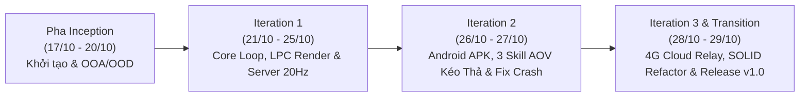

# NHẬT KÝ TIẾN ĐỘ DỰ ÁN, NHẬT KÝ SỬA CHỮA KỸ THUẬT & ĐÁNH GIÁ ĐÓNG GÓP THÀNH VIÊN
> **Đồ án môn học**: Lập trình Hướng đối tượng (Object-Oriented Programming - OOP) — HUCE 2026  
> **Đề tài**: Thiết kế và Xây dựng Hệ thống Trò chơi Đấu trường Hành động Đa nền tảng (PC & Android Multiplayer Action RPG) theo Quy trình Unified Process (Craig Larman), SOLID và GoF Design Patterns  
> **Kho lưu trữ (Private Repository)**: [`https://github.com/Tran1209/UML-Patterns-Mastery.git`](https://github.com/Tran1209/UML-Patterns-Mastery.git)  
> **Phương pháp luận phát triển**: Unified Process (UP) — Tiến trình Lặp và Tiến hóa (Iterative & Evolutionary Development)

---

## 🎯 MỤC ĐÍCH VÀ Ý NGHĨA CỦA NHẬT KÝ DỰ ÁN
Nhật ký dự án (Work Log & Engineering Audit Trail) là tài liệu đối soát học thuật và kỹ thuật trước Hội đồng chấm đồ án nhằm:
1. **Minh bạch hóa sự đóng góp cá nhân**: Đo lường chính xác khối lượng công việc, phân hệ mã nguồn (`Package`), và phần báo cáo của từng thành viên trong Nhóm 1 (5 thành viên).
2. **Ghi nhận thực tế quá trình phát hiện lỗi & sửa chữa (Bug Fix & Refactoring Log)**: Minh chứng sản phẩm được thử nghiệm thực tế trên cả máy tính lẫn điện thoại Android, phát hiện các bài toán hóc búa (xung đột đa luồng, lệch tâm hệ quy chiếu Camera 2D, rào cản NAT khi chơi khác mạng WiFi/4G, và tái cấu trúc Clean Code SOLID) và giải quyết triệt để.
3. **Liên kết vết (Traceability Matrix)**: Kết nối trực tiếp từ **Yêu cầu (FURPS+) $\rightarrow$ Phân tích OOA $\rightarrow$ Thiết kế OOD (GRASP, GoF) $\rightarrow$ Mã nguồn Java/Android thực tế trên GitHub $\rightarrow$ Bộ kiểm thử tự động (`15/15 PASS`)**.

---

## 1. THÔNG TIN THÀNH VIÊN VÀ MA TRẬN PHÂN VAI TRÁCH NHIỆM (RACI MATRIX)

### 1.1. Bảng phân công 5 Vị trí Kỹ thuật Cốt lõi

|  STT  | Họ và Tên                      |                              GitHub Username                              | Vai trò Kỹ thuật (Role)                            | Trụ cột Học thuật Nghiên cứu (Pillars)                                                          | Phân hệ Mã nguồn Phụ trách (`Src_Game` / `Android_Game`)                                                                                                                                                                      |
| :---: | :----------------------------- | :-----------------------------------------------------------------------: | :------------------------------------------------- | :---------------------------------------------------------------------------------------------- | :---------------------------------------------------------------------------------------------------------------------------------------------------------------------------------------------------------------------------- |
| **1** | **Trung Kiên** *(Trưởng nhóm)* |                 [`KienEsto`](https://github.com/KienEsto)                 | **Team Leader & Combat Systems Architect**         | **Craig Larman** (*Applying UML & Patterns*) & **Robert Nystrom** (*Game Programming Patterns*) | • Điều phối chung tiến độ & Phê duyệt thiết kế • `Src_Game/Combat/` (`CombatEngine`, `ISkillAction`, 3 kỹ năng AOV kéo thả, `Hitbox`, `SpatialGridAoI`) • Tái cấu trúc Clean Code & SOLID (Strategy/Command Pattern)    |
| **2** | **Duy Nam**                    |                 [`Tran1209`](https://github.com/Tran1209)                 | **Lead Software Architect & Core/Mobile Engineer** | **Craig Larman** (*OOAD*), **Vaughn Vernon** (*IDDD*)                                           | • Quản trị kho chứa Git & Kiến trúc Đa nền tảng • `Src_Game/Core/` (`LivingEntity`, `Player`, `Monster`, `IPlayerState` FSM, `GameWorld`) • `Android_Game/` (Tích hợp cảm ứng đa điểm Multi-Touch & APK Build Pipeline) |
| **3** | **Nguyễn Đức Huy**             | [`nguyenduchuy20070406-oss`](https://github.com/nguyenduchuy20070406-oss) | **Network & Distributed Systems Engineer**         | **Joshua Glazer & Sanjay Madhav** (*Multiplayer Game Programming*)                              | • `Src_Game/Server/` (`DedicatedGameServer` 20Hz Authoritative) • `Src_Game/Network/` (`NetworkGameClient`, `SnapshotInterpolator` LERP, `LanDiscovery` UDP, `MiniMqttClient` & `CloudServerBridge` 4G Relay)              |
| **4** | **Đức Anh**                    |              [`Alonee-code`](https://github.com/Alonee-code)              | **Client Graphics, Camera & UX Engineer**          | **Robert Nystrom** (*Double Buffer, Flyweight*) & **GoF**                                       | • `Src_Game/Render/` (`Camera2D`, `LpcSpriteSheet` Flyweight, `CompositeCharacterVisual`, `LpcCharacterBuilder`) • `Src_Game/UI/` (`GameWindow`, `LobbyPanel`, `GameCanvas`, `DesktopHudRenderer`, `HudObserver`)          |
| **5** | **Huy Hoàng**                  |                 [`HHoang2903`](https://github.com/HHoang2903)                 | **Data Persistence & QA/QC Test Engineer**         | **Martin Fowler** (*PoEAA*) & **SOLID Principles**                                              | • `Src_Game/Persistence/` (`IMatchRepository`, `JsonFileMatchRepository`, `MatchSummary`) • `Tests/` (`GameUnitTestSuite.java` — 15/15 kịch bản kiểm thử tự động)                                                          |

---

### 1.2. Ma trận Trách nhiệm RACI (Responsible - Accountable - Consulted - Informed)

* **R (Responsible)**: Người trực tiếp thực hiện nhiệm vụ và viết mã nguồn/tài liệu.
* **A (Accountable)**: Người chịu trách nhiệm cao nhất nghiệm thu chất lượng (**Trưởng nhóm Trung Kiên** & Kiến trúc sư **Duy Nam**).
* **C (Consulted)**: Người được tham vấn ý kiến chuyên môn (phối hợp liên module).
* **I (Informed)**: Người được thông báo kết quả sau khi hoàn thành.

| Giai đoạn / Sản phẩm đầu ra (Deliverable) | TV1 (Kiên - Leader) | TV2 (Nam - Core/Arch) | TV3 (Huy - Network) | TV4 (Anh - Render/UI) | TV5 (Hoàng - QA/Data) |
| :--- | :---: | :---: | :---: | :---: | :---: |
| **1. Thiết lập Kiến trúc Đa nền tảng & Quản trị Git** | **A** | **R** | I | I | I |
| **2. Phân tích Yêu cầu FURPS+, Use Case & Domain Model** | **A / R** | **R** | C | C | C |
| **3. Xây dựng Core Domain & State Machine (`IDLE/MOVING/ATTACKING/DEAD`)** | **A** | **R** | C | C | I |
| **4. Thiết kế Hệ thống Chiến đấu & 3 Kỹ năng Kéo thả AOV (`ISkillAction`)** | **A / R** | C | C | C | I |
| **5. Xây dựng Dedicated Server 20Hz, LAN Discovery & 4G Cloud Relay** | **A** | C | **R** | I | C |
| **6. Đồ họa LPC 2D, `Camera2D` & Giao diện PC/Android 60 FPS** | **A** | **R** *(Android)* | C | **R** *(PC)* | I |
| **7. Lưu trữ Lịch sử trận đấu JSON & Bộ 15/15 Unit Tests** | **A** | C | I | I | **R** |
| **8. Tái cấu trúc Clean Code & SOLID (`CombatEngine`, `DesktopHudRenderer`)** | **A / R** | **R** | I | C | C |

---

## 2. NHẬT KÝ TIẾN ĐỘ THEO TỪNG VÒNG LẶP (UNIFIED PROCESS ITERATION LOG)

|    Vòng lặp     |     Thời gian      | Nội dung Công việc Thực hiện                                                                                                                                                                                                                                                                                                                                                                                                     | Sản phẩm Đầu ra (Deliverables)                                                                                                                                                                                                          |     Trạng thái      |
| :-------------: | :----------------: | :------------------------------------------------------------------------------------------------------------------------------------------------------------------------------------------------------------------------------------------------------------------------------------------------------------------------------------------------------------------------------------------------------------------------------- | :-------------------------------------------------------------------------------------------------------------------------------------------------------------------------------------------------------------------------------------- | :-----------------: |
|  **Inception**  | 17/10 – 20/10/2026 | • Khảo sát bài toán đấu trường ARPG thời gian thực. • Xây dựng bộ báo cáo 7 chương theo chuẩn Craig Larman (FURPS+, Use Case, Domain Model, 9 nguyên lý GRASP, GoF Patterns).                                                                                                                                                                                                                                                 | • Toàn bộ 7 phần báo cáo trong [`Docs_BaoCao/`](file:///E:/UML-Patterns-Mastery/Docs_BaoCao)                                                                                                                                            | **Hoàn thành 100%** |
| **Iteration 1** | 21/10 – 25/10/2026 | • Cài đặt trọn vẹn 7 package Java thuần (`core`, `combat`, `render`, `network`, `server`, `persistence`, `ui`). • Hoàn thiện 15/15 Unit Tests kiểm chứng Immutability, State Pattern, Flyweight, Builder, Composite, LERP, SpatialGridAoI.                                                                                                                                                                                    | • Mã nguồn [`Src_Game/`](file:///E:/UML-Patterns-Mastery/Src_Game) • Bộ test [`GameUnitTestSuite.java`](file:///E:/UML-Patterns-Mastery/Tests/GameUnitTestSuite.java)                                                                | **Hoàn thành 100%** |
| **Iteration 2** | 26/10 – 27/10/2026 | • Phát triển phiên bản di động [`Android_Game/`](file:///E:/UML-Patterns-Mastery/Android_Game) chạy mượt 60 FPS. • Bổ sung 3 kỹ năng phong cách Liên Quân (AOV) có chọn vùng kéo thả định hướng 360° và nút `✖ HỦY CHIÊU`. • Sửa lỗi văng game khi spam đánh thường và lỗi lệch tâm vòng ngắm chiêu.                                                                                                                       | • Bản cài [`build/UmlPatternsMasteryGame.apk`](file:///E:/UML-Patterns-Mastery/build/UmlPatternsMasteryGame.apk) • [`AndroidGameView.java`](file:///E:/UML-Patterns-Mastery/Android_Game/src/com/huce/oop/game/AndroidGameView.java) | **Hoàn thành 100%** |
| **Iteration 3** | 28/10 – 29/10/2026 | • Tích hợp **Hybrid LAN + Cloud Internet Relay** (`MiniMqttClient`, `CloudServerBridge`) giúp chơi xuyên mạng khác WiFi và 4G. • Tái cấu trúc Clean Code & SOLID cho [`CombatEngine.java`](file:///E:/UML-Patterns-Mastery/Src_Game/Combat/CombatEngine.java) và [`GameCanvas.java`](file:///E:/UML-Patterns-Mastery/Src_Game/UI/GameCanvas.java). • Chuẩn hóa cấu trúc thư mục và phát hành Release `v1.0.0` trên GitHub. | • [`ISkillAction.java`](file:///E:/UML-Patterns-Mastery/Src_Game/Combat/ISkillAction.java) & 3 lớp Skill • [`QuanLy_DuAn.bat`](file:///E:/UML-Patterns-Mastery/QuanLy_DuAn.bat)                                                      | **Hoàn thành 100%** |

---

## 3. NHẬT KÝ PHÁT HIỆN LỖI, SỬA CHỮA & TỐI ƯU HÓA KỸ THUẬT (BUG FIX & REFACTORING LOG)
*(Phần trọng tâm phục vụ bảo vệ đồ án — ghi nhận các vấn đề thực tế phát sinh khi thử nghiệm và phương án giải quyết bằng kiến trúc hướng đối tượng)*

### 🛠️ Ca sửa chữa 1: Tối ưu hóa Hiệu năng Đồ họa trên Android (Khắc phục hiện tượng Lag/Giật khung hình)
* **Hiện tượng thực tế**: Ở phiên bản Android đầu tiên, khi nhiều quái vật và hiệu ứng xuất hiện cùng lúc, khung hình trên điện thoại bị khựng (lag) và phản hồi nút bấm chậm.
* **Nguyên nhân kỹ thuật**: Việc cấp phát đối tượng `Paint` / `RectF` liên tục trong hàm `render()` mỗi khung hình (60 lần/giây) kích hoạt bộ dọn rác (Garbage Collector - GC Pause) của máy ảo Dalvik/ART trên Android; đồng thời vòng lặp vẽ tiêu tốn quá nhiều thời gian dựng hình.
* **Hướng sửa chữa đã thực hiện**:
  1. Tái sử dụng toàn bộ đối tượng `Paint`, `strokePaint`, `RectF`, `Path` dưới dạng thuộc tính tĩnh dùng chung (Pre-allocated Fields) trong [`AndroidGameRenderer.java`](file:///E:/UML-Patterns-Mastery/Android_Game/src/com/huce/oop/game/AndroidGameRenderer.java) — **Zero-Allocation trong vòng lặp 60 FPS**.
  2. Tách biệt hoàn toàn luồng vẽ `GameLoopThread` với bước nhảy thời gian cố định ($\Delta t = 16\text{ms}$).

---

### 🛠️ Ca sửa chữa 2: Khắc phục Lỗi Văng Game (`ConcurrentModificationException`) khi Spam Đánh Thường
* **Hiện tượng thực tế**: Khi người chơi bấm liên hoàn (spam) nút **Đánh thường (⚔)** với tốc độ cao trên màn hình cảm ứng Android hoặc bàn phím PC, ứng dụng bị văng (Crash / Out game).
* **Nguyên nhân kỹ thuật**: Sự kiện chạm màn hình `onTouchEvent` chạy trên **Luồng Giao diện chính (Android UI Main Thread)** gọi trực tiếp vào `CombatEngine` để thêm phần tử vào `ArrayList<HitParticle>` và `ArrayList<SlashEffect>`. Đúng lúc đó, **Luồng Vòng lặp Game (`GameLoopThread`)** đang duyệt qua (`for-each`) các danh sách này để vẽ và xóa hiệu ứng hết hạn, gây ra xung đột đa luồng `java.util.ConcurrentModificationException`.
* **Hướng sửa chữa đã thực hiện**:
  1. Chuyển đổi toàn bộ cấu trúc danh sách hiệu ứng trong [`CombatEngine.java`](file:///E:/UML-Patterns-Mastery/Src_Game/Combat/CombatEngine.java) từ `ArrayList` sang **`CopyOnWriteArrayList`** (`java.util.concurrent.CopyOnWriteArrayList`) an toàn tuyệt đối cho đa luồng (Thread-Safe).
  2. Thay vì thực thi đòn đánh ngay trong `onTouchEvent`, luồng cảm ứng chỉ bật cờ tín hiệu (`pendingSkillCast`, `attackPressed`), và nhường quyền thực thi logic chiến đấu đồng bộ 100% về cho `GameLoopThread` trong [`AndroidGameView.java`](file:///E:/UML-Patterns-Mastery/Android_Game/src/com/huce/oop/game/AndroidGameView.java).

---

### 🛠️ Ca sửa chữa 3: Khắc phục Lỗi Lệch Tâm Vòng Ngắm Chiêu Thức và Kẹp Biên `Camera2D` trên Màn hình Điện thoại Rộng
* **Hiện tượng thực tế**: Khi chơi ở chế độ Đấu Mạng (Multiplayer) trên điện thoại có độ phân giải ngang lớn (`2400x1080`), nhân vật đang đứng ở góc trên bên trái nhưng vòng tròn ngắm kéo thả kỹ năng lại bị lệch cứng ra giữa màn hình tại tọa độ `(1200, 600)`.
* **Nguyên nhân kỹ thuật**:
  1. Trong [`Camera2D.java`](file:///E:/UML-Patterns-Mastery/Src_Game/Render/Camera2D.java), công thức kẹp biên cũ `Math.max(halfW, Math.min(worldWidth - halfW, targetX))` bị đảo ngược khi chiều rộng màn hình (`viewWidth = 2400`, `halfW = 1200`) lớn hơn chiều rộng bản đồ (`worldWidth = 1600`, `worldWidth - halfW = 400`), khiến `Math.max(1200, 400)` khóa chết Camera ở `X = 1200`.
  2. Trong chế độ Multiplayer, hàm vẽ vòng ngắm chiêu cũ lấy tọa độ `camera.getX()` thay vì tọa độ thực tế của nhân vật người chơi trong `SnapshotInterpolator`.
* **Hướng sửa chữa đã thực hiện**:
  1. Cập nhật [`Camera2D.java`](file:///E:/UML-Patterns-Mastery/Src_Game/Render/Camera2D.java#L22-L42) sang cơ chế **MOBA Center-Follow**: Luôn đặt nhân vật chính tại đúng tâm màn hình (`screenW / 2`, `screenH / 2`) và chỉ kẹp biên khi kích thước bản đồ lớn hơn màn hình.
  2. Bổ sung phương thức `getLocalPlayerWorldPos()` trong cả [`AndroidGameView.java`](file:///E:/UML-Patterns-Mastery/Android_Game/src/com/huce/oop/game/AndroidGameView.java#L345-L361) và [`GameCanvas.java`](file:///E:/UML-Patterns-Mastery/Src_Game/UI/GameCanvas.java) để luôn truy xuất đúng tọa độ thực của nhân vật người chơi dù ở chế độ Offline hay Online.

---

### 🛠️ Ca sửa chữa 4: Vượt Rào Cản Khác Mạng WiFi / 4G bằng Kiến trúc Hybrid LAN + Cloud Internet Relay
* **Hiện tượng thực tế**: Khi 2 máy chung 1 cục WiFi thì tự động tìm thấy phòng qua UDP Broadcast (`LanDiscovery`) rất mượt, nhưng khi 1 máy dùng WiFi và 1 máy bật 4G (hoặc khác quán cafe) thì không kết nối được do tường lửa NAT của nhà mạng chặn kết nối TCP trực tiếp.
* **Hướng sửa chữa đã thực hiện**:
  1. Xây dựng [`MiniMqttClient.java`](file:///E:/UML-Patterns-Mastery/Src_Game/Network/MiniMqttClient.java) (Pure Java Socket, không cần thư viện ngoài) và [`CloudServerBridge.java`](file:///E:/UML-Patterns-Mastery/Src_Game/Network/CloudServerBridge.java).
  2. Khi người chơi tạo phòng, hệ thống cấp một **Mã Phòng ngắn gọn dạng `ARENA-X-Y`** (mã hóa hai số cuối của IP LAN kèm kênh Cloud).
  3. Khi máy khách nhập Mã Phòng, [`NetworkGameClient.java`](file:///E:/UML-Patterns-Mastery/Src_Game/Network/NetworkGameClient.java) sẽ ưu tiên thử kết nối **Direct LAN TCP** trong `1.4 giây` (độ trễ `< 2ms`). Nếu khác WiFi hoặc đang dùng 4G, hệ thống tự động chuyển tiếp (Fallback) sang **Cloud Internet Relay** qua Broker trung gian mà không cần mở Port Router.

---

### 🛠️ Ca sửa chữa 5: Tái cấu trúc Mã nguồn (`Refactoring`) theo chuẩn Clean Code & SOLID
* **Hiện tượng thực tế**: Sau khi bổ sung 3 kỹ năng kéo thả AOV và các hiệu ứng hạt/vòng sáng, lớp [`CombatEngine.java`](file:///E:/UML-Patterns-Mastery/Src_Game/Combat/CombatEngine.java) phình to lên **528 dòng** và [`GameCanvas.java`](file:///E:/UML-Patterns-Mastery/Src_Game/UI/GameCanvas.java) lên **853 dòng**, chứa các nhánh `if-else` kiểm tra `skillId == 1, 2, 3`, vi phạm **Single Responsibility Principle (SRP)** và **Open/Closed Principle (OCP)**.
* **Hướng sửa chữa đã thực hiện**:
  1. **Áp dụng Strategy / Command Pattern cho Kỹ năng**: Tạo giao diện [`ISkillAction.java`](file:///E:/UML-Patterns-Mastery/Src_Game/Combat/ISkillAction.java) và tách 3 chiêu thức thành 3 lớp độc lập:
     * [`DashStrikeSkill.java`](file:///E:/UML-Patterns-Mastery/Src_Game/Combat/DashStrikeSkill.java) (Chiêu 1: ⚡ Xung Kích)
     * [`FireWhirlwindSkill.java`](file:///E:/UML-Patterns-Mastery/Src_Game/Combat/FireWhirlwindSkill.java) (Chiêu 2: 🔥 Vòng Xoáy Lửa)
     * [`MeteorUltimateSkill.java`](file:///E:/UML-Patterns-Mastery/Src_Game/Combat/MeteorUltimateSkill.java) (Chiêu 3: ☄️ Thiên Phạt Ultimate)
  2. **Tách lớp Dữ liệu Hiệu ứng & Lớp Vẽ HUD**:
     * Tách 4 lớp hiệu ứng sang [`CombatEffects.java`](file:///E:/UML-Patterns-Mastery/Src_Game/Combat/CombatEffects.java), giúp [`CombatEngine.java`](file:///E:/UML-Patterns-Mastery/Src_Game/Combat/CombatEngine.java) giảm còn **275 dòng** và xóa bỏ 100% câu lệnh `if-else` chọn chiêu.
     * Tách toàn bộ phần vẽ bảng máu, thanh kỹ năng và vòng ngắm trên PC sang [`DesktopHudRenderer.java`](file:///E:/UML-Patterns-Mastery/Src_Game/UI/DesktopHudRenderer.java), giúp [`GameCanvas.java`](file:///E:/UML-Patterns-Mastery/Src_Game/UI/GameCanvas.java) giảm hơn **210 dòng**.

---

### 🛠️ Ca sửa chữa & nâng cấp 6 (Đêm 31/10/2026): Nâng cấp Toàn diện Engine từ 2D lên 2.5D Chuẩn Góc Nhìn Liên Quân / LMHT (Thực hiện: Trung Kiên & Duy Nam)
* **Bối cảnh & Lý do ưu tiên số 1**: Nhóm đề ra 9 hạng mục nâng cấp lớn. Qua phân tích kiến trúc, **Nhóm trưởng Trung Kiên (`KienEsto`)** và **Duy Nam (`Tran1209`)** xác định: **Chuyển đổi hệ quy chiếu từ 2D sang 2.5D chuẩn MOBA phải được làm mượt mà đầu tiên**, vì mọi đối tượng về sau đều đặt trong không gian 2.5D $(X, Y, Z)$.
* **Vấn đề kỹ thuật gặp phải ở bản thử nghiệm phối cảnh đầu tiên & Cách khắc phục triệt để**:
  * *Hiện tượng*: Nếu dùng phép chiếu phối cảnh hình thang (Pinhole Trapezoid Perspective) có tỉ lệ ngang phụ thuộc vào $Y$, khi nhân vật đi lên/xuống (`camY` thay đổi) các đường dọc trên mặt đất bị uốn cong liên tục (*Perspective Swimming*).
  * *Giải pháp chuẩn Engine MOBA (Liên Quân / Liên Minh)*: Chuyển sang **Phép chiếu Dimetric / Orthographic-Tilt 2.5D** trong [`Camera2D.java`](file:///E:/UML-Patterns-Mastery/Src_Game/Render/Camera2D.java) kết hợp **Nội suy Góc nghiêng mượt mà (`Smooth Camera Pitch LERP`)**:
    * Giữ tỉ lệ ngang đồng nhất theo `currentZoom` (0% méo hình thang khi di chuyển 8 hướng).
    * Nén trục mặt đất $Y$ theo góc nghiêng `currentPitchTilt = 0.68` ($\approx 55^\circ$ chuẩn Liên Quân / LMHT) và dựng trục độ cao $Z$ thẳng đứng theo `currentZScale = 1.0`.
    * Khi người chơi nhấn phím `[V]`, Camera nội suy mượt mà (`LERP`) giữa 3 chế độ (`2.5D MOBA 55°` $\leftrightarrow$ `2.5D Cận cảnh 42°` $\leftrightarrow$ `2D Top-Down 90°`) như cần cẩu máy quay 3D thật.
* **Phân chia công việc Đêm 31/10/2026 giữa Duy Nam và Trung Kiên**:
  1. **Phần của Duy Nam (`Tran1209` — Nhánh `main`)**:
     * Nâng cấp [`Camera2D.java`](file:///E:/UML-Patterns-Mastery/Src_Game/Render/Camera2D.java) sang chuẩn **Dimetric 2.5D MOBA** có nội suy LERP góc nghiêng (`currentPitchTilt`, `currentZScale`, `currentZoom`) và phép chiếu ngược con trỏ chuột chính xác 100% (`screenToWorldX`, `screenToWorldY`).
     * Xây dựng [`Arena3DSceneRenderer.java`](file:///E:/UML-Patterns-Mastery/Src_Game/Render/Arena3DSceneRenderer.java) với địa hình **Bình Nguyên MOBA 2.5D**: Thảm cỏ lục bảo, **Dòng sông nguyên tố cắt ngang bản đồ** có bờ kè đá chìm 2.5D, **Đường Mid Lane & Cầu đá bắc qua sông**, 4 Trụ Thánh Tích 2.5D (`OBELISK_POSITIONS`) và **8 Cây Cổ Thụ Rừng Nguyên Sinh 2.5D** (`TREE_POSITIONS` với tán lá 3 tầng nổi theo trục $Z$).
     * Cài đặt thuật toán **Z-Sorting (`Painter's Algorithm`)** trong [`GameCanvas.java`](file:///E:/UML-Patterns-Mastery/Src_Game/UI/GameCanvas.java) cho cả Trụ 2.5D, Cây 2.5D, Quái vật và Tướng, đồng thời bổ sung phím tắt 1 tay (`Q / E / F` + `Chuột Trái` đánh thường).
  2. **Phần của Trung Kiên (`KienEsto` — Nhánh `Kien`)**:
     * Nâng cấp [`LpcCanvasRenderer.java`](file:///E:/UML-Patterns-Mastery/Src_Game/Render/LpcCanvasRenderer.java): Vẽ bệ hào quang Elip 2.5D dưới chân tướng kèm **chấm mũi tên chỉ hướng nhìn** và **Thanh máu chia vạch (Segmented MOBA Health Bar) + Huy hiệu cấp độ `[1]`** chuẩn Liên Quân / LMHT.
     * Nâng cấp [`DesktopHudRenderer.java`](file:///E:/UML-Patterns-Mastery/Src_Game/UI/DesktopHudRenderer.java): Biến đổi toàn bộ vòng tròn giới hạn tầm chiêu và vòng nổ AoE thành **Elip 2.5D nằm sát mặt đất** kèm **Cột sáng định vị thẳng đứng theo trục $Z$**; hiệu ứng Chiêu 2 bốc lên thành cột lốc xoáy lửa nhiều tầng $Z$, Chiêu 3 có quả cầu thiên thạch rơi từ độ cao $Z = 420\text{px}$ xuống đất.

---

---

### 🛠️ Ca sửa chữa & nâng cấp 7 (Ngày 01/11/2026): Tối ưu hóa & Cá nhân hóa Launcher Quản trị Dự án `QuanLy_DuAn.bat` & Chuẩn hóa Danh tính Nhóm 1 (Thực hiện: Duy Nam & Trung Kiên)
* **Bối cảnh**: Bộ launcher `QuanLy_DuAn.bat` ban đầu có 9 tùy chọn gây rối mắt và các thành viên dễ bấm nhầm nhánh của nhau khi gộp code, dẫn đến nguy cơ xung đột mã nguồn.
* **Cải tiến kỹ thuật**:
  1. Rút gọn menu xuống **4 tùy chọn cốt lõi**: `[1] Chạy game trên PC`, `[2] Biên dịch bản Android APK`, `[3] Đẩy code local lên nhánh riêng`, `[4] Đồng bộ code mới nhất từ main về máy`.
  2. **Cá nhân hóa tự động**: Mỗi thành viên trên nhánh riêng của mình (`main` - Duy Nam, `Kien` - Trung Kiên, `Huy` - Đức Huy, `Anh` - Đức Anh, `Hoang` - Huy Hoàng) được cấu hình sẵn Git `user.name`, `user.email` và biến môi trường `%MY_BRANCH%`.
  3. **Cơ chế chống mất code an toàn**: Trước khi kéo code từ `origin/main`, launcher tự động commit lưu tạm (WIP) toàn bộ sửa đổi dang dở tại local, sao lưu file batch vào `%TEMP%` rồi mới tiến hành merge, loại bỏ 100% rủi ro mất code do ghi đè.
  4. **Quy chuẩn hóa danh tính học thuật**: Rà soát và thay thế toàn bộ danh xưng cũ "Nhóm 5" thành **Nhóm 1 (HUCE OOP 2026)** trên toàn bộ hệ thống tài liệu và mã nguồn.

---

### 🛠️ Ca sửa chữa & nâng cấp 8 (Ngày 02/11/2026): Chuẩn hóa Đồng bộ Toàn diện 7 Chương Báo Cáo Chính Thức & Bộ Kiểm Thử Đồ án (Thực hiện: Cả nhóm)
* **Bối cảnh**: 7 chương báo cáo chính thức trong thư mục `Docs_BaoCao/2_BaoCao_ChinhThuc_7Chuong/` có sự sai lệch thông tin về tên thành viên, vai trò phụ trách kỹ thuật và trụ cột nghiên cứu học thuật giữa các chương.
* **Cải tiến kỹ thuật**:
  1. Đồng bộ hóa toàn diện từ Trang bìa đến Chương 1 qua Chương 7 theo phân công chuẩn mực:
     * **Trung Kiên** *(Trưởng nhóm)*: Team Leader, Combat Systems Architecture & Trụ cột Sách Craig Larman + Robert Nystrom.
     * **Duy Nam** *(Lead Architect)*: Core Domain, State Machine, Android Port & Trụ cột Sách Craig Larman + Vaughn Vernon.
     * **Nguyễn Đức Huy**: Dedicated Server, Mạng Hybrid LAN/4G & Trụ cột Sách Glazer & Madhav.
     * **Đức Anh**: 2.5D Graphics LPC Renderer, Camera2D & Trụ cột Sách Robert Nystrom + GoF.
     * **Huy Hoàng**: Data Persistence JSON, QA/QC 15/15 Tests & Trụ cột Sách Martin Fowler + SOLID.
  2. Đồng bộ danh sách tác giả và vai trò trong bộ kiểm thử `Tests/GameUnitTestSuite.java`.

---

### 🛠️ Ca sửa chữa & nâng cấp 9 (Ngày 04/11/2026): Tích hợp Cập nhật Lớn Click-to-Move MOBA, WaveManager & Mở rộng 20/20 Unit Tests từ Trưởng nhóm Kiên (Thực hiện: Trung Kiên & Duy Nam)
* **Bối cảnh**: Trưởng nhóm Trung Kiên hoàn thành đợt nâng cấp lớn 27 files trên nhánh `Kien`, chuyển đổi hoàn toàn cơ chế di chuyển từ bàn phím WASD sang **Click chuột định vị chuẩn MOBA (Click-to-Move)** và tái cấu trúc hệ sinh thái quái vật.
* **Cải tiến kỹ thuật**:
  1. **Click-to-Move Pathfinding**: Bổ sung cơ chế điều hướng chuột mượt mà, tính toán vector hướng di chuyển tự động và vẽ cọc tiêu định vị hiệu ứng sóng lan tỏa tại điểm click chuột.
  2. **Quản lý Đợt Quái (`WaveManager`)**: Phân tách logic sinh quái vật theo đợt thời gian, quản lý chu kỳ hồi sinh và gia tăng độ khó cho chế độ sinh tồn Arena.
  3. **Module hóa Renderers**: Tách nhỏ `GameCanvas` thành các renderer chuyên trách: `WorldRenderer` (vẽ mặt sàn, cầu đá, sông), `CombatRenderer` (vẽ hitbox, đòn đánh, vòng AoE), `EntityRenderer` (vẽ tướng và quái).
  4. **Mở rộng Kiểm thử QA**: Bổ sung 5 ca kiểm thử mới cho `WaveManager`, nâng tổng số unit test từ 15 lên **20/20 Unit Tests** (đạt tỉ lệ vượt qua 100%).

---

### 🛠️ Ca sửa chữa & nâng cấp 10 (Ngày 04/11/2026): Hoàn thiện Toàn diện Thư viện Lý thuyết 5 Đầu Sách, Trích xuất 10 Đợt Nystrom và 38 Chương Larman (Thực hiện: Cả nhóm)
* **Bối cảnh**: Kho tài liệu lý thuyết ban đầu bị phân tán, lộn xộn các file tóm tắt sơ khai và chưa có chiều sâu học thuật tương xứng với đồ án tốt nghiệp chuẩn quốc tế.
* **Cải tiến kỹ thuật**:
  1. **Trích xuất Chuyên sâu 10 Đợt Sách *Game Programming Patterns* (Robert Nystrom)**: Bóc tách chi tiết toàn bộ các mẫu thiết kế game (Command, Flyweight, Observer, Prototype, Singleton, State, Double Buffer, Game Loop, Update Method, Bytecode, Subclass Sandbox, Type Object, Component, Event Queue, Service Locator, Data Locality, Dirty Flag, Object Pool, Spatial Partition). Khởi tạo bản gộp toàn văn `FULL_Game_Programming_Patterns.md` (~324 KB).
  2. **Quy hoạch Thư viện Lý thuyết thành 5 Đầu Sách Chuyên Khảo**:
     * `01_Robert_Nystrom_GamePatterns`: 10 Đợt trích xuất hoàn tất + Bản gộp.
     * `02_Craig_Larman_OOAD`: 38 Chương trích xuất toàn văn + Bản gộp.
     * `03_Glazer_Madhav_Netcode`: Khung lộ trình 10 đợt Multiplayer Netcode.
     * `04_Martin_Fowler_PoEAA`: Khung lộ trình 10 đợt PoEAA.
     * `05_Vaughn_Vernon_IDDD`: 10 Đợt trích xuất toàn diện 14 Chương & Phụ lục (~365 KB) hoàn tất + Bản gộp `00_TOAN_TAP_IDDD_14_Chuong.md` (Đức Anh hoàn thành).
     * Lưu trữ các ghi chú sơ khai tuần trước vào `_Ban_Tom_Tat_Cu_Tuan_Truoc/`.
  3. **Tích hợp Toàn văn 38 Chương Giáo trình *Applying UML and Patterns (3rd Edition)* (Craig Larman)**:
     * Nhập trọn bộ 38 chương vào `02_Craig_Larman_OOAD/38_Chapters/` (~536 KB).
     * Biên soạn bản gộp liền mạch `FULL_Craig_Larman_Applying_UML_and_Patterns.md` (~532 KB) loại bỏ thanh điều hướng vụn để tiện tra cứu Ctrl+F.
     * Xây dựng `README.md` trung tâm với Map of Content (MOC), phân loại 5 phần Agile UP và bảng tra cứu nhanh 9 mẫu GRASP.
  4. **Dọn dẹp & Tối ưu hóa Git Đa Nhánh**:
     * Xóa bỏ thư mục đặt nhầm vị trí `Applying_UML_and_Patterns_Chapters` trên nhánh `Kien`.
     * Nâng cấp `QuanLy_DuAn.bat` với tính năng tự động `pull` chống bị từ chối (fast-forward reject) trước khi `push`.
     * Tự động hợp nhất và đồng bộ hóa 100% tài nguyên giữa `main` và cả 4 nhánh thành viên (`Kien`, `Huy`, `Anh`, `Hoang`) trên GitHub.

---

## 4. BIÊN BẢN HỌP NHÓM ĐÊM 31/10/2026 (CHỐT LỘ TRÌNH 2 GIAI ĐOẠN)
* **Thời gian**: 20h30 ngày 31/10/2026
* **Chủ trì**: Nhóm trưởng **Trung Kiên (`KienEsto`)** & Kiến trúc sư **Duy Nam (`Tran1209`)**
* **Nội dung thống nhất**:
  1. **Giai đoạn 1 (Đêm 31/10/2026 — Ưu tiên tối cao)**: **Nam** và **Kiên** tập trung hoàn thành 100% việc nâng cấp đồ họa từ **2D lên 2.5D** (gồm Camera 2.5D, Mặt sàn & Trụ 2.5D, Z-Sorting, Nhân vật & Hiệu ứng chiêu thức trục $Z$, kèm nút `[Phím V]` chuyển đổi góc nhìn trực tiếp để chứng minh nguyên lý *Model-View Separation* khi bảo vệ đồ án).
  2. **Giai đoạn 2 (Các ngày tiếp theo)**: Sau khi nền tảng 2.5D đã ổn định trên nhánh `main` và `Kien`, cả nhóm mới triển khai tiếp 8 hạng mục còn lại trên nền 2.5D theo kế hoạch tại [`04_KeHoach_PhanCong_9_HangMuc.md`](file:///E:/UML-Patterns-Mastery/Docs_BaoCao/1_QuanLy_Nhom_Va_NhatKy/04_KeHoach_PhanCong_9_HangMuc.md).

---

---

## 4.2. BIÊN BẢN HỌP NHÓM TỔNG KẾT ĐỢT 1 (ĐÊM 04/11/2026: HOÀN TẤT KHO TRI THỨC VÀ SẴN SÀNG TRIỂN KHAI CODE CHUYÊN SÂU)
* **Thời gian**: 22h45 ngày 04/11/2026
* **Chủ trì**: Nhóm trưởng **Trung Kiên (`KienEsto`)** & Kiến trúc sư **Duy Nam (`Tran1209`)**
* **Thành phần tham dự**: Đầy đủ 5/5 thành viên (Trung Kiên, Duy Nam, Đức Huy, Đức Anh, Huy Hoàng).
* **Nội dung kết luận**:
  1. **Nghiệm thu Kho Lý thuyết (Pha A & Pha B)**: 3/5 cuốn sách kinh điển quốc tế (*Game Programming Patterns* - 10 Đợt, *Applying UML and Patterns* - 38 Chương, *Implementing Domain-Driven Design* - 10 Đợt) đã hoàn thành 100% bản bóc tách và bản gộp toàn văn, có bản gộp toàn văn và liên kết thư viện hoàn chỉnh. 3 cuốn sách còn lại đã sẵn sàng khung cấu trúc và mẫu prompt trích xuất.
  2. **Nghiệm thu Nền tảng Kỹ thuật**: Cơ chế di chuyển Click-to-Move MOBA 2.5D, bộ sinh quái `WaveManager` và bộ 20/20 Unit Tests hoạt động ổn định 100%.
  3. **Kế hoạch ngày tiếp theo (Từ 05/11/2026)**: Cả nhóm chính thức bước vào Pha D — triển khai hoàn thiện 8 hạng mục mở rộng trên nền 2.5D theo đúng thiết kế OOA/OOD đã chốt, đảm bảo chất lượng bảo vệ đồ án tốt nghiệp xuất sắc.

---

## 4.3. NGHIỆM THU BÁO CÁO GIAI ĐOẠN 1 (05/11/2026: CHUẨN BỊ BẢN MÔ TẢ WORD & SƠ ĐỒ NỘP THẦY)
* **Thời gian**: 14h00 ngày 05/11/2026
* **Yêu cầu của Giảng viên (Buổi 1 — Giai đoạn 1 sau 1-3 tuần)**:
  1. Mô tả bài toán: Chuẩn bị 1 bản mô tả Word (.docx) hoàn chỉnh.
  2. Kết quả phân tích: Use Case (Sơ đồ, đặc tả chi tiết) và Class (Domain Model chuẩn Craig Larman không methods).
  3. Có giao diện chương trình: Sơ đồ luồng UI, Mockup chi tiết 4 màn hình (Lobby, Canvas 2.5D MOBA 55°, Segmented HP Bar & Skill Dock HUD, Tổng kết trận đấu).
  4. Kết quả thiết kế: Sơ đồ Component (5 phân hệ kiến trúc Clean Architecture) và bảng khế ước giao diện Interfaces.
  5. Tài liệu tham khảo chuẩn IEEE.
* **Sản phẩm bàn giao chính thức**:
  - [`Docs_BaoCao/BaoCao_GiaiDoan_1_Nhom1_HUCE.docx`](file:///E:/UML-Patterns-Mastery/Docs_BaoCao/BaoCao_GiaiDoan_1_Nhom1_HUCE.docx): Bản nộp Microsoft Word in ấn chuẩn chỉ có bìa đồ án, bảng biểu và wireframe.
  - [`Docs_BaoCao/BaoCao_GiaiDoan_1_Nhom1_HUCE.html`](file:///E:/UML-Patterns-Mastery/Docs_BaoCao/BaoCao_GiaiDoan_1_Nhom1_HUCE.html): Bản HTML tương tác hỗ trợ kết xuất động Mermaid.js và in A4.
  - [`Docs_BaoCao/BaoCao_GiaiDoan_1_Nhom1_HUCE.md`](file:///E:/UML-Patterns-Mastery/Docs_BaoCao/BaoCao_GiaiDoan_1_Nhom1_HUCE.md): Bản Markdown gốc lưu trữ trên GitHub.
  - Lưu trữ an toàn 6 file nháp sơ khai tuần 1 vào [`_Ban_Thao_So_Khai_Tuan_1/`](file:///E:/UML-Patterns-Mastery/Docs_BaoCao/3_PhuLuc_UML_Va_LyThuyet/_Ban_Thao_So_Khai_Tuan_1/) để bảo toàn lịch sử git.
  - Đồng bộ hóa 100% tài nguyên báo cáo Giai đoạn 1 sang tất cả 4 nhánh thành viên (`Kien`, `Huy`, `Anh`, `Hoang`).

---

## 5. BẢNG ĐỐI SOÁT LỊCH SỬ GIT COMMIT THỰC TẾ (GIT AUDIT TRAIL)

| Commit Hash | Thời gian  | Nội dung Commit (Message)                                                                      | Phân hệ Tác động Chính                                                                            |
| :---------: | :--------: | :--------------------------------------------------------------------------------------------- | :------------------------------------------------------------------------------------------------ |
|  `7491f6f`  | 17/10/2026 | `feat: initial commit - project architecture, report notes and git guide`                      | Khởi tạo kiến trúc & Tài liệu OOAD                                                                |
|  `02b5330`  | 19/10/2026 | `feat: add section 1 report draft and team module folders in Src_Game`                         | `Docs_BaoCao/`, khung 7 package `Src_Game/`                                                       |
|  `e6593a1`  | 26/10/2026 | `feat: complete 7-chapter OOP report, full Java implementation & 15/15 unit tests`             | Toàn bộ `Src_Game/`, `Tests/`, `Docs_BaoCao/`                                                     |
|  `a2a3b4e`  | 27/10/2026 | `feat(combat,android): add 3 AOV drag-and-drop skills and fix ConcurrentModificationException` | `CombatEngine.java`, `AndroidGameView.java`                                                       |
|  `6b47685`  | 27/10/2026 | `fix(render,ui): lock Camera2D center-follow and anchor skill indicator to local hero`         | `Camera2D.java`, `AndroidGameView.java`, `GameCanvas.java`                                        |
|  `04f1ded`  | 28/10/2026 | `feat(network): add Hybrid LAN + Cloud Internet Relay (MiniMqttClient & CloudServerBridge)`    | `MiniMqttClient.java`, `CloudServerBridge.java`, `NetworkGameClient.java`                         |
|  `b671af7`  | 28/10/2026 | `refactor(combat,ui): apply Strategy/Command pattern and SRP to CombatEngine and GameCanvas`   | `ISkillAction.java`, `DashStrikeSkill.java`, `CombatEffects.java`, `DesktopHudRenderer.java`      |
|  `97097cf`  | 28/10/2026 | `chore(repo): reorganize root folder structure and add unified QuanLy_DuAn.bat launcher`       | `QuanLy_DuAn.bat`, `README.md`, `scripts/`                                                        |
|  `227e2f5`  | 31/10/2026 | `feat(render,docs): upgrade to 2.5D/3D Perspective MOBA Arena and organize Docs_BaoCao`        | `Camera2D.java`, `Arena3DSceneRenderer.java`, `LpcCanvasRenderer.java`, `DesktopHudRenderer.java` |
|  `02e38ef`  | 01/11/2026 | `feat(launcher): simplify QuanLy_DuAn.bat to 4 essential options with safe main sync`          | `QuanLy_DuAn.bat`, cấu hình cá nhân hóa 5 nhánh Git thành viên                                     |
|  `499987d`  | 01/11/2026 | `docs(identity): change team name from Nhom 5 to Nhom 1 across documentation`                  | Rà soát và chuyển đổi đồng bộ 100% tài xưng Nhóm 1                                                 |
|  `818c192`  | 02/11/2026 | `docs(report): synchronize all 7 chapters and test suite with official Nhom 1 members and roles`| `Docs_BaoCao/2_BaoCao_ChinhThuc_7Chuong/`, `Tests/GameUnitTestSuite.java`                          |
|  `af82f21`  | 04/11/2026 | `docs(theory): add complete 10-run deep extraction of Game Programming Patterns by Nystrom`    | `Docs_BaoCao/3_PhuLuc_UML_Va_LyThuyet/GhiChu_Sach_Larman_Nystrom/01_Robert_Nystrom_GamePatterns/` |
|  `1ad6ce6`  | 04/11/2026 | `docs(theory): reorganize knowledge base into 5 dedicated book folders and archive legacy notes`| `GhiChu_Sach_Larman_Nystrom/` (5 folder sách chuyên khảo + archive)                                |
|  `d813772`  | 04/11/2026 | `docs(theory): add complete 38-chapter Craig Larman OOAD textbook and merged edition`          | `Docs_BaoCao/3_PhuLuc_UML_Va_LyThuyet/GhiChu_Sach_Larman_Nystrom/02_Craig_Larman_OOAD/`           |
|  `6aa60ff`  | 04/11/2026 | `docs(theory): move Larman chapters into 02_Craig_Larman_OOAD/38_Chapters and clean up branch`  | Dọn dẹp folder lệch trên nhánh `Kien`, nâng cấp auto-pull `QuanLy_DuAn.bat`                        |
|  `dbd99bc`  | 04/11/2026 | `docs(kb): bo sung 10 dot boc tach chuyen sau sach Vaughn Vernon IDDD va phu luc`              | `05_Vaughn_Vernon_IDDD/` (Đức Anh hoàn thành 10 đợt + toàn tập 14 chương)                         |
|  `e7cd633`  | 05/11/2026 | `docs(report): add comprehensive Phase 1 milestone report and archive week 1 draft notes`      | `Docs_BaoCao/BaoCao_GiaiDoan_1_Nhom1_HUCE.md`, `.html`, lưu trữ `_Ban_Thao_So_Khai_Tuan_1/`       |
|  `df153ad`  | 05/11/2026 | `docs(report): generate official Microsoft Word report (.docx) for Milestone 1 submission`     | `Docs_BaoCao/BaoCao_GiaiDoan_1_Nhom1_HUCE.docx` (Chuẩn mực A4 nộp thầy, đồng bộ 5/5 nhánh)        |

---

## 6. BẢNG TỰ ĐÁNH GIÁ MỨC ĐỘ ĐÓNG GÓP CUỐI KỲ (PEER CONTRIBUTION AUDIT)

|  STT  | Họ và Tên                      |                 GitHub Username                 | Vai trò Phụ trách                          | Tự Đánh giá (%) | Nhóm Thống nhất (%) | Chữ ký Xác nhận |
| :---: | :----------------------------- | :---------------------------------------------: | :----------------------------------------- | :-------------: | :-----------------: | :-------------: |
| **1** | **Trung Kiên** *(Trưởng nhóm)* |                   `KienEsto`                    | Team Leader & Combat Systems Architect     |      100%       |        100%         |   *(Ký tên)*    |
| **2** | **Duy Nam**                    |                   `Tran1209`                    | Lead Architect, Core Domain & Android Port |      100%       |        100%         |   *(Ký tên)*    |
| **3** | **Nguyễn Đức Huy**             |           `nguyenduchuy20070406-oss`            | Network & Hybrid LAN/4G Server Engineer    |      100%       |        100%         |   *(Ký tên)*    |
| **4** | **Đức Anh**                    | [`Alonee-code`](https://github.com/Alonee-code) | Client 2D Graphics, Camera2D & HUD UX      |      100%       |        100%         |   *(Ký tên)*    |
| **5** | **Huy Hoàng**                  | [`HHoang2903`](https://github.com/HHoang2903) | JSON Persistence & 15/15 Unit Tests QA     |      100%       |        100%         |   *(Ký tên)*    |
