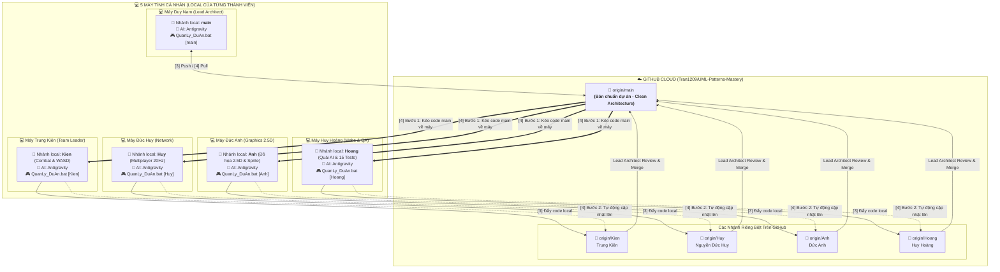

# 🗺️ SƠ ĐỒ & QUY TRÌNH LÀM VIỆC GIT 5 THÀNH VIÊN VỚI ANTIGRAVITY

> **Dành riêng cho Đồ án Game OOP Nhóm 1 (HUCE 2026)**  
> **Repository**: [https://github.com/Tran1209/UML-Patterns-Mastery](https://github.com/Tran1209/UML-Patterns-Mastery)  
> *Tất cả thành viên làm việc độc lập trên máy tính cá nhân qua AI Antigravity và file `QuanLy_DuAn.bat` riêng của nhánh mình.*

---

## 1. 📊 SƠ ĐỒ TOÀN CẢNH HỆ THỐNG 5 THÀNH VIÊN

---

## 2. 🗂️ BẢNG PHÂN VÙNG TRÁCH NHIỆM & NHÁNH RIÊNG

| STT | Thành viên | Vai trò phụ trách | Nhánh Git | Thư mục code chính | Email & Git Author |
| :-: | :--- | :--- | :---: | :--- | :--- |
| **1** | **Duy Nam** | **Lead Architect / Core Domain** | `main` | `Src_Game/Core/`, Root config, Build APK | `oknha278@gmail.com` |
| **2** | **Trung Kiên** | **Team Leader / Combat & Phím** | `Kien` | `Src_Game/Combat/`, WASD + Q/E/R, Chuột | `kienesto@huce.edu.vn` |
| **3** | **Nguyễn Đức Huy** | **Network & Sảnh Chờ** | `Huy` | `Src_Game/Network/`, Server UDP/TCP 20Hz | `duchuy462007` (noreply) |
| **4** | **Đức Anh** | **2.5D Graphics & Z-Sorting** | `Anh` | `Src_Game/Render/`, LPC Sprite, Camera2D | `Alonee-code` (noreply) |
| **5** | **Huy Hoàng** | **Mobs AI & Kiểm thử QA** | `Hoang` | `Src_Game/Core/` (Mobs), `Tests/` (15 Tests) | `HHoang2903` (noreply) |

---

## 3. 🎯 NGUYÊN TẮC VÀNG KHI LÀM VIỆC VỚI ANTIGRAVITY

1. **Antigravity chỉ chạy trên máy tính cá nhân (LOCAL)**:
   * AI chỉ sửa file trên ổ cứng máy bạn. Nó **không bao giờ tự động push lên GitHub** nếu bạn không yêu cầu.
   * Bạn không sợ bị lộ code chưa hoàn thiện hoặc đè vào việc của bạn bè.
2. **Không ai được sửa trực tiếp trên `main` (trừ Lead Architect)**:
   * Toàn bộ 4 thành viên code 100% trên nhánh cá nhân của mình (`Kien`, `Huy`, `Anh`, `Hoang`).
3. **Mỗi người có một file `QuanLy_DuAn.bat` riêng biệt**:
   * File `.bat` của bạn tự động biết bạn là ai, tự cấu hình tên tác giả và chỉ đẩy vào đúng nhánh của bạn.

---

## 4. 🚀 HƯỚNG DẪN 4 NÚT BẤM TRONG `QuanLy_DuAn.bat`

Khi mở file `QuanLy_DuAn.bat` trên máy của mình, bạn chỉ cần dùng 4 lựa chọn:

### 🎮 Phím `[1]` — Chạy game trên PC
* **Công dụng**: Tự động biên dịch toàn bộ code Java mới nhất và mở Game 2.5D lên màn hình để chơi thử ngay.
* **Thời điểm dùng**: Mỗi khi Antigravity viết xong một đoạn code, bấm `[1]` để xem nhân vật di chuyển và kỹ năng hoạt động ra sao.

### 📱 Phím `[2]` — Biên dịch bản Android
* **Công dụng**: Đóng gói mã nguồn thành file `build\UmlPatternsMasteryGame.apk` để cài vào điện thoại Android.

### ⬆️ Phím `[3]` — Đẩy code local lên nhánh GitHub của mình
* **Công dụng**:
  1. Tự động kiểm tra các file vừa sửa (`git add -A`).
  2. Tạo commit với tên tác giả chuẩn của bạn (`user.name` và `user.email`).
  3. Đẩy thẳng lên nhánh cá nhân (`origin/Kien`, `origin/Huy`,...).
* **Thời điểm dùng**: Sau khi test bằng phím `[1]` thấy code chạy ngon lành, hoặc trước khi tắt máy nghỉ làm việc.

### 🔄 Phím `[4]` — Đồng bộ code mới nhất từ `main` về máy
* **Công dụng an toàn 4 bước**:
  1. Tự động lưu commit tạm các code bạn đang làm dở (bảo vệ tuyệt đối code Antigravity vừa sinh ra, không sợ mất).
  2. Kéo code bản chuẩn mới nhất từ `origin/main` về máy bạn.
  3. Tự động gộp (`merge`) vào nhánh local của bạn và giữ nguyên file `QuanLy_DuAn.bat` riêng của bạn.
  4. Đẩy bản đã gộp lên nhánh GitHub của bạn.
* **Thời điểm dùng**: Khi Duy Nam (Lead Architect) thông báo đã gộp tính năng mới vào `main`, các bạn bấm `[4]` để cập nhật code mới nhất về máy mình.
