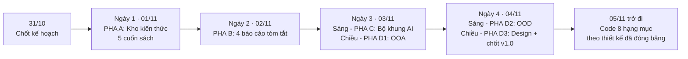

# 🗺️ KẾ HOẠCH 4 NGÀY (01/11 – 04/11/2026): KHO KIẾN THỨC → BÁO CÁO SÁCH → BỘ KHUNG AI → THIẾT KẾ OOA/OOD

> **Quyết định ngày 31/10/2026**: Trước khi code tiếp 8 hạng mục mở rộng, nhóm dành **4 ngày** (01/11 → 04/11) để dựng nền tri thức và thiết kế. Từ **05/11** mới quay lại code, và **code theo đúng thiết kế đã chốt** (không code theo cảm tính nữa).
>
> **Nguyên tắc cốt lõi**: Khối lượng này là **hàng chục prompt**, không thể làm trong 1 lần. Mỗi prompt chỉ làm **1 việc nhỏ → ra 1 file → được người phụ trách duyệt → commit**, rồi mới sang prompt kế tiếp.

---

## 1. BỨC TRANH TỔNG THỂ



| Pha | Ngày | Sản phẩm đầu ra | Phụ thuộc vào |
| :-: | :-: | :--- | :--- |
| **A** | 01/11 | **Kho kiến thức** rành mạch cho cả nhóm (mục lục + thẻ kiến thức từng chương của 5 cuốn) | — |
| **B** | 02/11 | **4 báo cáo tóm tắt** (Larman · Nystrom · Glazer & Madhav · Fowler + Vernon) | Pha A |
| **C** | 03/11 sáng | **Bộ khung thống nhất cho AI** (luật dự án, mẫu prompt, mẫu tài liệu, quy ước code/test) | Pha A, B |
| **D1** | 03/11 chiều | **OOA**: danh mục chức năng, Use Case, Domain Model, SSD, Contract | Pha C |
| **D2** | 04/11 sáng | **OOD**: kiến trúc, Sequence, DCD, FSM, giao thức mạng, ánh xạ GRASP/GoF | D1 |
| **D3** | 04/11 chiều | **Design chi tiết**: wireframe, bảng số liệu, kế hoạch test, ma trận truy vết, **đóng băng v1.0** | D2 |

> 📚 **5 cuốn sách**: Larman (*Applying UML and Patterns*) · Nystrom (*Game Programming Patterns*) · Glazer & Madhav (*Multiplayer Game Programming*) · Fowler (*PoEAA*) · Vernon (*Implementing DDD*).
> **4 báo cáo** vì Fowler + Vernon gộp chung 1 báo cáo (cùng chủ đề kiến trúc doanh nghiệp / miền nghiệp vụ).

---

## 2. QUY TẮC CHẠY PROMPT (ĐỂ KHÔNG BỊ LOẠN)

1. **1 prompt = 1 việc = 1 file đầu ra.** Không gộp nhiều việc vào một prompt.
2. **Sách dài thì chia nhỏ**: tối đa **~5 chương/prompt** (ước tính: Larman 38 chương ≈ 8 prompt, Nystrom 21 ≈ 5, Glazer & Madhav 14 ≈ 3, Fowler ≈ 6 theo nhóm pattern, Vernon ≈ 3).
3. **Mỗi prompt ghi rõ 4 thứ**: Đầu vào (đọc file nào) · Đầu ra (ghi file nào) · Ràng buộc · Tiêu chí xong (DoD).
4. **Cổng chất lượng (Gate)**: người phụ trách **đọc lại và duyệt** đầu ra trước khi chạy prompt kế tiếp. AI sinh sai thì sửa ngay, không dồn lại.
5. **Không bịa trích dẫn**: mọi nội dung lấy từ sách phải gắn **mã thẻ kiến thức** (vd `LAR-07-02`) hoặc số trang; không chắc thì ghi `[CẦN KIỂM TRA]`.
6. **Commit sau mỗi cụm prompt**: `docs(<pha>): <MÃ PROMPT> <nội dung>` (vd `docs(kb): KT-04 nystrom chapters 1-5`).
7. **Bản quyền**: file PDF và bản bóc tách nguyên văn nằm trong `_Archive_CaNhan/` (đã `.gitignore`, **không đẩy lên GitHub**). Chỉ commit **thẻ kiến thức do nhóm tự tóm tắt**, không dán nguyên văn sách.
8. **Chạy song song**: các prompt của từng người (mỗi người một cuốn / một cụm UC) chạy song song được; các prompt "chốt" (KT-09, BC-08, AI-08, DES-05) chỉ chạy khi mọi phần trước đã duyệt.

**Mẫu prompt chuẩn** (sẽ được chốt chính thức ở AI-03):

```text
VAI TRÒ: <AI đóng vai gì>
BỐI CẢNH: <đọc .agent/rules/project-guide.md + file nào>
NHIỆM VỤ: <đúng 1 việc>
RÀNG BUỘC: <không bịa trang, theo template nào, không đụng file nào>
ĐẦU RA: <đường dẫn file duy nhất>
TIÊU CHÍ XONG: <checklist kiểm được>
```

---

## 3. NGÀY 1 (01/11) — PHA A: KHO KIẾN THỨC

**Mục tiêu**: Cả nhóm tra cứu được "chương nào nói gì, dùng vào đâu" mà không phải mở lại PDF.
**Kho nguồn sẵn có (cục bộ)**: `_Archive_CaNhan/00_Raw_PDF/_Knowledge_Base_{Larman, Nystrom, Glazer_Madhav, Fowler, Vernon}/`.
**Kho đầu ra (đẩy GitHub)**: `Docs_BaoCao/4_KhoKienThuc/<Sach>/` — mỗi chương 1 file thẻ kiến thức.

**Khuôn thẻ kiến thức** (mỗi chương): `Mã thẻ` · `Tên chương/trang` · `Ý chính (≤10 dòng)` · `Khái niệm/Pattern` · `Khi nào dùng` · `Liên hệ với dự án game` · `Thuật ngữ`.

| Mã | Việc cần làm (1 prompt = 1 dòng) | Đầu ra | Phụ trách |
| :-: | :--- | :--- | :-: |
| **KT-01** | Chốt cấu trúc kho, quy ước mã thẻ (`LAR-07-02`), front-matter chuẩn | `4_KhoKienThuc/README.md` | Nam |
| **KT-02** | Kiểm kê phần đã bóc tách sẵn của 5 sách: đủ chương chưa, lỗi font/dấu không → bảng độ phủ | `4_KhoKienThuc/00_DoPhu.md` | Nam |
| **KT-03a…h** | **Larman** (38 chương, ~8 prompt): mục lục + thẻ từng chương. *Ưu tiên trước*: UP, Use Case, Domain Model, SSD, Contract, GRASP, GoF | `4_KhoKienThuc/Larman/` | Kiên |
| **KT-04a…e** | **Nystrom** (21 chương, ~5 prompt). *Ưu tiên*: Game Loop, State, Command, Component, Observer, Spatial Partition, Double Buffer | `4_KhoKienThuc/Nystrom/` | Anh |
| **KT-05a…c** | **Glazer & Madhav** (14 chương, ~3 prompt). *Ưu tiên*: kiến trúc client-server, snapshot, LERP, độ trễ, đồng bộ trạng thái | `4_KhoKienThuc/GlazerMadhav/` | Huy |
| **KT-06a…f** | **Fowler PoEAA** (~6 prompt theo nhóm pattern: Domain Logic, Data Source, OR, Presentation, Distribution…) | `4_KhoKienThuc/Fowler/` | Hoàng |
| **KT-07a…c** | **Vernon IDDD** (~3 prompt): Entity, Value Object, Aggregate, Repository, Domain Event | `4_KhoKienThuc/Vernon/` | Hoàng (Nam duyệt) |
| **KT-08** | Từ điển thuật ngữ + **bản đồ khái niệm chéo** (GRASP ↔ GoF ↔ PoEAA ↔ DDD ↔ game patterns) | `4_KhoKienThuc/99_TuDien_va_BanDoKhaiNiem.md` | Nam |
| **KT-09** | Kiểm tra độ phủ (mọi chương có thẻ, mọi thẻ có mã) và **chốt kho v1.0** | `4_KhoKienThuc/00_DoPhu.md` (cập nhật) | Cả nhóm |

**Xong Ngày 1 khi**: `00_DoPhu.md` báo 5/5 sách đủ thẻ; ít nhất các chương *Ưu tiên* đã có thẻ hoàn chỉnh.
**Nếu trễ**: chỉ giữ các chương *Ưu tiên*; chương còn lại để dạng mục lục, bổ sung sau — **không** để chặn Pha B.

---

## 4. NGÀY 2 (02/11) — PHA B: 4 BÁO CÁO TÓM TẮT

**Mục tiêu**: Mỗi cuốn một báo cáo ngắn, đọc 10 phút hiểu được sách này **giúp gì cho dự án**.
**Đầu vào**: Chỉ dùng thẻ kiến thức ở Pha A (không đọc lại PDF) → báo cáo luôn khớp kho.

| Mã | Việc cần làm | Đầu ra | Phụ trách |
| :-: | :--- | :--- | :-: |
| **BC-01** | Template báo cáo cố định: *Tóm tắt 1 trang · Khái niệm cốt lõi · Pattern/nguyên lý · Áp dụng vào game · Checklist khi code · Trích dẫn (mã thẻ)* | `4_KhoKienThuc/_Template_BaoCao.md` | Nam |
| **BC-02a/b/c** | **Báo cáo Larman**: (a) UP & UML · (b) OOA/OOD & GRASP · (c) GoF & tiến hóa thiết kế | `Docs_BaoCao/5_BaoCaoTomTat/01_Larman.md` | Kiên |
| **BC-03a/b** | **Báo cáo Nystrom**: (a) mẫu thiết kế hành vi/khởi tạo · (b) mẫu tối ưu & vòng lặp | `5_BaoCaoTomTat/02_Nystrom.md` | Anh |
| **BC-04a/b** | **Báo cáo Glazer & Madhav**: (a) kiến trúc mạng & giao thức · (b) đồng bộ, độ trễ, chống gian lận | `5_BaoCaoTomTat/03_GlazerMadhav.md` | Huy |
| **BC-05a/b** | **Báo cáo Fowler + Vernon** (gộp): (a) PoEAA · (b) DDD, rồi đối chiếu hai bên | `5_BaoCaoTomTat/04_Fowler_Vernon.md` | Hoàng |
| **BC-06** | **Ma trận "Sách → Hạng mục → Package"**: mỗi hạng mục trong 9 hạng mục dựa vào chương nào | `5_BaoCaoTomTat/05_MaTran_Sach_HangMuc.md` | Nam |
| **BC-07** | **Review chéo**: mỗi người duyệt 1 báo cáo của người khác, kiểm tra mã thẻ/trang | ghi chú review trong từng file | Cả nhóm |
| **BC-08** | Chốt v1.0, gắn vào Chương 7 báo cáo chính thức | cập nhật `Chuong_07_TaiLieuThamKhao.md` | Nam |

**Xong Ngày 2 khi**: 4 báo cáo + ma trận có mặt, đã qua review chéo, không còn `[CẦN KIỂM TRA]` chưa xử lý.

---

## 5. NGÀY 3 SÁNG (03/11) — PHA C: BỘ KHUNG THỐNG NHẤT CHO AI

**Mục tiêu**: 5 người dùng AI theo **cùng một luật** → thiết kế/code của mọi người ghép khớp, không mỗi người một kiểu.
**Nền có sẵn**: `.agent/rules/project-guide.md` (kiến trúc, lệnh build, quy ước hiện tại) → **mở rộng, không viết lại từ đầu**.

| Mã | Việc cần làm | Đầu ra | Phụ trách |
| :-: | :--- | :--- | :-: |
| **AI-01** | **Hiến chương dự án**: kiến trúc phân tầng, thuật ngữ thống nhất, điều cấm (vd: không `import java.awt.*` vào `core/combat/network/server/persistence`), ngôn ngữ trả lời | `.agent/rules/project-guide.md` (mở rộng) | Nam |
| **AI-02** | **Luật truy xuất kiến thức**: AI phải trích mã thẻ, không bịa trang; cách trỏ vào `4_KhoKienThuc/` | `.agent/rules/knowledge-rules.md` | Nam |
| **AI-03** | **Mẫu prompt chuẩn + Thư viện prompt** theo loại: OOA · OOD · code · test · báo cáo | `Docs_BaoCao/6_BoKhungAI/01_ThuVienPrompt.md` | Nam + Kiên |
| **AI-04** | **Bộ template tài liệu thiết kế**: Use Case fully dressed, SSD, Operation Contract, DCD, Sequence (Mermaid), State Machine | `6_BoKhungAI/templates/` | Kiên |
| **AI-05** | **Quy ước code & test**: đặt tên, package, cách thêm test cho mỗi hạng mục (nối tiếp bộ 15/15 hiện có) | `6_BoKhungAI/02_QuyUoc_Code_Test.md` | Hoàng |
| **AI-06** | **Quy trình Git + AI**: nhánh theo người, commit message, checklist trước khi gộp `main` (nối với `03_HuongDan_Git_Nhom.md`) | `6_BoKhungAI/03_QuyTrinh_Git_AI.md` | Nam |
| **AI-07** | **Chạy thử (pilot)** bộ khung trên **1 chức năng nhỏ** (đề xuất: *Sảnh chờ*) từ Use Case đến DCD, ghi lại chỗ khung bị thiếu/mâu thuẫn | `6_BoKhungAI/04_KetQua_Pilot.md` | Huy |
| **AI-08** | Sửa bộ khung theo kết quả pilot và **chốt v1.0** | cập nhật các file AI-01…06 | Nam |

**Xong buổi sáng khi**: pilot chạy trơn từ UC → DCD mà không phải "giải thích thêm bằng miệng".

---

## 6. NGÀY 3 CHIỀU → NGÀY 4 (03/11 – 04/11) — PHA D: THIẾT KẾ OOA → OOD → DESIGN

**Mục tiêu**: Thiết kế **gần như toàn bộ chức năng** của dự án (phần đã có + 9 hạng mục mở rộng) để từ 05/11 code là "dịch thiết kế ra Java".
**Thư mục đầu ra**: `Docs_BaoCao/7_ThietKe/{OOA, OOD, Design}/`. Mọi tài liệu dùng template ở AI-04 và trích thẻ kiến thức.

### 6.1. D1 — OOA (03/11 chiều)

| Mã | Việc cần làm | Phụ trách |
| :-: | :--- | :-: |
| **OOA-01** | **Kiểm kê chức năng**: cái đã có + 9 hạng mục; gán độ ưu tiên **P1/P2/P3** và quan hệ phụ thuộc | Nam + Kiên |
| **OOA-02** | Sơ đồ Use Case tổng + **Use Case brief** cho toàn bộ chức năng | Kiên |
| **OOA-03** | **Fully dressed** cho UC ưu tiên, mỗi người một cụm: Sảnh chờ & Vòng bo (Huy) · Map & Mobs (Hoàng) · Hệ nhân vật & Bot (Kiên) · Đồ họa 2.5D (Anh) · Core/Điều khiển (Nam) | Từng người |
| **OOA-04** | **Domain Model v2** (khái niệm thế giới thật, chưa có method) | Nam |
| **OOA-05** | **SSD + Operation Contract** cho các thao tác hệ thống chính | Huy (lobby/mạng) · Kiên (chiến đấu) |
| **OOA-06** | **Supplementary Spec (FURPS+)**: 60 FPS, server 20 Hz, độ trễ, số người, bản đồ 66.000 px | Hoàng |

### 6.2. D2 — OOD (04/11 sáng)

| Mã | Việc cần làm | Phụ trách |
| :-: | :--- | :-: |
| **OOD-01** | **Kiến trúc logic & bản đồ package v2** (lớp nào thuộc tầng nào) | Nam |
| **OOD-02** | **Sơ đồ tương tác (Sequence)** cho từng UC, chỉ rõ GRASP (Controller, Expert, Creator…) | Từng người |
| **OOD-03** | **DCD v2** từng cụm, sau đó Nam hợp nhất để không trùng/lệch tên lớp | Từng người → Nam |
| **OOD-04** | **State Machine**: FSM nhân vật, luồng Sảnh chờ → Trận → Kết thúc, trạng thái Vòng bo | Nam · Huy |
| **OOD-05** | **Thiết kế giao thức mạng**: gói tin, snapshot, đồng bộ Mobs/Bot, relay 4G | Huy |
| **OOD-06** | **Thiết kế dữ liệu & cấu hình** (6 Mobs, 4 hệ nhân vật, vòng bo) theo Fowler/DDD | Hoàng |
| **OOD-07** | **Bảng ánh xạ GoF/GRASP → lớp** (mẫu đã chọn + lý do + sách nào) | Kiên |
| **OOD-08** | **Thiết kế pipeline render 2.5D**: Z-Sorting, culling, sprite/mobs | Anh |

### 6.3. D3 — DESIGN CHI TIẾT & CHỐT (04/11 chiều)

| Mã | Việc cần làm | Phụ trách |
| :-: | :--- | :-: |
| **DES-01** | **Luồng màn hình & wireframe**: Sảnh chờ, chọn Tướng/Team/Bot, HUD, minimap, vòng bo | Anh + Huy |
| **DES-02** | **Bảng số liệu thiết kế**: chỉ số 4 hệ nhân vật, 6 Mobs, thông số vòng bo | Kiên + Hoàng |
| **DES-03** | **Kế hoạch test & tiêu chí nghiệm thu** cho từng hạng mục | Hoàng |
| **DES-04** | **Ma trận truy vết**: Yêu cầu → UC → Lớp → Test | Nam |
| **DES-05** | **Review toàn bộ, đóng băng thiết kế v1.0**, chia task code cho từng người từ 05/11 | Cả nhóm |

**Xong Ngày 4 khi**: mỗi hạng mục có đủ chuỗi `UC → Sequence → DCD → Test nghiệm thu`; DES-05 đã ký duyệt.

---

## 7. RỦI RO & PHƯƠNG ÁN DỰ PHÒNG

| Rủi ro | Dấu hiệu | Cách xử lý |
| :--- | :--- | :--- |
| Pha A kéo dài vì sách quá dài | 18h ngày 01/11 vẫn chưa xong | Chỉ giữ các chương *Ưu tiên*, phần còn lại để mục lục, **không chặn** Pha B |
| AI tóm tắt sai/bịa trang | Báo cáo có trang không tồn tại | Luật AI-02 + review chéo BC-07; ghi `[CẦN KIỂM TRA]` |
| Mỗi người thiết kế một kiểu | DCD tên lớp lệch nhau | Dùng template AI-04 + Nam hợp nhất ở OOD-03 |
| Pha D quá nhiều so với 1,5 ngày | Hết 04/11 chưa kịp Design | **Làm theo thứ tự ưu tiên P1 → P2 → P3**; hạng mục P3 để dạng Use Case brief, bổ sung sau, **không** tụt tiến độ code P1 |
| Pilot AI-07 lộ lỗi lớn của bộ khung | Pilot phải giải thích thêm bằng miệng | Dành đủ AI-08 để sửa; chưa chốt khung thì chưa vào Pha D |

---

## 8. THEO DÕI TIẾN ĐỘ

Đánh dấu khi **đã duyệt + commit** (không phải khi AI vừa sinh xong):

* **Pha A (Kho kiến thức)**: ☑ KT-01 ☑ KT-02 ☑ KT-03 ☑ KT-04 ☑ KT-05 ☑ KT-06 ☑ KT-07 ☑ KT-08 ☑ KT-09 *(Hoàn thành 100%: Nystrom 10 đợt + Larman 38 chương + Khung 3 sách còn lại)*
* **Pha B (Bản gộp toàn văn)**: ☑ BC-01 ☑ BC-02 ☑ BC-03 ☑ BC-04 ☑ BC-05 ☑ BC-06 ☑ BC-07 ☑ BC-08 *(Hoàn thành 100%: Bản gộp FULL_Game_Programming_Patterns.md & FULL_Craig_Larman_Applying_UML_and_Patterns.md)*
* **Pha C**: ☐ AI-01 ☐ AI-02 ☐ AI-03 ☐ AI-04 ☐ AI-05 ☐ AI-06 ☐ AI-07 ☐ AI-08
* **Pha D1 (OOA)**: ☐ OOA-01 ☐ OOA-02 ☐ OOA-03 ☐ OOA-04 ☐ OOA-05 ☐ OOA-06
* **Pha D2 (OOD)**: ☐ OOD-01 ☐ OOD-02 ☐ OOD-03 ☐ OOD-04 ☐ OOD-05 ☐ OOD-06 ☐ OOD-07 ☐ OOD-08
* **Pha D3 (Design)**: ☐ DES-01 ☐ DES-02 ☐ DES-03 ☐ DES-04 ☐ DES-05

> Phân công trên là **đề xuất** theo sách/phân hệ mỗi người đang phụ trách (Kiên–Larman & Combat, Anh–Nystrom & Render, Huy–Glazer & Mạng, Hoàng–Fowler/Vernon & Dữ liệu/Test, Nam–Kiến trúc & tổng hợp). Nhóm có thể đổi người cho cân tải.
