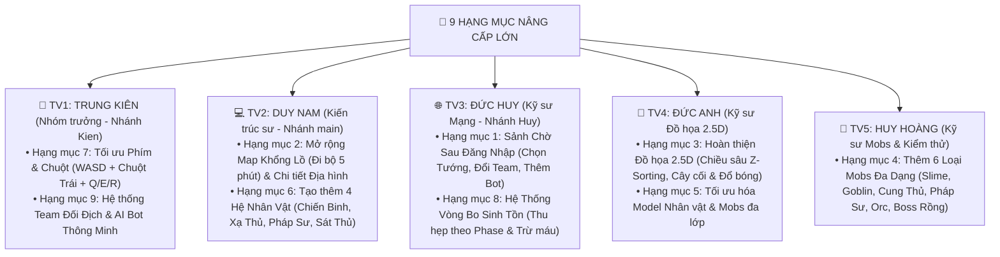

# 📋 KẾ HOẠCH CHI TIẾT PHÂN CÔNG 9 HẠNG MỤC NÂNG CẤP GAME (NHÓM 5 — HUCE OOP 2026)

> **Mục tiêu**: Phân chia 9 hạng mục nâng cấp cốt lõi cho 5 thành viên theo đúng kiến trúc **Clean Architecture & SOLID**, đảm bảo **không giẫm chân lên file của nhau (0% Merge Conflict)**, có đầy đủ hướng dẫn kỹ thuật, tên file Java cần tạo/sửa, và **câu lệnh mẫu (Prompt) để từng thành viên dán thẳng vào Antigravity thực hiện**.

---

## 🗺️ BẢNG TỔNG HỢP PHÂN CÔNG 9 CÔNG VIỆC CHO 5 THÀNH VIÊN



| Mã CV | Tên Công Việc (Theo đúng danh sách của Nhóm) | Thành Viên Phụ Trách | Nhánh Git | Phân Hệ Code (`Package`) | Độ Ưu Tiên |
| :---: | :--- | :--- | :---: | :--- | :---: |
| **CV-01** | **1. Thêm sảnh chờ sau đăng nhập** (Chọn tướng, chọn Team, thêm Bot, Ready) | **Đức Huy** | `Huy` | `Src_Game/UI/` & `Network/` | 🔥 Cao |
| **CV-02** | **2. Mở rộng Map cực lớn (đi bộ 5 phút)** & thêm chi tiết sông, rừng, đá, cỏ | **Duy Nam** | `main` | `Src_Game/Core/` & `Render/` | 🔥 Cao |
| **CV-03** | **3. Nâng cấp đồ họa từ 2D lên 2.5D** (Góc nghiêng, chiều cao Z, Z-Sorting) | **Đức Anh** *(+ Nam)* | `Anh` / `main` | `Src_Game/Render/` | ⭐ Trọng tâm |
| **CV-04** | **4. Thêm các loại Mobs khác nhau** (6 loại quái + đồng bộ lên cả Server Online) | **Huy Hoàng** *(+ Kiên)* | `Hoang` / `Kien` | `Src_Game/Core/` & `Server/` | 🔥 Cao |
| **CV-05** | **5. Tối ưu hóa Model Nhân vật và Mobs** (Vẽ đa lớp, hoạt ảnh thở & vung vũ khí) | **Đức Anh** | `Anh` / `main` | `Src_Game/Render/` | ⚡ Trung bình |
| **CV-06** | **6. Tạo thêm Nhân vật mới** (4 Hệ: Đấu Sĩ, Xạ Thủ, Pháp Sư, Sát Thủ) | **Duy Nam** | `main` | `Src_Game/Core/` & `Combat/` | 🔥 Cao |
| **CV-07** | **7. Tối ưu lại phím di chuyển và Skill** (Tay trái `WASD + Q/E/R/1/2/3`, Tay phải Chuột) | **Trung Kiên** *(Leader)* | `Kien` | `Src_Game/UI/GameCanvas.java` | 🚨 Cấp bách |
| **CV-08** | **8. Thêm Vòng Bo sinh tồn** (Thu hẹp dần trên Map & Minimap, đốt máu ngoài bo) | **Đức Huy** | `Huy` | `Src_Game/Core/` & `Server/` | ⭐ Trọng tâm |
| **CV-09** | **9. Thêm các Team đối địch & AI Bot** (Tự động bù Bot khi thiếu người, biết chạy bo & đánh nhau) | **Trung Kiên** *(Leader)* | `Kien` | `Src_Game/Core/` & `Combat/` | 🔥 Cao |

---

## 🛠️ CHI TIẾT KỸ THUẬT & HƯỚNG DẪN TỪNG THÀNH VIÊN

---

### 👑 PHẦN VIỆC 1: TRUNG KIÊN *(Nhóm trưởng — Nhánh `Kien`)*
**Phụ trách: Hạng mục 7 (Tối ưu điều khiển Phím + Chuột) & Hạng mục 9 (Hệ thống Team Đối Địch + AI Bot)**

#### 1.1. Hạng mục 7 — Tối ưu hóa cụm phím Di chuyển & Kỹ năng (`Src_Game/UI/GameCanvas.java`)
* **Vấn đề hiện tại**: Người chơi phải dùng 2 nửa bàn phím (`WASD` bên trái + `J/U/I/O` bên phải) đồng thời lại phải dùng Chuột để kéo thả ngắm chiêu $\rightarrow$ Rất mỏi tay và khó thao tác.
* **Thiết kế mới chuẩn MOBA / ARPG trên PC (1 Tay Trái Bàn Phím + 1 Tay Phải Cầm Chuột)**:
  * **Tay Trái (Đặt cố định 1 chỗ bên trái bàn phím)**:
    * `W, A, S, D`: Di chuyển 8 hướng.
    * `Q, E, R` *(hoặc `1, 2, 3`)*: Kích hoạt nhanh Chiêu 1, Chiêu 2, Chiêu 3 (**Quick-Cast**: Tự động lấy hướng từ nhân vật tới vị trí con trỏ chuột hiện tại! Nhấn giữ để xem vòng ngắm 2.5D, thả phím là tung chiêu ngay hướng con trỏ chuột mà không cần kéo từ đáy màn hình).
    * `SPACE`: Đánh thường nhanh.
  * **Tay Phải (Đặt trên Chuột 100% thời gian)**:
    * **Chuột Trái (`Left Click`)**: Đánh thường trực tiếp về phía con trỏ chuột!
    * **Di chuyển Chuột**: Tự động xoay hướng mặt nhân vật và cập nhật tọa độ tâm ngắm chiêu thức theo thời gian thực.
    * **Chuột Phải (`Right Click`)**: Hủy ngắm chiêu.

#### 1.2. Hạng mục 9 — Hệ thống Team Đối Địch & AI Bot Thông Minh (`Src_Game/Core/BotController.java`)
* **Yêu cầu kỹ thuật**:
  * Thêm thuộc tính `teamId` (`1 = Team Xanh`, `2 = Team Đỏ`, `3 = Team Vàng`, `0 = Quái tự nhiên`) vào [`LivingEntity.java`](file:///E:/UML-Patterns-Mastery/Src_Game/Core/LivingEntity.java). Các thực thể khác `teamId` có thể tấn công và gây sát thương bằng cả Đánh thường lẫn 3 Kỹ năng lên nhau!
  * Tạo lớp `Src_Game/Core/HeroBotAI.java` điều khiển các nhân vật máy (**AI Bots**) khi phòng chơi không đủ người:
    * **Trạng thái 1 (`STAY_IN_SAFE_ZONE`)**: Nếu Bot đang ở ngoài Vòng Bo $\rightarrow$ Tự động chạy hướng về tâm Vòng Bo.
    * **Trạng thái 2 (`COMBAT_ENEMY_TEAM`)**: Nếu phát hiện người chơi hoặc Bot thuộc Team địch trong tầm `350px` $\rightarrow$ Tự động lao vào tung Chiêu 1 (`⚡ Xung Kích`), Chiêu 2 (`🔥 Vòng Xoáy Lửa`), Chiêu 3 (`☄️ Thiên Phạt`) và đánh thường.
    * **Trạng thái 3 (`FARM_MOBS`)**: Khi chưa gặp địch $\rightarrow$ Tự động tìm đánh Mobs gần nhất.

> 💬 **Câu lệnh (Prompt) để Kiên copy dán vào Antigravity trên máy Kiên**:
> ```text
> Hãy chuyển sang nhánh Kien, kéo code mới nhất về và thực hiện 2 hạng mục của Nhóm trưởng trong kế hoạch 04_KeHoach_PhanCong_9_HangMuc.md:
> 1. Hạng mục 7: Nâng cấp điều khiển trong GameCanvas.java để tay trái dùng WASD + Q/E/R (hoặc 1/2/3) ngắm nhanh theo vị trí con trỏ chuột, còn Chuột Trái dùng để đánh thường trực tiếp theo hướng chuột (không cần dùng nửa phải bàn phím J/U/I/O nữa).
> 2. Hạng mục 9: Thêm teamId vào LivingEntity/Player và tạo lớp HeroBotAI để sinh ra các Team đối địch (AI Bots biết tự chạy vào vòng bo, tự đánh quái và tự tung 3 skill đánh nhau với người chơi).
> ```

---

### 💻 PHẦN VIỆC 2: DUY NAM *(Kiến trúc sư — Nhánh `main`)*
**Phụ trách: Hạng mục 2 (Mở rộng Bản đồ 5 phút đi bộ + Chi tiết địa hình) & Hạng mục 6 (Tạo 4 Hệ Nhân Vật)**

#### 2.1. Hạng mục 2 — Mở rộng Bản đồ Lớn & Chi tiết Địa hình Sinh thái (`GameWorld.java` & `Arena3DSceneRenderer.java`)
* **Tính toán kích thước Map**:
  * Tốc độ đi bộ của nhân vật là `220 px/giây`. Để đi bộ một mạch từ đầu này sang đầu kia mất **5 phút ($300\text{ giây}$)**:
    $$\text{Chiều dài bản đồ} = 220 \times 300 = 66,000\text{ px}$$
  * Cập nhật `WORLD_WIDTH = 66000.0` và `WORLD_HEIGHT = 66000.0` (hoặc tùy chọn Map Nhỏ / Map Khổng Lồ `66,000 x 66,000` kèm Minimap phóng thu).
* **Kỹ thuật Tối ưu OOP (Procedural Biome & View Frustum Culling — Không tốn RAM)**:
  * Chia bản đồ thành **5 Quần xã sinh thái (Biomes)**: *Thảo Nguyên Tân Thủ*, *Rừng Cổ Thụ*, *Sa Mạc Cổ Ngữ*, *Đầm Lầy Bóng Đêm*, và *Đấu Trường Trung Tâm*.
  * Dùng hàm băm tọa độ tất định (`Deterministic Spatial Hash`) để rải hàng nghìn **Cây cổ thụ 2.5D, Tảng đá rêu phong, Bụi cỏ, Dòng sông, Trụ di tích** trên toàn bản đồ mà chỉ cần vẽ đúng các vật thể nằm trong khung nhìn Camera (`View Frustum Culling`), giữ tốc độ luôn đạt **60 FPS tuyệt đối**!

#### 2.2. Hạng mục 6 — Tạo thêm 4 Hệ Nhân Vật (`Src_Game/Core/HeroClassType.java`)
* Tạo Enum / Factory `HeroClassType` với 4 lớp nhân vật có chỉ số, màu sắc giáp trụ, vũ khí và hiệu ứng đòn đánh riêng:
  1. 🛡️ **Đấu Sĩ Kiếm Thánh (`WARRIOR`)**: Máu `150`, Giáp `12`, Sát thương `25`, Tốc chạy `220` (Cận chiến bền bỉ).
  2. 🏹 **Xạ Thủ Tinh Linh (`RANGER`)**: Máu `100`, Giáp `6`, Sát thương `32`, Tốc chạy `250`, Tầm đánh thường xa `220px` (Bắn tên năng lượng).
  3. 🔮 **Pháp Sư Nguyên Tố (`MAGE`)**: Máu `95`, Giáp `5`, Sát thương phép `40`, Thời gian hồi 3 chiêu giảm `30%` (Chưởng phép diện rộng).
  4. 🗡️ **Sát Thủ Bóng Đêm (`ASSASSIN`)**: Máu `105`, Giáp `7`, Sát thương chí mạng `45`, Tốc chạy siêu thanh `275` (Cơ động áp sát).

> 💬 **Câu lệnh (Prompt) để Nam gõ vào Antigravity**:
> ```text
> Hãy thực hiện Hạng mục 2 (Mở rộng Map lên quy mô đi bộ 5 phút 66000x66000 với kỹ thuật View Frustum Culling 60 FPS, thêm cây cối, đá tảng, sông suối, quần xã sinh thái 2.5D) và Hạng mục 6 (Tạo 4 Hệ Nhân vật: Đấu Sĩ, Xạ Thủ, Pháp Sư, Sát Thủ trong HeroClassType.java).
> ```

---

### 🌐 PHẦN VIỆC 3: NGUYỄN ĐỨC HUY *(Kỹ sư Mạng — Nhánh `Huy`)*
**Phụ trách: Hạng mục 1 (Sảnh chờ sau đăng nhập) & Hạng mục 8 (Hệ thống Vòng Bo Sinh Tồn)**

#### 3.1. Hạng mục 1 — Sảnh Chờ Sau Đăng Nhập (`Src_Game/UI/WaitingRoomPanel.java`)
* **Luồng màn hình mới**:
  `Đăng nhập tên` $\rightarrow$ **`Sảnh Chờ Chiến Trường (WaitingRoomPanel)`** $\rightarrow$ `Vào Trận Đấu 2.5D`.
* **Các chức năng trên Sảnh Chờ**:
  1. Chọn **Hệ Nhân Vật** (Đấu Sĩ / Xạ Thủ / Pháp Sư / Sát Thủ) kèm xem trước chỉ số (HP, Sát thương, Tốc chạy, Kỹ năng).
  2. Chọn **Phe / Team** (`Team Xanh` vs `Team Đỏ` vs `Team Vàng`).
  3. Chọn **Số lượng AI Bot** (Ví dụ: Bấm nút `+ Thêm Bot` để lấp đầy đủ 4v4 hoặc 10 người trong trận).
  4. Hiển thị **Mã Phòng (`ARENA-X-Y`)** và danh sách người chơi đã vào phòng theo thời gian thực + Nút **`⚔️ BẮT ĐẦU TRẬN ĐẤU`**.

#### 3.2. Hạng mục 8 — Hệ Thống Vòng Bo Sinh Tồn (`Src_Game/Core/SafeZoneSystem.java`)
* **Cơ chế hoạt động (Chuẩn Battle Royale / Arena Survival)**:
  * Khởi tạo vòng tròn an toàn bao trùm bản đồ với tâm $(C_x, C_y)$ và bán kính $R_{\text{current}}$.
  * Qua mỗi đợt (Phase 1 $\rightarrow$ Phase 5, mỗi Phase 45 giây), vòng bo thu hẹp dần bán kính về tâm mới kèm thông báo đếm ngược trên đỉnh màn hình (`⚠️ VÒNG BO ĐANG THU HẸP TRONG 15 GIÂY!`).
  * **Xử lý sát thương ngoài bo**: Mỗi `1.0 giây`, mọi người chơi hoặc Bot có khoảng cách tới tâm bo $\sqrt{(x - C_x)^2 + (y - C_y)^2} > R_{\text{current}}$ sẽ bị trừ máu theo phần trăm (`5 -> 15 HP/giây`) và hiện cảnh báo viền tím/đỏ trên màn hình.
  * Vẽ đường viền Vòng Bo 2.5D phát sáng trên mặt đất và vòng tròn trắng/xanh trên **Minimap Radar**.

> 💬 **Câu lệnh (Prompt) để Huy copy dán vào Antigravity trên máy Huy**:
> ```text
> Hãy chuyển sang nhánh Huy, kéo code mới nhất về và thực hiện 2 hạng mục của Đức Huy trong kế hoạch 04_KeHoach_PhanCong_9_HangMuc.md:
> 1. Hạng mục 1: Tạo màn hình Sảnh Chờ Sau Đăng Nhập (WaitingRoomPanel.java) cho phép chọn Hệ Tướng, chọn Team, chỉnh số lượng Bot và xem danh sách người chơi trước khi bấm Bắt Đầu.
> 2. Hạng mục 8: Xây dựng hệ thống Vòng Bo Sinh Tồn (SafeZoneSystem.java) thu hẹp theo từng giai đoạn, đốt máu người chơi đứng ngoài bo, hiển thị vòng bo trên mặt đất 2.5D và trên Minimap.
> ```

---

### 🎨 PHẦN VIỆC 4: ĐỨC ANH *(Kỹ sư Đồ họa 2.5D — Nhánh `Anh` / `main`)*
**Phụ trách: Hạng mục 3 (Đồ họa 2.5D) & Hạng mục 5 (Tối ưu hóa Model Nhân vật và Mobs)**

* **Hạng mục 3 (Nâng cấp 2D lên 2.5D)**:
  * Tinh chỉnh góc nghiêng `Camera2D` (`pitchTilt = 0.70`), thêm hiệu ứng chiều cao $Z$ cho cây cối, đá tảng, trụ tháp và hệ thống sắp xếp độ sâu **Z-Ordering (`Painter's Algorithm`)** để nhân vật đi sau cây/trụ sẽ bị che khuất tự nhiên.
* **Hạng mục 5 (Tối ưu Model Nhân vật & Mobs)**:
  * Nâng cấp [`LpcCanvasRenderer.java`](file:///E:/UML-Patterns-Mastery/Src_Game/Render/LpcCanvasRenderer.java): Vẽ chi tiết áo choàng bay theo hướng di chuyển, hiệu ứng nhấp nhô thở khi đứng yên (`Idle Breathing`), phân biệt rõ vũ khí của 4 hệ tướng (Kiếm đại đao, Cung tên phát sáng, Trượng phép thuật, Song đao sát thủ) và hoạt ảnh riêng cho từng loại Mobs.

---

### 🧪 PHẦN VIỆC 5: HUY HOÀNG *(Kỹ sư Mobs & QA — Nhánh `Hoang` / `main`)*
**Phụ trách: Hạng mục 4 (Thêm 6 loại Mobs khác nhau & Kiểm thử)**

* **Hạng mục 4 — Đa dạng hóa các loại Mobs (`Monster.java`, `DedicatedGameServer.java`, `LpcCanvasRenderer.java`)**:
  * Khắc phục triệt để việc chế độ Online trước đây chỉ hiện 1 loại quái duy nhất: Đồng bộ `MonsterType` vào gói tin mạng [`WorldSnapshotPayload.java`](file:///E:/UML-Patterns-Mastery/Src_Game/Network/WorldSnapshotPayload.java).
  * Mở rộng `MonsterType` thành **6 chủng loại Mobs** có máu, tốc chạy, sát thương và hình dáng 2.5D hoàn toàn khác nhau:
    1. 🟢 **`SLIME`** (*Slime Ngọc Bích* — Máu `45`, di chuyển nhảy tưng tưng).
    2. 🗡️ **`GOBLIN`** (*Goblin Trinh Sát* — Máu `65`, tốc chạy rất nhanh `140`, cầm dao găm).
    3. 🏹 **`SKELETON_ARCHER`** (*Bộ Xương Cung Thủ* — Máu `80`, tấn công tầm xa).
    4. 🔮 **`DARK_MAGE`** (*Pháp Sư Hắc Ám* — Máu `95`, lơ lửng trên mặt đất $Z = 12\text{px}$, phát hào quang tím).
    5. 🪓 **`ORC_WARRIOR`** (*Chiến Binh Orc Giáp Sắt* — Máu `160`, giáp dày, cầm rìu chiến khổng lồ).
    6. 🐉 **`DRAGON_BOSS`** (*Hắc Long Thống Lĩnh* — Boss khủng máu `600`, kích thước gấp đôi, có đôi cánh 2.5D và vương miện lửa).

---

## 🔄 QUY TRÌNH GHÉP CODE (INTEGRATION) CHO NHÓM TRƯỞNG KIÊN & DUY NAM
1. Mỗi thành viên làm xong hạng mục của mình thì mở **`QuanLy_DuAn.bat`** $\rightarrow$ Bấm phím **`[4]`** (Biên dịch kiểm tra) $\rightarrow$ Bấm phím **`[3]`** (Chạy Unit Test) $\rightarrow$ Bấm phím **`[7]`** (Đẩy lên nhánh cá nhân trên GitHub).
2. Khi các nhánh `Kien`, `Huy` đã đẩy lên xong, Nhóm trưởng **Kiên** hoặc **Nam** bấm phím **`[8]`** trong **`QuanLy_DuAn.bat`** để **Gộp (Merge)** tất cả vào nhánh chính `main` và đóng gói bản Release mới!
