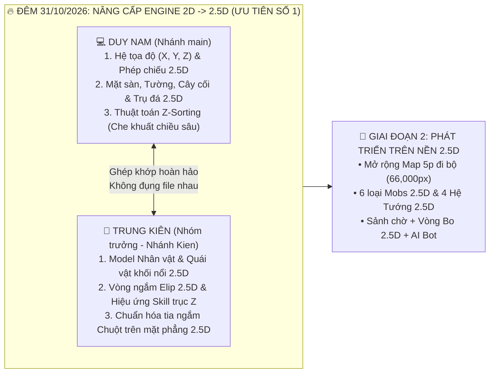

# 📋 KẾ HOẠCH TÁC CHIẾN: ƯU TIÊN SỐ 1 NÂNG CẤP 2D $\rightarrow$ 2.5D (ĐÊM 31/10) & LỘ TRÌNH 9 HẠNG MỤC

> **Quyết định Kiến trúc của Nhóm trưởng Trung Kiên (`KienEsto`) & Kiến trúc sư Duy Nam (`Tran1209`) — Đêm 31/10/2026**:
> Toàn bộ 8 hạng mục mở rộng (Sảnh chờ, Map lớn 5 phút đi bộ, 6 loại Mobs, 4 Hệ Nhân vật, Phím + Chuột, Vòng Bo, AI Bot) đều phụ thuộc trực tiếp vào **Hệ quy chiếu không gian 2.5D**.
> Vì vậy, **Nâng cấp Đồ họa & Engine từ 2D lên 2.5D là ƯU TIÊN SỐ 1 TUYỆT ĐỐI** được **Duy Nam và Trung Kiên** thực hiện dứt điểm ngay trong **Đêm nay (31/10/2026)** trước khi triển khai các hạng mục tiếp theo.

---

## 🔥 GIAI ĐOẠN 1 (ĐÊM NAY — 31/10/2026): CHIẾN DỊCH CỐT LÕI 2D $\rightarrow$ 2.5D (NAM & KIÊN)



### 1. Phân chia ranh giới File Đêm nay giữa **Duy Nam** và **Trung Kiên** (Cam kết 0% Xung đột Git)

| Thành viên | Nhánh làm việc | Các File Java Phụ trách Độc quyền | Nội dung Kỹ thuật 2.5D Cần Hoàn Thành Đêm Nay |
| :--- | :---: | :--- | :--- |
| **1. Duy Nam**<br>(`Tran1209`) | `main` | • `Src_Game/Render/Camera2D.java`<br>• `Src_Game/Render/Arena3DSceneRenderer.java`<br>• `Android_Game/.../AndroidGameRenderer.java` | **Tầng Không gian, Phép chiếu & Địa hình 2.5D**:<br>1. Xây dựng hệ trục $(X, Y, Z)$ với góc nghiêng chuẩn 2.5D MOBA ($\text{pitchTilt} = 0.72$, hội tụ xa-gần `getPerspectiveScale`).<br>2. Dựng Đài Đấu Trường nổi 2.5D có vách đá sâu $Z = -85\text{px}$, tường thành $Z = +46\text{px}$, 4 Trụ Tháp Cổ Đại 2.5D cao $Z = 92\text{px}$ có pha lê xoay và đổ bóng nghiêng.<br>3. Cài đặt **Z-Sorting (`Painter's Algorithm`)** sắp xếp thứ tự vẽ theo chiều sâu trục $Y$ để khi nhân vật đi ra phía sau trụ đá sẽ bị che khuất thật. |
| **2. Trung Kiên**<br>*(Nhóm trưởng)*<br>(`KienEsto`) | `Kien` | • `Src_Game/Render/LpcCanvasRenderer.java`<br>• `Src_Game/UI/DesktopHudRenderer.java`<br>• `Src_Game/UI/GameCanvas.java` *(phần Input & Vòng ngắm)* | **Tầng Model Nhân Vật 2.5D, Hiệu ứng Chiêu 2.5D & Điều khiển**:<br>1. Nâng cấp `LpcCanvasRenderer.java`: Vẽ Đế hào quang Elip 2.5D dưới chân tướng, bóng đổ 2.5D, tạo khối nổi cho Giáp/Đầu/Vũ khí và độ phóng đại xa-gần (`scale`).<br>2. Nâng cấp `DesktopHudRenderer.java`: Chiếu toàn bộ vòng tròn tầm chiêu và vòng nổ AoE thành **Elip nằm sát mặt đất nghiêng 2.5D** + **Cột sáng định vị thẳng đứng theo trục $Z$**.<br>3. Đồng bộ tia ngắm Chuột (`updateAimFromMouse` chia bù cho `camera.getPitchTilt()`) và hỗ trợ phím `WASD + Q/E/R + Chuột Trái` mượt mà trên mặt phẳng 2.5D. |

---

### 💬 Câu lệnh (Prompt) cho **Nhóm trưởng Kiên** dán vào Antigravity Đêm nay:
```text
Đêm nay tôi và Nam ưu tiên số 1 nâng cấp toàn diện game từ 2D lên 2.5D và viết nhật ký dự án.
Hãy chuyển máy tôi sang nhánh Kien, kéo code mới nhất từ origin/main về, đọc file Docs_BaoCao/1_QuanLy_Nhom_Va_NhatKy/04_KeHoach_PhanCong_9_HangMuc.md và thực hiện phần việc Đêm 31/10 của Nhóm trưởng Kiên:
1. Nâng cấp LpcCanvasRenderer.java để nhân vật và quái vật có chiều sâu 2.5D (đổ bóng nghiêng 2.5D, bệ đứng Elip 2.5D, hiệu ứng độ cao trục Z khi di chuyển và tung chiêu).
2. Nâng cấp DesktopHudRenderer.java và GameCanvas.java để vòng ngắm kỹ năng nằm phẳng theo góc nghiêng 2.5D và tối ưu thao tác phím WASD + Q/E/R + Chuột Trái đánh thường theo hướng chuột trên mặt phẳng 2.5D.
3. Ghi nhận chi tiết công việc nâng cấp 2.5D của Trung Kiên vào file 01_NhatKy_TienDo_Va_SuaLoi.md rồi đẩy lên nhánh Kien!
```

---

## 🚀 GIAI ĐOẠN 2 (CÁC NGÀY TIẾP THEO): TRIỂN KHAI 8 HẠNG MỤC MỞ RỘNG TRÊN NỀN 2.5D

Sau khi **Duy Nam** và **Trung Kiên** hoàn tất và gộp (`Merge`) nền tảng **Engine 2.5D** vào nhánh `main`, cả nhóm triển khai tiếp các hạng mục còn lại theo đúng thứ tự ưu tiên sau:

| Thứ tự Ưu tiên | Hạng mục Công việc (Chạy trên nền 2.5D) | Thành viên Phụ trách | Nhánh Git | Giải pháp Kỹ thuật trên nền 2.5D |
| :---: | :--- | :--- | :---: | :--- |
| **Ưu tiên 1**<br>*(Đêm 31/10)* | **Hạng mục 3 & 7: Nâng cấp Đồ họa 2D $\rightarrow$ 2.5D + Tối ưu Phím & Chuột 2.5D** | **Duy Nam & Trung Kiên** | `main` & `Kien` | Phép chiếu 2.5D $(X, Y, Z)$, Z-Sorting, Trụ 2.5D, Thiên thạch rơi theo trục $Z$, điều khiển `WASD + Q/E/R + Chuột` |
| **Ưu tiên 2** | **Hạng mục 2: Mở rộng Map 2.5D khổng lồ (đi bộ 5 phút = `66,000px`) & thêm chi tiết** | **Duy Nam** | `main` | 5 Quần xã sinh thái 2.5D (Cây cổ thụ 2.5D, Đá tảng 2.5D, Sông suối) + **View Frustum Culling** giữ 60 FPS |
| **Ưu tiên 3** | **Hạng mục 4 & 5: Thêm 6 loại Mobs 2.5D & Tối ưu Model** | **Huy Hoàng & Đức Anh** | `Hoang` / `Anh` | 6 chủng loại Mobs (*Slime, Goblin, Cung Thủ, Pháp Sư bay lơ lửng $Z=15$, Chiến Binh Orc, Boss Rồng 2.5D*) |
| **Ưu tiên 4** | **Hạng mục 6 & 9: Tạo 4 Hệ Nhân vật 2.5D + Team Đối Địch & AI Bot** | **Trung Kiên & Duy Nam** | `Kien` & `main` | 4 Class (*Đấu Sĩ, Xạ Thủ, Pháp Sư, Sát Thủ*) + `HeroBotAI` tự chạy bo và tung chiêu |
| **Ưu tiên 5** | **Hạng mục 1 & 8: Sảnh chờ sau đăng nhập + Vòng Bo 2.5D** | **Đức Huy** | `Huy` | `WaitingRoomPanel` chọn Tướng/Team/Bot + `SafeZoneSystem` vẽ cột sáng biên giới Vòng Bo 2.5D |
