# PHẦN III: THIẾT KẾ HƯỚNG ĐỐI TƯỢNG (OBJECT-ORIENTED DESIGN - OOD)

> **Môn học**: Lập trình Hướng đối tượng (OOP)  
> **Trường**: Đại học Xây dựng Hà Nội (HUCE) — Khoa Công nghệ Thông tin  
> **Nhóm sinh viên thực hiện**:  
> 1. **Nguyễn Hoài Nam** (Trưởng nhóm / Lead Architect) — *Phụ trách Core Architecture & FSM*  
> 2. **Trần Trung Kiên** — *Phụ trách Dedicated Server & Real-Time Netcode*  
> 3. **Phạm Quang Anh** — *Phụ trách Combat Engine, Physics & Collision*  
> 4. **Vũ Quang Huy** — *Phụ trách Client Rendering 60 FPS, HUD & Observer*  
> 5. **Bùi Minh Hoàng** — *Phụ trách Persistence, Data Mapper & QA/Benchmarking*  
> **Giáo trình tham chiếu chính**: Craig Larman, *Applying UML and Patterns*, 3rd Edition (Chương 16, 17, 25, 26)  
> **Mẫu thiết kế kinh điển**: Erich Gamma et al. (GoF), *Design Patterns: Elements of Reusable Object-Oriented Software*  
> **Mẫu thiết kế game**: Robert Nystrom, *Game Programming Patterns*

---

## 3.1. TỔNG QUAN QUY TRÌNH THIẾT KẾ HƯỚNG ĐỐI TƯỢNG (OOD)

### 3.1.1. Chuyển dịch từ Phân tích (OOA) sang Thiết kế (OOD)

Nếu như **Phân tích (OOA)** trả lời câu hỏi *"Hệ thống cần làm gì để giải quyết đúng bài toán thế giới thực?"* thì **Thiết kế (OOD)** trả lời câu hỏi:

$$\text{OOD: "Làm thế nào để phân bổ trách nhiệm vào các lớp phần mềm một cách tối ưu?"}$$

Quá trình chuyển dịch từ OOA sang OOD trong tiến trình Unified Process của Craig Larman bao gồm các bước chuyển hóa cụ thể:
1. **Từ Khái niệm sang Lớp Phần mềm**: Biến các lớp khái niệm trong Domain Model (vốn chỉ có thuộc tính) thành các lớp phần mềm (Software Classes) có đầy đủ thuộc tính, kiểu dữ liệu Java chuẩn, hàm khởi tạo (Constructors) và phương thức (Methods).
2. **Thiết kế Hướng Trách nhiệm (Responsibility-Driven Design - RDD)**: Sử dụng **9 nguyên lý GRASP** để suy luận khoa học: *Tại sao hàm này lại đặt ở Class A mà không đặt ở Class B?*
3. **Áp dụng các Mẫu Thiết kế (GoF & Game Design Patterns)**: Tái sử dụng các giải pháp kiến trúc đã được chứng minh để giải quyết các bài toán biến đổi phức tạp (tính sát thương đa hình, máy trạng thái, quan sát giao diện, bộ đệm nội suy).
4. **Xây dựng Biểu đồ Lớp Thiết kế Chi tiết (Design Class Diagram - DCD)**: Bản vẽ kỹ thuật hoàn chỉnh để lập trình viên chuyển dịch trực tiếp $1:1$ sang mã nguồn Java.

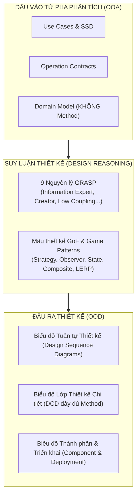

---

## 3.2. ÁP DỤNG 9 NGUYÊN LÝ PHÂN BỔ TRÁCH NHIỆM GRASP

*(Tham chiếu: Craig Larman — Chương 17: GRASP: Designing Objects with Responsibilities)*

Hệ thống GRASP (General Responsibility Assignment Software Patterns) của Craig Larman là la bàn định hướng cho mọi quyết định phân bổ hàm trong đồ án. Nhóm áp dụng đầy đủ 9 nguyên lý:

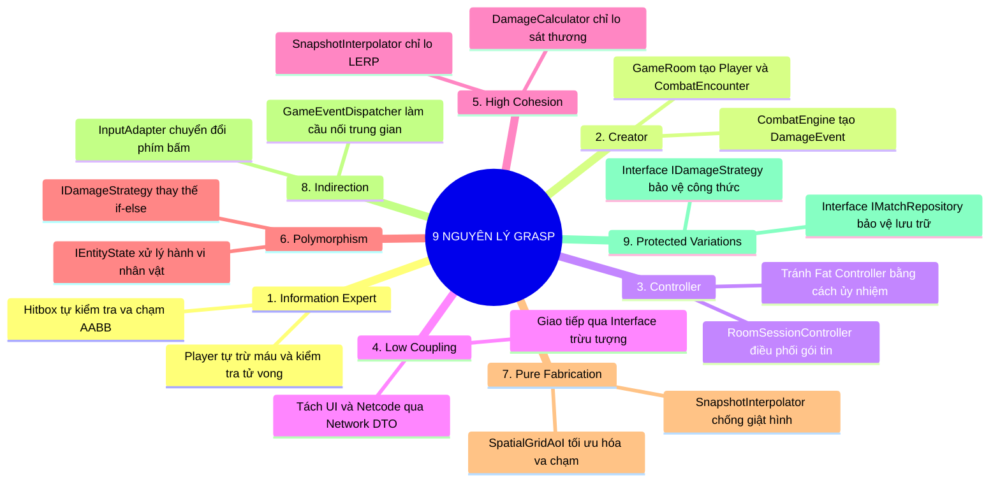

---

### 1. Information Expert (Chuyên gia Thông tin)
* **Nguyên tắc**: Gán trách nhiệm cho lớp sở hữu đầy đủ thông tin nhất để hoàn thành trách nhiệm đó.
* **Áp dụng trong Đồ án**:
  * **Trách nhiệm tính toán máu còn lại và phán quyết tử vong**: Lớp `LivingEntity` (và lớp con `Player`) nắm giữ `currentHp`, `maxHp` và trạng thái `isAlive`. Do đó, phương thức `takeDamage(int amount)` được đặt trực tiếp trong `LivingEntity`. Lớp bên ngoài không được can thiệp trừ máu tùy tiện mà phải gọi `player.takeDamage(finalDamage)`.
  * **Trách nhiệm kiểm tra va chạm hình học**: Lớp `Hitbox` nắm giữ tọa độ $(x, y)$, chiều rộng `width`, chiều cao `height`. Do đó, phương thức `intersects(Hitbox other)` phải do chính `Hitbox` sở hữu.

### 2. Creator (Người Khởi Tạo)
* **Nguyên tắc**: Lớp $B$ nên tạo thể hiện của lớp $A$ nếu $B$ chứa, tập hợp, ghi nhận hoặc sử dụng mật thiết $A$.
* **Áp dụng trong Đồ án**:
  * `GameRoom` chứa danh sách các `Player` trong phòng $\longrightarrow$ `GameRoom` chịu trách nhiệm khởi tạo `Player` thông qua phương thức `spawnPlayer(PlayerId id, String name)`.
  * `CombatEngine` ghi nhận các va chạm giữa các đòn đánh $\longrightarrow$ `CombatEngine` chịu trách nhiệm tạo ra các thể hiện `DamageEvent`.

### 3. Controller (Bộ Điều Phối)
* **Nguyên tắc**: Đối tượng đầu tiên ở tầng nghiệp vụ tiếp nhận và điều phối sự kiện hệ thống từ tầng giao tiếp (Network/UI). Tránh đưa logic nghiệp vụ vào Socket Handler.
* **Áp dụng trong Đồ án**:
  * Lớp `RoomSessionController` đóng vai trò là Use-Case Controller cho kịch bản điều khiển phòng chơi. Khi `SocketServer` nhận được một chuỗi bytes từ mạng, nó chuyển đổi thành `Packet` và chuyển giao ngay lập tức cho `RoomSessionController.handlePlayerInput(packet)`.
  * **Chống Anti-pattern Fat Controller**: Controller không tự tính va chạm hay tự vẽ màn hình; nó chỉ đóng vai trò nhạc trưởng ủy nhiệm (Delegation) công việc cho `GameRoom`, `PhysicsWorld` và `CombatEngine`.

### 4. Low Coupling (Ghép Nối Lỏng Lẻo)
* **Nguyên tắc**: Giảm thiểu sự phụ thuộc lẫn nhau giữa các lớp để việc sửa đổi ở một module không làm gãy đổ các module khác.
* **Áp dụng trong Đồ án**:
  * Tầng hiển thị đồ họa (`CanvasRenderer`) và Tầng mạng (`SocketClient`) **hoàn toàn không biết nhau**. Chúng chỉ trao đổi thông qua một cấu trúc dữ liệu bất biến trung gian là `WorldSnapshotDto`. Nếu thay đổi thư viện mạng từ Raw Socket sang WebSocket, toàn bộ mã nguồn đồ họa và tính toán vật lý không cần sửa một dòng code nào.

### 5. High Cohesion (Độ Gắn Kết Cao)
* **Nguyên tắc**: Một lớp chỉ nên tập trung thực hiện xuất sắc một trách nhiệm duy nhất (Single Responsibility Principle).
* **Áp dụng trong Đồ án**:
  * Nhóm kiên quyết bài trừ **God Object** `GameManager` (lớp thường thấy trong code sinh viên chứa tới 3000 dòng code làm mọi việc).
  * Trong thiết kế của nhóm:
    * `GameLoop` chỉ quản lý nhịp thời gian (Tick Timing).
    * `SnapshotInterpolator` chỉ quản lý hàng đợi gói tin và thuật toán LERP.
    * `SpatialGridAoI` chỉ quản lý ô lưới bản đồ để lọc va chạm.
    * `DamageCalculator` chỉ tính toán trừ giáp và sát thương.

### 6. Polymorphism (Đa Hình)
* **Nguyên tắc**: Xử lý các biến thể hành vi dựa trên kiểu đối tượng bằng cách sử dụng phương thức đa hình thay vì các khối lệnh rẽ nhánh phức tạp `switch-case` hoặc `if (type == ...)`.
* **Áp dụng trong Đồ án**:
  * Thay vì viết `if (weaponType.equals("SWORD")) ... else if (weaponType.equals("MAGIC")) ...`, nhóm thiết kế interface `IDamageStrategy`. Mỗi loại vũ khí hoặc đòn đánh sở hữu một chiến lược đa hình riêng (`PhysicalDamageStrategy`, `MagicalDamageStrategy`, `TrueDamageStrategy`). Khi thêm vũ khí mới, hệ thống tuân thủ nguyên lý đóng mở Open-Closed Principle ($OCP$).

### 7. Pure Fabrication (Chế Tác Thuần Túy)
* **Nguyên tắc**: Tạo ra một lớp nhân tạo không hề tương ứng với khái niệm thực tế nào trong Domain Model nhằm đảm bảo tính gắn kết cao, ghép nối lỏng và khả năng tái sử dụng.
* **Áp dụng trong Đồ án**:
  * Trong thế giới thực của trò chơi, không có khái niệm nào tên là **"Bộ đệm nội suy ảnh chụp" (`SnapshotInterpolator`)** hay **"Lưới phân vùng không gian" (`SpatialGridAoI`)**. Đây là hai sáng chế kỹ thuật thuần túy (Pure Fabrication) do nhóm tạo ra:
    1. `SnapshotInterpolator`: Giải quyết triệt để lỗi giật hình (Micro-stutter) giữa 20Hz Server và 60 FPS Client.
    2. `SpatialGridAoI`: Chế tác thuật toán lưới để hạ độ phức tạp tính toán va chạm từ $O(N^2)$ xuống $O(N)$.

### 8. Indirection (Chuyển Tiếp Gián Tiếp)
* **Nguyên tắc**: Phân bổ trách nhiệm cho một đối tượng trung gian để làm cầu nối tương tác giữa hai thành phần, tránh sự phụ thuộc trực tiếp.
* **Áp dụng trong Đồ án**:
  * Nhóm sử dụng `GameEventDispatcher` làm đối tượng trung gian chuyển tiếp. Khi một nhân vật tử vong trong `CombatEngine`, nó không gọi trực tiếp lên màn hình hiển thị HUD mà bắn ra một sự kiện `EntityDeathEvent` vào `GameEventDispatcher`. Lớp `HudObserver` đăng ký lắng nghe và tự động cập nhật thanh máu.

### 9. Protected Variations (Bảo Vệ Khỏi Biến Động)
* **Nguyên tắc**: Nhận diện các điểm có xu hướng thay đổi không ổn định và bao bọc chúng đằng sau một giao diện ổn định (Stable Interface).
* **Áp dụng trong Đồ án**:
  * Điểm lưu trữ dữ liệu có thể biến động từ file JSON cục bộ sang cơ sở dữ liệu SQLite hoặc PostgreSQL trong tương lai. Nhóm tạo interface `IMatchRepository`. Toàn bộ hệ thống chỉ phụ thuộc vào interface này; việc thay đổi giải pháp lưu trữ từ JSON sang SQL được bảo vệ an toàn.

---

## 3.3. ỨNG DỤNG CÁC MẪU THIẾT KẾ GOF & GAME PATTERNS

*(Tham chiếu: GoF — Design Patterns & Robert Nystrom — Game Programming Patterns)*

Nhóm tích hợp 5 mẫu thiết kế kinh điển vào kiến trúc hệ thống:

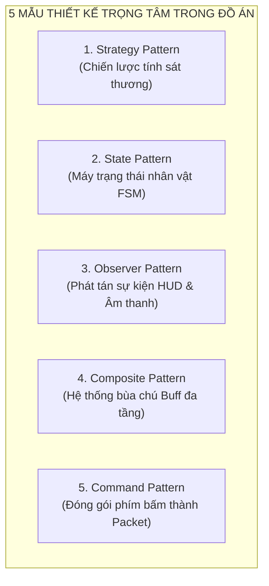

---

### 3.3.1. Strategy Pattern — Đa hình Hóa Chiến Lược Sát Thương

* **Vấn đề**: Các loại đòn đánh gây sát thương theo cơ chế vật lý (trừ giáp thẳng), phép thuật (trừ kháng phép theo phần trăm), hoặc sát thương chuẩn (xuyên thấu hoàn toàn). Nếu dùng câu lệnh điều kiện, code sẽ cực kỳ phình to và vi phạm nguyên lý Open-Closed.
* **Giải pháp GoF**: Tách thuật toán tính toán sát thương thành interface `IDamageStrategy`.

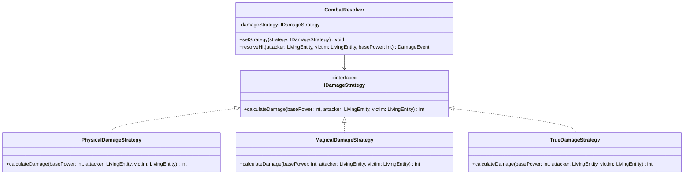

* **Công thức cài đặt mẫu**:
  * *Sát thương vật lý*: $\text{Damage} = \max\left(1, \text{Power} - \text{Armor}_{\text{victim}}\right)$
  * *Sát thương phép thuật*: $\text{Damage} = \text{Power} \times \left(1 - \frac{\text{MagicResist}}{100 + \text{MagicResist}}\right)$
  * *Sát thương chuẩn*: $\text{Damage} = \text{Power}$ (bỏ qua toàn bộ phòng ngự).

---

### 3.3.2. State Pattern — Máy Trạng Thái Hữu Hạn Nhân Vật (FSM)

* **Vấn đề**: Nhân vật trong game đối kháng chuyển đổi liên tục giữa các trạng thái: Đứng yên (`Idle`), Di chuyển (`Moving`), Đang vung đòn (`Attacking`), Choáng váng (`Stunned`), và Tử vong (`Dead`). Nếu dùng cờ biến (`boolean isMoving, isAttacking`), việc kiểm soát xung đột hành vi (ví dụ: đang chết vẫn di chuyển được) sẽ gây lỗi nghiêm trọng.
* **Giải pháp GoF**: Mỗi trạng thái được đóng gói thành một lớp thực thể hiện thực interface `IPlayerState`.

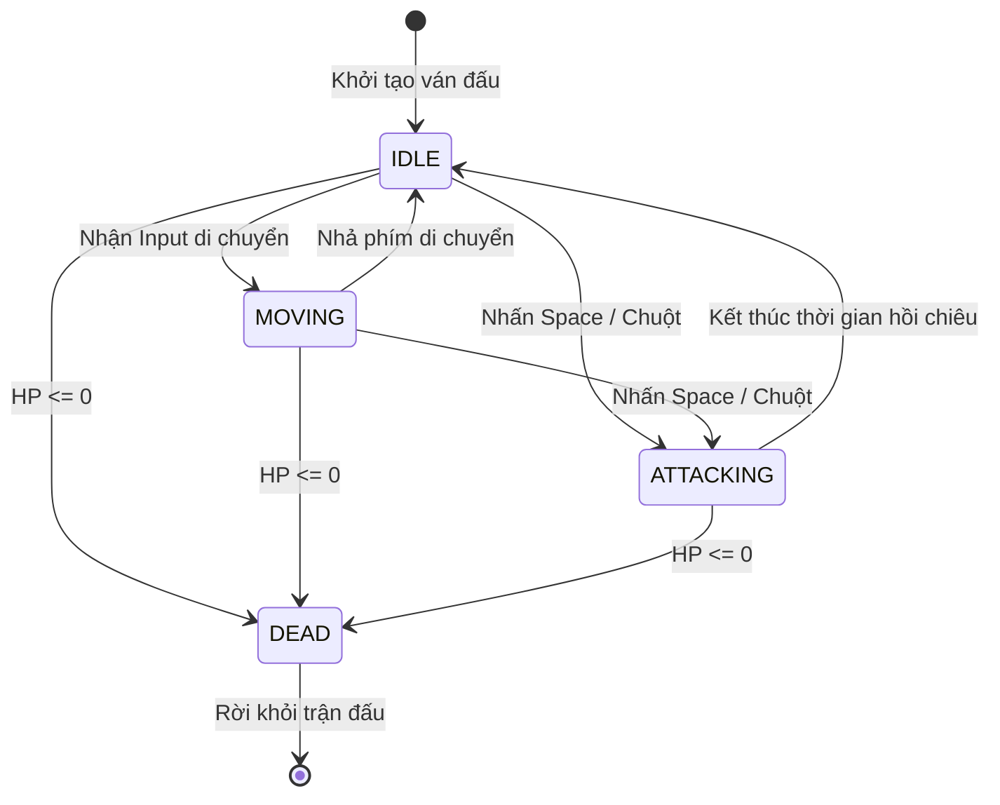

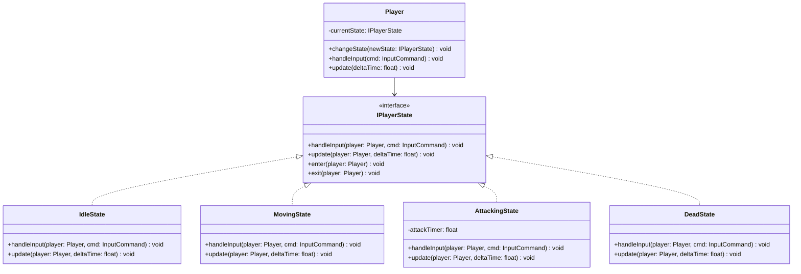

---

### 3.3.3. Observer Pattern — Cập Nhật Giao Diện HUD & Sự Kiện Không Ghép Nối

* **Vấn đề**: Khi điểm sinh lực ($HP$) của nhân vật thay đổi hoặc nhân vật bị tiêu diệt, giao diện người dùng (Thanh máu, Chỉ số Ping, Bảng điểm) và hiệu ứng âm thanh cần cập nhật tức thời. Nhưng nếu lớp `LivingEntity` gọi trực tiếp `HudView.drawHealthBar()`, mã nguồn nghiệp vụ sẽ bị ô nhiễm bởi thư viện đồ họa (vi phạm nghiêm ngặt nguyên lý Model-View Separation của Craig Larman).
* **Giải pháp GoF**: Áp dụng Observer Pattern. `LivingEntity` đóng vai trò là Subject (phát sinh sự kiện); các lớp giao diện và âm thanh là các Observer đăng ký lắng nghe.

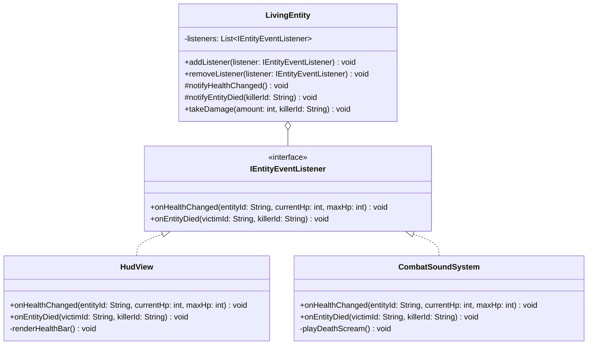

---

### 3.3.4. Composite Pattern — Cấu Trúc Bùa Chú Đa Tầng (Buffs & Modifiers)

* **Vấn đề**: Nhân vật có thể nhặt nhiều loại bùa chú cùng một lúc (ví dụ: vừa nhặt "Ngọc Tốc Độ +20%", vừa nhặt "Hào Quang Cuồng Nộ +15% Sát Thương"). Hệ thống cần xử lý một bùa đơn lẻ hay một tập hợp nhiều bùa chú kết hợp theo cùng một giao diện duy nhất.
* **Giải pháp GoF**: Áp dụng Composite Pattern.

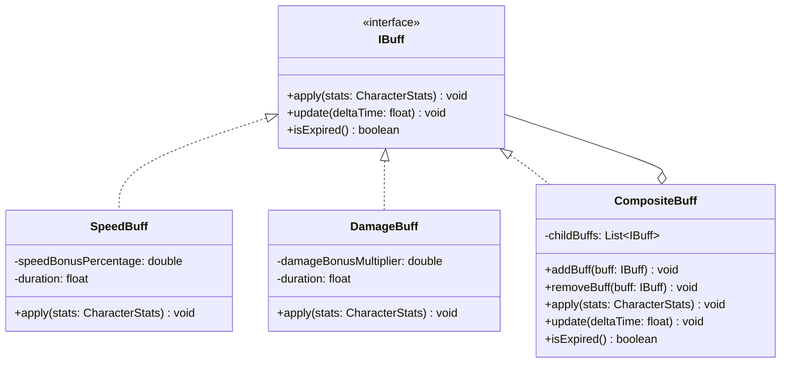

---

### 3.3.5. Command Pattern — Đóng Gói Hành Vi Điều Khiển Qua Mạng

* **Vấn đề**: Trong game thời gian thực qua mạng, các thao tác phím không được thực thi trực tiếp trên Client mà phải được đóng gói thành các đối tượng lệnh (Commands), đính kèm số chuỗi tự tăng (`sequenceNumber`) và mốc thời gian (`clientTimestamp`) để phục vụ việc chống tráo gói tin và hỗ trợ cơ chế hoàn nguyên (Reconciliation).
* **Giải pháp GoF**: Biến thao tác người dùng thành các đối tượng `InputCommand` kế thừa interface chung.

---

## 3.4. BIỂU ĐỒ TUẦN TỰ THIẾT KẾ CHI TIẾT (DESIGN SEQUENCE DIAGRAMS)

Khác với biểu đồ SSD ở pha OOA (vốn chỉ có hộp đen `:System`), Biểu đồ Tuần tự Thiết kế (DSD) mô tả **luồng gọi hàm nội bộ (White-box method calls)** giữa các đối tượng phần mềm cụ thể.

### Luồng Xử lý Gói tin Tấn công & Sát thương (White-box Sequence)

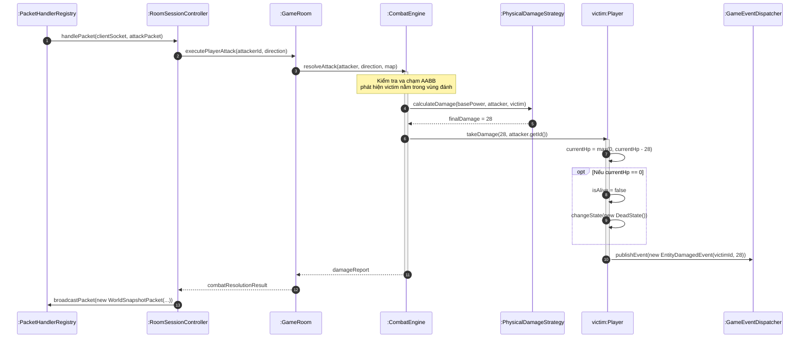

---

## 3.5. BIỂU ĐỒ LỚP THIẾT KẾ CHI TIẾT (DESIGN CLASS DIAGRAM - DCD)

Dưới đây là Biểu đồ Lớp Thiết kế Chi tiết (DCD) tổng thể của toàn bộ hệ thống, mô tả các lớp thuộc 5 phân vùng trách nhiệm: **Core Loop, Server/Network, Combat, UI Renderer, và Persistence**. Sơ đồ bao gồm đầy đủ thuộc tính, kiểu dữ liệu Java và các phương thức nghiệp vụ:

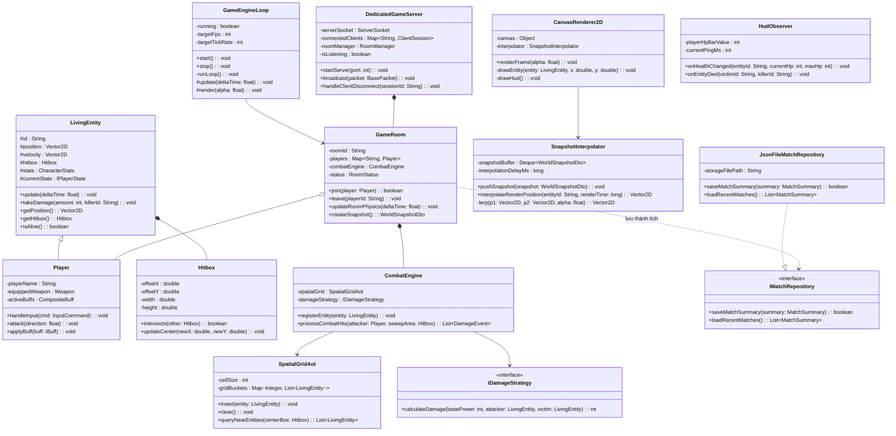

---

## 3.6. BIỂU ĐỒ THÀNH PHẦN VÀ BIỂU ĐỒ TRIỂN KHAI

### 3.6.1. Biểu đồ Thành phần Hệ thống (Component Diagram)

Biểu đồ Thành phần phân chia toàn bộ giải pháp phần mềm thành 5 hệ thống con (Subsystems), tương ứng chính xác với 5 module mã nguồn và 5 nhánh Git của các thành viên:

```mermaid
flowchart TD
    subgraph CLIENT_APP["ỨNG DỤNG MÁY KHÁCH (CLIENT APPLICATION)"]
        UI_COMP["🎨 Module UI & Render<br/>(Huy — feature/client-ui)<br/>CanvasRenderer, HUD, InputAdapter"]
        INTERP_COMP["🔄 Module LERP Interpolator<br/>SnapshotInterpolator, LERP Buffer"]
        NET_CLIENT["📡 Module Client Socket<br/>TCP Client, Packet Serializer"]
    end

    subgraph SERVER_APP["ỨNG DỤNG MÁY CHỦ (DEDICATED SERVER)"]
        NET_SERVER["🌐 Module Network Server<br/>(Kiên — feature/network-server)<br/>SocketListener, SessionManager"]
        CORE_COMP["⚙️ Module Core Loop & Room<br/>(Nam — feature/core-loop)<br/>GameEngineLoop, Player FSM, Room"]
        COMBAT_COMP["⚔️ Module Combat & Physics<br/>(Anh — feature/combat-system)<br/>Hitbox AABB, SpatialGrid, DamageStrategy"]
        DATA_COMP["💾 Module Persistence & QA<br/>(Hoàng — feature/data-testing)<br/>JsonDataMapper, JUnit Test Suite"]
    end

    UI_COMP --> INTERP_COMP
    INTERP_COMP --> NET_CLIENT
    NET_CLIENT <==>|Gói tin TCP nhị phân (20Hz)| NET_SERVER
    NET_SERVER --> CORE_COMP
    CORE_COMP --> COMBAT_COMP
    CORE_COMP --> DATA_COMP
    DATA_COMP --> JSON_DISK[("📁 Tệp match_history.json")]
```

---

### 3.6.2. Biểu đồ Triển khai Vật lý (Deployment Diagram)

Biểu đồ Triển khai mô tả kiến trúc phân tán thực tế khi hệ thống vận hành trên môi trường mạng cục bộ LAN (Phòng máy trường HUCE):

```mermaid
deploymentDiagram
```

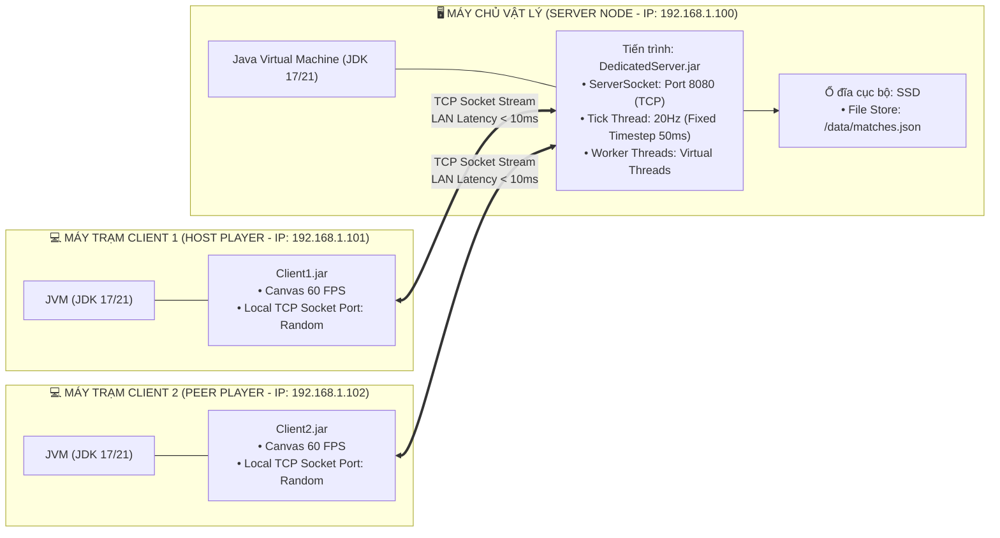

---

## 3.7. TỔNG KẾT BƯỚC CHUYỂN TIẾP TỪ OOD SANG OOP

Khép lại giai đoạn Thiết kế Hướng đối tượng (OOD), toàn bộ các câu hỏi kiến trúc hóc búa nhất đã được giải quyết bằng lý luận khoa học:
1. **Phân bổ phương thức**: Đã được chứng minh bằng **9 nguyên lý GRASP** của Craig Larman.
2. **Khả năng mở rộng**: Đã được giải quyết bằng **5 mẫu thiết kế GoF** (Strategy, State, Observer, Composite, Command).
3. **Hiệu năng & Mượt mà**: Đã được giải quyết bằng **Pure Fabrication** (`SnapshotInterpolator` dùng LERP và `SpatialGridAoI` dùng lưới ô).
4. **Bản vẽ thi công chi tiết**: Đã hoàn thiện qua **Biểu đồ Lớp Chi tiết (DCD)** và các biểu đồ thành phần/triển khai.

Hệ thống đã sẵn sàng 100% để bước sang **Phần IV: Cài đặt Hướng đối tượng (OOP Implementation)** — chuyển giao trực tiếp các lớp thiết kế thành các tệp mã nguồn Java cụ thể trên kho lưu trữ Git.

---

*Tài liệu tham khảo chuyên sâu cho chương này:*
- *[1] Craig Larman — Applying UML and Patterns, 3rd ed. (2004), Chương 16 (UML Class Diagrams), Chương 17 (GRASP: Designing Objects with Responsibilities), Chương 25 (GoF Design Patterns), Chương 26 (Iterative Design).*
- *[2] Erich Gamma, Richard Helm, Ralph Johnson, John Vlissides — Design Patterns: Elements of Reusable Object-Oriented Software (1994).*
- *[3] Robert Nystrom — Game Programming Patterns (2014), Chương 9 (Game Loop), Chương 14 (Component), Chương 19 (Spatial Partition).*
