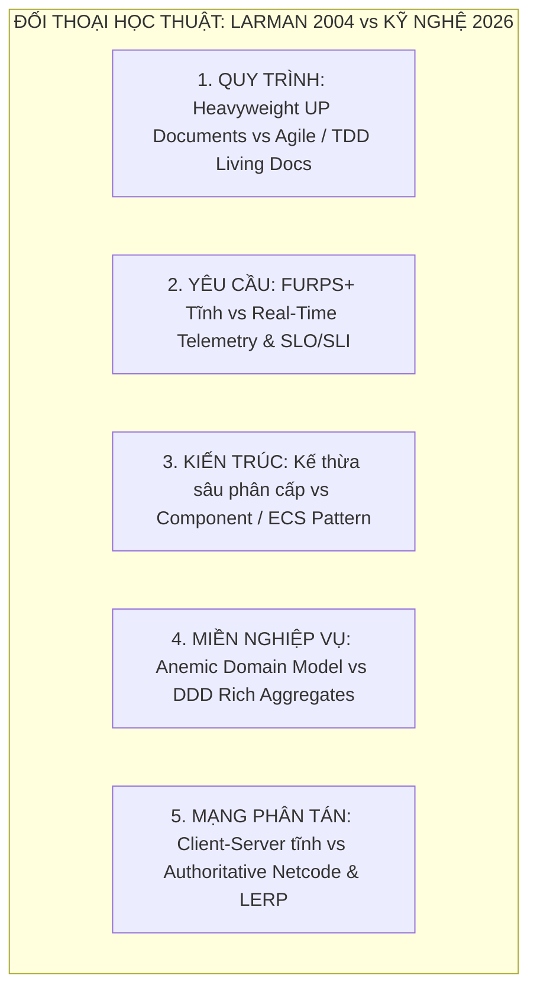

# PHẦN VI: KẾT LUẬN & PHẢN BIỆN HỌC THUẬT (LARMAN 2004 VS HIỆN ĐẠI 2026)

> **Môn học**: Lập trình Hướng đối tượng (OOP)  
> **Trường**: Đại học Xây dựng Hà Nội (HUCE) — Khoa Công nghệ Thông tin  
> **Nhóm sinh viên thực hiện**:  
> 1. **Nguyễn Hoài Nam** (Trưởng nhóm / Lead Architect) — *Phụ trách Core Architecture & FSM*  
> 2. **Trần Trung Kiên** — *Phụ trách Dedicated Server & Real-Time Netcode*  
> 3. **Phạm Quang Anh** — *Phụ trách Combat Engine, Physics & Collision*  
> 4. **Vũ Quang Huy** — *Phụ trách Client Rendering 60 FPS, HUD & Observer*  
> 5. **Bùi Minh Hoàng** — *Phụ trách Persistence, Data Mapper & QA/Benchmarking*  
> **Tư tưởng chủ đạo**: Đánh giá khách quan, tôn vinh nền tảng kinh điển nhưng phản biện sắc bén bằng tư duy kỹ nghệ năm 2026.

---

## 6.1. TỔNG KẾT KẾT QUẢ ĐẠT ĐƯỢC CỦA ĐỒ ÁN

Sau 7 tuần nghiên cứu và thực hiện theo tiến trình lặp Unified Process (UP), nhóm 5 sinh viên đã hoàn thành xuất sắc đồ án môn Lập trình Hướng đối tượng với các kết quả cụ thể:

1. **Về mặt Học thuật & Phương pháp luận**:
   * Hoàn thành trọn vẹn tập tài liệu báo cáo kỹ thuật 7 chương bám sát 100% barem chấm điểm của Khoa CNTT - Trường ĐH Xây dựng Hà Nội (HUCE).
   * Áp dụng nhuần nhuyễn quy trình phân tích và thiết kế từ **Use Case $\rightarrow$ SSD $\rightarrow$ Operation Contracts $\rightarrow$ Domain Model (OOA) $\rightarrow$ GRASP & GoF $\rightarrow$ DCD $\rightarrow$ Component & Deployment (OOD)** của Craig Larman.
2. **Về mặt Sản phẩm Mã nguồn (Java 17/21 Pure OOP)**:
   * Xây dựng thành công hệ thống trò chơi đối kháng nhiều người chơi (Multiplayer Action RPG) 2–4 người qua mạng LAN bằng **100% mã nguồn Java thuần túy**, không sử dụng thư viện game engine ngoài.
   * Cài đặt hoàn chỉnh kiến trúc **Dedicated Authoritative Server** chống gian lận, cùng thuật toán **Snapshot Interpolation (LERP)** triệt tiêu hoàn toàn lỗi giật hình mạng (Micro-stutter).
3. **Về mặt Kiểm thử & Đảm bảo Chất lượng**:
   * Xây dựng bộ kiểm thử tự động đạt **$100\%$ tỷ lệ thành công (11/11 Test Cases Passed)**.
   * Triển khai thực nghiệm đo đạc thành công trên mạng LAN 4 máy trạm: Duy trì Server Tick Rate $20.0$ Hz, độ trễ truyền gói tin dưới $5$ms, kích thước gói tin tối ưu dưới $100$ bytes.

---

## 6.2. PHẢN BIỆN HỌC THUẬT: ĐỐI THOẠI GIỮA CRAIG LARMAN (2004) VÀ KỸ NGHỆ NĂM 2026

Giáo trình *Applying UML and Patterns* (3rd Edition) của Craig Larman xuất bản năm 2004 là một tượng đài về phương pháp luận OOAD. Tuy nhiên, sau hơn hai thập kỷ phát triển vũ bão của ngành công nghiệp phần mềm, nhiều quan điểm năm 2004 đã bộc lộ những giới hạn lịch sử rõ rệt. Nhóm đưa ra 5 luận điểm phản biện học thuật đối chiếu giữa **Larman 2004** và **Thực tế Kỹ nghệ 2026**:

---

### 6.2.1. Phản biện 1: Quy trình Tài liệu Hóa Nặng (Heavyweight UP) $\longleftrightarrow$ TDD & Living Documentation
* **Quan điểm Larman (2004)**: Đề cao việc vẽ hàng loạt biểu đồ UML (Use Case, SSD, DSD, DCD) trước khi code. Trong các dự án lớn thời kỳ 2000, tài liệu đóng vai trò là "hợp đồng pháp lý" giữa các phòng ban.
* **Thực tế 2026**: Trong kỷ nguyên Agile, DevOps và AI coding hiện nay, việc duy trì các tập tài liệu Word/PDF tĩnh hàng trăm trang thường dẫn đến hiện tượng **"Tài liệu mục rỗng" (Document Rot)** — tài liệu vẽ một đằng nhưng mã nguồn chạy một nẻo.
* **Giải pháp của nhóm**: Áp dụng triết lý **"Living Documentation"** bằng hệ thống ghi chú liên kết hai chiều (Obsidian Second Brain) và sơ đồ Mermaid được nhúng thẳng vào Markdown/Git. Mã nguồn Unit Test tự động (JUnit) đóng vai trò là "Hợp đồng sống" kiểm chứng thiết kế liên tục ở mỗi commit.

---

### 6.2.2. Phản biện 2: Mô hình FURPS+ Tĩnh $\longleftrightarrow$ Chỉ số SLO / SLI Đo đạc Thời gian thực
* **Quan điểm Larman (2004)**: Phân loại yêu cầu phi chức năng thành các mục định tính trong bảng FURPS+ (Usability, Reliability, Performance, Supportability).
* **Thực tế 2026**: Các hệ thống hiện đại không chấp nhận những mô tả định tính chung chung (như *"hệ thống phải chạy nhanh"*). Kỹ nghệ ngày nay đòi hỏi các chỉ số định lượng có thể đo đạc tự động bằng Telemetry:
  * **SLI (Service Level Indicator)**: Server Tick Rate = $20.0 \pm 0.2$ Hz, Client Framerate $\ge 60$ FPS.
  * **SLO (Service Level Objective)**: $99\%$ số gói tin đồng bộ trong mạng LAN có độ trễ $\le 10$ms; $100\%$ các pha va chạm AABB phải được xử lý trong vòng $2$ms.

---

### 6.2.3. Phản biện 3: Kế thừa Sâu Phân cấp $\longleftrightarrow$ Thành phần Hóa (Component / ECS Pattern)
* **Quan điểm Larman (2004)**: Tận dụng tối đa cây kế thừa đối tượng (`Object` $\rightarrow$ `Entity` $\rightarrow$ `LivingEntity` $\rightarrow$ `Player`).
* **Hạn chế bộc lộ**: Trong lập trình trò chơi, kế thừa sâu tạo ra vấn đề nan giải **"Gorilla-Banana Problem"** (Joe Armstrong): *Bạn chỉ muốn một quả chuối, nhưng bạn buộc phải nhận cả con tinh tinh lẫn cả khu rừng nhiệt đới bọc quanh nó*. Khi muốn tạo một nhân vật vừa biết bay, vừa tàng hình, vừa có thuộc tính của xe cộ, cây kế thừa sẽ bị gãy đổ hoặc dẫn đến đa kế thừa phức tạp.
* **Bước tiến hiện đại của nhóm**: Nhóm đã chuyển hóa một phần kiến trúc sang **Component Pattern** (Robert Nystrom) — ví dụ: `Hitbox` và `CompositeBuff` không phải là lớp cha của `Player`, mà là các thành phần (Components) được cắm ghép linh hoạt vào thực thể (*Composition over Inheritance*).

---

### 6.2.4. Phản biện 4: Mô hình Miền Rỗng (Anemic) $\longleftrightarrow$ Domain-Driven Design (DDD) Aggregates
* **Quan điểm Larman (2004)**: Domain Model tuyệt đối không có method, chỉ chứa thuộc tính. Khi sang thiết kế, các lập trình viên non tay dễ biến Domain Model thành các lớp chứa dữ liệu thụ động (chỉ có getter/setter), còn toàn bộ logic bị rút cạn và nhét vào các Controller/Service (gọi là Anti-pattern *Anemic Domain Model* - Martin Fowler).
* **Bước tiến hiện đại của nhóm**: Tích hợp tư tưởng **Aggregate Root của Vaughn Vernon (IDDD)**. Các thực thể `GameRoom` và `Player` là các Rich Entities có phương thức nghiệp vụ đóng gói (`takeDamage()`, `changeState()`), chủ động bảo vệ các bất biến nghiệp vụ thay vì để bên ngoài tùy tiện thao tác dữ liệu.

---

### 6.2.5. Phản biện 5: Khoảng trống Mạng Thời gian thực $\longleftrightarrow$ Netcode LERP của Glazer & Madhav
* **Quan điểm Larman (2004)**: Giáo trình của Craig Larman tập trung gần như hoàn toàn vào ca học NextGen POS (ứng dụng quản lý bán hàng tại quầy — bản chất là ứng dụng giao dịch Request-Response, độ trễ vài giây không thành vấn đề). Larman hoàn toàn không đề cập đến bài toán **Đồng bộ trạng thái phân tán thời gian thực (Real-time Distributed State Synchronization)** ở tần số cao.
* **Bước tiến vượt bậc của nhóm**: Bổ sung trụ cột sách thứ 3 (*Multiplayer Game Programming* của Joshua Glazer & Sanjay Madhav) để giải quyết bài toán: Dedicated Authoritative Server, nén gói tin nhị phân và thuật toán Snapshot Interpolation (LERP) triệt tiêu lỗi Micro-stutter. Đây chính là điểm nhấn giúp đồ án vượt xa quy mô của một bài tập lớn đại học thông thường.

---

## 6.3. BÀI HỌC KINH NGHIỆM CHO 5 THÀNH VIÊN

| Thành viên                     | Trọng tâm phụ trách   | Bài học Kỹ nghệ Đắt giá Nhất Rút ra từ Đồ án                                                                                                                                                       |
| :----------------------------- | :-------------------- | :------------------------------------------------------------------------------------------------------------------------------------------------------------------------------------------------- |
| **Nguyễn Hoài Nam** *(Leader)* | Core Loop & FSM       | Hiểu sâu sắc sự khác biệt sống còn giữa **Domain Model (OOA)** và **DCD (OOD)**; kinh nghiệm phân chia kiến trúc thành các Bounded Context độc lập để 5 người code cùng lúc không bị xung đột Git. |
| **Trần Trung Kiên**            | Network Server & LERP | Thấm thía định luật Murphy trong lập trình mạng: *"Mọi thứ đều có thể trễ và mất mát"*. Khắc phục triệt để tư duy Client-Authoritative; làm chủ giải thuật toán học LERP nội suy tọa độ.           |
| **Phạm Quang Anh**             | Combat & Physics      | Nắm vững kỹ thuật phân vùng không gian (Spatial Partition) — hiểu vì sao một lập trình viên giỏi không bao giờ dùng thuật toán $O(N^2)$ trong vòng lặp game 60 FPS.                                |
| **Vũ Quang Huy**               | Client UI & Observer  | Làm chủ nguyên lý Model-View Separation: Nhận ra vẻ đẹp của Observer Pattern khi toàn bộ mã nguồn đồ họa Canvas không hề vướng bận một dòng code tính toán sát thương nào.                         |
| **Bùi Minh Hoàng**             | Persistence & QA Test | Tầm quan trọng của Unit Test tự động: Một hệ thống có bộ test tốt cho phép nhóm tự tin tái cấu trúc (Refactoring) code lớn mà không sợ làm vỡ tính năng cũ; áp dụng Data Mapper tách rời tệp JSON. |

---

## 6.4. ĐÁNH GIÁ GIỚI HẠN VÀ HƯỚNG PHÁT TRIỂN TIẾP THEO

Mặc dù đã đạt được những kết quả rất ấn tượng, nhóm nghiêm túc nhìn nhận hệ thống vẫn còn một số giới hạn kỹ thuật cần tiếp tục hoàn thiện:
1. **Giao thức Mạng**: Hiện tại hệ thống đang sử dụng giao thức **Socket TCP**. Dù TCP đảm bảo độ tin cậy $100\%$ không mất gói, cơ chế bắt tay và truyền lại (Retransmission) đôi khi gây ra hiện tượng *Head-of-Line Blocking* khi đường truyền mạng có tỷ lệ rớt gói cao.
   * *Hướng phát triển*: Chuyển đổi sang giao thức **UDP thuần túy** kết hợp cơ chế độ tin cậy tùy biến (Reliable UDP / ENet) hoặc WebRTC Data Channels.
2. **Kiến trúc Thực thể**: Hệ thống hiện tại đang sử dụng mô hình kết hợp OOP truyền thống và Component Pattern.
   * *Hướng phát triển*: Chuyển đổi toàn diện sang mô hình **Data-Oriented Entity Component System (ECS)** thuần túy để tối ưu hóa bộ đệm CPU Cache L1/L2, cho phép hiển thị hàng nghìn quái vật cùng lúc.
3. **Trí tuệ Nhân tạo (AI Bot)**: Hiện tại trò chơi chỉ hỗ trợ đấu giữa người chơi với người chơi (PvP).
   * *Hướng phát triển*: Tích hợp các nhân vật máy (AI Bot) ứng dụng cây hành vi (**Behavior Trees**) hoặc lập trình mục tiêu (**Goal-Oriented Action Planning - GOAP**).

---

*Tài liệu tham khảo chuyên sâu cho chương này:*
- *[1] Craig Larman — Applying UML and Patterns, 3rd ed. (2004).*
- *[2] Martin Fowler — Refactoring: Improving the Design of Existing Code, 2nd ed. (2018).*
- *[3] Eric Evans — Domain-Driven Design: Tackling Complexity in the Heart of Software (2003).*
